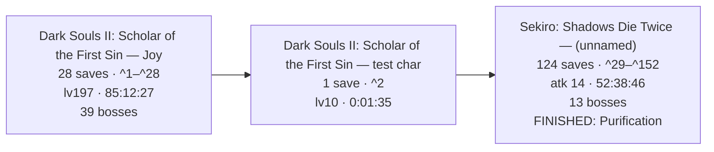
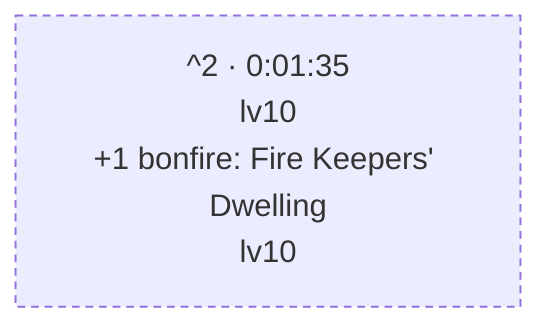

# sl2-corpus — Combined Timeline

This is the current corpus' detailed, machine-generated companion document.
It reconstructs 152 readable snapshots from the two archived games below. For
the archive's purpose, safe-use guidance, and extraction instructions, start
with [README.md](README.md). Game-specific collections live beside their own
archives and `Combined.md` reports.

The reports intentionally use a conservative reading: progression and first
appearance timestamps are evidence floors and upper bounds, not a claim to a
complete play log.

---

# FromSoftware Saves — Combined Playthrough Timeline

_Reconstructed from 152 save files across 3 runs and 2 games: Dark Souls II: Scholar of the First Sin · Sekiro: Shadows Die Twice._

_Every timestamp is an UPPER BOUND, not the moment it happened: a thing is dated to the first save it appears in, so the real event is somewhere between the previous save and that one. This is a reconstruction from sparse backups, not a log._

---

## The Journey

_One box per character, in the order the files were last written — the only clock the games share, since a Dark Souls II play time and a Dark Souls III one are unrelated numbers._

---

## Dark Souls II: Scholar of the First Sin — Joy

_28 saves · lv127 → lv197 · 36:58:24 → 85:12:27 played · 77 bonfires · 39 bosses (38 still provable in the newest save, 1 carried from earlier)._

### Save Tree

_Each box is one save file, numbered as in the references at the end. A snapshot's parent is the latest earlier one whose progress it still entirely contains — event flags never clear, so a fork (the same save played on twice) lands both children on the shared ancestor._

_No forks, a dashed box is where a line stopped._

```mermaid
flowchart TD
  n0["^1 · 36:58:24<br/>lv127<br/>BOSS: Belfry Gargoyles · Covetous Demon +18 more<br/>KEY ITEM: Antiquated Key · Brightstone Key +16 more<br/>COVENANT: Bell Keepers · Brotherhood of Blood"]
  n1["^2 · 37:00:45<br/>lv127"]
  n2["^3 · 37:47:12<br/>lv129<br/>BOSS: Guardian Dragon<br/>+1 bonfire: Dragon Aerie<br/>lv127 → lv129"]
  n3["^4 · 39:10:28<br/>lv129<br/>KEY ITEM: Heavy Iron Key<br/>+2 bonfires: Shrine Entrance · Outer Wall"]
  n4["^5 · 40:09:57<br/>lv129<br/>KEY ITEM: Ashen Mist Heart"]
  n5["^6 · 40:10:25<br/>lv129"]
  n6["^7 · 40:11:27<br/>lv129"]
  n7["^8 · 40:25:47<br/>lv130<br/>lv129 → lv130"]
  n8["^9 · 40:26:22<br/>lv130"]
  n9["^10 · 41:15:50<br/>lv140<br/>BOSS: Giant Lord<br/>KEY ITEM: Giant's Kinship<br/>lv130 → lv140"]
  n10["^11 · 41:41:59<br/>lv155<br/>lv140 → lv155"]
  n11["^12 · 41:57:54<br/>lv155"]
  n12["^13 · 42:25:34<br/>lv155"]
  n13["^14 · 43:34:28<br/>lv155<br/>+5 bonfires"]
  n14["^15 · 44:15:25<br/>lv156<br/>+4 bonfires<br/>lv155 → lv156"]
  n15["^16 · 46:00:28<br/>lv157<br/>KEY ITEM: Bastille Key · Dragon Stone +1 more<br/>+2 bonfires: Priestess' Chamber · Tower of Prayer<br/>lv156 → lv157"]
  n16["^17 · 46:27:51<br/>lv159<br/>BOSS: Graverobber, Varg, and Cerah<br/>lv157 → lv159"]
  n17["^18 · 48:07:34<br/>lv159<br/>COVENANT: Dragon Remnants"]
  n18["^19 · 51:04:20<br/>lv163<br/>BOSS: Elana, the Squalid Queen · Sinh, the Slumbering Dragon<br/>KEY ITEM: Small Smooth & Silky Stone<br/>+6 bonfires"]
  n19["^20 · 54:06:12<br/>lv169<br/>BOSS: Aava, the King's Pet<br/>KEY ITEM: Garrison Ward Key · Smooth & Silky Stone<br/>+5 bonfires"]
  n20["^21 · 55:13:08<br/>lv171<br/>BOSS: Burnt Ivory King<br/>KEY ITEM: Tower Key<br/>+3 bonfires"]
  n21["^22 · 57:37:28<br/>lv179<br/>BOSS: Blue Smelter Demon · Fume Knight +1 more<br/>lv171 → lv179"]
  n22["^23 · 58:24:34<br/>lv179<br/>BOSS: Ancient Dragon<br/>COVENANT: Pilgrims of Dark"]
  n23["^24 · 74:14:20<br/>lv195<br/>BOSS: Darklurker · The Pursuer<br/>lv179 → lv195"]
  n24["^25 · 77:00:45<br/>lv196<br/>BOSS: Sir Alonne<br/>lv195 → lv196"]
  n25["^26 · 84:29:15<br/>lv196<br/>BOSS: Lud, the King's Pet · Zallen, the King's Pet"]
  n26["^27 · 84:43:19<br/>lv197<br/>BOSS: Nashandra · Throne Defender +1 more<br/>lv196 → lv197"]
  n27["^28 · 85:12:27<br/>lv197<br/>KEY ITEM: Ladder Miniature"]
  n0 --> n1
  n1 --> n2
  n2 --> n3
  n3 --> n4
  n4 --> n5
  n5 --> n6
  n6 --> n7
  n7 --> n8
  n8 --> n9
  n9 --> n10
  n10 --> n11
  n11 --> n12
  n12 --> n13
  n13 --> n14
  n14 --> n15
  n15 --> n16
  n16 --> n17
  n17 --> n18
  n18 --> n19
  n19 --> n20
  n20 --> n21
  n21 --> n22
  n22 --> n23
  n23 --> n24
  n24 --> n25
  n25 --> n26
  n26 --> n27
  classDef leaf stroke-dasharray:4 3;
  class n27 leaf;
```

### Current State — `Joy_85-12-27_lv197_361d_77bf_37b.sl2` (^28)

### Slot 2: Joy

- **Soul Level:** 197
- **Class:** Knight
- **Covenant:** Pilgrims of Dark
- **Sex:** Female
- **Playthrough:** New Game
- **Soul Memory:** 5,509,824  _(total souls earned — main progress metric)_
- **Play Time:** 85:12:27
- **Souls held:** 661
- **Max HP:** 2,145
- **Deaths:** 361
- **Build:** strength-focused melee

#### Attributes

| VGR | END | VIT | ATN | STR | DEX | ADP | INT | FTH |
|----|----|----|----|----|----|----|----|----|
| 50 | 40 | 40 | 4 | 60 | 12 | 34 | 4 | 6 |

<b>Attribute Scaling</b> — what each stat scales and its soft caps (game-mechanics reference, not read from this save)

- **Vigor** (50) — Max HP. Soft caps 20 & 50; +30 HP/lvl to 20, +20 to 50, +5 after.
- **Endurance** (40) — Stamina. Soft cap 20; +2 stamina/lvl to 20, +1 after.
- **Vitality** (40) — Equip load, physical defense, petrify resistance. Soft caps 29/49/70; +1.5 load/lvl to 29, +1 to 49, +0.5 to 69, +0.25 after.
- **Attunement** (4) — Attunement (spell) slots, casting speed. Slots at 10/13/16/20/25/30/40/50/60/75/94; cast-speed breakpoints 30/45/60/80.
- **Strength** (60) — Physical attack, strength-weapon scaling. Scaling soft caps 40 & 50.
- **Dexterity** (12) — Physical attack, dex-weapon scaling, casting speed. Scaling soft caps 40 & 50.
- **Adaptability** (34) — Agility (i-frames), poison/bleed/petrify resistance. Raises Agility (with Attunement); gains taper past ~40.
- **Intelligence** (4) — Magic & dark attack, sorcery/hex scaling. Scaling soft caps 40 & 50.
- **Faith** (6) — Lightning & dark attack, miracle/hex scaling. Scaling soft caps 40 & 50.

#### Derived Stats  _(computed from attributes — base values before rings & equipment; the in-game screen adds ring/gear bonuses on top)_

- **Stamina:** 140
- **Equip Load (max capacity):** 93.0
- **Attunement Slots:** 0
- **Agility (AGL):** 106  _(13 roll i-frames)_
- **Poise (base):** 9.8
- **ATK: Str:** 162
- **ATK: Dex:** 61
- **Magic DEF:** 24
- **Fire DEF:** 30
- **Lightning DEF:** 36
- **Dark DEF:** 24

#### Key Items  _(progress / areas & shortcuts unlocked)_

- Soul Vessel ×4
- Skeptic's Spice ×15
- Simpleton's Spice ×14
- Soul of a Giant ×5
- Small Smooth & Silky Stone ×6
- Smooth & Silky Stone ×10
- Lenigrast's Key
- Soldier Key
- House Key
- Antiquated Key
- Undead Lockaway Key
- Tseldora Den Key
- Brightstone Key
- Frozen Flower
- Key to King's Passage
- Iron Key
- Forgotten Key
- Dragon Talon
- Heavy Iron Key
- Ashen Mist Heart
- Giant's Kinship
- Bastille Key
- Eternal Sanctum Key
- Garrison Ward Key
- Ladder Miniature
- Tower Key

#### Bonfires Discovered (77 of 77, in 34 of 34 areas)  _(each bonfire the save records as discovered, by area — a floor)_

- Things Betwixt: 1/1 — Fire Keepers' Dwelling
- Majula: 1/1 — The Far Fire
- Forest of Fallen Giants: 4/4 — Cardinal Tower, Soldiers' Rest, The Crestfallen's Retreat, The Place Unbeknownst
- Shrine of Amana: 4/4 — Tower of Prayer, Crumbled Ruins, Rhoy's Resting Place, Rise of the Dead
- Brightstone Cove Tseldora: 3/3 — Lower Brightstone Cove, Royal Army Campsite, Chapel Threshold
- Aldia's Keep: 2/2 — Foregarden, Ritual Site
- The Lost Bastille: 5/5 — Straid's Cell, Exile Holding Cells, The Tower Apart, McDuff's Workshop, Servants' Quarters
- Belfry Luna: 1/1 — Upper Ramparts
- Sinners' Rise: 1/1 — The Saltfort
- Harvest Valley: 2/2 — The Mines, Poison Pool
- Earthen Peak: 3/3 — Lower Earthen Peak, Central Earthen Peak, Upper Earthen Peak
- No-Man's Wharf: 1/1 — Unseen Path to Heide
- Iron Keep: 3/3 — Ironhearth Hall, Threshold Bridge, Eygil's Idol
- Belfry Sol: 1/1 — Belfry Sol Approach
- Drangleic Castle: 4/4 — King's Gate, Central Castle Drangleic, Forgotten Chamber, Under Castle Drangleic
- Huntsman's Copse: 3/3 — Undead Refuge, Bridge Approach, Undead Lockaway
- Undead Purgatory: 1/1 — Undead Purgatory
- Undead Crypt: 2/2 — Undead Ditch, Undead Crypt Entrance
- Black Gulch: 2/2 — Black Gulch Mouth, Hidden Chamber
- The Gutter: 2/2 — Central Gutter, Upper Gutter
- Dragon Aerie: 1/1 — Dragon Aerie
- Dragon Shrine: 1/1 — Shrine Entrance
- Shaded Woods: 3/3 — Old Akelarre, Ruined Fork Road, Shaded Ruins
- Heide's Tower of Flame: 2/2 — Tower of Flame, Heide's Ruin
- Cathedral of Blue: 1/1 — The Blue Cathedral
- Doors of Pharros: 2/2 — Gyrm's Respite, Ordeal's End
- Grave of Saints: 2/2 — Grave Entrance, Harval's Resting Place
- Shulva, Sanctum City: 3/3 — Sanctum Walk, Priestess' Chamber, Tower of Prayer
- Dragon's Rest: 1/1 — Sanctum Nadir
- Dragon's Sanctum: 3/3 — Hidden Sanctum Chamber, Lair of the Imperfect, Sanctum Interior
- Brume Tower: 5/5 — Throne Floor, Foyer, Upper Floor, Lowermost Floor, The Smelter Throne
- Iron Passage: 1/1 — Iron Hallway Entrance
- Frozen Eleum Loyce: 5/5 — Outer Wall, Abandoned Dwelling, Lower Garrison, Expulsion Chamber, Inner Wall
- Grand Cathedral: 1/1 — Grand Cathedral

#### Covenants Found (5 of 9)  _(discovered — a floor; the one currently worn is the Covenant field above)_

- **Brotherhood of Blood:** discovered
- **Way of Blue:** rank 3 of 3
- **Bell Keepers:** discovered
- **Dragon Remnants:** discovered
- **Pilgrims of Dark:** rank 3 of 3

_Not found yet: Blue Sentinels · Company of Champions · Heirs of the Sun · Rat King._

#### Bosses Defeated (38 of 39 tracked)  _(a floor — from defeat flags, held boss souls, progression, and NG+ clears; a boss whose soul was consumed and isn't gated may still be missing)_

- Aava, the King's Pet  _(soul held)_
- Ancient Dragon  _(soul held)_
- Belfry Gargoyles  _(soul held)_
- Blue Smelter Demon  _(progression)_
- Burnt Ivory King  _(soul held)_
- Covetous Demon  _(soul held)_
- Darklurker  _(confirmed, soul held)_
- Demon of Song  _(progression, soul held)_
- Dragonrider  _(progression)_
- Elana, the Squalid Queen  _(soul held)_
- Executioner's Chariot  _(confirmed, soul held)_
- Flexile Sentry  _(soul held)_
- Fume Knight  _(soul held)_
- Giant Lord  _(confirmed, soul held)_
- Graverobber, Varg, and Cerah  _(progression)_
- Guardian Dragon  _(soul held)_
- Looking Glass Knight  _(progression, soul held)_
- Lud, the King's Pet  _(soul held)_
- Mytha, the Baneful Queen  _(soul held)_
- Nashandra  _(soul held)_
- Old Dragonslayer  _(soul held)_
- Old Iron King  _(soul held)_
- Royal Rat Vanguard  _(soul held)_
- Ruin Sentinels  _(soul held)_
- Scorpioness Najka  _(soul held)_
- Sinh, the Slumbering Dragon  _(soul held)_
- Sir Alonne  _(soul held)_
- Skeleton Lords  _(soul held)_
- Smelter Demon  _(soul held)_
- The Duke's Dear Freja  _(soul held)_
- The Last Giant  _(confirmed, soul held)_
- The Lost Sinner  _(soul held)_
- The Pursuer  _(soul held)_
- The Rotten  _(confirmed, soul held)_
- Throne Defender  _(progression, soul held)_
- Throne Watcher  _(progression, soul held)_
- Velstadt, the Royal Aegis  _(confirmed, progression, soul held)_
- Zallen, the King's Pet  _(soul held)_

_No evidence yet: Royal Rat Authority._

#### Inventory

##### Weapons

- Broadsword ×3
- Mirrah Shield
- Dagger
- Foot Soldier Sword ×2
- Short Bow ×2
- Sorcerer's Staff
- Winged Spear ×3
- Longsword
- Blue Wooden Shield
- Large Leather Shield
- Silverblack Shield
- Fire Longsword +6
- Crimson Parma
- Broken Thief Sword
- Grand Lance
- Winged Spear +7
- Pate's Spear
- Light Crossbow
- Mail Breaker
- Greatsword
- Hand Axe
- Small Leather Shield
- Magic Mace
- Craftsman's Hammer
- Drakekeeper's Greataxe
- Bone Staff
- Parrying Dagger ×2
- Twinblade
- Drangleic Sword
- Drangleic Shield
- Halberd ×2
- Zweihander
- Greataxe +7
- Broken Straight Sword
- Great Club
- Caestus
- Morning Star ×2
- Dragonslayer's Crescent Axe
- Golden Falcon Shield
- Cleric's Sacred Chime
- Binoculars
- Shotel
- Dark Scythe
- Manikin Knife ×2
- Black Knight Halberd
- Target Shield
- Large Club
- Priest's Chime
- Bandit's Knife
- Sanctum Crossbow ×2
- Silverblack Spear
- Pike
- Gyrm Axe
- Giant Stone Axe
- Lightning Gyrm Great Hammer +10
- Pursuer's Ultra Greatsword
- Avelyn
- Bell Keeper Bow
- Blacksteel Katana
- Llewellyn Shield
- Black Knight Greataxe
- Lightning Short Bow +5
- Dragon Tooth ×2
- Enchanted Falchion
- Mastodon Greatsword
- Notched Whip
- Old Knight Hammer
- Caitha's Chime
- Washing Pole
- Long Bow
- Cleric's Parma ×2
- Blacksmith's Hammer
- Bastard Sword
- Whip
- Slumbering Dragon Shield
- Archdrake Mace
- Red Iron Twinblade
- Staff of Amana
- Witchtree Branch
- Witchtree Bellvine
- Syan's Halberd ×2
- Magic Shield
- Mace of the Insolent
- Blue Flame Sword ×2
- Smelter Sword
- Drakeblood Greatsword
- Old Whip ×4
- Demon's Great Hammer ×2
- Giant Warrior Club +10
- Royal Dirk
- Espada Ropera
- Hunter's Blackbow
- Sanctum Mace
- Long Bow +7
- Puzzling Stone Sword
- Sanctum Shield
- Melu Scimitar
- Varangian Shield
- Pyromancy Flame
- Varangian Sword
- Bandit Axe
- Handmaid's Ladle
- Scythe +7
- Vessel Shield
- Retainer Staff
- Retainer's Short Sword ×3
- Sorcerer's Twinblade
- Curved Nil Greatsword
- Charred Loyce Greatsword
- Large Club +8
- Azal's Staff
- Alonne Greatbow +5
- Majestic Greatsword
- Partizan +6
- Twinblade +7
- Staff of Wisdom
- Black Knight Ultra Greatsword
- Dragon Chime
- Heavy Crossbow
- Malformed Skull
- Lightning Short Bow +1
- Iron Parma
- Silver Eagle Kite Shield

##### Armor

- Imported Hood
- Imported Tunic
- Imported Manchettes
- Imported Trousers
- Hollow Soldier Gauntlets ×9
- Falconer Armor ×3
- Falconer Gloves
- Falconer Boots ×4
- Alonne Knight Helm +5
- Ironclad Helm
- Varangian Leggings ×2
- Hollow Soldier Helm ×4
- Hollow Soldier Armor ×2
- Tattered Cloth Robe ×2
- Tseldora Cap +2
- Tseldora Robe +2
- Tseldora Manchettes +2
- Tseldora Trousers +2
- Flower Skirt
- Alonne Knight Armor ×5
- Hollow Infantry Gloves
- Prisoner's Tatters ×4
- Infantry Helm
- Hollow Infantry Armor
- Tattered Cloth Hood
- Hunter's Hat
- Varangian Armor ×2
- Wanderer Coat
- Wanderer Manchettes
- Wanderer Boots
- Old Knight Armor
- Tattered Cloth Manchettes
- Drangleic Mail +5
- Drangleic Gauntlets +5
- Drangleic Leggings +5
- Blossom Kite Shield ×2
- Prisoner's Hood ×5
- Rogue Armor
- Royal Swordsman Leggings ×2
- Heavy Boots
- Royal Swordsman Armor ×3
- Royal Swordsman Helm +1
- Prisoner's Gloves
- Wicked Eye Greatshield
- Drakekeeper's Greatshield
- Prisoner's Waistcloth ×5
- Royal Swordsman Gloves ×2
- Alonne Knight Leggings ×8
- Royal Swordsman Helm ×3
- Manikin Mask
- Ironclad Armor ×2
- Rogue Leggings
- Grave Warden Top ×2
- Rogue Hood
- Manikin Top
- Alonne Knight Helm ×7
- Desert Sorceress Skirt
- Drangleic Helm
- Rusted Mastodon Helm
- Alonne Knight Gauntlets ×6
- Gyrm Warrior Helm
- Peasant Attire
- Alonne Captain Armor
- Ironclad Gauntlets
- Orma's Greatshield
- Syan's Gauntlets
- Desert Sorceress Top
- Imperious Armor
- Tower Shield
- Dragon Acolyte Mask
- Archdrake Boots ×2
- Archdrake Robes
- Archdrake Helm
- Imperious Gloves
- Leydia White Hood
- Syan's Helm
- Syan's Armor
- Rebel's Greatshield +5
- Bone Shield
- Mask of Judgment
- Robe of Judgment
- Manchettes of Judgment
- Tights of Judgment
- Drakekeeper Gauntlets
- Drakekeeper Helm
- Vengarl's Armor +2
- Vengarl's Gloves +1
- Vengarl's Boots +1
- Vengarl's Helm +5
- Drakekeeper Boots
- Llewellyn Armor
- Llewellyn Gloves
- Llewellyn Shoes
- Ruin Gauntlets
- Ruin Armor
- Faraam Helm
- Faraam Armor
- Faraam Gauntlets
- Faraam Boots
- Catarina Helm
- Drakeblood Helm
- Drakeblood Armor
- Flying Feline Boots
- Thief Mask
- Black Leather Armor
- Black Leather Gloves
- Black Leather Boots
- Brigand Hood
- Brigand Armor
- Brigand Gauntlets
- Brigand Trousers
- Rampart Golem Leggings
- Drakeblood Gauntlets
- Varangian Cuffs
- Sanctum Knight Helm
- Drakeblood Leggings
- Crown of the Sunken King
- Crown of the Ivory King
- Northwarder Hood
- Northwarder Robe
- Northwarder Manchettes
- Northwarder Trousers
- Old Bell Helm
- Symbol of Avarice
- Retainer Robe
- Mirrah Hat
- Mad Warrior Mask
- Mad Warrior Leggings
- Crown of the Old Iron King
- Imperious Helm
- Pharros Mask
- Dark Leggings
- King's Crown +5
- King's Armor
- King's Gauntlets
- King's Leggings
- Durgo's Hat
- Rampart Golem Armor
- Xanthous Crown
- Xanthous Overcoat
- Xanthous Gloves
- Xanthous Waistcloth
- Engraved Gauntlets
- Peasant Trousers +5
- Twin Dragon Greatshield
- Standard Helm
- Hard Leather Armor
- Hard Leather Gauntlets
- Hard Leather Boots
- Infantry Armor
- Infantry Gloves
- Infantry Boots
- Falconer Helm
- Raime's Leggings
- Raime's Gauntlets
- Raime's Armor
- Raime's Helm
- Alonne's Leggings
- Alonne's Gauntlets
- Alonne's Armor
- Alonne's Helm
- Bandit Boots
- Bandit Gauntlets
- Bandit Armor
- Spiked Bandit Helm
- Jester's Tights
- Jester's Gloves
- Jester's Robes
- Jester's Cap

##### Rings

- Blue Seal
- Life Ring
- Stone Ring
- Ring of Binding
- Life Ring+1
- Ring of Restoration
- Chloranthy Ring
- Silvercat Ring
- Ring of Blades ×2
- Covetous Silver Serpent Ring
- Ash Knuckle Ring
- Northern Ritual Band
- Covetous Silver Serpent Ring+1
- Ring of Steel Protection+1
- Red Tearstone Ring
- Clear Bluestone Ring+1
- Chloranthy Ring+1
- Second Dragon Ring
- White Ring
- Ring of the Evil Eye
- Redeye Ring
- Ring of Whispers
- Poisonbite Ring
- Blue Tearstone Ring
- Flame Quartz Ring
- Southern Ritual Band
- Covetous Gold Serpent Ring+1
- Northern Ritual Band+2
- Thunder Quartz Ring+1
- Bell Keeper's Seal
- Royal Soldier's Ring+1
- Covetous Gold Serpent Ring
- Dark Quartz Ring+1 ×2
- Gower's Ring of Protection
- Spell Quartz Ring+2
- Thunder Quartz Ring
- Old Leo Ring
- Crest of Blood
- Ring of Giants+1
- Ring of the Dead
- Ring of Thorns+1
- King's Ring
- Dark Quartz Ring
- Ring of the Evil Eye+1
- Flame Quartz Ring+1
- Hawk Ring
- Ring of Giants+2 ×3
- Third Dragon Ring
- Simpleton's Ring
- Bracing Knuckle Ring+1
- Ring of Steel Protection
- Poisonbite Ring+1
- Dark Quartz Ring+3
- Bloodbite Ring+1
- Lightning Clutch Ring
- Name-engraved Ring
- Ancient Dragon Seal
- Cursebite Ring
- Flynn's Ring
- Yorgh's Ring
- Dexterity Ring
- Flame Quartz Ring+3
- Spell Quartz Ring+3
- Ring of Resistance+1
- Fire Clutch Ring
- Strength Ring
- Sorcery Clutch Ring
- Abyss Seal

##### Spells

- Great Soul Arrow ×15
- Emit Force ×4
- Great Magic Barrier
- Lingering Flame ×4
- Dark Greatsword ×3
- Great Heal ×3
- Dark Fog ×4
- Combustion ×10
- Great Magic Weapon ×3
- Hush ×10
- Scraps of Life ×4
- Twisted Barricade ×20
- Soul Spear ×2
- Immolation ×8
- Soul Greatsword ×3
- Firestorm ×4
- Strong Magic Shield ×4
- Soul Bolt ×3
- Great Lightning Spear ×2
- Soul Vortex ×4
- Soul Geyser
- Crystal Magic Weapon
- Focus Souls ×2
- Fireball ×8
- Denial
- Dance of Fire ×3
- Soul Flash ×4
- Recollection ×6
- Great Fireball ×6
- Homing Soulmass ×4
- Resonant Soul ×20
- Fire Snake ×2
- Great Resonant Soul ×4
- Splintering Lightning Spear ×2
- Climax ×3
- Soul Arrow ×30
- Fall Control ×10
- Heavy Soul Arrow ×20

##### Ammunition

- Fire Arrow ×16
- Heavy Bolt ×10
- Lacerating Arrow
- Magic Bolt ×10
- Iron Greatarrow ×15
- Destructive Greatarrow ×63
- Dark Arrow
- Fire Greatarrow ×10
- Iron Arrow ×90
- Magic Arrow ×83
- Lightning Arrow ×106
- Poison Arrow ×15

##### Upgrade Materials

- Titanite Shard ×9
- Titanite Slab ×15
- Bleed Stone ×6
- Titanite Chunk ×17
- Petrified Dragon Bone ×37
- Palestone ×4
- Poison Stone ×3
- Old Mundane Stone ×3
- Large Titanite Shard ×26
- Magic Stone ×9
- Darknight Stone ×2
- Boltstone ×7
- Raw Stone ×3
- Faintstone ×5
- Firedrake Stone ×3
- Twinkling Titanite ×19

##### Consumables

- Darksign
- Human Effigy ×35
- Amber Herb ×21
- Estus Flask (10/10 charges)
- Homeward Bone ×15
- Rusted Coin ×23
- Rubbish ×2
- Repair Powder ×7
- Lloyd's Talisman ×17
- Silver Talisman ×17
- Twilight Herb ×13
- Monastery Charm ×3
- Pharros' Lockstone ×5
- Alluring Skull ×20
- Flame Butterfly ×17
- Common Fruit ×4
- Fragrant Branch of Yore ×3
- Throwing Knife ×29
- Lacerating Knife ×45
- Wilted Dusk Herb ×14
- Poison Throwing Knife ×41
- Brightbug ×5
- Blackweed Balm ×5
- Rotten Pine Resin ×4
- Prism Stone ×41
- Crimson Water ×4
- Firebomb ×49
- Elizabeth Mushroom
- Rouge Water ×4
- Small Blue Burr ×14
- Small Yellow Burr ×7
- Bonfire Ascetic ×19
- Dragon Charm ×2
- Red Leech Troches
- Charcoal Pine Resin ×6
- Triclops Snake Troches ×6
- Corrosive Urn ×16
- Poison Moss ×3
- Divine Blessing ×3
- Fire Seed ×12
- Black Firebomb ×3
- Aged Feather
- Dark Pine Resin
- Seed Of A Tree Of Giants
- Goldenfruit Balm ×15
- Hexing Urn ×10
- Soul of Nadalia, Bride of Ash ×11
- Old Growth Balm ×15
- Dried Root ×5
- Witching Urn
- Aromatic Ooze
- Bleeding Serum ×4
- Lifegem ×30
- Dung Pie ×11
- Holy Water Urn ×8
- Vine Balm ×6
- Green Blossom
- Small Orange Burr ×4
- Gold Pine Resin ×9
- Hello Carving
- Thank You Carving
- I'm Sorry Carving
- Very Good! Carving
- Lightning Urn ×10
- Smelter Wedge
- Eye of the Priestess

##### Summon & Covenant Items

- Black Separation Crystal
- Bone of Order
- Cracked Blue Eye Orb ×9
- Small White Sign Soapstone
- White Sign Soapstone
- Rat Tail ×2
- Token of Spite
- Sunlight Medal
- Cracked Red Eye Orb ×21
- Dragon Scale ×2
- Dried Fingers
- Dragon Eye

##### Great Boss Souls

- Old Witch Soul
- Old King Soul
- Old Paledrake Soul
- Old Dead One Soul

##### Boss Souls

- Old Iron King Soul
- Flexile Sentry Soul
- Royal Rat Vanguard Soul
- Ruin Sentinel Soul
- Soul of the Lost Sinner
- Soul of the Rotten
- Skeleton Lord's Soul
- Mytha, the Baneful Queen Soul
- Giant Lord Soul
- Covetous Demon Soul
- Scorpioness Najka Soul
- Belfry Gargoyle Soul
- Soul of the Duke's Dear Freja ×2
- Throne Defender Soul
- Executioner's Chariot Soul
- Looking Glass Knight Soul
- Old Dragonslayer Soul
- Guardian Dragon Soul
- Demon of Song Soul
- Soul of Velstadt
- Soul of the Ivory King
- Soul of Elana, Squalid Queen
- Soul of Sinh, the Slumbering Dragon
- Soul of Aava, the King's Pet
- Loyce Soul
- Soul of the Fume Knight
- Smelter Demon Soul
- Ancient Dragon Soul
- Soul of the King
- Darklurker Soul
- Soul of the Last Giant
- Soul of the Pursuer
- Soul of Sir Alonne
- Soul of Lud, the King's Pet
- Soul of Zallen, the King's Pet
- Throne Watcher Soul
- Soul of Nashandra

##### Gestures

- "Point" Gesture
- "I won't bite" Gesture
- "Bow" Gesture
- "Wave" Gesture
- "Pumped up" Gesture
- "Warcry" Gesture
- "Righty-ho!" Gesture
- "No way" Gesture
- "Fist pump" Gesture
- "Mock" Gesture
- "Prostration" Gesture
- "Have mercy!" Gesture
- "Warmup" Gesture
- "Decapitate" Gesture
- "Hurrah!" Gesture
- "This one's me" Gesture
- "Welcome" Gesture

_1 inventory item(s) had IDs not in the name database (upgraded / infused variants) and were omitted._

### Bosses Carried Forward

_Proven by an EARLIER save on this line and not by the newest one. A held boss soul is proof of a kill, and spending the soul destroys the proof — but a kill is permanent, so the evidence stands. Only this save's own ancestors count; a boss killed on a different branch was never killed here._

| Boss | Evidence | Proven in | Play Time |
|---|---|---|---|
| Royal Rat Authority | soul held | ^9 | 40:26:22 |

### Timeline

#### Bosses — first appearance

| Play Time | Lv | Boss | Evidence | Save |
|---|---|---|---|---|
| 36:58:24 | 127 | Belfry Gargoyles | soul held | ^1 |
| 36:58:24 | 127 | Covetous Demon | soul held | ^1 |
| 36:58:24 | 127 | Demon of Song | progression, soul held | ^1 |
| 36:58:24 | 127 | Dragonrider | progression | ^1 |
| 36:58:24 | 127 | Executioner's Chariot | confirmed, soul held | ^1 |
| 36:58:24 | 127 | Flexile Sentry | soul held | ^1 |
| 36:58:24 | 127 | Looking Glass Knight | progression, soul held | ^1 |
| 36:58:24 | 127 | Mytha, the Baneful Queen | soul held | ^1 |
| 36:58:24 | 127 | Old Dragonslayer | soul held | ^1 |
| 36:58:24 | 127 | Old Iron King | soul held | ^1 |
| 36:58:24 | 127 | Royal Rat Authority | soul held | ^1 |
| 36:58:24 | 127 | Royal Rat Vanguard | soul held | ^1 |
| 36:58:24 | 127 | Ruin Sentinels | soul held | ^1 |
| 36:58:24 | 127 | Scorpioness Najka | soul held | ^1 |
| 36:58:24 | 127 | Skeleton Lords | soul held | ^1 |
| 36:58:24 | 127 | The Duke's Dear Freja | soul held | ^1 |
| 36:58:24 | 127 | The Last Giant | confirmed | ^1 |
| 36:58:24 | 127 | The Lost Sinner | soul held | ^1 |
| 36:58:24 | 127 | The Rotten | confirmed, soul held | ^1 |
| 36:58:24 | 127 | Velstadt, the Royal Aegis | confirmed, progression, soul held | ^1 |
| 37:47:12 | 129 | Guardian Dragon | soul held | ^3 |
| 41:15:50 | 140 | Giant Lord | confirmed, soul held | ^10 |
| 46:27:51 | 159 | Graverobber, Varg, and Cerah | progression | ^17 |
| 51:04:20 | 163 | Elana, the Squalid Queen | soul held | ^19 |
| 51:04:20 | 163 | Sinh, the Slumbering Dragon | soul held | ^19 |
| 54:06:12 | 169 | Aava, the King's Pet | soul held | ^20 |
| 55:13:08 | 171 | Burnt Ivory King | soul held | ^21 |
| 57:37:28 | 179 | Blue Smelter Demon | progression | ^22 |
| 57:37:28 | 179 | Fume Knight | soul held | ^22 |
| 57:37:28 | 179 | Smelter Demon | soul held | ^22 |
| 58:24:34 | 179 | Ancient Dragon | soul held | ^23 |
| 74:14:20 | 195 | Darklurker | confirmed, soul held | ^24 |
| 74:14:20 | 195 | The Pursuer | soul held | ^24 |
| 77:00:45 | 196 | Sir Alonne | soul held | ^25 |
| 84:29:15 | 196 | Lud, the King's Pet | soul held | ^26 |
| 84:29:15 | 196 | Zallen, the King's Pet | soul held | ^26 |
| 84:43:19 | 197 | Nashandra | soul held | ^27 |
| 84:43:19 | 197 | Throne Defender | progression, soul held | ^27 |
| 84:43:19 | 197 | Throne Watcher | progression, soul held | ^27 |

#### Covenants — first found

| Play Time | Lv | Covenant | Progress | Save |
|---|---|---|---|---|
| 36:58:24 | 127 | Brotherhood of Blood | discovered | ^1 |
| 36:58:24 | 127 | Way of Blue | rank 3 of 3 | ^1 |
| 36:58:24 | 127 | Bell Keepers | discovered | ^1 |
| 48:07:34 | 159 | Dragon Remnants | discovered | ^18 |
| 58:24:34 | 179 | Pilgrims of Dark | rank 1 of 3 | ^23 |

#### Bonfires — first lit

**36:58:24 · lv127 · ^1** — 49 total (+49)

- Aldia's Keep: Foregarden
- Belfry Luna: Upper Ramparts
- Belfry Sol: Belfry Sol Approach
- Black Gulch: Black Gulch Mouth
- Black Gulch: Hidden Chamber
- Brightstone Cove Tseldora: Chapel Threshold
- Brightstone Cove Tseldora: Lower Brightstone Cove
- Brightstone Cove Tseldora: Royal Army Campsite
- Cathedral of Blue: The Blue Cathedral
- Doors of Pharros: Gyrm's Respite
- Doors of Pharros: Ordeal's End
- Drangleic Castle: Central Castle Drangleic
- Drangleic Castle: King's Gate
- Earthen Peak: Central Earthen Peak
- Earthen Peak: Lower Earthen Peak
- Forest of Fallen Giants: Cardinal Tower
- Forest of Fallen Giants: Soldiers' Rest
- Forest of Fallen Giants: The Crestfallen's Retreat
- Forest of Fallen Giants: The Place Unbeknownst
- Grave of Saints: Grave Entrance
- Grave of Saints: Harval's Resting Place
- Harvest Valley: The Mines
- Heide's Tower of Flame: Heide's Ruin
- Heide's Tower of Flame: Tower of Flame
- Huntsman's Copse: Bridge Approach
- Huntsman's Copse: Undead Lockaway
- Huntsman's Copse: Undead Refuge
- Iron Keep: Eygil's Idol
- Iron Keep: Ironhearth Hall
- Iron Keep: Threshold Bridge
- Majula: The Far Fire
- No-Man's Wharf: Unseen Path to Heide
- Shaded Woods: Old Akelarre
- Shaded Woods: Ruined Fork Road
- Shaded Woods: Shaded Ruins
- Shrine of Amana: Crumbled Ruins
- Shrine of Amana: Rhoy's Resting Place
- Shrine of Amana: Tower of Prayer
- Sinners' Rise: The Saltfort
- The Gutter: Upper Gutter
- The Lost Bastille: Exile Holding Cells
- The Lost Bastille: McDuff's Workshop
- The Lost Bastille: Servants' Quarters
- The Lost Bastille: Straid's Cell
- The Lost Bastille: The Tower Apart
- Things Betwixt: Fire Keepers' Dwelling
- Undead Crypt: Undead Crypt Entrance
- Undead Crypt: Undead Ditch
- Undead Purgatory: Undead Purgatory

**37:47:12 · lv129 · ^3** — 50 total (+1)

- Dragon Aerie: Dragon Aerie

**39:10:28 · lv129 · ^4** — 52 total (+2)

- Dragon Shrine: Shrine Entrance
- Frozen Eleum Loyce: Outer Wall

**43:34:28 · lv155 · ^14** — 57 total (+5)

- Brume Tower: Throne Floor
- Drangleic Castle: Forgotten Chamber
- Drangleic Castle: Under Castle Drangleic
- Harvest Valley: Poison Pool
- Shulva, Sanctum City: Sanctum Walk

**44:15:25 · lv156 · ^15** — 61 total (+4)

- Aldia's Keep: Ritual Site
- Earthen Peak: Upper Earthen Peak
- Shrine of Amana: Rise of the Dead
- The Gutter: Central Gutter

**46:00:28 · lv157 · ^16** — 63 total (+2)

- Shulva, Sanctum City: Priestess' Chamber
- Shulva, Sanctum City: Tower of Prayer

**51:04:20 · lv163 · ^19** — 69 total (+6)

- Brume Tower: Foyer
- Brume Tower: Upper Floor
- Dragon's Rest: Sanctum Nadir
- Dragon's Sanctum: Hidden Sanctum Chamber
- Dragon's Sanctum: Lair of the Imperfect
- Dragon's Sanctum: Sanctum Interior

**54:06:12 · lv169 · ^20** — 74 total (+5)

- Frozen Eleum Loyce: Abandoned Dwelling
- Frozen Eleum Loyce: Expulsion Chamber
- Frozen Eleum Loyce: Inner Wall
- Frozen Eleum Loyce: Lower Garrison
- Grand Cathedral: Grand Cathedral

**55:13:08 · lv171 · ^21** — 77 total (+3)

- Brume Tower: Lowermost Floor
- Brume Tower: The Smelter Throne
- Iron Passage: Iron Hallway Entrance

---

## Dark Souls II: Scholar of the First Sin — test char

_1 save · lv10 → lv10 · 0:01:35 → 0:01:35 played · 1 bonfire._

### Save Tree

_Each box is one save file, numbered as in the references at the end. A snapshot's parent is the latest earlier one whose progress it still entirely contains — event flags never clear, so a fork (the same save played on twice) lands both children on the shared ancestor._

_No forks, a dashed box is where a line stopped._

### Current State — `Joy_37-00-45_lv127_181d_49bf_19b.sl2` (^2)

### Slot 1: test char

- **Soul Level:** 10
- **Class:** Explorer
- **Sex:** Male
- **Playthrough:** New Game
- **Soul Memory:** 0  _(total souls earned — main progress metric)_
- **Play Time:** 0:01:35
- **Souls held:** 0
- **Max HP:** 822
- **Deaths:** 0
- **Build:** caster / hybrid (high INT/FTH/ATN)

#### Attributes

| VGR | END | VIT | ATN | STR | DEX | ADP | INT | FTH |
|----|----|----|----|----|----|----|----|----|
| 7 | 6 | 9 | 7 | 6 | 6 | 12 | 5 | 5 |

<b>Attribute Scaling</b> — what each stat scales and its soft caps (game-mechanics reference, not read from this save)

- **Vigor** (7) — Max HP. Soft caps 20 & 50; +30 HP/lvl to 20, +20 to 50, +5 after.
- **Endurance** (6) — Stamina. Soft cap 20; +2 stamina/lvl to 20, +1 after.
- **Vitality** (9) — Equip load, physical defense, petrify resistance. Soft caps 29/49/70; +1.5 load/lvl to 29, +1 to 49, +0.5 to 69, +0.25 after.
- **Attunement** (7) — Attunement (spell) slots, casting speed. Slots at 10/13/16/20/25/30/40/50/60/75/94; cast-speed breakpoints 30/45/60/80.
- **Strength** (6) — Physical attack, strength-weapon scaling. Scaling soft caps 40 & 50.
- **Dexterity** (6) — Physical attack, dex-weapon scaling, casting speed. Scaling soft caps 40 & 50.
- **Adaptability** (12) — Agility (i-frames), poison/bleed/petrify resistance. Raises Agility (with Attunement); gains taper past ~40.
- **Intelligence** (5) — Magic & dark attack, sorcery/hex scaling. Scaling soft caps 40 & 50.
- **Faith** (5) — Lightning & dark attack, miracle/hex scaling. Scaling soft caps 40 & 50.

#### Derived Stats  _(computed from attributes — base values before rings & equipment; the in-game screen adds ring/gear bonuses on top)_

- **Stamina:** 92
- **Equip Load (max capacity):** 52.0
- **Attunement Slots:** 0
- **Agility (AGL):** 90  _(9 roll i-frames)_
- **Poise (base):** 1.8
- **ATK: Str:** 54
- **ATK: Dex:** 54
- **Magic DEF:** 30
- **Fire DEF:** 30
- **Lightning DEF:** 30
- **Dark DEF:** 30

#### Bonfires Discovered (1 of 77, in 1 of 34 areas)  _(each bonfire the save records as discovered, by area — a floor)_

- Things Betwixt: 1/1 — Fire Keepers' Dwelling
- Majula: 0/1
- Forest of Fallen Giants: 0/4
- Shrine of Amana: 0/4
- Brightstone Cove Tseldora: 0/3
- Aldia's Keep: 0/2
- The Lost Bastille: 0/5
- Belfry Luna: 0/1
- Sinners' Rise: 0/1
- Harvest Valley: 0/2
- Earthen Peak: 0/3
- No-Man's Wharf: 0/1
- Iron Keep: 0/3
- Belfry Sol: 0/1
- Drangleic Castle: 0/4
- Huntsman's Copse: 0/3
- Undead Purgatory: 0/1
- Undead Crypt: 0/2
- Black Gulch: 0/2
- The Gutter: 0/2
- Dragon Aerie: 0/1
- Dragon Shrine: 0/1
- Shaded Woods: 0/3
- Heide's Tower of Flame: 0/2
- Cathedral of Blue: 0/1
- Doors of Pharros: 0/2
- Grave of Saints: 0/2
- Shulva, Sanctum City: 0/3
- Dragon's Rest: 0/1
- Dragon's Sanctum: 0/3
- Brume Tower: 0/5
- Iron Passage: 0/1
- Frozen Eleum Loyce: 0/5
- Grand Cathedral: 0/1

#### Inventory

##### Weapons

- Dagger

##### Armor

- Imported Hood
- Imported Tunic
- Imported Manchettes
- Imported Trousers
- Traveling Merchant Hat
- Traveling Merchant Coat
- Traveling Merchant Gloves
- Traveling Merchant Boots

##### Rings

- Spell Quartz Ring

##### Ammunition

- Wood Bolt ×20

##### Consumables

- Darksign
- Seed Of A Tree Of Giants
- Lifegem ×20
- Witching Urn ×8
- Aromatic Ooze ×4
- Prism Stone ×5
- Rusted Coin ×2
- Repair Powder
- Pharros' Lockstone

##### Summon & Covenant Items

- Black Separation Crystal
- Bone of Order

##### Gestures

- "Point" Gesture
- "I won't bite" Gesture
- "Bow" Gesture
- "Wave" Gesture
- "Pumped up" Gesture
- "Warcry" Gesture
- "Righty-ho!" Gesture
- "No way" Gesture

### Timeline

#### Bonfires — first lit

**0:01:35 · lv10 · ^2** — 1 total (+1)

- Things Betwixt: Fire Keepers' Dwelling

---

## Sekiro: Shadows Die Twice — (unnamed)

_124 saves · atk 1 → atk 14 · 2:05:30 → 52:38:46 played · 55 bonfires · 13 bosses · 488 of 581 world items · finished: Purification._

### Save Tree

_Each box is one save file, numbered as in the references at the end. A snapshot's parent is the latest earlier one whose progress it still entirely contains — event flags never clear, so a fork (the same save played on twice) lands both children on the shared ancestor._

_3 forks, a dashed box is where a line stopped._

```mermaid
flowchart TD
  n0["^48 · 2:05:30<br/>atk 1<br/>KEY ITEM: Kusabimaru · Night Eye +1 more<br/>+3 world items"]
  n1["^49 · 2:40:13<br/>atk 1<br/>KEY ITEM: Resurrection · Shinobi Prosthetic +1 more<br/>+3 bonfires<br/>+8 world items"]
  n2["^131 · 5:15:19<br/>atk 1<br/>MINIBOSS: General Naomori Kawarada<br/>GOURD SEED USED: gourd 1 → 2<br/>KEY ITEM: Flame Barrel · Flame Barrel Memo +5 more"]
  n3["^150 · 6:25:43<br/>atk 1<br/>KEY ITEM: Prosthetic Esoteric Text<br/>+6 world items"]
  n4["^151 · 9:19:46<br/>atk 1<br/>MINIBOSS: Chained Ogre · Juzou the Drunkard +1 more<br/>GOURD SEED USED: gourd 2 → 3<br/>KEY ITEM: Hidden Temple Key · Shinobi Medicine Rank 1 +1 more"]
  n5["^152 · 9:20:07<br/>atk 1<br/>NECKLACE USED: vitality 1 → 2<br/>KEY ITEM: First Prayer Necklace"]
  n6["^29 · 12:04:28<br/>atk 1<br/>MINIBOSS: General Tenzen Yamauchi<br/>KEY ITEM: Phantom Kunai · Prayer Bead<br/>+1 bonfire: Underbridge Valley"]
  n7["^30 · 12:04:44<br/>atk 1<br/>+1 bonfire: Ashina Castle Fortress"]
  n8["^31 · 14:26:51<br/>atk 1<br/>KEY ITEM: Robert's Firecrackers<br/>+6 world items"]
  n9["^32 · 14:33:50<br/>atk 1<br/>BOSS: Gyoubu Masataka Oniwa<br/>KEY ITEM: Mechanical Barrel · Memory: Gyoubu Oniwa"]
  n10["^33 · 14:34:09<br/>atk 1"]
  n11["^34 · 14:34:22<br/>atk 1<br/>+1 bonfire: Ashina Castle Gate"]
  n12["^35 · 15:26:59<br/>atk 1<br/>+8 world items"]
  n13["^36 · 15:29:29<br/>atk 1<br/>MINIBOSS: Blazing Bull<br/>KEY ITEM: Shinobi Medicine Rank 2<br/>+1 bonfire: Ashina Castle"]
  n14["^37 · 15:38:39<br/>atk 1<br/>KEY ITEM: Gatehouse Key<br/>+3 world items"]
  n15["^38 · 15:42:12<br/>atk 1<br/>+1 bonfire: Abandoned Dungeon Entrance"]
  n16["^39 · 15:49:25<br/>atk 1<br/>+1 world item"]
  n17["^40 · 15:49:37<br/>atk 1<br/>+1 bonfire: Ashina Reservoir"]
  n18["^41 · 17:12:12<br/>atk 1<br/>KEY ITEM: Rot Essence: Crow Mob · Rot Essence: Newcomer<br/>+5 world items"]
  n19["^42 · 17:35:58<br/>atk 2<br/>BOSS: Lady Butterfly<br/>MEMORY SPENT: attack 1 → 2<br/>KEY ITEM: Memory: Lady Butterfly · Remnant: Gyoubu +1 more"]
  n20["^43 · 17:52:36<br/>atk 3<br/>MINIBOSS: Lone Shadow Longswordsman<br/>MEMORY SPENT: attack 2 → 3<br/>KEY ITEM: Remnant: Lady Butterfly"]
  n21["^44 · 19:07:32<br/>atk 3<br/>KEY ITEM: Gyoubu's Broken Horn · Rotting Prisoner's Note +1 more<br/>+16 world items"]
  n22["^45 · 19:07:44<br/>atk 3<br/>+1 bonfire: Hirata Estate - Hidden Temple"]
  n23["^46 · 19:21:18<br/>atk 3<br/>+4 world items"]
  n24["^47 · 19:22:11<br/>atk 3<br/>+1 bonfire: Upper Tower - Antechamber"]
  n25["^50 · 20:26:16<br/>atk 3<br/>GOURD SEED USED: gourd 3 → 4<br/>KEY ITEM: Dragon's Blood Droplet · Iron Fortress +1 more<br/>+1 bonfire: Old Grave"]
  n26["^51 · 20:32:46<br/>atk 3<br/>KEY ITEM: Anti-air Deathblow Text"]
  n27["^52 · 21:05:02<br/>atk 3<br/>KEY ITEM: Rot Essence: Surgeons<br/>+3 world items"]
  n28["^53 · 21:05:27<br/>atk 3<br/>+1 bonfire: Upper Tower - Ashina Dojo<br/>+1 world item"]
  n29["^54 · 22:01:15<br/>atk 3<br/>MINIBOSS: General Kuranosuke Matsumoto · Ashina Elite - Jinsuke Saze<br/>NECKLACE USED: vitality 2 → 3<br/>KEY ITEM: Dragonrot Blood Sample · Nightjar Beacon Memo +1 more"]
  n30["^55 · 22:01:35<br/>atk 3<br/>+1 bonfire: Underground Waterway"]
  n31["^56 · 22:06:23<br/>atk 3<br/>+5 world items"]
  n32["^57 · 22:06:34<br/>atk 3<br/>+1 bonfire: Senpou Temple, Mt. Kongo"]
  n33["^58 · 23:22:31<br/>atk 3<br/>KEY ITEM: Gourd Seed<br/>+25 world items"]
  n34["^59 · 23:22:40<br/>atk 3<br/>+1 bonfire: Shugendo"]
  n35["^60 · 25:05:15<br/>atk 3<br/>MINIBOSS: Armored Warrior<br/>KEY ITEM: Breath of Nature: Shadow · Monkey Booze +6 more<br/>+2 bonfires: Bell Demon's Temple · Temple Grounds"]
  n36["^61 · 25:29:43<br/>atk 3<br/>GOURD SEED USED: gourd 4 → 5<br/>KEY ITEM: Holy Chapter: Infested · Recovery Charm +1 more<br/>+1 bonfire: Main Hall"]
  n37["^62 · 32:24:26<br/>atk 3<br/>MINIBOSS: Leader Shigenori Yamauchi · Seven Ashina Spears - Shikibu Toshikatsu Yamauchi +1 more<br/>NECKLACE USED: vitality 3 → 4<br/>KEY ITEM: Rot Essence: Faithful One · Rot Essence: Pious Mob +1 more"]
  n38["^63 · 34:18:32<br/>atk 3<br/>NECKLACE USED: vitality 4 → 5<br/>GOURD SEED USED: gourd 5 → 6<br/>KEY ITEM: Ashina Esoteric Text · Ashina Sake +3 more"]
  n39["^64 · 34:47:16<br/>atk 3<br/>+3 bonfires<br/>+9 world items"]
  n40["^65 · 35:20:51<br/>atk 3<br/>BOSS: Genichiro Ashina<br/>KEY ITEM: Bloodsmoke Ninjutsu · Memory: Genichiro<br/>+1 bonfire: Castle Tower Lookout"]
  n41["^66 · 35:34:28<br/>atk 3<br/>KEY ITEM: Gourd Seed · Sabimaru Memo (Bought) +3 more<br/>+1 bonfire: Upper Tower - Kuro's Room<br/>+1 world item"]
  n42["^67 · 35:36:49<br/>atk 3<br/>KEY ITEM: Immortal Severance Text"]
  n43["^68 · 36:02:23<br/>atk 4<br/>MEMORY SPENT: attack 3 → 4<br/>GOURD SEED USED: gourd 6 → 7<br/>KEY ITEM: Fragrant Flower Note · Gun Fort Shrine Key +1 more"]
  n44["^69 · 36:06:44<br/>atk 4<br/>GOURD SEED USED: gourd 7 → 8"]
  n45["^70 · 36:22:18<br/>atk 4<br/>MINIBOSS: Snake Eyes Shirahagi<br/>KEY ITEM: Prayer Bead<br/>+1 bonfire: Hidden Forest"]
  n46["^71 · 36:41:09<br/>atk 4<br/>+1 world item"]
  n47["^72 · 36:45:37<br/>atk 5<br/>BOSS: Folding Screen Monkeys<br/>MEMORY SPENT: attack 4 → 5<br/>KEY ITEM: Puppeteer Ninjutsu · Remnant: Screen Monkeys"]
  n48["^73 · 37:50:21<br/>atk 5<br/>KEY ITEM: Mortal Blade<br/>+1 bonfire: Sunken Valley Cavern<br/>+3 world items"]
  n49["^74 · 38:03:21<br/>atk 5<br/>MINIBOSS: Long-arm Centipede Giraffe<br/>KEY ITEM: Fresh Serpent Viscera · Large Fan<br/>+2 bonfires: Gun Fort · Riven Cave"]
  n50["^75 · 38:39:08<br/>atk 5<br/>MINIBOSS: Snake Eyes Shirafuji<br/>+1 bonfire: Bodhisattva Valley<br/>+13 world items"]
  n51["^76 · 38:49:39<br/>atk 5<br/>+2 world items"]
  n52["^77 · 39:14:26<br/>atk 5<br/>MINIBOSS: Mist Noble · Tokujiro the Glutton<br/>NECKLACE USED: vitality 5 → 6<br/>KEY ITEM: Fifth Prayer Necklace · Floating Passage Text"]
  n53["^78 · 39:39:16<br/>atk 5"]
  n54["^79 · 40:03:33<br/>atk 5<br/>+1 bonfire: Water Mill<br/>+13 world items"]
  n55["^80 · 40:06:13<br/>atk 5<br/>KEY ITEM: Prayer Bead<br/>+5 world items"]
  n56["^81 · 40:09:45<br/>atk 6<br/>BOSS: Corrupted Monk<br/>MEMORY SPENT: attack 5 → 6<br/>KEY ITEM: Remnant: Corrupted Monk"]
  n57["^82 · 40:53:40<br/>atk 6<br/>KEY ITEM: Red Carp Eyes · Shelter Stone +1 more<br/>+23 world items"]
  n58["^83 · 40:56:25<br/>atk 6"]
  n59["^84 · 41:00:51<br/>atk 6<br/>MINIBOSS: O'Rin of the Water<br/>NECKLACE USED: vitality 6 → 7<br/>KEY ITEM: Breath of Life: Shadow · Sixth Prayer Necklace"]
  n60["^85 · 41:19:39<br/>atk 6<br/>KEY ITEM: Surgeon's Stained Letter<br/>+1 world item"]
  n61["^86 · 41:20:18<br/>atk 6"]
  n62["^87 · 41:27:08<br/>atk 6<br/>BOSS: Guardian Ape<br/>KEY ITEM: Memory: Guardian Ape · Slender Finger<br/>+1 bonfire: Guardian Ape's Watering Hole"]
  n63["^88 · 41:47:55<br/>atk 7<br/>MEMORY SPENT: attack 6 → 7<br/>KEY ITEM: Lotus of the Palace · Precious Bait +1 more<br/>+12 world items"]
  n64["^89 · 41:51:32<br/>atk 7<br/>MINIBOSS: Lone Shadow Vilehand<br/>KEY ITEM: Prayer Bead<br/>+1 world item"]
  n65["^90 · 41:58:39<br/>atk 7<br/>MINIBOSS: Lone Shadow Masanaga the Spear-Bearer<br/>+1 world item"]
  n66["^91 · 42:03:50<br/>atk 7"]
  n67["^92 · 42:18:16<br/>atk 7<br/>MINIBOSS: Chained Ogre<br/>KEY ITEM: Shinobi Medicine Rank 3<br/>+1 world item"]
  n68["^93 · 42:41:21<br/>atk 7<br/>+2 world items"]
  n69["^94 · 42:47:34<br/>atk 7<br/>BOSS: Headless Ape<br/>KEY ITEM: Bestowal Ninjutsu · Memory: Headless Ape<br/>+1 bonfire: Guardian Ape's Burrow"]
  n70["^95 · 43:05:15<br/>atk 8<br/>MEMORY SPENT: attack 7 → 8<br/>NECKLACE USED: vitality 7 → 8<br/>KEY ITEM: Remnant: Headless Ape · Seventh Prayer Necklace"]
  n71["^96 · 43:35:24<br/>atk 8<br/>MINIBOSS: Shichimen Warrior<br/>KEY ITEM: Gourd Seed · Malcontent's Ring<br/>+5 world items"]
  n72["^97 · 44:01:41<br/>atk 8<br/>GOURD SEED USED: gourd 8 → 9<br/>+1 world item"]
  n73["^98 · 44:02:41<br/>atk 8"]
  n74["^99 · 44:04:47<br/>atk 8"]
  n75["^100 · 44:09:51<br/>atk 8<br/>ENDING: Shura<br/>BOSS: Emma, the Gentle Blade · Isshin Ashina<br/>KEY ITEM: Memory: Isshin Ashina · One Mind"]
  n76["^101 · 44:10:36<br/>atk 8<br/>BOSS: Great Shinobi Owl<br/>KEY ITEM: Aromatic Branch · Memory: Great Shinobi"]
  n77["^102 · 44:40:18<br/>atk 9<br/>BOSS: True Corrupted Monk<br/>MEMORY SPENT: attack 8 → 9<br/>KEY ITEM: Dosaku's Note · Immortal Severance Scrap +2 more"]
  n78["^103 · 44:48:50<br/>atk 10<br/>MEMORY SPENT: attack 9 → 10<br/>KEY ITEM: Dragon's Tally Board · Remnant: True Monk<br/>+2 bonfires: Mibu Manor · Vermilion Bridge"]
  n79["^104 · 45:01:53<br/>atk 10<br/>+1 bonfire: Flower Viewing Stage<br/>+8 world items"]
  n80["^105 · 45:11:46<br/>atk 10<br/>MINIBOSS: Sakura Bull of the Palace<br/>KEY ITEM: A Beast's Karma<br/>+12 world items"]
  n81["^106 · 45:19:10<br/>atk 10<br/>+1 bonfire: Great Sakura<br/>+1 world item"]
  n82["^107 · 45:28:46<br/>atk 10<br/>MINIBOSS: Okami Leader Shizu<br/>NECKLACE USED: vitality 8 → 9<br/>KEY ITEM: Eighth Prayer Necklace"]
  n83["^108 · 46:32:24<br/>atk 10<br/>KEY ITEM: Dried Serpent Viscera · Father's Bell Charm +3 more<br/>+12 world items"]
  n84["^109 · 46:51:12<br/>atk 10<br/>+6 world items"]
  n85["^110 · 47:02:48<br/>atk 10<br/>MINIBOSS: Juzou the Drunkard · Lone Shadow Masanaga the Spear-Bearer<br/>KEY ITEM: Prayer Bead<br/>+1 world item"]
  n86["^111 · 47:53:00<br/>atk 10<br/>+8 world items"]
  n87["^112 · 48:16:48<br/>atk 10<br/>+2 bonfires: Near Pot Noble · Palace Grounds<br/>+4 world items"]
  n88["^113 · 48:31:07<br/>atk 10<br/>KEY ITEM: Gourd Seed<br/>+1 bonfire: Feeding Grounds<br/>+2 world items"]
  n89["^114 · 48:34:51<br/>atk 10<br/>KEY ITEM: Rot Essence: Jail Mob · Rot Essence: Surgeons +1 more<br/>+1 bonfire: Sanctuary"]
  n90["^115 · 48:41:10<br/>atk 11<br/>BOSS: Divine Dragon<br/>MEMORY SPENT: attack 10 → 11<br/>GOURD SEED USED: gourd 9 → 10"]
  n91["^116 · 48:53:25<br/>atk 11<br/>+1 bonfire: Flames of Hatred<br/>+5 world items"]
  n92["^117 · 49:10:21<br/>atk 10<br/>GOURD SEED USED: gourd 9 → 10<br/>KEY ITEM: Black Scroll · Frozen Tears +1 more<br/>+2 world items"]
  n93["^118 · 49:17:31<br/>atk 10<br/>BOSS: Divine Dragon<br/>KEY ITEM: Divine Dragon's Tears · Memory: Divine Dragon +1 more"]
  n94["^119 · 49:22:42<br/>atk 11<br/>MINIBOSS: Headless<br/>MEMORY SPENT: attack 10 → 11<br/>KEY ITEM: Remnant: Divine Dragon"]
  n95["^120 · 49:24:14<br/>atk 11"]
  n96["^121 · 49:26:19<br/>atk 11<br/>MINIBOSS: Ashina Elite - Ujinari Mizuo<br/>+1 world item"]
  n97["^122 · 49:31:31<br/>atk 11<br/>MINIBOSS: Shigekichi of the Red Guard<br/>KEY ITEM: Promissory Note<br/>+5 world items"]
  n98["^123 · 49:40:33<br/>atk 12<br/>MINIBOSS: Seven Ashina Spears - Shume Masaji Oniwa<br/>MEMORY SPENT: attack 11 → 12<br/>NECKLACE USED: vitality 9 → 10"]
  n99["^124 · 49:45:20<br/>atk 13<br/>BOSS: Owl (Father)<br/>MEMORY SPENT: attack 12 → 13<br/>KEY ITEM: Aromatic Flower · Remnant: Foster Father"]
  n100["^125 · 49:46:30<br/>atk 13<br/>+1 bonfire: Near Secret Passage<br/>+1 world item"]
  n101["^126 · 49:47:34<br/>atk 12<br/>BOSS: Demon of Hatred<br/>MEMORY SPENT: attack 11 → 12<br/>KEY ITEM: Remnant: Hatred Demon"]
  n102["^127 · 49:51:32<br/>atk 13<br/>BOSS: Isshin, the Sword Saint<br/>KEY ITEM: Dragon Flash · Memory: Saint Isshin"]
  n103["^128 · 49:54:50<br/>atk 13<br/>ENDING: Return<br/>KEY ITEM: Another's Memory: Ashina"]
  n104["^129 · 49:56:02<br/>atk 12<br/>+4 world items"]
  n105["^130 · 49:57:16<br/>atk 12"]
  n106["^132 · 50:01:07<br/>atk 12<br/>MINIBOSS: Seven Ashina Spears - Shume Masaji Oniwa<br/>+1 world item"]
  n107["^133 · 50:33:20<br/>atk 12<br/>MINIBOSS: Shigekichi of the Red Guard<br/>+1 bonfire: Near Secret Passage<br/>+8 world items"]
  n108["^134 · 50:43:44<br/>atk 12"]
  n109["^135 · 51:08:19<br/>atk 12<br/>MINIBOSS: Headless<br/>KEY ITEM: Promissory Note<br/>+1 world item"]
  n110["^136 · 51:12:12<br/>atk 12<br/>MINIBOSS: Headless"]
  n111["^137 · 51:16:03<br/>atk 12<br/>MINIBOSS: Headless<br/>+2 world items"]
  n112["^138 · 51:23:16<br/>atk 12<br/>MINIBOSS: Headless<br/>+2 world items"]
  n113["^139 · 51:25:47<br/>atk 12<br/>MINIBOSS: Headless<br/>+1 world item"]
  n114["^140 · 51:29:06<br/>atk 12<br/>MINIBOSS: Ashina Elite - Ujinari Mizuo<br/>NECKLACE USED: vitality 9 → 10<br/>KEY ITEM: Black Scroll · Ninth Prayer Necklace"]
  n115["^141 · 51:31:50<br/>atk 12<br/>MINIBOSS: Shichimen Warrior<br/>+1 world item"]
  n116["^142 · 51:36:29<br/>atk 12<br/>MINIBOSS: Shichimen Warrior"]
  n117["^143 · 52:14:03<br/>atk 13<br/>MEMORY SPENT: attack 12 → 13<br/>KEY ITEM: Dancing Dragon Mask"]
  n118["^144 · 52:14:47<br/>atk 13"]
  n119["^145 · 52:19:52<br/>atk 13<br/>BOSS: Owl (Father)<br/>KEY ITEM: Aromatic Flower · Memory: Foster Father"]
  n120["^146 · 52:23:18<br/>atk 14<br/>MEMORY SPENT: attack 13 → 14<br/>KEY ITEM: Remnant: Foster Father"]
  n121["^147 · 52:33:54<br/>atk 14<br/>BOSS: Isshin, the Sword Saint<br/>KEY ITEM: Dragon Flash · Memory: Saint Isshin"]
  n122["^148 · 52:36:30<br/>atk 14<br/>ENDING: Immortal Severance<br/>KEY ITEM: Another's Memory: Ashina"]
  n123["^149 · 52:38:46<br/>atk 14<br/>ENDING: Purification<br/>KEY ITEM: Another's Memory: Ashina"]
  n0 --> n1
  n1 --> n2
  n2 --> n3
  n3 --> n4
  n4 --> n5
  n5 --> n6
  n6 --> n7
  n7 --> n8
  n8 --> n9
  n9 --> n10
  n10 --> n11
  n11 --> n12
  n12 --> n13
  n13 --> n14
  n14 --> n15
  n15 --> n16
  n16 --> n17
  n17 --> n18
  n18 --> n19
  n19 --> n20
  n20 --> n21
  n21 --> n22
  n22 --> n23
  n23 --> n24
  n24 --> n25
  n25 --> n26
  n26 --> n27
  n27 --> n28
  n28 --> n29
  n29 --> n30
  n30 --> n31
  n31 --> n32
  n32 --> n33
  n33 --> n34
  n34 --> n35
  n35 --> n36
  n36 --> n37
  n37 --> n38
  n38 --> n39
  n39 --> n40
  n40 --> n41
  n41 --> n42
  n42 --> n43
  n43 --> n44
  n44 --> n45
  n45 --> n46
  n46 --> n47
  n47 --> n48
  n48 --> n49
  n49 --> n50
  n50 --> n51
  n51 --> n52
  n52 --> n53
  n53 --> n54
  n54 --> n55
  n55 --> n56
  n56 --> n57
  n57 --> n58
  n58 --> n59
  n59 --> n60
  n60 --> n61
  n61 --> n62
  n62 --> n63
  n63 --> n64
  n64 --> n65
  n65 --> n66
  n66 --> n67
  n67 --> n68
  n68 --> n69
  n69 --> n70
  n70 --> n71
  n71 --> n72
  n72 --> n73
  n73 --> n74
  n74 --> n75
  n74 --> n76
  n76 --> n77
  n77 --> n78
  n78 --> n79
  n79 --> n80
  n80 --> n81
  n81 --> n82
  n82 --> n83
  n83 --> n84
  n84 --> n85
  n85 --> n86
  n86 --> n87
  n87 --> n88
  n88 --> n89
  n89 --> n90
  n90 --> n91
  n89 --> n92
  n92 --> n93
  n93 --> n94
  n94 --> n95
  n95 --> n96
  n96 --> n97
  n97 --> n98
  n98 --> n99
  n99 --> n100
  n91 --> n101
  n100 --> n102
  n102 --> n103
  n101 --> n104
  n104 --> n105
  n105 --> n106
  n106 --> n107
  n107 --> n108
  n108 --> n109
  n109 --> n110
  n110 --> n111
  n111 --> n112
  n112 --> n113
  n113 --> n114
  n114 --> n115
  n115 --> n116
  n116 --> n117
  n117 --> n118
  n118 --> n119
  n119 --> n120
  n120 --> n121
  n121 --> n122
  n121 --> n123
  classDef ending fill:#3a2a12,stroke:#c9a227,color:#f0e6d2,stroke-width:2px;
  class n75,n103,n122,n123 ending;
```

### Current State — `Wolf_52-38-46_atk14_13b.sl2` (^149)

### Slot 1: (unnamed)

- **Playthrough:** New Game
- **Play Time:** 52:38:46
- **Sen held:** 87
- **Attack Power:** 14
- **Vitality:** 10  _(9 Prayer Necklaces used — four Prayer Beads each, read back from Vitality across every journey so far)_
- **Healing Gourd:** 10 charges  _(9 Gourd Seeds used — handed to Emma, read back from the gourd's own capacity across every journey so far)_
- **Skill Points Held:** 1  _(spendable at a Sculptor's Idol — the points already spent are not stored, so this is what is banked, not what has been earned)_
- **Memories:** 14 Memory-dropping bosses defeated  _(13 Memories already spent, read back from Attack Power, plus 1 still held — this journey; a boss that drops no Memory is not counted either way)_
- **Max HP:** 1,040
- **Max Posture:** 390
- **Ending Reached:** Purification

#### Key Items  _(progress / areas & shortcuts unlocked)_

- Night Eye
- Shinobi Medicine Rank 1
- Resurrection
- Three-story Pagoda Memo (In Shop)
- Shinobi Medicine Rank 2
- Breath of Nature: Shadow
- Dragon's Blood Droplet
- Sabimaru Memo (In Shop)
- Bloodsmoke Ninjutsu
- Puppeteer Ninjutsu
- Breath of Life: Shadow
- Shinobi Medicine Rank 3
- Bestowal Ninjutsu
- A Beast's Karma
- Valley Apparitions Memo (In Shop)
- Dragon Flash
- Ornamental Letter
- Kusabimaru
- Shinobi Prosthetic
- Rat Description
- Young Lord's Bell Charm
- First Prayer Necklace
- Flame Barrel Memo
- Shinobi Esoteric Text
- Fifth Prayer Necklace
- Prosthetic Esoteric Text
- Hidden Temple Key
- Unrefined Sake ×2
- Second Prayer Necklace
- Remnant: Gyoubu
- Gatehouse Key
- Ashina Esoteric Text
- Remnant: Genichiro
- Gun Fort Shrine Key
- Remnant: Lady Butterfly
- Rotting Prisoner's Note
- Surgeon's Bloody Letter
- Anti-air Deathblow Text
- Fourth Prayer Necklace
- Third Prayer Necklace
- Nightjar Beacon Memo
- Ashina Sake
- Ashina Sake ×2
- White Pinwheel
- Monkey Booze ×2
- Three-story Pagoda Memo (Bought)
- Sabimaru Memo (Bought)
- Immortal Severance Text
- Unrefined Sake
- Fresh Serpent Viscera
- Senpou Esoteric Text
- Recovery Charm
- Fragrant Flower Note
- Remnant: Screen Monkeys
- Isshin's Letter
- Mortal Blade
- Floating Passage Text
- Sixth Prayer Necklace
- Remnant: Corrupted Monk
- Shelter Stone
- Treasure Carp Scale ×3
- Remnant: Guardian Ape
- Surgeon's Stained Letter
- Precious Bait ×4
- Lotus of the Palace
- Eighth Prayer Necklace
- Remnant: Headless Ape
- Seventh Prayer Necklace
- Aromatic Branch
- Remnant: Great Shinobi
- Page's Diary
- Dosaku's Note
- Immortal Severance Scrap
- Dragon's Tally Board
- Remnant: True Monk
- Valley Apparitions Memo (Bought)
- Dried Serpent Viscera
- Tomoe's Note
- Father's Bell Charm
- Ninth Prayer Necklace
- Remnant: Divine Dragon
- Aromatic Flower
- Remnant: Foster Father
- Memory: Saint Isshin
- Divine Dragon's Tears
- Remnant: Hatred Demon
- Secret Passage Key
- Promissory Note
- Black Scroll
- Another's Memory: Ashina
- Dancing Dragon Mask

#### Sculptor's Idols Lit (55 of 55, in 8 of 8 areas)  _(each idol's own flag bit, by area — a floor, and one that starts again on a new journey)_

- Ashina Outskirts: 8/8 — Dilapidated Temple, Outskirts Wall - Gate Path, Outskirts Wall - Stairway, Underbridge Valley, Ashina Castle Fortress, Ashina Castle Gate, Ashina Outskirts, Flames of Hatred
- Hirata Estate: 6/6 — Dragonspring - Hirata Estate, Estate Path, Bamboo Thicket Slope, Hirata Estate - Main Hall, Hirata Estate - Hidden Temple, Hirata Audience Chamber
- Ashina Castle: 10/10 — Ashina Castle, Upper Tower - Antechamber, Castle Tower Lookout, Upper Tower - Kuro's Room, Great Serpent Shrine, Abandoned Dungeon Entrance, Old Grave, Upper Tower - Ashina Dojo, Near Secret Passage, Ashina Reservoir
- Abandoned Dungeon: 2/2 — Underground Waterway, Bottomless Hole
- Senpou Temple, Mt. Kongo: 7/7 — Senpou Temple, Mt. Kongo, Shugendo, Temple Grounds, Main Hall, Inner Sanctum, Sunken Valley Cavern, Bell Demon's Temple
- Sunken Valley: 6/6 — Sunken Valley, Gun Fort, Riven Cave, Guardian Ape's Watering Hole, Under-Shrine Valley, Bodhisattva Valley
- Ashina Depths: 7/7 — Hidden Forest, Mibu Village, Water Mill, Wedding Cave Door, Poison Pool, Ashina Depths, Guardian Ape's Burrow
- Fountainhead Palace: 9/9 — Fountainhead Palace, Vermilion Bridge, Flower Viewing Stage, Great Sakura, Palace Grounds, Sanctuary, Mibu Manor, Feeding Grounds, Near Pot Noble

#### Minibosses Defeated (37 of 37 tracked)  _(each miniboss's own defeat flag — exact, not inferred, but it resets on a new journey; names are the game's own, so a repeat in an area is a second placement of that character)_

- Ashina Outskirts: 5/5 — General Naomori Kawarada · General Tenzen Yamauchi · Chained Ogre · Headless · Shigekichi of the Red Guard
- Hirata Estate: 4/4 — Juzou the Drunkard ×2 · Shinobi Hunter Enshin of Misen · Lone Shadow Masanaga the Spear-Bearer
- Ashina Castle: 8/8 — Lone Shadow Vilehand · Lone Shadow Masanaga the Spear-Bearer · General Kuranosuke Matsumoto · Blazing Bull · Ashina Elite - Jinsuke Saze · Ashina Elite - Ujinari Mizuo · Chained Ogre · Headless
- Ashina Reservoir: 4/4 — Leader Shigenori Yamauchi · Lone Shadow Longswordsman · Seven Ashina Spears - Shume Masaji Oniwa · Seven Ashina Spears - Shikibu Toshikatsu Yamauchi
- Abandoned Dungeon: 1/1 — Shichimen Warrior
- Senpou Temple, Mt. Kongo: 2/2 — Long-arm Centipede Sen'un · Armored Warrior
- Sunken Valley: 5/5 — Snake Eyes Shirafuji · Snake Eyes Shirahagi · Long-arm Centipede Giraffe · Headless · Shichimen Warrior
- Ashina Depths: 4/4 — Mist Noble · Tokujiro the Glutton · Headless · O'Rin of the Water
- Fountainhead Palace: 4/4 — Okami Leader Shizu · Headless · Sakura Bull of the Palace · Shichimen Warrior

#### Items Collected (488 of 581 tracked)  _(one-off world items picked up, from each area's item-lot flags — covers the nine areas whose flag bank is mapped, 581 of the 826 lots the table knows)_

- Ashina Outskirts: 58/70  _(12 still out there)_
- Hirata Estate: 54/64  _(10 still out there)_
- Ashina Castle: 83/97  _(14 still out there)_
- Ashina Reservoir: 18/20  _(2 still out there)_
- Abandoned Dungeon: 26/27  _(1 still out there)_
- Senpou Temple, Mt. Kongo: 72/76  _(4 still out there)_
- Sunken Valley: 68/89  _(21 still out there)_
- Ashina Depths: 60/68  _(8 still out there)_
- Fountainhead Palace: 49/70  _(21 still out there)_

Where the missing items are — the ones with a known location

**Ashina Outskirts** — 12 missing

- Light Coin Purse — ashinaoutskirts stairway ×3
- Heavy Coin Purse — ashinaoutskirts fortress1
- Bundled Jizo Statue — ashinaoutskirts gatepath
- Ako's Sugar — ashinaoutskirts gatepath
- Ceramic Shard — ashinaoutskirts gatepath
- Ceramic Shard — ashinaoutskirts fortress1
- Mibu Balloon of Wealth — ashinaoutskirts fortress1
- Adamantite Scrap — ashinaoutskirts invasion2
- Ministry Dousing Powder — ashinaoutskirts invasion2
- Pellet — ashinaoutskirts invasion2

**Hirata Estate** — 10 missing

- Dragon's Blood Droplet — fountainhead
- Lapis Lazuli — fountainhead
- Ungo's Sugar — hirata
- Mibu Possession Balloon — hirata sidepath
- Mibu Balloon of Soul — hirata sidepath
- Bundled Jizo Statue — hirata
- Pellet — hirata sidepath
- Pellet — hirata courtyard2
- Gokan's Sugar — hirata temple2
- Red Lump — hirata

**Ashina Castle** — 14 missing

- Light Coin Purse — ashinacastle
- Scrap Iron — ashinacastle
- Gachiin's Sugar — ashinacastle
- Heavy Coin Purse — ashinacastle
- Pellet — ashinacastle invasion1
- Antidote Powder — ashinacastle invasion1
- Ako's Sugar — ashinacastle invasion2
- Pellet — ashinacastle invasion2
- Gokan's Sugar — ashinacastle invasion2
- Bundled Jizo Statue — ashinacastle
- Oil — ashinacastle invasion1
- Black Gunpowder — ashinacastle invasion1
- Adamantite Scrap — ashinacastle invasion2
- Prayer Bead — ashinacastle

**Ashina Reservoir** — 2 missing

- Fulminated Mercury — ashinareservoir invasion2
- Mibu Balloon of Soul — ashinareservoir underwater

**Abandoned Dungeon** — 1 missing

- Black Gunpowder — dungeon

**Senpou Temple, Mt. Kongo** — 4 missing

- Holy Chapter: Dragon's Return — senpou grounds
- Ceramic Shard — senpou grounds
- Mibu Possession Balloon — senpou grounds
- Divine Grass — senpou

**Sunken Valley** — 21 missing

- Bundled Jizo Statue — sunkenvalley
- Bundled Jizo Statue — sunkenvalley burrow1
- Divine Confetti — sunkenvalley
- Gokan's Sugar — sunkenvalley
- Ungo's Sugar — sunkenvalley
- Snap Seed — sunkenvalley passage
- Ungo's Sugar — sunkenvalley passage
- Pacifying Agent — sunkenvalley passage
- Divine Confetti — sunkenvalley shrine
- Ako's Sugar — sunkenvalley passage
- Fulminated Mercury — sunkenvalley passage
- Yellow Gunpowder — sunkenvalley burrow1
- Yellow Gunpowder — sunkenvalley poisonpool
- Contact Medicine — sunkenvalley passage ×2
- Scrap Magnetite — sunkenvalley passage
- Monkey Booze — sunkenvalley burrow1
- Contact Medicine — sunkenvalley
- Scrap Iron — sunkenvalley passage
- Prayer Bead — sunkenvalley
- Prayer Bead — sunkenvalley burrow1

**Ashina Depths** — 8 missing

- Adamantite Scrap — hiddenforest
- Fistful of Ash — mibuvillage
- Precious Bait — mibuvillage underwater
- Contact Medicine — mibuvillage
- Yashariku's Sugar — mibuvillage
- Adamantite Scrap — mibuvillage ×2
- Heavy Coin Purse — mibuvillage

**Fountainhead Palace** — 21 missing

- Mibu Balloon of Wealth — fountainhead surface
- Treasure Carp Scale — fountainhead ×6
- Ako's Sugar — fountainhead surface
- Heavy Coin Purse — fountainhead surface
- Bulging Coin Purse — fountainhead surface
- Light Coin Purse — fountainhead
- Adamantite Scrap — fountainhead
- Mibu Balloon of Soul — fountainhead
- Dragon's Blood Droplet — fountainhead
- Heavy Coin Purse — fountainhead
- Adamantite Scrap — fountainhead surface
- Lump of Grave Wax — fountainhead surface ×2
- Water of the Palace — fountainhead
- Ako's Sugar — fountainhead
- Ungo's Sugar — fountainhead

#### Bosses Defeated (13 of 18 tracked)  _(a floor — from defeat flags, held boss souls, progression, and NG+ clears; a boss whose soul was consumed and isn't gated may still be missing)_

- Isshin, the Sword Saint  _(confirmed, soul held)_
- Gyoubu Masataka Oniwa  _(confirmed)_
- Lady Butterfly  _(confirmed)_
- Genichiro Ashina  _(confirmed)_
- Guardian Ape  _(confirmed)_
- Folding Screen Monkeys  _(confirmed)_
- Corrupted Monk  _(confirmed)_
- Headless Ape  _(confirmed)_
- Great Shinobi Owl  _(confirmed)_
- True Corrupted Monk  _(confirmed)_
- Divine Dragon  _(confirmed)_
- Demon of Hatred  _(confirmed)_
- Owl (Father)  _(confirmed)_

_No evidence yet: Emma, the Gentle Blade · Inner Father (Gauntlet) · Inner Genichiro (Gauntlet) · Inner Isshin (Gauntlet) · Isshin Ashina._

#### Inventory

##### Combat Arts

- Whirlwind Slash
- Praying Strikes
- Ichimonji
- Mortal Draw
- Floating Passage
- Ichimonji: Double
- Nightjar Slash
- Dragon Flash

##### Prosthetic Tools

- Loaded Shuriken
- Loaded Axe
- Spinning Shuriken
- Flame Vent
- Spring-load Axe
- Malconent
- Phantom Kunai
- Loaded Spear
- Sabimaru
- Shinobi Firecracker
- Improved Sabimaru
- Loaded Umbrella
- Spring-load Firecracker
- Spring-load Flame Vent
- Double Divine Abduction
- Loaded Umbrella - Magnet
- Divine Abduction
- Long Spark
- Mountain Echo
- Sparking Axe
- Golden Vortex
- Finger Whistle
- Loaded Spear Thrust type
- Gouging Top
- Phoenix's Lilac Umbrella
- Suzaku's Lotus Umbrella
- Loaded Spear Cleave type
- Purple Fume Spark
- Spiral Spear
- Sen Throw
- Aged Feather Mist Raven
- Mist Raven
- Okinaga's Flame Vent
- Piercing Sabimaru
- Leaping Flame

##### Skills & Techniques

- Breath of Life: Light
- Mikiri Counter
- Shinobi Medicine Rank 1
- Run and Slide
- Mid-air Deflection
- Grappling Hook Attack
- Chasing Slice
- Suppress Presence
- Suppress Sound
- Emma's Medicine: Potency
- A Shinobi's Karma: Body
- Fang and Blade
- Shinobi Medicine Rank 2
- A Shinobi's Karma: Mind
- Anti-air Deathblow
- Mid-air Prosthetic Tool
- Breath of Nature: Shadow
- Ascending Carp
- Descending Carp
- Shinobi Eyes
- Floating Passage
- Mibu Breathing Technique
- Breath of Life: Shadow
- Flowing Water
- Shinobi Medicine Rank 3
- Projected Force
- Virtuous Deed
- A Beast's Karma
- Mid-air Combat Arts
- Emma's Medicine: Aroma

##### Attire

- Another's Memory: Ashina - Head
- Another's Memory: Ashina - Body
- Another's Memory: Ashina - Body - No Mortal Blade
- Another's Memory: Ashina - Prosthetic Arm
- Another's Memory: Ashina - Legs

##### Upgrade Materials

- Black Gunpowder ×10
- Scrap Magnetite ×14
- Yellow Gunpowder ×11
- Adamantite Scrap ×7
- Lump of Grave Wax ×12
- Lump of Fat Wax
- Lapis Lazuli ×4

##### Consumables

- Homeward Idol
- Healing Gourd ×10
- Fistful of Ash ×10
- Ceramic Shard ×10
- Ungo's Sugar ×3
- Temporary Regenerative Power
- Regenerative Power ×2
- Mibu Balloon of Wealth ×5
- Gachiin's Sugar ×3
- Dousing Powder ×5
- Mibu Possession Balloon ×5
- Spirit Emblem ×16
- Withered Red Gourd ×5
- Gokan's Sugar ×3
- Antidote Powder ×5
- Bulging Coin Purse ×2
- Nightjar Monocular
- Pacifying Agent ×5
- Snap Seed ×10
- Contact Medicine ×3
- Red Lump ×3
- Bite Down ×3
- Mibu Balloon of Soul ×5
- Divine Grass
- Eel Liver ×5
- Mibu Balloon of Spirit ×5
- Yashariku's Sugar ×3
- Heavy Coin Purse
- Persimmon ×2
- Bundled Jizo Statue
- Pellet ×3
- Light Coin Purse ×8
- Oil ×10
- Illusive Hall Bell
- Hidden Tooth
- Rice ×2
- Ministry Dousing Powder ×5
- Ako's Spiritfall
- Ungo's Spiritfall
- Gachiin's Spiritfall
- Gokan's Spiritfall
- Yashariku's Spiritfall
- Ceremonial Tanto ×3
- Divine Confetti ×5

##### Storage (item box)

- Pacifying Agent ×8
- Spirit Emblem ×136
- Ceramic Shard ×50
- Ungo's Sugar ×10
- Dousing Powder ×20
- Gachiin's Sugar ×12
- Mibu Possession Balloon ×18
- Fistful of Ash ×42
- Mibu Balloon of Wealth ×16
- Antidote Powder ×14
- Oil ×15
- Gokan's Sugar ×12
- Contact Medicine ×18
- Dragon's Blood Droplet ×9
- Mibu Balloon of Spirit ×11
- Bundled Jizo Statue ×4
- Eel Liver ×15
- Pellet ×44
- Yashariku's Sugar ×13
- Mibu Balloon of Soul ×23
- Bite Down ×4
- Snap Seed ×7
- Divine Grass ×4
- Red Lump
- Ministry Dousing Powder ×5

_10 further entries carried only an engine development name — placeholder rows and debug items rather than anything the game hands you — and were left out._

_41 further entries were engine state rather than inventory — Sekiro has no armour system, so the character's own body models sit in the protector table, the `Virtual Weapon:` rows restate a Combat Art already listed under its own name, and the two plain `Memory` rows are the game's counters of Memories spent and held. Counted here, not printed._

### Timeline

#### Bosses — first appearance

| Play Time | Atk | Boss | Evidence | Save |
|---|---|---|---|---|
| 14:33:50 | 1 | Gyoubu Masataka Oniwa | confirmed, soul held | ^32 |
| 17:35:58 | 2 | Lady Butterfly | confirmed, soul held | ^42 |
| 35:20:51 | 3 | Genichiro Ashina | confirmed, soul held | ^65 |
| 36:45:37 | 5 | Folding Screen Monkeys | confirmed | ^72 |
| 40:09:45 | 6 | Corrupted Monk | confirmed | ^81 |
| 41:27:08 | 6 | Guardian Ape | confirmed, soul held | ^87 |
| 42:47:34 | 7 | Headless Ape | confirmed, soul held | ^94 |
| 44:09:51 | 8 | Isshin Ashina | confirmed, soul held | ^100 |
| 44:09:51 | 8 | Emma, the Gentle Blade | confirmed | ^100 |
| 44:10:36 | 8 | Great Shinobi Owl | confirmed, soul held | ^101 |
| 44:40:18 | 9 | True Corrupted Monk | confirmed | ^102 |
| 48:41:10 | 11 | Divine Dragon | confirmed | ^115 |
| 49:45:20 | 13 | Owl (Father) | confirmed | ^124 |
| 49:47:34 | 12 | Demon of Hatred | confirmed | ^126 |
| 49:51:32 | 13 | Isshin, the Sword Saint | confirmed, soul held | ^127 |

#### Bonfires — first lit

**2:40:13 · atk 1 · ^49** — 3 total (+3)

- Ashina Outskirts: Ashina Outskirts
- Ashina Outskirts: Dilapidated Temple
- Ashina Outskirts: Outskirts Wall - Gate Path

**5:15:19 · atk 1 · ^131** — 6 total (+3)

- Ashina Outskirts: Outskirts Wall - Stairway
- Hirata Estate: Dragonspring - Hirata Estate
- Hirata Estate: Estate Path

**9:19:46 · atk 1 · ^151** — 9 total (+3)

- Hirata Estate: Bamboo Thicket Slope
- Hirata Estate: Hirata Audience Chamber
- Hirata Estate: Hirata Estate - Main Hall

**12:04:28 · atk 1 · ^29** — 10 total (+1)

- Ashina Outskirts: Underbridge Valley

**12:04:44 · atk 1 · ^30** — 11 total (+1)

- Ashina Outskirts: Ashina Castle Fortress

**14:34:22 · atk 1 · ^34** — 12 total (+1)

- Ashina Outskirts: Ashina Castle Gate

**15:29:29 · atk 1 · ^36** — 13 total (+1)

- Ashina Castle: Ashina Castle

**15:42:12 · atk 1 · ^38** — 14 total (+1)

- Ashina Castle: Abandoned Dungeon Entrance

**15:49:37 · atk 1 · ^40** — 15 total (+1)

- Ashina Castle: Ashina Reservoir

**19:07:44 · atk 3 · ^45** — 16 total (+1)

- Hirata Estate: Hirata Estate - Hidden Temple

**19:22:11 · atk 3 · ^47** — 17 total (+1)

- Ashina Castle: Upper Tower - Antechamber

**20:26:16 · atk 3 · ^50** — 18 total (+1)

- Ashina Castle: Old Grave

**21:05:27 · atk 3 · ^53** — 19 total (+1)

- Ashina Castle: Upper Tower - Ashina Dojo

**22:01:35 · atk 3 · ^55** — 20 total (+1)

- Abandoned Dungeon: Underground Waterway

**22:06:34 · atk 3 · ^57** — 21 total (+1)

- Senpou Temple, Mt. Kongo: Senpou Temple, Mt. Kongo

**23:22:40 · atk 3 · ^59** — 22 total (+1)

- Senpou Temple, Mt. Kongo: Shugendo

**25:05:15 · atk 3 · ^60** — 24 total (+2)

- Senpou Temple, Mt. Kongo: Bell Demon's Temple
- Senpou Temple, Mt. Kongo: Temple Grounds

**25:29:43 · atk 3 · ^61** — 25 total (+1)

- Senpou Temple, Mt. Kongo: Main Hall

**34:18:32 · atk 3 · ^63** — 28 total (+3)

- Ashina Castle: Great Serpent Shrine
- Sunken Valley: Sunken Valley
- Sunken Valley: Under-Shrine Valley

**34:47:16 · atk 3 · ^64** — 31 total (+3)

- Abandoned Dungeon: Bottomless Hole
- Ashina Depths: Ashina Depths
- Ashina Depths: Poison Pool

**35:20:51 · atk 3 · ^65** — 32 total (+1)

- Ashina Castle: Castle Tower Lookout

**35:34:28 · atk 3 · ^66** — 33 total (+1)

- Ashina Castle: Upper Tower - Kuro's Room

**36:22:18 · atk 4 · ^70** — 34 total (+1)

- Ashina Depths: Hidden Forest

**36:45:37 · atk 5 · ^72** — 35 total (+1)

- Senpou Temple, Mt. Kongo: Inner Sanctum

**37:50:21 · atk 5 · ^73** — 36 total (+1)

- Senpou Temple, Mt. Kongo: Sunken Valley Cavern

**38:03:21 · atk 5 · ^74** — 38 total (+2)

- Sunken Valley: Gun Fort
- Sunken Valley: Riven Cave

**38:39:08 · atk 5 · ^75** — 39 total (+1)

- Sunken Valley: Bodhisattva Valley

**39:14:26 · atk 5 · ^77** — 40 total (+1)

- Ashina Depths: Mibu Village

**40:03:33 · atk 5 · ^79** — 41 total (+1)

- Ashina Depths: Water Mill

**40:09:45 · atk 6 · ^81** — 42 total (+1)

- Ashina Depths: Wedding Cave Door

**41:27:08 · atk 6 · ^87** — 43 total (+1)

- Sunken Valley: Guardian Ape's Watering Hole

**42:47:34 · atk 7 · ^94** — 44 total (+1)

- Ashina Depths: Guardian Ape's Burrow

**44:40:18 · atk 9 · ^102** — 45 total (+1)

- Fountainhead Palace: Fountainhead Palace

**44:48:50 · atk 10 · ^103** — 47 total (+2)

- Fountainhead Palace: Mibu Manor
- Fountainhead Palace: Vermilion Bridge

**45:01:53 · atk 10 · ^104** — 48 total (+1)

- Fountainhead Palace: Flower Viewing Stage

**45:19:10 · atk 10 · ^106** — 49 total (+1)

- Fountainhead Palace: Great Sakura

**48:16:48 · atk 10 · ^112** — 51 total (+2)

- Fountainhead Palace: Near Pot Noble
- Fountainhead Palace: Palace Grounds

**48:31:07 · atk 10 · ^113** — 52 total (+1)

- Fountainhead Palace: Feeding Grounds

**48:34:51 · atk 10 · ^114** — 53 total (+1)

- Fountainhead Palace: Sanctuary

**48:53:25 · atk 11 · ^116** — 54 total (+1)

- Ashina Outskirts: Flames of Hatred

**49:46:30 · atk 13 · ^125** — 55 total (+1)

- Ashina Castle: Near Secret Passage

#### World items — where the count moved

_Only the areas whose pickup-flag group is mapped are counted, so an area absent here is unmapped, not empty._

**2:05:30 · atk 1 · ^48** — 3 total (+3)

- Ashina Reservoir: +3 (now 3)

**2:40:13 · atk 1 · ^49** — 11 total (+8)

- Ashina Outskirts: +8 (now 8)

**5:15:19 · atk 1 · ^131** — 33 total (+22)

- Ashina Outskirts: +7 (now 15)
- Hirata Estate: +15 (now 15)

**6:25:43 · atk 1 · ^150** — 39 total (+6)

- Hirata Estate: +6 (now 21)

**9:19:46 · atk 1 · ^151** — 59 total (+20)

- Ashina Outskirts: +9 (now 24)
- Hirata Estate: +11 (now 32)

**12:04:28 · atk 1 · ^29** — 72 total (+13)

- Ashina Outskirts: +10 (now 34)
- Hirata Estate: +3 (now 35)

**14:26:51 · atk 1 · ^31** — 78 total (+6)

- Ashina Outskirts: +5 (now 39)
- Hirata Estate: +1 (now 36)

**15:26:59 · atk 1 · ^35** — 86 total (+8)

- Ashina Castle: +8 (now 8)

**15:38:39 · atk 1 · ^37** — 89 total (+3)

- Ashina Castle: +3 (now 11)

**15:49:25 · atk 1 · ^39** — 90 total (+1)

- Ashina Castle: +1 (now 12)

**17:12:12 · atk 1 · ^41** — 95 total (+5)

- Ashina Castle: +2 (now 14)
- Ashina Reservoir: +3 (now 6)

**19:07:32 · atk 3 · ^44** — 111 total (+16)

- Abandoned Dungeon: +9 (now 9)
- Ashina Castle: +2 (now 16)
- Ashina Reservoir: +5 (now 11)

**19:21:18 · atk 3 · ^46** — 115 total (+4)

- Ashina Castle: +4 (now 20)

**20:26:16 · atk 3 · ^50** — 130 total (+15)

- Ashina Castle: +15 (now 35)

**21:05:02 · atk 3 · ^52** — 133 total (+3)

- Ashina Castle: +3 (now 38)

**21:05:27 · atk 3 · ^53** — 134 total (+1)

- Ashina Castle: +1 (now 39)

**22:01:15 · atk 3 · ^54** — 143 total (+9)

- Ashina Castle: +7 (now 46)
- Ashina Reservoir: +2 (now 13)

**22:06:23 · atk 3 · ^56** — 148 total (+5)

- Abandoned Dungeon: +5 (now 14)

**23:22:31 · atk 3 · ^58** — 173 total (+25)

- Senpou Temple, Mt. Kongo: +25 (now 25)

**25:05:15 · atk 3 · ^60** — 194 total (+21)

- Senpou Temple, Mt. Kongo: +21 (now 46)

**25:29:43 · atk 3 · ^61** — 207 total (+13)

- Senpou Temple, Mt. Kongo: +13 (now 59)

**32:24:26 · atk 3 · ^62** — 221 total (+14)

- Ashina Castle: +1 (now 47)
- Ashina Reservoir: +1 (now 14)
- Hirata Estate: +7 (now 43)
- Senpou Temple, Mt. Kongo: +5 (now 64)

**34:18:32 · atk 3 · ^63** — 240 total (+19)

- Ashina Castle: +7 (now 54)
- Ashina Outskirts: +5 (now 44)
- Sunken Valley: +7 (now 7)

**34:47:16 · atk 3 · ^64** — 249 total (+9)

- Abandoned Dungeon: +4 (now 18)
- Sunken Valley: +5 (now 12)

**35:34:28 · atk 3 · ^66** — 250 total (+1)

- Ashina Castle: +1 (now 55)

**36:02:23 · atk 4 · ^68** — 257 total (+7)

- Ashina Castle: +1 (now 56)
- Sunken Valley: +6 (now 18)

**36:22:18 · atk 4 · ^70** — 270 total (+13)

- Ashina Depths: +11 (now 11)
- Sunken Valley: +2 (now 20)

**36:41:09 · atk 4 · ^71** — 271 total (+1)

- Sunken Valley: +1 (now 21)

**36:45:37 · atk 5 · ^72** — 272 total (+1)

- Senpou Temple, Mt. Kongo: +1 (now 65)

**37:50:21 · atk 5 · ^73** — 275 total (+3)

- Senpou Temple, Mt. Kongo: +3 (now 68)

**38:03:21 · atk 5 · ^74** — 287 total (+12)

- Senpou Temple, Mt. Kongo: +1 (now 69)
- Sunken Valley: +11 (now 32)

**38:39:08 · atk 5 · ^75** — 300 total (+13)

- Sunken Valley: +13 (now 45)

**38:49:39 · atk 5 · ^76** — 302 total (+2)

- Ashina Depths: +2 (now 13)

**39:14:26 · atk 5 · ^77** — 313 total (+11)

- Ashina Depths: +11 (now 24)

**40:03:33 · atk 5 · ^79** — 326 total (+13)

- Ashina Depths: +10 (now 34)
- Sunken Valley: +3 (now 48)

**40:06:13 · atk 5 · ^80** — 331 total (+5)

- Ashina Depths: +5 (now 39)

**40:53:40 · atk 6 · ^82** — 354 total (+23)

- Ashina Castle: +7 (now 63)
- Ashina Depths: +8 (now 47)
- Hirata Estate: +1 (now 44)
- Senpou Temple, Mt. Kongo: +2 (now 71)
- Sunken Valley: +5 (now 53)

**41:19:39 · atk 6 · ^85** — 355 total (+1)

- Ashina Reservoir: +1 (now 15)

**41:47:55 · atk 7 · ^88** — 367 total (+12)

- Ashina Castle: +10 (now 73)
- Sunken Valley: +2 (now 55)

**41:51:32 · atk 7 · ^89** — 368 total (+1)

- Ashina Castle: +1 (now 74)

**41:58:39 · atk 7 · ^90** — 369 total (+1)

- Ashina Castle: +1 (now 75)

**42:18:16 · atk 7 · ^92** — 370 total (+1)

- Ashina Castle: +1 (now 76)

**42:41:21 · atk 7 · ^93** — 372 total (+2)

- Sunken Valley: +2 (now 57)

**43:35:24 · atk 8 · ^96** — 377 total (+5)

- Ashina Depths: +5 (now 52)

**44:01:41 · atk 8 · ^97** — 378 total (+1)

- Ashina Castle: +1 (now 77)

**44:40:18 · atk 9 · ^102** — 387 total (+9)

- Abandoned Dungeon: +7 (now 25)
- Ashina Reservoir: +1 (now 16)
- Fountainhead Palace: +1 (now 1)

**44:48:50 · atk 10 · ^103** — 395 total (+8)

- Fountainhead Palace: +8 (now 9)

**45:01:53 · atk 10 · ^104** — 403 total (+8)

- Fountainhead Palace: +8 (now 17)

**45:11:46 · atk 10 · ^105** — 415 total (+12)

- Fountainhead Palace: +12 (now 29)

**45:19:10 · atk 10 · ^106** — 416 total (+1)

- Fountainhead Palace: +1 (now 30)

**45:28:46 · atk 10 · ^107** — 428 total (+12)

- Fountainhead Palace: +12 (now 42)

**46:32:24 · atk 10 · ^108** — 440 total (+12)

- Hirata Estate: +2 (now 46)
- Senpou Temple, Mt. Kongo: +1 (now 72)
- Sunken Valley: +9 (now 66)

**46:51:12 · atk 10 · ^109** — 446 total (+6)

- Ashina Outskirts: +1 (now 45)
- Hirata Estate: +5 (now 51)

**47:02:48 · atk 10 · ^110** — 447 total (+1)

- Hirata Estate: +1 (now 52)

**47:53:00 · atk 10 · ^111** — 455 total (+8)

- Ashina Depths: +6 (now 58)
- Hirata Estate: +2 (now 54)

**48:16:48 · atk 10 · ^112** — 459 total (+4)

- Fountainhead Palace: +4 (now 46)

**48:31:07 · atk 10 · ^113** — 461 total (+2)

- Fountainhead Palace: +2 (now 48)

**48:53:25 · atk 11 · ^116** — 466 total (+5)

- Ashina Castle: +2 (now 79)
- Ashina Outskirts: +3 (now 48)

**49:10:21 · atk 10 · ^117** — 463 total (+1)

- Senpou Temple, Mt. Kongo: +1 (now 73)

**49:26:19 · atk 11 · ^121** — 464 total (+1)

- Ashina Castle: +1 (now 79)

**49:31:31 · atk 11 · ^122** — 469 total (+5)

- Ashina Outskirts: +5 (now 50)

**49:40:33 · atk 12 · ^123** — 470 total (+1)

- Ashina Reservoir: +1 (now 17)

**49:46:30 · atk 13 · ^125** — 471 total (+1)

- Ashina Reservoir: +1 (now 18)

**49:56:02 · atk 12 · ^129** — 470 total (+2)

- Ashina Castle: +2 (now 81)

**50:01:07 · atk 12 · ^132** — 471 total (+1)

- Ashina Reservoir: +1 (now 17)

**50:33:20 · atk 12 · ^133** — 479 total (+8)

- Ashina Outskirts: +7 (now 57)
- Ashina Reservoir: +1 (now 18)

**51:08:19 · atk 12 · ^135** — 480 total (+1)

- Ashina Outskirts: +1 (now 58)

**51:16:03 · atk 12 · ^137** — 482 total (+2)

- Ashina Depths: +2 (now 60)

**51:23:16 · atk 12 · ^138** — 484 total (+2)

- Sunken Valley: +2 (now 68)

**51:25:47 · atk 12 · ^139** — 485 total (+1)

- Fountainhead Palace: +1 (now 49)

**51:29:06 · atk 12 · ^140** — 487 total (+2)

- Ashina Castle: +2 (now 83)

**51:31:50 · atk 12 · ^141** — 488 total (+1)

- Abandoned Dungeon: +1 (now 26)

---

## References

_Every node above is one save file. Numbered earliest to latest by file date._

^1: [[Joy_36-58-24_lv127_181d_49bf_19b.sl2]] — _2026-09-28 00:43_
^2: [[Joy_37-00-45_lv127_181d_49bf_19b.sl2]] — _2026-09-28 00:43_
^3: [[Joy_37-47-12_lv129_183d_50bf_20b.sl2]] — _2026-09-28 00:43_
^4: [[Joy_39-10-28_lv129_195d_52bf_20b.sl2]] — _2026-09-28 00:43_
^5: [[Joy_40-09-57_lv129_201d_52bf_20b.sl2]] — _2026-09-28 00:43_
^6: [[Joy_40-10-25_lv129_201d_52bf_20b_Male.sl2]] — _2026-09-28 00:43_
^7: [[Joy_40-11-27_lv129_201d_52bf_20b_Male.sl2]] — _2026-09-28 00:43_
^8: [[Joy_40-25-47_lv130_201d_52bf_20b.sl2]] — _2026-09-28 00:43_
^9: [[Joy_40-26-22_lv130_202d_52bf_20b.sl2]] — _2026-09-28 00:43_
^10: [[Joy_41-15-50_lv140_207d_52bf_20b.sl2]] — _2026-09-28 00:43_
^11: [[Joy_41-41-59_lv155_210d_52bf_20b.sl2]] — _2026-09-28 00:43_
^12: [[Joy_41-57-54_lv155_213d_52bf_20b.sl2]] — _2026-09-28 00:43_
^13: [[Joy_42-25-34_lv155_224d_52bf_20b.sl2]] — _2026-09-28 00:43_
^14: [[Joy_43-34-28_lv155_229d_57bf_20b.sl2]] — _2026-09-28 00:43_
^15: [[Joy_44-15-25_lv156_229d_61bf_20b.sl2]] — _2026-09-28 00:43_
^16: [[Joy_46-00-28_lv157_236d_63bf_20b.sl2]] — _2026-09-28 00:43_
^17: [[Joy_46-27-51_lv159_237d_63bf_20b.sl2]] — _2026-09-28 00:43_
^18: [[Joy_48-07-34_lv159_239d_63bf_20b.sl2]] — _2026-09-28 00:43_
^19: [[Joy_51-04-20_lv163_249d_69bf_22b.sl2]] — _2026-09-28 00:44_
^20: [[Joy_54-06-12_lv169_254d_74bf_23b.sl2]] — _2026-09-28 00:44_
^21: [[Joy_55-13-08_lv171_259d_77bf_24b.sl2]] — _2026-09-28 00:44_
^22: [[Joy_57-37-28_lv179_284d_77bf_26b.sl2]] — _2026-09-28 00:44_
^23: [[Joy_58-24-34_lv179_285d_77bf_27b.sl2]] — _2026-09-28 00:44_
^24: [[Joy_74-14-20_lv195_320d_77bf_29b.sl2]] — _2026-09-28 00:44_
^25: [[Joy_77-00-45_lv196_339d_77bf_30b.sl2]] — _2026-09-28 00:44_
^26: [[Joy_84-29-15_lv196_359d_77bf_32b.sl2]] — _2026-09-28 00:44_
^27: [[Joy_84-43-19_lv197_360d_77bf_37b.sl2]] — _2026-09-28 00:44_
^28: [[Joy_85-12-27_lv197_361d_77bf_37b.sl2]] — _2026-09-28 00:44_
^29: [[Wolf_12-04-28_atk1_0b.sl2]] — _2026-09-28 00:44_
^30: [[Wolf_12-04-44_atk1_0b.sl2]] — _2026-09-28 00:44_
^31: [[Wolf_14-26-51_atk1_0b.sl2]] — _2026-09-28 00:44_
^32: [[Wolf_14-33-50_atk1_1b.sl2]] — _2026-09-28 00:44_
^33: [[Wolf_14-34-09_atk1_1b.sl2]] — _2026-09-28 00:44_
^34: [[Wolf_14-34-22_atk1_1b.sl2]] — _2026-09-28 00:44_
^35: [[Wolf_15-26-59_atk1_1b.sl2]] — _2026-09-28 00:44_
^36: [[Wolf_15-29-29_atk1_1b.sl2]] — _2026-09-28 00:44_
^37: [[Wolf_15-38-39_atk1_1b.sl2]] — _2026-09-28 00:44_
^38: [[Wolf_15-42-12_atk1_1b.sl2]] — _2026-09-28 00:44_
^39: [[Wolf_15-49-25_atk1_1b.sl2]] — _2026-09-28 00:44_
^40: [[Wolf_15-49-37_atk1_1b.sl2]] — _2026-09-28 00:44_
^41: [[Wolf_17-12-12_atk1_1b.sl2]] — _2026-09-28 00:44_
^42: [[Wolf_17-35-58_atk2_2b.sl2]] — _2026-09-28 00:44_
^43: [[Wolf_17-52-36_atk3_2b.sl2]] — _2026-09-28 00:44_
^44: [[Wolf_19-07-32_atk3_2b.sl2]] — _2026-09-28 00:44_
^45: [[Wolf_19-07-44_atk3_2b.sl2]] — _2026-09-28 00:44_
^46: [[Wolf_19-21-18_atk3_2b.sl2]] — _2026-09-28 00:44_
^47: [[Wolf_19-22-11_atk3_2b.sl2]] — _2026-09-28 00:44_
^48: [[Wolf_2-05-30_atk1_0b.sl2]] — _2026-09-28 00:44_
^49: [[Wolf_2-40-13_atk1_0b.sl2]] — _2026-09-28 00:44_
^50: [[Wolf_20-26-16_atk3_2b.sl2]] — _2026-09-28 00:44_
^51: [[Wolf_20-32-46_atk3_2b.sl2]] — _2026-09-28 00:44_
^52: [[Wolf_21-05-02_atk3_2b.sl2]] — _2026-09-28 00:44_
^53: [[Wolf_21-05-27_atk3_2b.sl2]] — _2026-09-28 00:44_
^54: [[Wolf_22-01-15_atk3_2b.sl2]] — _2026-09-28 00:44_
^55: [[Wolf_22-01-35_atk3_2b.sl2]] — _2026-09-28 00:44_
^56: [[Wolf_22-06-23_atk3_2b.sl2]] — _2026-09-28 00:44_
^57: [[Wolf_22-06-34_atk3_2b.sl2]] — _2026-09-28 00:44_
^58: [[Wolf_23-22-31_atk3_2b.sl2]] — _2026-09-28 00:44_
^59: [[Wolf_23-22-40_atk3_2b.sl2]] — _2026-09-28 00:44_
^60: [[Wolf_25-05-15_atk3_2b.sl2]] — _2026-09-28 00:44_
^61: [[Wolf_25-29-43_atk3_2b.sl2]] — _2026-09-28 00:44_
^62: [[Wolf_32-24-26_atk3_2b.sl2]] — _2026-09-28 00:44_
^63: [[Wolf_34-18-32_atk3_2b.sl2]] — _2026-09-28 00:44_
^64: [[Wolf_34-47-16_atk3_2b.sl2]] — _2026-09-28 00:44_
^65: [[Wolf_35-20-51_atk3_3b.sl2]] — _2026-09-28 00:44_
^66: [[Wolf_35-34-28_atk3_3b.sl2]] — _2026-09-28 00:44_
^67: [[Wolf_35-36-49_atk3_3b.sl2]] — _2026-09-28 00:44_
^68: [[Wolf_36-02-23_atk4_3b.sl2]] — _2026-09-28 00:44_
^69: [[Wolf_36-06-44_atk4_3b.sl2]] — _2026-09-28 00:44_
^70: [[Wolf_36-22-18_atk4_3b.sl2]] — _2026-09-28 00:44_
^71: [[Wolf_36-41-09_atk4_3b.sl2]] — _2026-09-28 00:44_
^72: [[Wolf_36-45-37_atk5_4b.sl2]] — _2026-09-28 00:44_
^73: [[Wolf_37-50-21_atk5_4b.sl2]] — _2026-09-28 00:44_
^74: [[Wolf_38-03-21_atk5_4b.sl2]] — _2026-09-28 00:44_
^75: [[Wolf_38-39-08_atk5_4b.sl2]] — _2026-09-28 00:44_
^76: [[Wolf_38-49-39_atk5_4b.sl2]] — _2026-09-28 00:44_
^77: [[Wolf_39-14-26_atk5_4b.sl2]] — _2026-09-28 00:44_
^78: [[Wolf_39-39-16_atk5_4b.sl2]] — _2026-09-28 00:44_
^79: [[Wolf_40-03-33_atk5_4b.sl2]] — _2026-09-28 00:44_
^80: [[Wolf_40-06-13_atk5_4b.sl2]] — _2026-09-28 00:44_
^81: [[Wolf_40-09-45_atk6_5b.sl2]] — _2026-09-28 00:44_
^82: [[Wolf_40-53-40_atk6_5b.sl2]] — _2026-09-28 00:44_
^83: [[Wolf_40-56-25_atk6_5b.sl2]] — _2026-09-28 00:44_
^84: [[Wolf_41-00-51_atk6_5b.sl2]] — _2026-09-28 00:44_
^85: [[Wolf_41-19-39_atk6_5b.sl2]] — _2026-09-28 00:44_
^86: [[Wolf_41-20-18_atk6_5b.sl2]] — _2026-09-28 00:44_
^87: [[Wolf_41-27-08_atk6_6b.sl2]] — _2026-09-28 00:44_
^88: [[Wolf_41-47-55_atk7_6b.sl2]] — _2026-09-28 00:44_
^89: [[Wolf_41-51-32_atk7_6b.sl2]] — _2026-09-28 00:44_
^90: [[Wolf_41-58-39_atk7_6b.sl2]] — _2026-09-28 00:44_
^91: [[Wolf_42-03-50_atk7_6b.sl2]] — _2026-09-28 00:44_
^92: [[Wolf_42-18-16_atk7_6b.sl2]] — _2026-09-28 00:44_
^93: [[Wolf_42-41-21_atk7_6b.sl2]] — _2026-09-28 00:44_
^94: [[Wolf_42-47-34_atk7_7b.sl2]] — _2026-09-28 00:44_
^95: [[Wolf_43-05-15_atk8_7b.sl2]] — _2026-09-28 00:44_
^96: [[Wolf_43-35-24_atk8_7b.sl2]] — _2026-09-28 00:44_
^97: [[Wolf_44-01-41_atk8_7b.sl2]] — _2026-09-28 00:44_
^98: [[Wolf_44-02-41_atk8_7b.sl2]] — _2026-09-28 00:44_
^99: [[Wolf_44-04-47_atk8_7b.sl2]] — _2026-09-28 00:44_
^100: [[Wolf_44-09-51_atk8_9b.sl2]] — _2026-09-28 00:44_
^101: [[Wolf_44-10-36_atk8_8b.sl2]] — _2026-09-28 00:44_
^102: [[Wolf_44-40-18_atk9_9b.sl2]] — _2026-09-28 00:44_
^103: [[Wolf_44-48-50_atk10_9b.sl2]] — _2026-09-28 00:44_
^104: [[Wolf_45-01-53_atk10_9b.sl2]] — _2026-09-28 00:44_
^105: [[Wolf_45-11-46_atk10_9b.sl2]] — _2026-09-28 00:44_
^106: [[Wolf_45-19-10_atk10_9b.sl2]] — _2026-09-28 00:44_
^107: [[Wolf_45-28-46_atk10_9b.sl2]] — _2026-09-28 00:44_
^108: [[Wolf_46-32-24_atk10_9b.sl2]] — _2026-09-28 00:44_
^109: [[Wolf_46-51-12_atk10_9b.sl2]] — _2026-09-28 00:44_
^110: [[Wolf_47-02-48_atk10_9b.sl2]] — _2026-09-28 00:44_
^111: [[Wolf_47-53-00_atk10_9b.sl2]] — _2026-09-28 00:44_
^112: [[Wolf_48-16-48_atk10_9b.sl2]] — _2026-09-28 00:44_
^113: [[Wolf_48-31-07_atk10_9b.sl2]] — _2026-09-28 00:44_
^114: [[Wolf_48-34-51_atk10_9b.sl2]] — _2026-09-28 00:44_
^115: [[Wolf_48-41-10_atk11_10b.sl2]] — _2026-09-28 00:44_
^116: [[Wolf_48-53-25_atk11_10b.sl2]] — _2026-09-28 00:44_
^117: [[Wolf_49-10-21_atk10_9b.sl2]] — _2026-09-28 00:44_
^118: [[Wolf_49-17-31_atk10_10b.sl2]] — _2026-09-28 00:44_
^119: [[Wolf_49-22-42_atk11_10b.sl2]] — _2026-09-28 00:44_
^120: [[Wolf_49-24-14_atk11_10b.sl2]] — _2026-09-28 00:44_
^121: [[Wolf_49-26-19_atk11_10b.sl2]] — _2026-09-28 00:44_
^122: [[Wolf_49-31-31_atk11_10b.sl2]] — _2026-09-28 00:44_
^123: [[Wolf_49-40-33_atk12_10b.sl2]] — _2026-09-28 00:44_
^124: [[Wolf_49-45-20_atk13_11b.sl2]] — _2026-09-28 00:44_
^125: [[Wolf_49-46-30_atk13_11b.sl2]] — _2026-09-28 00:44_
^126: [[Wolf_49-47-34_atk12_11b.sl2]] — _2026-09-28 00:44_
^127: [[Wolf_49-51-32_atk13_12b.sl2]] — _2026-09-28 00:44_
^128: [[Wolf_49-54-50_atk13_12b.sl2]] — _2026-09-28 00:44_
^129: [[Wolf_49-56-02_atk12_11b.sl2]] — _2026-09-28 00:44_
^130: [[Wolf_49-57-16_atk12_11b.sl2]] — _2026-09-28 00:44_
^131: [[Wolf_5-15-19_atk1_0b.sl2]] — _2026-09-28 00:44_
^132: [[Wolf_50-01-07_atk12_11b.sl2]] — _2026-09-28 00:44_
^133: [[Wolf_50-33-20_atk12_11b.sl2]] — _2026-09-28 00:44_
^134: [[Wolf_50-43-44_atk12_11b.sl2]] — _2026-09-28 00:44_
^135: [[Wolf_51-08-19_atk12_11b.sl2]] — _2026-09-28 00:44_
^136: [[Wolf_51-12-12_atk12_11b.sl2]] — _2026-09-28 00:44_
^137: [[Wolf_51-16-03_atk12_11b.sl2]] — _2026-09-28 00:44_
^138: [[Wolf_51-23-16_atk12_11b.sl2]] — _2026-09-28 00:44_
^139: [[Wolf_51-25-47_atk12_11b.sl2]] — _2026-09-28 00:44_
^140: [[Wolf_51-29-06_atk12_11b.sl2]] — _2026-09-28 00:44_
^141: [[Wolf_51-31-50_atk12_11b.sl2]] — _2026-09-28 00:44_
^142: [[Wolf_51-36-29_atk12_11b.sl2]] — _2026-09-28 00:44_
^143: [[Wolf_52-14-03_atk13_11b.sl2]] — _2026-09-28 00:44_
^144: [[Wolf_52-14-47_atk13_11b.sl2]] — _2026-09-28 00:44_
^145: [[Wolf_52-19-52_atk13_12b.sl2]] — _2026-09-28 00:44_
^146: [[Wolf_52-23-18_atk14_12b.sl2]] — _2026-09-28 00:44_
^147: [[Wolf_52-33-54_atk14_13b.sl2]] — _2026-09-28 00:44_
^148: [[Wolf_52-36-30_atk14_13b.sl2]] — _2026-09-28 00:44_
^149: [[Wolf_52-38-46_atk14_13b.sl2]] — _2026-09-28 00:44_
^150: [[Wolf_6-25-43_atk1_0b.sl2]] — _2026-09-28 00:44_
^151: [[Wolf_9-19-46_atk1_0b.sl2]] — _2026-09-28 00:44_
^152: [[Wolf_9-20-07_atk1_0b.sl2]] — _2026-09-28 00:44_

---

About this file — how it was produced, and how far to trust it

- **Save files read:** 152
- **Runs (characters):** 3

**Games covered**

- **Dark Souls II: Scholar of the First Sin:** support tier full
- **Sekiro: Shadows Die Twice:** support tier full

**Setup**  _(supplied by the caller — not read from the saves, which cannot know any of it)_

- **Edition:** Dark Souls II: Scholar of the First Sin · Sekiro: Game of the Year Edition
- **Version:** Sekiro: 1.06
- **Platform:** PC
- **Launcher:** Heroic
- **Proton:** GE-Proton11-3
- **OS:** Dark Souls II: Nobara 43 · Sekiro: Nobara Linux 44

Everything above is read out of the saves themselves, in this browser or on this machine — nothing is uploaded. A field the tool cannot verify is left out rather than guessed, and every progress section is a FLOOR: it reports what the saves prove, never what they merely suggest.

_Generated 2026-09-28 00:45 by sl2-analyzer._

