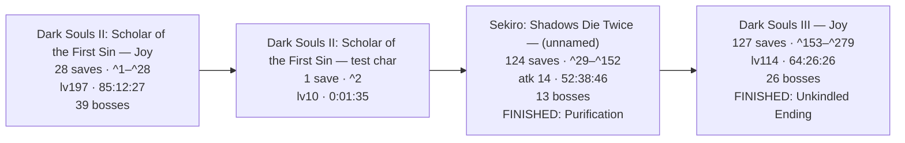
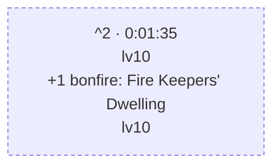

# sl2-corpus — Combined Timeline

This is the current corpus' detailed, machine-generated companion document.
It reconstructs 279 readable snapshots from the three archived games below. For
the archive's purpose, safe-use guidance, and extraction instructions, start
with [README.md](README.md). Game-specific collections live beside their own
archives and `Combined.md` reports.

The reports intentionally use a conservative reading: progression and first
appearance timestamps are evidence floors and upper bounds, not a claim to a
complete play log.

---

# FromSoftware Saves — Combined Playthrough Timeline

_Reconstructed from 279 save files across 4 runs and 3 games: Dark Souls II: Scholar of the First Sin · Sekiro: Shadows Die Twice · Dark Souls III._

_Every timestamp is an UPPER BOUND, not the moment it happened: a thing is dated to the first save it appears in, so the real event is somewhere between the previous save and that one. This is a reconstruction from sparse backups, not a log._

---

## The Journey

_One box per character, in the order the files were last written — the only clock the games share, since a Dark Souls II play time and a Dark Souls III one are unrelated numbers._

---

## Dark Souls II: Scholar of the First Sin — Joy

_28 saves · lv127 → lv197 · 36:58:24 → 85:12:27 played · 77 bonfires · 39 bosses (38 still provable in the newest save, 1 carried from earlier)._

### Save Tree

_Each box is one save file, numbered as in the references at the end. A snapshot's parent is the latest earlier one whose progress it still entirely contains — event flags never clear, so a fork (the same save played on twice) lands both children on the shared ancestor._

_No forks, a dashed box is where a line stopped._

```mermaid
flowchart TD
  n0["^1 · 36:58:24<br/>lv127<br/>BOSS: Belfry Gargoyles · Covetous Demon +18 more<br/>KEY ITEM: Antiquated Key · Brightstone Key +16 more<br/>COVENANT: Bell Keepers · Brotherhood of Blood"]
  n1["^2 · 37:00:45<br/>lv127"]
  n2["^3 · 37:47:12<br/>lv129<br/>BOSS: Guardian Dragon<br/>+1 bonfire: Dragon Aerie<br/>lv127 → lv129"]
  n3["^4 · 39:10:28<br/>lv129<br/>KEY ITEM: Heavy Iron Key<br/>+2 bonfires: Shrine Entrance · Outer Wall"]
  n4["^5 · 40:09:57<br/>lv129<br/>KEY ITEM: Ashen Mist Heart"]
  n5["^6 · 40:10:25<br/>lv129"]
  n6["^7 · 40:11:27<br/>lv129"]
  n7["^8 · 40:25:47<br/>lv130<br/>lv129 → lv130"]
  n8["^9 · 40:26:22<br/>lv130"]
  n9["^10 · 41:15:50<br/>lv140<br/>BOSS: Giant Lord<br/>KEY ITEM: Giant's Kinship<br/>lv130 → lv140"]
  n10["^11 · 41:41:59<br/>lv155<br/>lv140 → lv155"]
  n11["^12 · 41:57:54<br/>lv155"]
  n12["^13 · 42:25:34<br/>lv155"]
  n13["^14 · 43:34:28<br/>lv155<br/>+5 bonfires"]
  n14["^15 · 44:15:25<br/>lv156<br/>+4 bonfires<br/>lv155 → lv156"]
  n15["^16 · 46:00:28<br/>lv157<br/>KEY ITEM: Bastille Key · Dragon Stone +1 more<br/>+2 bonfires: Priestess' Chamber · Tower of Prayer<br/>lv156 → lv157"]
  n16["^17 · 46:27:51<br/>lv159<br/>BOSS: Graverobber, Varg, and Cerah<br/>lv157 → lv159"]
  n17["^18 · 48:07:34<br/>lv159<br/>COVENANT: Dragon Remnants"]
  n18["^19 · 51:04:20<br/>lv163<br/>BOSS: Elana, the Squalid Queen · Sinh, the Slumbering Dragon<br/>KEY ITEM: Small Smooth & Silky Stone<br/>+6 bonfires"]
  n19["^20 · 54:06:12<br/>lv169<br/>BOSS: Aava, the King's Pet<br/>KEY ITEM: Garrison Ward Key · Smooth & Silky Stone<br/>+5 bonfires"]
  n20["^21 · 55:13:08<br/>lv171<br/>BOSS: Burnt Ivory King<br/>KEY ITEM: Tower Key<br/>+3 bonfires"]
  n21["^22 · 57:37:28<br/>lv179<br/>BOSS: Blue Smelter Demon · Fume Knight +1 more<br/>lv171 → lv179"]
  n22["^23 · 58:24:34<br/>lv179<br/>BOSS: Ancient Dragon<br/>COVENANT: Pilgrims of Dark"]
  n23["^24 · 74:14:20<br/>lv195<br/>BOSS: Darklurker · The Pursuer<br/>lv179 → lv195"]
  n24["^25 · 77:00:45<br/>lv196<br/>BOSS: Sir Alonne<br/>lv195 → lv196"]
  n25["^26 · 84:29:15<br/>lv196<br/>BOSS: Lud, the King's Pet · Zallen, the King's Pet"]
  n26["^27 · 84:43:19<br/>lv197<br/>BOSS: Nashandra · Throne Defender +1 more<br/>lv196 → lv197"]
  n27["^28 · 85:12:27<br/>lv197<br/>KEY ITEM: Ladder Miniature"]
  n0 --> n1
  n1 --> n2
  n2 --> n3
  n3 --> n4
  n4 --> n5
  n5 --> n6
  n6 --> n7
  n7 --> n8
  n8 --> n9
  n9 --> n10
  n10 --> n11
  n11 --> n12
  n12 --> n13
  n13 --> n14
  n14 --> n15
  n15 --> n16
  n16 --> n17
  n17 --> n18
  n18 --> n19
  n19 --> n20
  n20 --> n21
  n21 --> n22
  n22 --> n23
  n23 --> n24
  n24 --> n25
  n25 --> n26
  n26 --> n27
  classDef leaf stroke-dasharray:4 3;
  class n27 leaf;
```

### Current State — `Joy_85-12-27_lv197_361d_77bf_37b.sl2` (^28)

### Slot 2: Joy

- **Soul Level:** 197
- **Class:** Knight
- **Covenant:** Pilgrims of Dark
- **Sex:** Female
- **Playthrough:** New Game
- **Soul Memory:** 5,509,824  _(total souls earned — main progress metric)_
- **Play Time:** 85:12:27
- **Souls held:** 661
- **Max HP:** 2,145
- **Deaths:** 361
- **Build:** strength-focused melee

#### Attributes

| VGR | END | VIT | ATN | STR | DEX | ADP | INT | FTH |
|----|----|----|----|----|----|----|----|----|
| 50 | 40 | 40 | 4 | 60 | 12 | 34 | 4 | 6 |

<b>Attribute Scaling</b> — what each stat scales and its soft caps (game-mechanics reference, not read from this save)

- **Vigor** (50) — Max HP. Soft caps 20 & 50; +30 HP/lvl to 20, +20 to 50, +5 after.
- **Endurance** (40) — Stamina. Soft cap 20; +2 stamina/lvl to 20, +1 after.
- **Vitality** (40) — Equip load, physical defense, petrify resistance. Soft caps 29/49/70; +1.5 load/lvl to 29, +1 to 49, +0.5 to 69, +0.25 after.
- **Attunement** (4) — Attunement (spell) slots, casting speed. Slots at 10/13/16/20/25/30/40/50/60/75/94; cast-speed breakpoints 30/45/60/80.
- **Strength** (60) — Physical attack, strength-weapon scaling. Scaling soft caps 40 & 50.
- **Dexterity** (12) — Physical attack, dex-weapon scaling, casting speed. Scaling soft caps 40 & 50.
- **Adaptability** (34) — Agility (i-frames), poison/bleed/petrify resistance. Raises Agility (with Attunement); gains taper past ~40.
- **Intelligence** (4) — Magic & dark attack, sorcery/hex scaling. Scaling soft caps 40 & 50.
- **Faith** (6) — Lightning & dark attack, miracle/hex scaling. Scaling soft caps 40 & 50.

#### Derived Stats  _(computed from attributes — base values before rings & equipment; the in-game screen adds ring/gear bonuses on top)_

- **Stamina:** 140
- **Equip Load (max capacity):** 93.0
- **Attunement Slots:** 0
- **Agility (AGL):** 106  _(13 roll i-frames)_
- **Poise (base):** 9.8
- **ATK: Str:** 162
- **ATK: Dex:** 61
- **Magic DEF:** 24
- **Fire DEF:** 30
- **Lightning DEF:** 36
- **Dark DEF:** 24

#### Key Items  _(progress / areas & shortcuts unlocked)_

- Soul Vessel ×4
- Skeptic's Spice ×15
- Simpleton's Spice ×14
- Soul of a Giant ×5
- Small Smooth & Silky Stone ×6
- Smooth & Silky Stone ×10
- Lenigrast's Key
- Soldier Key
- House Key
- Antiquated Key
- Undead Lockaway Key
- Tseldora Den Key
- Brightstone Key
- Frozen Flower
- Key to King's Passage
- Iron Key
- Forgotten Key
- Dragon Talon
- Heavy Iron Key
- Ashen Mist Heart
- Giant's Kinship
- Bastille Key
- Eternal Sanctum Key
- Garrison Ward Key
- Ladder Miniature
- Tower Key

#### Bonfires Discovered (77 of 77, in 34 of 34 areas)  _(each bonfire the save records as discovered, by area — a floor)_

- Things Betwixt: 1/1 — Fire Keepers' Dwelling
- Majula: 1/1 — The Far Fire
- Forest of Fallen Giants: 4/4 — Cardinal Tower, Soldiers' Rest, The Crestfallen's Retreat, The Place Unbeknownst
- Shrine of Amana: 4/4 — Tower of Prayer, Crumbled Ruins, Rhoy's Resting Place, Rise of the Dead
- Brightstone Cove Tseldora: 3/3 — Lower Brightstone Cove, Royal Army Campsite, Chapel Threshold
- Aldia's Keep: 2/2 — Foregarden, Ritual Site
- The Lost Bastille: 5/5 — Straid's Cell, Exile Holding Cells, The Tower Apart, McDuff's Workshop, Servants' Quarters
- Belfry Luna: 1/1 — Upper Ramparts
- Sinners' Rise: 1/1 — The Saltfort
- Harvest Valley: 2/2 — The Mines, Poison Pool
- Earthen Peak: 3/3 — Lower Earthen Peak, Central Earthen Peak, Upper Earthen Peak
- No-Man's Wharf: 1/1 — Unseen Path to Heide
- Iron Keep: 3/3 — Ironhearth Hall, Threshold Bridge, Eygil's Idol
- Belfry Sol: 1/1 — Belfry Sol Approach
- Drangleic Castle: 4/4 — King's Gate, Central Castle Drangleic, Forgotten Chamber, Under Castle Drangleic
- Huntsman's Copse: 3/3 — Undead Refuge, Bridge Approach, Undead Lockaway
- Undead Purgatory: 1/1 — Undead Purgatory
- Undead Crypt: 2/2 — Undead Ditch, Undead Crypt Entrance
- Black Gulch: 2/2 — Black Gulch Mouth, Hidden Chamber
- The Gutter: 2/2 — Central Gutter, Upper Gutter
- Dragon Aerie: 1/1 — Dragon Aerie
- Dragon Shrine: 1/1 — Shrine Entrance
- Shaded Woods: 3/3 — Old Akelarre, Ruined Fork Road, Shaded Ruins
- Heide's Tower of Flame: 2/2 — Tower of Flame, Heide's Ruin
- Cathedral of Blue: 1/1 — The Blue Cathedral
- Doors of Pharros: 2/2 — Gyrm's Respite, Ordeal's End
- Grave of Saints: 2/2 — Grave Entrance, Harval's Resting Place
- Shulva, Sanctum City: 3/3 — Sanctum Walk, Priestess' Chamber, Tower of Prayer
- Dragon's Rest: 1/1 — Sanctum Nadir
- Dragon's Sanctum: 3/3 — Hidden Sanctum Chamber, Lair of the Imperfect, Sanctum Interior
- Brume Tower: 5/5 — Throne Floor, Foyer, Upper Floor, Lowermost Floor, The Smelter Throne
- Iron Passage: 1/1 — Iron Hallway Entrance
- Frozen Eleum Loyce: 5/5 — Outer Wall, Abandoned Dwelling, Lower Garrison, Expulsion Chamber, Inner Wall
- Grand Cathedral: 1/1 — Grand Cathedral

#### Covenants Found (5 of 9)  _(discovered — a floor; the one currently worn is the Covenant field above)_

- **Brotherhood of Blood:** discovered
- **Way of Blue:** rank 3 of 3
- **Bell Keepers:** discovered
- **Dragon Remnants:** discovered
- **Pilgrims of Dark:** rank 3 of 3

_Not found yet: Blue Sentinels · Company of Champions · Heirs of the Sun · Rat King._

#### Bosses Defeated (38 of 39 tracked)  _(a floor — from defeat flags, held boss souls, progression, and NG+ clears; a boss whose soul was consumed and isn't gated may still be missing)_

- Aava, the King's Pet  _(soul held)_
- Ancient Dragon  _(soul held)_
- Belfry Gargoyles  _(soul held)_
- Blue Smelter Demon  _(progression)_
- Burnt Ivory King  _(soul held)_
- Covetous Demon  _(soul held)_
- Darklurker  _(confirmed, soul held)_
- Demon of Song  _(progression, soul held)_
- Dragonrider  _(progression)_
- Elana, the Squalid Queen  _(soul held)_
- Executioner's Chariot  _(confirmed, soul held)_
- Flexile Sentry  _(soul held)_
- Fume Knight  _(soul held)_
- Giant Lord  _(confirmed, soul held)_
- Graverobber, Varg, and Cerah  _(progression)_
- Guardian Dragon  _(soul held)_
- Looking Glass Knight  _(progression, soul held)_
- Lud, the King's Pet  _(soul held)_
- Mytha, the Baneful Queen  _(soul held)_
- Nashandra  _(soul held)_
- Old Dragonslayer  _(soul held)_
- Old Iron King  _(soul held)_
- Royal Rat Vanguard  _(soul held)_
- Ruin Sentinels  _(soul held)_
- Scorpioness Najka  _(soul held)_
- Sinh, the Slumbering Dragon  _(soul held)_
- Sir Alonne  _(soul held)_
- Skeleton Lords  _(soul held)_
- Smelter Demon  _(soul held)_
- The Duke's Dear Freja  _(soul held)_
- The Last Giant  _(confirmed, soul held)_
- The Lost Sinner  _(soul held)_
- The Pursuer  _(soul held)_
- The Rotten  _(confirmed, soul held)_
- Throne Defender  _(progression, soul held)_
- Throne Watcher  _(progression, soul held)_
- Velstadt, the Royal Aegis  _(confirmed, progression, soul held)_
- Zallen, the King's Pet  _(soul held)_

_No evidence yet: Royal Rat Authority._

#### Inventory

##### Weapons

- Broadsword ×3
- Mirrah Shield
- Dagger
- Foot Soldier Sword ×2
- Short Bow ×2
- Sorcerer's Staff
- Winged Spear ×3
- Longsword
- Blue Wooden Shield
- Large Leather Shield
- Silverblack Shield
- Fire Longsword +6
- Crimson Parma
- Broken Thief Sword
- Grand Lance
- Winged Spear +7
- Pate's Spear
- Light Crossbow
- Mail Breaker
- Greatsword
- Hand Axe
- Small Leather Shield
- Magic Mace
- Craftsman's Hammer
- Drakekeeper's Greataxe
- Bone Staff
- Parrying Dagger ×2
- Twinblade
- Drangleic Sword
- Drangleic Shield
- Halberd ×2
- Zweihander
- Greataxe +7
- Broken Straight Sword
- Great Club
- Caestus
- Morning Star ×2
- Dragonslayer's Crescent Axe
- Golden Falcon Shield
- Cleric's Sacred Chime
- Binoculars
- Shotel
- Dark Scythe
- Manikin Knife ×2
- Black Knight Halberd
- Target Shield
- Large Club
- Priest's Chime
- Bandit's Knife
- Sanctum Crossbow ×2
- Silverblack Spear
- Pike
- Gyrm Axe
- Giant Stone Axe
- Lightning Gyrm Great Hammer +10
- Pursuer's Ultra Greatsword
- Avelyn
- Bell Keeper Bow
- Blacksteel Katana
- Llewellyn Shield
- Black Knight Greataxe
- Lightning Short Bow +5
- Dragon Tooth ×2
- Enchanted Falchion
- Mastodon Greatsword
- Notched Whip
- Old Knight Hammer
- Caitha's Chime
- Washing Pole
- Long Bow
- Cleric's Parma ×2
- Blacksmith's Hammer
- Bastard Sword
- Whip
- Slumbering Dragon Shield
- Archdrake Mace
- Red Iron Twinblade
- Staff of Amana
- Witchtree Branch
- Witchtree Bellvine
- Syan's Halberd ×2
- Magic Shield
- Mace of the Insolent
- Blue Flame Sword ×2
- Smelter Sword
- Drakeblood Greatsword
- Old Whip ×4
- Demon's Great Hammer ×2
- Giant Warrior Club +10
- Royal Dirk
- Espada Ropera
- Hunter's Blackbow
- Sanctum Mace
- Long Bow +7
- Puzzling Stone Sword
- Sanctum Shield
- Melu Scimitar
- Varangian Shield
- Pyromancy Flame
- Varangian Sword
- Bandit Axe
- Handmaid's Ladle
- Scythe +7
- Vessel Shield
- Retainer Staff
- Retainer's Short Sword ×3
- Sorcerer's Twinblade
- Curved Nil Greatsword
- Charred Loyce Greatsword
- Large Club +8
- Azal's Staff
- Alonne Greatbow +5
- Majestic Greatsword
- Partizan +6
- Twinblade +7
- Staff of Wisdom
- Black Knight Ultra Greatsword
- Dragon Chime
- Heavy Crossbow
- Malformed Skull
- Lightning Short Bow +1
- Iron Parma
- Silver Eagle Kite Shield

##### Armor

- Imported Hood
- Imported Tunic
- Imported Manchettes
- Imported Trousers
- Hollow Soldier Gauntlets ×9
- Falconer Armor ×3
- Falconer Gloves
- Falconer Boots ×4
- Alonne Knight Helm +5
- Ironclad Helm
- Varangian Leggings ×2
- Hollow Soldier Helm ×4
- Hollow Soldier Armor ×2
- Tattered Cloth Robe ×2
- Tseldora Cap +2
- Tseldora Robe +2
- Tseldora Manchettes +2
- Tseldora Trousers +2
- Flower Skirt
- Alonne Knight Armor ×5
- Hollow Infantry Gloves
- Prisoner's Tatters ×4
- Infantry Helm
- Hollow Infantry Armor
- Tattered Cloth Hood
- Hunter's Hat
- Varangian Armor ×2
- Wanderer Coat
- Wanderer Manchettes
- Wanderer Boots
- Old Knight Armor
- Tattered Cloth Manchettes
- Drangleic Mail +5
- Drangleic Gauntlets +5
- Drangleic Leggings +5
- Blossom Kite Shield ×2
- Prisoner's Hood ×5
- Rogue Armor
- Royal Swordsman Leggings ×2
- Heavy Boots
- Royal Swordsman Armor ×3
- Royal Swordsman Helm +1
- Prisoner's Gloves
- Wicked Eye Greatshield
- Drakekeeper's Greatshield
- Prisoner's Waistcloth ×5
- Royal Swordsman Gloves ×2
- Alonne Knight Leggings ×8
- Royal Swordsman Helm ×3
- Manikin Mask
- Ironclad Armor ×2
- Rogue Leggings
- Grave Warden Top ×2
- Rogue Hood
- Manikin Top
- Alonne Knight Helm ×7
- Desert Sorceress Skirt
- Drangleic Helm
- Rusted Mastodon Helm
- Alonne Knight Gauntlets ×6
- Gyrm Warrior Helm
- Peasant Attire
- Alonne Captain Armor
- Ironclad Gauntlets
- Orma's Greatshield
- Syan's Gauntlets
- Desert Sorceress Top
- Imperious Armor
- Tower Shield
- Dragon Acolyte Mask
- Archdrake Boots ×2
- Archdrake Robes
- Archdrake Helm
- Imperious Gloves
- Leydia White Hood
- Syan's Helm
- Syan's Armor
- Rebel's Greatshield +5
- Bone Shield
- Mask of Judgment
- Robe of Judgment
- Manchettes of Judgment
- Tights of Judgment
- Drakekeeper Gauntlets
- Drakekeeper Helm
- Vengarl's Armor +2
- Vengarl's Gloves +1
- Vengarl's Boots +1
- Vengarl's Helm +5
- Drakekeeper Boots
- Llewellyn Armor
- Llewellyn Gloves
- Llewellyn Shoes
- Ruin Gauntlets
- Ruin Armor
- Faraam Helm
- Faraam Armor
- Faraam Gauntlets
- Faraam Boots
- Catarina Helm
- Drakeblood Helm
- Drakeblood Armor
- Flying Feline Boots
- Thief Mask
- Black Leather Armor
- Black Leather Gloves
- Black Leather Boots
- Brigand Hood
- Brigand Armor
- Brigand Gauntlets
- Brigand Trousers
- Rampart Golem Leggings
- Drakeblood Gauntlets
- Varangian Cuffs
- Sanctum Knight Helm
- Drakeblood Leggings
- Crown of the Sunken King
- Crown of the Ivory King
- Northwarder Hood
- Northwarder Robe
- Northwarder Manchettes
- Northwarder Trousers
- Old Bell Helm
- Symbol of Avarice
- Retainer Robe
- Mirrah Hat
- Mad Warrior Mask
- Mad Warrior Leggings
- Crown of the Old Iron King
- Imperious Helm
- Pharros Mask
- Dark Leggings
- King's Crown +5
- King's Armor
- King's Gauntlets
- King's Leggings
- Durgo's Hat
- Rampart Golem Armor
- Xanthous Crown
- Xanthous Overcoat
- Xanthous Gloves
- Xanthous Waistcloth
- Engraved Gauntlets
- Peasant Trousers +5
- Twin Dragon Greatshield
- Standard Helm
- Hard Leather Armor
- Hard Leather Gauntlets
- Hard Leather Boots
- Infantry Armor
- Infantry Gloves
- Infantry Boots
- Falconer Helm
- Raime's Leggings
- Raime's Gauntlets
- Raime's Armor
- Raime's Helm
- Alonne's Leggings
- Alonne's Gauntlets
- Alonne's Armor
- Alonne's Helm
- Bandit Boots
- Bandit Gauntlets
- Bandit Armor
- Spiked Bandit Helm
- Jester's Tights
- Jester's Gloves
- Jester's Robes
- Jester's Cap

##### Rings

- Blue Seal
- Life Ring
- Stone Ring
- Ring of Binding
- Life Ring+1
- Ring of Restoration
- Chloranthy Ring
- Silvercat Ring
- Ring of Blades ×2
- Covetous Silver Serpent Ring
- Ash Knuckle Ring
- Northern Ritual Band
- Covetous Silver Serpent Ring+1
- Ring of Steel Protection+1
- Red Tearstone Ring
- Clear Bluestone Ring+1
- Chloranthy Ring+1
- Second Dragon Ring
- White Ring
- Ring of the Evil Eye
- Redeye Ring
- Ring of Whispers
- Poisonbite Ring
- Blue Tearstone Ring
- Flame Quartz Ring
- Southern Ritual Band
- Covetous Gold Serpent Ring+1
- Northern Ritual Band+2
- Thunder Quartz Ring+1
- Bell Keeper's Seal
- Royal Soldier's Ring+1
- Covetous Gold Serpent Ring
- Dark Quartz Ring+1 ×2
- Gower's Ring of Protection
- Spell Quartz Ring+2
- Thunder Quartz Ring
- Old Leo Ring
- Crest of Blood
- Ring of Giants+1
- Ring of the Dead
- Ring of Thorns+1
- King's Ring
- Dark Quartz Ring
- Ring of the Evil Eye+1
- Flame Quartz Ring+1
- Hawk Ring
- Ring of Giants+2 ×3
- Third Dragon Ring
- Simpleton's Ring
- Bracing Knuckle Ring+1
- Ring of Steel Protection
- Poisonbite Ring+1
- Dark Quartz Ring+3
- Bloodbite Ring+1
- Lightning Clutch Ring
- Name-engraved Ring
- Ancient Dragon Seal
- Cursebite Ring
- Flynn's Ring
- Yorgh's Ring
- Dexterity Ring
- Flame Quartz Ring+3
- Spell Quartz Ring+3
- Ring of Resistance+1
- Fire Clutch Ring
- Strength Ring
- Sorcery Clutch Ring
- Abyss Seal

##### Spells

- Great Soul Arrow ×15
- Emit Force ×4
- Great Magic Barrier
- Lingering Flame ×4
- Dark Greatsword ×3
- Great Heal ×3
- Dark Fog ×4
- Combustion ×10
- Great Magic Weapon ×3
- Hush ×10
- Scraps of Life ×4
- Twisted Barricade ×20
- Soul Spear ×2
- Immolation ×8
- Soul Greatsword ×3
- Firestorm ×4
- Strong Magic Shield ×4
- Soul Bolt ×3
- Great Lightning Spear ×2
- Soul Vortex ×4
- Soul Geyser
- Crystal Magic Weapon
- Focus Souls ×2
- Fireball ×8
- Denial
- Dance of Fire ×3
- Soul Flash ×4
- Recollection ×6
- Great Fireball ×6
- Homing Soulmass ×4
- Resonant Soul ×20
- Fire Snake ×2
- Great Resonant Soul ×4
- Splintering Lightning Spear ×2
- Climax ×3
- Soul Arrow ×30
- Fall Control ×10
- Heavy Soul Arrow ×20

##### Ammunition

- Fire Arrow ×16
- Heavy Bolt ×10
- Lacerating Arrow
- Magic Bolt ×10
- Iron Greatarrow ×15
- Destructive Greatarrow ×63
- Dark Arrow
- Fire Greatarrow ×10
- Iron Arrow ×90
- Magic Arrow ×83
- Lightning Arrow ×106
- Poison Arrow ×15

##### Upgrade Materials

- Titanite Shard ×9
- Titanite Slab ×15
- Bleed Stone ×6
- Titanite Chunk ×17
- Petrified Dragon Bone ×37
- Palestone ×4
- Poison Stone ×3
- Old Mundane Stone ×3
- Large Titanite Shard ×26
- Magic Stone ×9
- Darknight Stone ×2
- Boltstone ×7
- Raw Stone ×3
- Faintstone ×5
- Firedrake Stone ×3
- Twinkling Titanite ×19

##### Consumables

- Darksign
- Human Effigy ×35
- Amber Herb ×21
- Estus Flask (10/10 charges)
- Homeward Bone ×15
- Rusted Coin ×23
- Rubbish ×2
- Repair Powder ×7
- Lloyd's Talisman ×17
- Silver Talisman ×17
- Twilight Herb ×13
- Monastery Charm ×3
- Pharros' Lockstone ×5
- Alluring Skull ×20
- Flame Butterfly ×17
- Common Fruit ×4
- Fragrant Branch of Yore ×3
- Throwing Knife ×29
- Lacerating Knife ×45
- Wilted Dusk Herb ×14
- Poison Throwing Knife ×41
- Brightbug ×5
- Blackweed Balm ×5
- Rotten Pine Resin ×4
- Prism Stone ×41
- Crimson Water ×4
- Firebomb ×49
- Elizabeth Mushroom
- Rouge Water ×4
- Small Blue Burr ×14
- Small Yellow Burr ×7
- Bonfire Ascetic ×19
- Dragon Charm ×2
- Red Leech Troches
- Charcoal Pine Resin ×6
- Triclops Snake Troches ×6
- Corrosive Urn ×16
- Poison Moss ×3
- Divine Blessing ×3
- Fire Seed ×12
- Black Firebomb ×3
- Aged Feather
- Dark Pine Resin
- Seed Of A Tree Of Giants
- Goldenfruit Balm ×15
- Hexing Urn ×10
- Soul of Nadalia, Bride of Ash ×11
- Old Growth Balm ×15
- Dried Root ×5
- Witching Urn
- Aromatic Ooze
- Bleeding Serum ×4
- Lifegem ×30
- Dung Pie ×11
- Holy Water Urn ×8
- Vine Balm ×6
- Green Blossom
- Small Orange Burr ×4
- Gold Pine Resin ×9
- Hello Carving
- Thank You Carving
- I'm Sorry Carving
- Very Good! Carving
- Lightning Urn ×10
- Smelter Wedge
- Eye of the Priestess

##### Summon & Covenant Items

- Black Separation Crystal
- Bone of Order
- Cracked Blue Eye Orb ×9
- Small White Sign Soapstone
- White Sign Soapstone
- Rat Tail ×2
- Token of Spite
- Sunlight Medal
- Cracked Red Eye Orb ×21
- Dragon Scale ×2
- Dried Fingers
- Dragon Eye

##### Great Boss Souls

- Old Witch Soul
- Old King Soul
- Old Paledrake Soul
- Old Dead One Soul

##### Boss Souls

- Old Iron King Soul
- Flexile Sentry Soul
- Royal Rat Vanguard Soul
- Ruin Sentinel Soul
- Soul of the Lost Sinner
- Soul of the Rotten
- Skeleton Lord's Soul
- Mytha, the Baneful Queen Soul
- Giant Lord Soul
- Covetous Demon Soul
- Scorpioness Najka Soul
- Belfry Gargoyle Soul
- Soul of the Duke's Dear Freja ×2
- Throne Defender Soul
- Executioner's Chariot Soul
- Looking Glass Knight Soul
- Old Dragonslayer Soul
- Guardian Dragon Soul
- Demon of Song Soul
- Soul of Velstadt
- Soul of the Ivory King
- Soul of Elana, Squalid Queen
- Soul of Sinh, the Slumbering Dragon
- Soul of Aava, the King's Pet
- Loyce Soul
- Soul of the Fume Knight
- Smelter Demon Soul
- Ancient Dragon Soul
- Soul of the King
- Darklurker Soul
- Soul of the Last Giant
- Soul of the Pursuer
- Soul of Sir Alonne
- Soul of Lud, the King's Pet
- Soul of Zallen, the King's Pet
- Throne Watcher Soul
- Soul of Nashandra

##### Gestures

- "Point" Gesture
- "I won't bite" Gesture
- "Bow" Gesture
- "Wave" Gesture
- "Pumped up" Gesture
- "Warcry" Gesture
- "Righty-ho!" Gesture
- "No way" Gesture
- "Fist pump" Gesture
- "Mock" Gesture
- "Prostration" Gesture
- "Have mercy!" Gesture
- "Warmup" Gesture
- "Decapitate" Gesture
- "Hurrah!" Gesture
- "This one's me" Gesture
- "Welcome" Gesture

_1 inventory item(s) had IDs not in the name database (upgraded / infused variants) and were omitted._

### Bosses Carried Forward

_Proven by an EARLIER save on this line and not by the newest one. A held boss soul is proof of a kill, and spending the soul destroys the proof — but a kill is permanent, so the evidence stands. Only this save's own ancestors count; a boss killed on a different branch was never killed here._

| Boss | Evidence | Proven in | Play Time |
|---|---|---|---|
| Royal Rat Authority | soul held | ^9 | 40:26:22 |

### Timeline

#### Bosses — first appearance

| Play Time | Lv | Boss | Evidence | Save |
|---|---|---|---|---|
| 36:58:24 | 127 | Belfry Gargoyles | soul held | ^1 |
| 36:58:24 | 127 | Covetous Demon | soul held | ^1 |
| 36:58:24 | 127 | Demon of Song | progression, soul held | ^1 |
| 36:58:24 | 127 | Dragonrider | progression | ^1 |
| 36:58:24 | 127 | Executioner's Chariot | confirmed, soul held | ^1 |
| 36:58:24 | 127 | Flexile Sentry | soul held | ^1 |
| 36:58:24 | 127 | Looking Glass Knight | progression, soul held | ^1 |
| 36:58:24 | 127 | Mytha, the Baneful Queen | soul held | ^1 |
| 36:58:24 | 127 | Old Dragonslayer | soul held | ^1 |
| 36:58:24 | 127 | Old Iron King | soul held | ^1 |
| 36:58:24 | 127 | Royal Rat Authority | soul held | ^1 |
| 36:58:24 | 127 | Royal Rat Vanguard | soul held | ^1 |
| 36:58:24 | 127 | Ruin Sentinels | soul held | ^1 |
| 36:58:24 | 127 | Scorpioness Najka | soul held | ^1 |
| 36:58:24 | 127 | Skeleton Lords | soul held | ^1 |
| 36:58:24 | 127 | The Duke's Dear Freja | soul held | ^1 |
| 36:58:24 | 127 | The Last Giant | confirmed | ^1 |
| 36:58:24 | 127 | The Lost Sinner | soul held | ^1 |
| 36:58:24 | 127 | The Rotten | confirmed, soul held | ^1 |
| 36:58:24 | 127 | Velstadt, the Royal Aegis | confirmed, progression, soul held | ^1 |
| 37:47:12 | 129 | Guardian Dragon | soul held | ^3 |
| 41:15:50 | 140 | Giant Lord | confirmed, soul held | ^10 |
| 46:27:51 | 159 | Graverobber, Varg, and Cerah | progression | ^17 |
| 51:04:20 | 163 | Elana, the Squalid Queen | soul held | ^19 |
| 51:04:20 | 163 | Sinh, the Slumbering Dragon | soul held | ^19 |
| 54:06:12 | 169 | Aava, the King's Pet | soul held | ^20 |
| 55:13:08 | 171 | Burnt Ivory King | soul held | ^21 |
| 57:37:28 | 179 | Blue Smelter Demon | progression | ^22 |
| 57:37:28 | 179 | Fume Knight | soul held | ^22 |
| 57:37:28 | 179 | Smelter Demon | soul held | ^22 |
| 58:24:34 | 179 | Ancient Dragon | soul held | ^23 |
| 74:14:20 | 195 | Darklurker | confirmed, soul held | ^24 |
| 74:14:20 | 195 | The Pursuer | soul held | ^24 |
| 77:00:45 | 196 | Sir Alonne | soul held | ^25 |
| 84:29:15 | 196 | Lud, the King's Pet | soul held | ^26 |
| 84:29:15 | 196 | Zallen, the King's Pet | soul held | ^26 |
| 84:43:19 | 197 | Nashandra | soul held | ^27 |
| 84:43:19 | 197 | Throne Defender | progression, soul held | ^27 |
| 84:43:19 | 197 | Throne Watcher | progression, soul held | ^27 |

#### Covenants — first found

| Play Time | Lv | Covenant | Progress | Save |
|---|---|---|---|---|
| 36:58:24 | 127 | Brotherhood of Blood | discovered | ^1 |
| 36:58:24 | 127 | Way of Blue | rank 3 of 3 | ^1 |
| 36:58:24 | 127 | Bell Keepers | discovered | ^1 |
| 48:07:34 | 159 | Dragon Remnants | discovered | ^18 |
| 58:24:34 | 179 | Pilgrims of Dark | rank 1 of 3 | ^23 |

#### Bonfires — first lit

**36:58:24 · lv127 · ^1** — 49 total (+49)

- Aldia's Keep: Foregarden
- Belfry Luna: Upper Ramparts
- Belfry Sol: Belfry Sol Approach
- Black Gulch: Black Gulch Mouth
- Black Gulch: Hidden Chamber
- Brightstone Cove Tseldora: Chapel Threshold
- Brightstone Cove Tseldora: Lower Brightstone Cove
- Brightstone Cove Tseldora: Royal Army Campsite
- Cathedral of Blue: The Blue Cathedral
- Doors of Pharros: Gyrm's Respite
- Doors of Pharros: Ordeal's End
- Drangleic Castle: Central Castle Drangleic
- Drangleic Castle: King's Gate
- Earthen Peak: Central Earthen Peak
- Earthen Peak: Lower Earthen Peak
- Forest of Fallen Giants: Cardinal Tower
- Forest of Fallen Giants: Soldiers' Rest
- Forest of Fallen Giants: The Crestfallen's Retreat
- Forest of Fallen Giants: The Place Unbeknownst
- Grave of Saints: Grave Entrance
- Grave of Saints: Harval's Resting Place
- Harvest Valley: The Mines
- Heide's Tower of Flame: Heide's Ruin
- Heide's Tower of Flame: Tower of Flame
- Huntsman's Copse: Bridge Approach
- Huntsman's Copse: Undead Lockaway
- Huntsman's Copse: Undead Refuge
- Iron Keep: Eygil's Idol
- Iron Keep: Ironhearth Hall
- Iron Keep: Threshold Bridge
- Majula: The Far Fire
- No-Man's Wharf: Unseen Path to Heide
- Shaded Woods: Old Akelarre
- Shaded Woods: Ruined Fork Road
- Shaded Woods: Shaded Ruins
- Shrine of Amana: Crumbled Ruins
- Shrine of Amana: Rhoy's Resting Place
- Shrine of Amana: Tower of Prayer
- Sinners' Rise: The Saltfort
- The Gutter: Upper Gutter
- The Lost Bastille: Exile Holding Cells
- The Lost Bastille: McDuff's Workshop
- The Lost Bastille: Servants' Quarters
- The Lost Bastille: Straid's Cell
- The Lost Bastille: The Tower Apart
- Things Betwixt: Fire Keepers' Dwelling
- Undead Crypt: Undead Crypt Entrance
- Undead Crypt: Undead Ditch
- Undead Purgatory: Undead Purgatory

**37:47:12 · lv129 · ^3** — 50 total (+1)

- Dragon Aerie: Dragon Aerie

**39:10:28 · lv129 · ^4** — 52 total (+2)

- Dragon Shrine: Shrine Entrance
- Frozen Eleum Loyce: Outer Wall

**43:34:28 · lv155 · ^14** — 57 total (+5)

- Brume Tower: Throne Floor
- Drangleic Castle: Forgotten Chamber
- Drangleic Castle: Under Castle Drangleic
- Harvest Valley: Poison Pool
- Shulva, Sanctum City: Sanctum Walk

**44:15:25 · lv156 · ^15** — 61 total (+4)

- Aldia's Keep: Ritual Site
- Earthen Peak: Upper Earthen Peak
- Shrine of Amana: Rise of the Dead
- The Gutter: Central Gutter

**46:00:28 · lv157 · ^16** — 63 total (+2)

- Shulva, Sanctum City: Priestess' Chamber
- Shulva, Sanctum City: Tower of Prayer

**51:04:20 · lv163 · ^19** — 69 total (+6)

- Brume Tower: Foyer
- Brume Tower: Upper Floor
- Dragon's Rest: Sanctum Nadir
- Dragon's Sanctum: Hidden Sanctum Chamber
- Dragon's Sanctum: Lair of the Imperfect
- Dragon's Sanctum: Sanctum Interior

**54:06:12 · lv169 · ^20** — 74 total (+5)

- Frozen Eleum Loyce: Abandoned Dwelling
- Frozen Eleum Loyce: Expulsion Chamber
- Frozen Eleum Loyce: Inner Wall
- Frozen Eleum Loyce: Lower Garrison
- Grand Cathedral: Grand Cathedral

**55:13:08 · lv171 · ^21** — 77 total (+3)

- Brume Tower: Lowermost Floor
- Brume Tower: The Smelter Throne
- Iron Passage: Iron Hallway Entrance

---

## Dark Souls II: Scholar of the First Sin — test char

_1 save · lv10 → lv10 · 0:01:35 → 0:01:35 played · 1 bonfire._

### Save Tree

_Each box is one save file, numbered as in the references at the end. A snapshot's parent is the latest earlier one whose progress it still entirely contains — event flags never clear, so a fork (the same save played on twice) lands both children on the shared ancestor._

_No forks, a dashed box is where a line stopped._

### Current State — `Joy_37-00-45_lv127_181d_49bf_19b.sl2` (^2)

### Slot 1: test char

- **Soul Level:** 10
- **Class:** Explorer
- **Sex:** Male
- **Playthrough:** New Game
- **Soul Memory:** 0  _(total souls earned — main progress metric)_
- **Play Time:** 0:01:35
- **Souls held:** 0
- **Max HP:** 822
- **Deaths:** 0
- **Build:** caster / hybrid (high INT/FTH/ATN)

#### Attributes

| VGR | END | VIT | ATN | STR | DEX | ADP | INT | FTH |
|----|----|----|----|----|----|----|----|----|
| 7 | 6 | 9 | 7 | 6 | 6 | 12 | 5 | 5 |

<b>Attribute Scaling</b> — what each stat scales and its soft caps (game-mechanics reference, not read from this save)

- **Vigor** (7) — Max HP. Soft caps 20 & 50; +30 HP/lvl to 20, +20 to 50, +5 after.
- **Endurance** (6) — Stamina. Soft cap 20; +2 stamina/lvl to 20, +1 after.
- **Vitality** (9) — Equip load, physical defense, petrify resistance. Soft caps 29/49/70; +1.5 load/lvl to 29, +1 to 49, +0.5 to 69, +0.25 after.
- **Attunement** (7) — Attunement (spell) slots, casting speed. Slots at 10/13/16/20/25/30/40/50/60/75/94; cast-speed breakpoints 30/45/60/80.
- **Strength** (6) — Physical attack, strength-weapon scaling. Scaling soft caps 40 & 50.
- **Dexterity** (6) — Physical attack, dex-weapon scaling, casting speed. Scaling soft caps 40 & 50.
- **Adaptability** (12) — Agility (i-frames), poison/bleed/petrify resistance. Raises Agility (with Attunement); gains taper past ~40.
- **Intelligence** (5) — Magic & dark attack, sorcery/hex scaling. Scaling soft caps 40 & 50.
- **Faith** (5) — Lightning & dark attack, miracle/hex scaling. Scaling soft caps 40 & 50.

#### Derived Stats  _(computed from attributes — base values before rings & equipment; the in-game screen adds ring/gear bonuses on top)_

- **Stamina:** 92
- **Equip Load (max capacity):** 52.0
- **Attunement Slots:** 0
- **Agility (AGL):** 90  _(9 roll i-frames)_
- **Poise (base):** 1.8
- **ATK: Str:** 54
- **ATK: Dex:** 54
- **Magic DEF:** 30
- **Fire DEF:** 30
- **Lightning DEF:** 30
- **Dark DEF:** 30

#### Bonfires Discovered (1 of 77, in 1 of 34 areas)  _(each bonfire the save records as discovered, by area — a floor)_

- Things Betwixt: 1/1 — Fire Keepers' Dwelling
- Majula: 0/1
- Forest of Fallen Giants: 0/4
- Shrine of Amana: 0/4
- Brightstone Cove Tseldora: 0/3
- Aldia's Keep: 0/2
- The Lost Bastille: 0/5
- Belfry Luna: 0/1
- Sinners' Rise: 0/1
- Harvest Valley: 0/2
- Earthen Peak: 0/3
- No-Man's Wharf: 0/1
- Iron Keep: 0/3
- Belfry Sol: 0/1
- Drangleic Castle: 0/4
- Huntsman's Copse: 0/3
- Undead Purgatory: 0/1
- Undead Crypt: 0/2
- Black Gulch: 0/2
- The Gutter: 0/2
- Dragon Aerie: 0/1
- Dragon Shrine: 0/1
- Shaded Woods: 0/3
- Heide's Tower of Flame: 0/2
- Cathedral of Blue: 0/1
- Doors of Pharros: 0/2
- Grave of Saints: 0/2
- Shulva, Sanctum City: 0/3
- Dragon's Rest: 0/1
- Dragon's Sanctum: 0/3
- Brume Tower: 0/5
- Iron Passage: 0/1
- Frozen Eleum Loyce: 0/5
- Grand Cathedral: 0/1

#### Inventory

##### Weapons

- Dagger

##### Armor

- Imported Hood
- Imported Tunic
- Imported Manchettes
- Imported Trousers
- Traveling Merchant Hat
- Traveling Merchant Coat
- Traveling Merchant Gloves
- Traveling Merchant Boots

##### Rings

- Spell Quartz Ring

##### Ammunition

- Wood Bolt ×20

##### Consumables

- Darksign
- Seed Of A Tree Of Giants
- Lifegem ×20
- Witching Urn ×8
- Aromatic Ooze ×4
- Prism Stone ×5
- Rusted Coin ×2
- Repair Powder
- Pharros' Lockstone

##### Summon & Covenant Items

- Black Separation Crystal
- Bone of Order

##### Gestures

- "Point" Gesture
- "I won't bite" Gesture
- "Bow" Gesture
- "Wave" Gesture
- "Pumped up" Gesture
- "Warcry" Gesture
- "Righty-ho!" Gesture
- "No way" Gesture

### Timeline

#### Bonfires — first lit

**0:01:35 · lv10 · ^2** — 1 total (+1)

- Things Betwixt: Fire Keepers' Dwelling

---

## Sekiro: Shadows Die Twice — (unnamed)

_124 saves · atk 1 → atk 14 · 2:05:30 → 52:38:46 played · 55 bonfires · 13 bosses · 488 of 581 world items · finished: Purification._

### Save Tree

_Each box is one save file, numbered as in the references at the end. A snapshot's parent is the latest earlier one whose progress it still entirely contains — event flags never clear, so a fork (the same save played on twice) lands both children on the shared ancestor._

_3 forks, a dashed box is where a line stopped._

```mermaid
flowchart TD
  n0["^48 · 2:05:30<br/>atk 1<br/>KEY ITEM: Kusabimaru · Night Eye +1 more<br/>+3 world items"]
  n1["^49 · 2:40:13<br/>atk 1<br/>KEY ITEM: Resurrection · Shinobi Prosthetic +1 more<br/>+3 bonfires<br/>+8 world items"]
  n2["^131 · 5:15:19<br/>atk 1<br/>MINIBOSS: General Naomori Kawarada<br/>GOURD SEED USED: gourd 1 → 2<br/>KEY ITEM: Flame Barrel · Flame Barrel Memo +5 more"]
  n3["^150 · 6:25:43<br/>atk 1<br/>KEY ITEM: Prosthetic Esoteric Text<br/>+6 world items"]
  n4["^151 · 9:19:46<br/>atk 1<br/>MINIBOSS: Chained Ogre · Juzou the Drunkard +1 more<br/>GOURD SEED USED: gourd 2 → 3<br/>KEY ITEM: Hidden Temple Key · Shinobi Medicine Rank 1 +1 more"]
  n5["^152 · 9:20:07<br/>atk 1<br/>NECKLACE USED: vitality 1 → 2<br/>KEY ITEM: First Prayer Necklace"]
  n6["^29 · 12:04:28<br/>atk 1<br/>MINIBOSS: General Tenzen Yamauchi<br/>KEY ITEM: Phantom Kunai · Prayer Bead<br/>+1 bonfire: Underbridge Valley"]
  n7["^30 · 12:04:44<br/>atk 1<br/>+1 bonfire: Ashina Castle Fortress"]
  n8["^31 · 14:26:51<br/>atk 1<br/>KEY ITEM: Robert's Firecrackers<br/>+6 world items"]
  n9["^32 · 14:33:50<br/>atk 1<br/>BOSS: Gyoubu Masataka Oniwa<br/>KEY ITEM: Mechanical Barrel · Memory: Gyoubu Oniwa"]
  n10["^33 · 14:34:09<br/>atk 1"]
  n11["^34 · 14:34:22<br/>atk 1<br/>+1 bonfire: Ashina Castle Gate"]
  n12["^35 · 15:26:59<br/>atk 1<br/>+8 world items"]
  n13["^36 · 15:29:29<br/>atk 1<br/>MINIBOSS: Blazing Bull<br/>KEY ITEM: Shinobi Medicine Rank 2<br/>+1 bonfire: Ashina Castle"]
  n14["^37 · 15:38:39<br/>atk 1<br/>KEY ITEM: Gatehouse Key<br/>+3 world items"]
  n15["^38 · 15:42:12<br/>atk 1<br/>+1 bonfire: Abandoned Dungeon Entrance"]
  n16["^39 · 15:49:25<br/>atk 1<br/>+1 world item"]
  n17["^40 · 15:49:37<br/>atk 1<br/>+1 bonfire: Ashina Reservoir"]
  n18["^41 · 17:12:12<br/>atk 1<br/>KEY ITEM: Rot Essence: Crow Mob · Rot Essence: Newcomer<br/>+5 world items"]
  n19["^42 · 17:35:58<br/>atk 2<br/>BOSS: Lady Butterfly<br/>MEMORY SPENT: attack 1 → 2<br/>KEY ITEM: Memory: Lady Butterfly · Remnant: Gyoubu +1 more"]
  n20["^43 · 17:52:36<br/>atk 3<br/>MINIBOSS: Lone Shadow Longswordsman<br/>MEMORY SPENT: attack 2 → 3<br/>KEY ITEM: Remnant: Lady Butterfly"]
  n21["^44 · 19:07:32<br/>atk 3<br/>KEY ITEM: Gyoubu's Broken Horn · Rotting Prisoner's Note +1 more<br/>+16 world items"]
  n22["^45 · 19:07:44<br/>atk 3<br/>+1 bonfire: Hirata Estate - Hidden Temple"]
  n23["^46 · 19:21:18<br/>atk 3<br/>+4 world items"]
  n24["^47 · 19:22:11<br/>atk 3<br/>+1 bonfire: Upper Tower - Antechamber"]
  n25["^50 · 20:26:16<br/>atk 3<br/>GOURD SEED USED: gourd 3 → 4<br/>KEY ITEM: Dragon's Blood Droplet · Iron Fortress +1 more<br/>+1 bonfire: Old Grave"]
  n26["^51 · 20:32:46<br/>atk 3<br/>KEY ITEM: Anti-air Deathblow Text"]
  n27["^52 · 21:05:02<br/>atk 3<br/>KEY ITEM: Rot Essence: Surgeons<br/>+3 world items"]
  n28["^53 · 21:05:27<br/>atk 3<br/>+1 bonfire: Upper Tower - Ashina Dojo<br/>+1 world item"]
  n29["^54 · 22:01:15<br/>atk 3<br/>MINIBOSS: General Kuranosuke Matsumoto · Ashina Elite - Jinsuke Saze<br/>NECKLACE USED: vitality 2 → 3<br/>KEY ITEM: Dragonrot Blood Sample · Nightjar Beacon Memo +1 more"]
  n30["^55 · 22:01:35<br/>atk 3<br/>+1 bonfire: Underground Waterway"]
  n31["^56 · 22:06:23<br/>atk 3<br/>+5 world items"]
  n32["^57 · 22:06:34<br/>atk 3<br/>+1 bonfire: Senpou Temple, Mt. Kongo"]
  n33["^58 · 23:22:31<br/>atk 3<br/>KEY ITEM: Gourd Seed<br/>+25 world items"]
  n34["^59 · 23:22:40<br/>atk 3<br/>+1 bonfire: Shugendo"]
  n35["^60 · 25:05:15<br/>atk 3<br/>MINIBOSS: Armored Warrior<br/>KEY ITEM: Breath of Nature: Shadow · Monkey Booze +6 more<br/>+2 bonfires: Bell Demon's Temple · Temple Grounds"]
  n36["^61 · 25:29:43<br/>atk 3<br/>GOURD SEED USED: gourd 4 → 5<br/>KEY ITEM: Holy Chapter: Infested · Recovery Charm +1 more<br/>+1 bonfire: Main Hall"]
  n37["^62 · 32:24:26<br/>atk 3<br/>MINIBOSS: Leader Shigenori Yamauchi · Seven Ashina Spears - Shikibu Toshikatsu Yamauchi +1 more<br/>NECKLACE USED: vitality 3 → 4<br/>KEY ITEM: Rot Essence: Faithful One · Rot Essence: Pious Mob +1 more"]
  n38["^63 · 34:18:32<br/>atk 3<br/>NECKLACE USED: vitality 4 → 5<br/>GOURD SEED USED: gourd 5 → 6<br/>KEY ITEM: Ashina Esoteric Text · Ashina Sake +3 more"]
  n39["^64 · 34:47:16<br/>atk 3<br/>+3 bonfires<br/>+9 world items"]
  n40["^65 · 35:20:51<br/>atk 3<br/>BOSS: Genichiro Ashina<br/>KEY ITEM: Bloodsmoke Ninjutsu · Memory: Genichiro<br/>+1 bonfire: Castle Tower Lookout"]
  n41["^66 · 35:34:28<br/>atk 3<br/>KEY ITEM: Gourd Seed · Sabimaru Memo (Bought) +3 more<br/>+1 bonfire: Upper Tower - Kuro's Room<br/>+1 world item"]
  n42["^67 · 35:36:49<br/>atk 3<br/>KEY ITEM: Immortal Severance Text"]
  n43["^68 · 36:02:23<br/>atk 4<br/>MEMORY SPENT: attack 3 → 4<br/>GOURD SEED USED: gourd 6 → 7<br/>KEY ITEM: Fragrant Flower Note · Gun Fort Shrine Key +1 more"]
  n44["^69 · 36:06:44<br/>atk 4<br/>GOURD SEED USED: gourd 7 → 8"]
  n45["^70 · 36:22:18<br/>atk 4<br/>MINIBOSS: Snake Eyes Shirahagi<br/>KEY ITEM: Prayer Bead<br/>+1 bonfire: Hidden Forest"]
  n46["^71 · 36:41:09<br/>atk 4<br/>+1 world item"]
  n47["^72 · 36:45:37<br/>atk 5<br/>BOSS: Folding Screen Monkeys<br/>MEMORY SPENT: attack 4 → 5<br/>KEY ITEM: Puppeteer Ninjutsu · Remnant: Screen Monkeys"]
  n48["^73 · 37:50:21<br/>atk 5<br/>KEY ITEM: Mortal Blade<br/>+1 bonfire: Sunken Valley Cavern<br/>+3 world items"]
  n49["^74 · 38:03:21<br/>atk 5<br/>MINIBOSS: Long-arm Centipede Giraffe<br/>KEY ITEM: Fresh Serpent Viscera · Large Fan<br/>+2 bonfires: Gun Fort · Riven Cave"]
  n50["^75 · 38:39:08<br/>atk 5<br/>MINIBOSS: Snake Eyes Shirafuji<br/>+1 bonfire: Bodhisattva Valley<br/>+13 world items"]
  n51["^76 · 38:49:39<br/>atk 5<br/>+2 world items"]
  n52["^77 · 39:14:26<br/>atk 5<br/>MINIBOSS: Mist Noble · Tokujiro the Glutton<br/>NECKLACE USED: vitality 5 → 6<br/>KEY ITEM: Fifth Prayer Necklace · Floating Passage Text"]
  n53["^78 · 39:39:16<br/>atk 5"]
  n54["^79 · 40:03:33<br/>atk 5<br/>+1 bonfire: Water Mill<br/>+13 world items"]
  n55["^80 · 40:06:13<br/>atk 5<br/>KEY ITEM: Prayer Bead<br/>+5 world items"]
  n56["^81 · 40:09:45<br/>atk 6<br/>BOSS: Corrupted Monk<br/>MEMORY SPENT: attack 5 → 6<br/>KEY ITEM: Remnant: Corrupted Monk"]
  n57["^82 · 40:53:40<br/>atk 6<br/>KEY ITEM: Red Carp Eyes · Shelter Stone +1 more<br/>+23 world items"]
  n58["^83 · 40:56:25<br/>atk 6"]
  n59["^84 · 41:00:51<br/>atk 6<br/>MINIBOSS: O'Rin of the Water<br/>NECKLACE USED: vitality 6 → 7<br/>KEY ITEM: Breath of Life: Shadow · Sixth Prayer Necklace"]
  n60["^85 · 41:19:39<br/>atk 6<br/>KEY ITEM: Surgeon's Stained Letter<br/>+1 world item"]
  n61["^86 · 41:20:18<br/>atk 6"]
  n62["^87 · 41:27:08<br/>atk 6<br/>BOSS: Guardian Ape<br/>KEY ITEM: Memory: Guardian Ape · Slender Finger<br/>+1 bonfire: Guardian Ape's Watering Hole"]
  n63["^88 · 41:47:55<br/>atk 7<br/>MEMORY SPENT: attack 6 → 7<br/>KEY ITEM: Lotus of the Palace · Precious Bait +1 more<br/>+12 world items"]
  n64["^89 · 41:51:32<br/>atk 7<br/>MINIBOSS: Lone Shadow Vilehand<br/>KEY ITEM: Prayer Bead<br/>+1 world item"]
  n65["^90 · 41:58:39<br/>atk 7<br/>MINIBOSS: Lone Shadow Masanaga the Spear-Bearer<br/>+1 world item"]
  n66["^91 · 42:03:50<br/>atk 7"]
  n67["^92 · 42:18:16<br/>atk 7<br/>MINIBOSS: Chained Ogre<br/>KEY ITEM: Shinobi Medicine Rank 3<br/>+1 world item"]
  n68["^93 · 42:41:21<br/>atk 7<br/>+2 world items"]
  n69["^94 · 42:47:34<br/>atk 7<br/>BOSS: Headless Ape<br/>KEY ITEM: Bestowal Ninjutsu · Memory: Headless Ape<br/>+1 bonfire: Guardian Ape's Burrow"]
  n70["^95 · 43:05:15<br/>atk 8<br/>MEMORY SPENT: attack 7 → 8<br/>NECKLACE USED: vitality 7 → 8<br/>KEY ITEM: Remnant: Headless Ape · Seventh Prayer Necklace"]
  n71["^96 · 43:35:24<br/>atk 8<br/>MINIBOSS: Shichimen Warrior<br/>KEY ITEM: Gourd Seed · Malcontent's Ring<br/>+5 world items"]
  n72["^97 · 44:01:41<br/>atk 8<br/>GOURD SEED USED: gourd 8 → 9<br/>+1 world item"]
  n73["^98 · 44:02:41<br/>atk 8"]
  n74["^99 · 44:04:47<br/>atk 8"]
  n75["^100 · 44:09:51<br/>atk 8<br/>ENDING: Shura<br/>BOSS: Emma, the Gentle Blade · Isshin Ashina<br/>KEY ITEM: Memory: Isshin Ashina · One Mind"]
  n76["^101 · 44:10:36<br/>atk 8<br/>BOSS: Great Shinobi Owl<br/>KEY ITEM: Aromatic Branch · Memory: Great Shinobi"]
  n77["^102 · 44:40:18<br/>atk 9<br/>BOSS: True Corrupted Monk<br/>MEMORY SPENT: attack 8 → 9<br/>KEY ITEM: Dosaku's Note · Immortal Severance Scrap +2 more"]
  n78["^103 · 44:48:50<br/>atk 10<br/>MEMORY SPENT: attack 9 → 10<br/>KEY ITEM: Dragon's Tally Board · Remnant: True Monk<br/>+2 bonfires: Mibu Manor · Vermilion Bridge"]
  n79["^104 · 45:01:53<br/>atk 10<br/>+1 bonfire: Flower Viewing Stage<br/>+8 world items"]
  n80["^105 · 45:11:46<br/>atk 10<br/>MINIBOSS: Sakura Bull of the Palace<br/>KEY ITEM: A Beast's Karma<br/>+12 world items"]
  n81["^106 · 45:19:10<br/>atk 10<br/>+1 bonfire: Great Sakura<br/>+1 world item"]
  n82["^107 · 45:28:46<br/>atk 10<br/>MINIBOSS: Okami Leader Shizu<br/>NECKLACE USED: vitality 8 → 9<br/>KEY ITEM: Eighth Prayer Necklace"]
  n83["^108 · 46:32:24<br/>atk 10<br/>KEY ITEM: Dried Serpent Viscera · Father's Bell Charm +3 more<br/>+12 world items"]
  n84["^109 · 46:51:12<br/>atk 10<br/>+6 world items"]
  n85["^110 · 47:02:48<br/>atk 10<br/>MINIBOSS: Juzou the Drunkard · Lone Shadow Masanaga the Spear-Bearer<br/>KEY ITEM: Prayer Bead<br/>+1 world item"]
  n86["^111 · 47:53:00<br/>atk 10<br/>+8 world items"]
  n87["^112 · 48:16:48<br/>atk 10<br/>+2 bonfires: Near Pot Noble · Palace Grounds<br/>+4 world items"]
  n88["^113 · 48:31:07<br/>atk 10<br/>KEY ITEM: Gourd Seed<br/>+1 bonfire: Feeding Grounds<br/>+2 world items"]
  n89["^114 · 48:34:51<br/>atk 10<br/>KEY ITEM: Rot Essence: Jail Mob · Rot Essence: Surgeons +1 more<br/>+1 bonfire: Sanctuary"]
  n90["^115 · 48:41:10<br/>atk 11<br/>BOSS: Divine Dragon<br/>MEMORY SPENT: attack 10 → 11<br/>GOURD SEED USED: gourd 9 → 10"]
  n91["^116 · 48:53:25<br/>atk 11<br/>+1 bonfire: Flames of Hatred<br/>+5 world items"]
  n92["^117 · 49:10:21<br/>atk 10<br/>GOURD SEED USED: gourd 9 → 10<br/>KEY ITEM: Black Scroll · Frozen Tears +1 more<br/>+2 world items"]
  n93["^118 · 49:17:31<br/>atk 10<br/>BOSS: Divine Dragon<br/>KEY ITEM: Divine Dragon's Tears · Memory: Divine Dragon +1 more"]
  n94["^119 · 49:22:42<br/>atk 11<br/>MINIBOSS: Headless<br/>MEMORY SPENT: attack 10 → 11<br/>KEY ITEM: Remnant: Divine Dragon"]
  n95["^120 · 49:24:14<br/>atk 11"]
  n96["^121 · 49:26:19<br/>atk 11<br/>MINIBOSS: Ashina Elite - Ujinari Mizuo<br/>+1 world item"]
  n97["^122 · 49:31:31<br/>atk 11<br/>MINIBOSS: Shigekichi of the Red Guard<br/>KEY ITEM: Promissory Note<br/>+5 world items"]
  n98["^123 · 49:40:33<br/>atk 12<br/>MINIBOSS: Seven Ashina Spears - Shume Masaji Oniwa<br/>MEMORY SPENT: attack 11 → 12<br/>NECKLACE USED: vitality 9 → 10"]
  n99["^124 · 49:45:20<br/>atk 13<br/>BOSS: Owl (Father)<br/>MEMORY SPENT: attack 12 → 13<br/>KEY ITEM: Aromatic Flower · Remnant: Foster Father"]
  n100["^125 · 49:46:30<br/>atk 13<br/>+1 bonfire: Near Secret Passage<br/>+1 world item"]
  n101["^126 · 49:47:34<br/>atk 12<br/>BOSS: Demon of Hatred<br/>MEMORY SPENT: attack 11 → 12<br/>KEY ITEM: Remnant: Hatred Demon"]
  n102["^127 · 49:51:32<br/>atk 13<br/>BOSS: Isshin, the Sword Saint<br/>KEY ITEM: Dragon Flash · Memory: Saint Isshin"]
  n103["^128 · 49:54:50<br/>atk 13<br/>ENDING: Return<br/>KEY ITEM: Another's Memory: Ashina"]
  n104["^129 · 49:56:02<br/>atk 12<br/>+4 world items"]
  n105["^130 · 49:57:16<br/>atk 12"]
  n106["^132 · 50:01:07<br/>atk 12<br/>MINIBOSS: Seven Ashina Spears - Shume Masaji Oniwa<br/>+1 world item"]
  n107["^133 · 50:33:20<br/>atk 12<br/>MINIBOSS: Shigekichi of the Red Guard<br/>+1 bonfire: Near Secret Passage<br/>+8 world items"]
  n108["^134 · 50:43:44<br/>atk 12"]
  n109["^135 · 51:08:19<br/>atk 12<br/>MINIBOSS: Headless<br/>KEY ITEM: Promissory Note<br/>+1 world item"]
  n110["^136 · 51:12:12<br/>atk 12<br/>MINIBOSS: Headless"]
  n111["^137 · 51:16:03<br/>atk 12<br/>MINIBOSS: Headless<br/>+2 world items"]
  n112["^138 · 51:23:16<br/>atk 12<br/>MINIBOSS: Headless<br/>+2 world items"]
  n113["^139 · 51:25:47<br/>atk 12<br/>MINIBOSS: Headless<br/>+1 world item"]
  n114["^140 · 51:29:06<br/>atk 12<br/>MINIBOSS: Ashina Elite - Ujinari Mizuo<br/>NECKLACE USED: vitality 9 → 10<br/>KEY ITEM: Black Scroll · Ninth Prayer Necklace"]
  n115["^141 · 51:31:50<br/>atk 12<br/>MINIBOSS: Shichimen Warrior<br/>+1 world item"]
  n116["^142 · 51:36:29<br/>atk 12<br/>MINIBOSS: Shichimen Warrior"]
  n117["^143 · 52:14:03<br/>atk 13<br/>MEMORY SPENT: attack 12 → 13<br/>KEY ITEM: Dancing Dragon Mask"]
  n118["^144 · 52:14:47<br/>atk 13"]
  n119["^145 · 52:19:52<br/>atk 13<br/>BOSS: Owl (Father)<br/>KEY ITEM: Aromatic Flower · Memory: Foster Father"]
  n120["^146 · 52:23:18<br/>atk 14<br/>MEMORY SPENT: attack 13 → 14<br/>KEY ITEM: Remnant: Foster Father"]
  n121["^147 · 52:33:54<br/>atk 14<br/>BOSS: Isshin, the Sword Saint<br/>KEY ITEM: Dragon Flash · Memory: Saint Isshin"]
  n122["^148 · 52:36:30<br/>atk 14<br/>ENDING: Immortal Severance<br/>KEY ITEM: Another's Memory: Ashina"]
  n123["^149 · 52:38:46<br/>atk 14<br/>ENDING: Purification<br/>KEY ITEM: Another's Memory: Ashina"]
  n0 --> n1
  n1 --> n2
  n2 --> n3
  n3 --> n4
  n4 --> n5
  n5 --> n6
  n6 --> n7
  n7 --> n8
  n8 --> n9
  n9 --> n10
  n10 --> n11
  n11 --> n12
  n12 --> n13
  n13 --> n14
  n14 --> n15
  n15 --> n16
  n16 --> n17
  n17 --> n18
  n18 --> n19
  n19 --> n20
  n20 --> n21
  n21 --> n22
  n22 --> n23
  n23 --> n24
  n24 --> n25
  n25 --> n26
  n26 --> n27
  n27 --> n28
  n28 --> n29
  n29 --> n30
  n30 --> n31
  n31 --> n32
  n32 --> n33
  n33 --> n34
  n34 --> n35
  n35 --> n36
  n36 --> n37
  n37 --> n38
  n38 --> n39
  n39 --> n40
  n40 --> n41
  n41 --> n42
  n42 --> n43
  n43 --> n44
  n44 --> n45
  n45 --> n46
  n46 --> n47
  n47 --> n48
  n48 --> n49
  n49 --> n50
  n50 --> n51
  n51 --> n52
  n52 --> n53
  n53 --> n54
  n54 --> n55
  n55 --> n56
  n56 --> n57
  n57 --> n58
  n58 --> n59
  n59 --> n60
  n60 --> n61
  n61 --> n62
  n62 --> n63
  n63 --> n64
  n64 --> n65
  n65 --> n66
  n66 --> n67
  n67 --> n68
  n68 --> n69
  n69 --> n70
  n70 --> n71
  n71 --> n72
  n72 --> n73
  n73 --> n74
  n74 --> n75
  n74 --> n76
  n76 --> n77
  n77 --> n78
  n78 --> n79
  n79 --> n80
  n80 --> n81
  n81 --> n82
  n82 --> n83
  n83 --> n84
  n84 --> n85
  n85 --> n86
  n86 --> n87
  n87 --> n88
  n88 --> n89
  n89 --> n90
  n90 --> n91
  n89 --> n92
  n92 --> n93
  n93 --> n94
  n94 --> n95
  n95 --> n96
  n96 --> n97
  n97 --> n98
  n98 --> n99
  n99 --> n100
  n91 --> n101
  n100 --> n102
  n102 --> n103
  n101 --> n104
  n104 --> n105
  n105 --> n106
  n106 --> n107
  n107 --> n108
  n108 --> n109
  n109 --> n110
  n110 --> n111
  n111 --> n112
  n112 --> n113
  n113 --> n114
  n114 --> n115
  n115 --> n116
  n116 --> n117
  n117 --> n118
  n118 --> n119
  n119 --> n120
  n120 --> n121
  n121 --> n122
  n121 --> n123
  classDef ending fill:#3a2a12,stroke:#c9a227,color:#f0e6d2,stroke-width:2px;
  class n75,n103,n122,n123 ending;
```

### Current State — `Wolf_52-38-46_atk14_13b.sl2` (^149)

### Slot 1: (unnamed)

- **Playthrough:** New Game
- **Play Time:** 52:38:46
- **Sen held:** 87
- **Attack Power:** 14
- **Vitality:** 10  _(9 Prayer Necklaces used — four Prayer Beads each, read back from Vitality across every journey so far)_
- **Healing Gourd:** 10 charges  _(9 Gourd Seeds used — handed to Emma, read back from the gourd's own capacity across every journey so far)_
- **Skill Points Held:** 1  _(spendable at a Sculptor's Idol — the points already spent are not stored, so this is what is banked, not what has been earned)_
- **Memories:** 14 Memory-dropping bosses defeated  _(13 Memories already spent, read back from Attack Power, plus 1 still held — this journey; a boss that drops no Memory is not counted either way)_
- **Max HP:** 1,040
- **Max Posture:** 390
- **Ending Reached:** Purification

#### Key Items  _(progress / areas & shortcuts unlocked)_

- Night Eye
- Shinobi Medicine Rank 1
- Resurrection
- Three-story Pagoda Memo (In Shop)
- Shinobi Medicine Rank 2
- Breath of Nature: Shadow
- Dragon's Blood Droplet
- Sabimaru Memo (In Shop)
- Bloodsmoke Ninjutsu
- Puppeteer Ninjutsu
- Breath of Life: Shadow
- Shinobi Medicine Rank 3
- Bestowal Ninjutsu
- A Beast's Karma
- Valley Apparitions Memo (In Shop)
- Dragon Flash
- Ornamental Letter
- Kusabimaru
- Shinobi Prosthetic
- Rat Description
- Young Lord's Bell Charm
- First Prayer Necklace
- Flame Barrel Memo
- Shinobi Esoteric Text
- Fifth Prayer Necklace
- Prosthetic Esoteric Text
- Hidden Temple Key
- Unrefined Sake ×2
- Second Prayer Necklace
- Remnant: Gyoubu
- Gatehouse Key
- Ashina Esoteric Text
- Remnant: Genichiro
- Gun Fort Shrine Key
- Remnant: Lady Butterfly
- Rotting Prisoner's Note
- Surgeon's Bloody Letter
- Anti-air Deathblow Text
- Fourth Prayer Necklace
- Third Prayer Necklace
- Nightjar Beacon Memo
- Ashina Sake
- Ashina Sake ×2
- White Pinwheel
- Monkey Booze ×2
- Three-story Pagoda Memo (Bought)
- Sabimaru Memo (Bought)
- Immortal Severance Text
- Unrefined Sake
- Fresh Serpent Viscera
- Senpou Esoteric Text
- Recovery Charm
- Fragrant Flower Note
- Remnant: Screen Monkeys
- Isshin's Letter
- Mortal Blade
- Floating Passage Text
- Sixth Prayer Necklace
- Remnant: Corrupted Monk
- Shelter Stone
- Treasure Carp Scale ×3
- Remnant: Guardian Ape
- Surgeon's Stained Letter
- Precious Bait ×4
- Lotus of the Palace
- Eighth Prayer Necklace
- Remnant: Headless Ape
- Seventh Prayer Necklace
- Aromatic Branch
- Remnant: Great Shinobi
- Page's Diary
- Dosaku's Note
- Immortal Severance Scrap
- Dragon's Tally Board
- Remnant: True Monk
- Valley Apparitions Memo (Bought)
- Dried Serpent Viscera
- Tomoe's Note
- Father's Bell Charm
- Ninth Prayer Necklace
- Remnant: Divine Dragon
- Aromatic Flower
- Remnant: Foster Father
- Memory: Saint Isshin
- Divine Dragon's Tears
- Remnant: Hatred Demon
- Secret Passage Key
- Promissory Note
- Black Scroll
- Another's Memory: Ashina
- Dancing Dragon Mask

#### Sculptor's Idols Lit (55 of 55, in 8 of 8 areas)  _(each idol's own flag bit, by area — a floor, and one that starts again on a new journey)_

- Ashina Outskirts: 8/8 — Dilapidated Temple, Outskirts Wall - Gate Path, Outskirts Wall - Stairway, Underbridge Valley, Ashina Castle Fortress, Ashina Castle Gate, Ashina Outskirts, Flames of Hatred
- Hirata Estate: 6/6 — Dragonspring - Hirata Estate, Estate Path, Bamboo Thicket Slope, Hirata Estate - Main Hall, Hirata Estate - Hidden Temple, Hirata Audience Chamber
- Ashina Castle: 10/10 — Ashina Castle, Upper Tower - Antechamber, Castle Tower Lookout, Upper Tower - Kuro's Room, Great Serpent Shrine, Abandoned Dungeon Entrance, Old Grave, Upper Tower - Ashina Dojo, Near Secret Passage, Ashina Reservoir
- Abandoned Dungeon: 2/2 — Underground Waterway, Bottomless Hole
- Senpou Temple, Mt. Kongo: 7/7 — Senpou Temple, Mt. Kongo, Shugendo, Temple Grounds, Main Hall, Inner Sanctum, Sunken Valley Cavern, Bell Demon's Temple
- Sunken Valley: 6/6 — Sunken Valley, Gun Fort, Riven Cave, Guardian Ape's Watering Hole, Under-Shrine Valley, Bodhisattva Valley
- Ashina Depths: 7/7 — Hidden Forest, Mibu Village, Water Mill, Wedding Cave Door, Poison Pool, Ashina Depths, Guardian Ape's Burrow
- Fountainhead Palace: 9/9 — Fountainhead Palace, Vermilion Bridge, Flower Viewing Stage, Great Sakura, Palace Grounds, Sanctuary, Mibu Manor, Feeding Grounds, Near Pot Noble

#### Minibosses Defeated (37 of 37 tracked)  _(each miniboss's own defeat flag — exact, not inferred, but it resets on a new journey; names are the game's own, so a repeat in an area is a second placement of that character)_

- Ashina Outskirts: 5/5 — General Naomori Kawarada · General Tenzen Yamauchi · Chained Ogre · Headless · Shigekichi of the Red Guard
- Hirata Estate: 4/4 — Juzou the Drunkard ×2 · Shinobi Hunter Enshin of Misen · Lone Shadow Masanaga the Spear-Bearer
- Ashina Castle: 8/8 — Lone Shadow Vilehand · Lone Shadow Masanaga the Spear-Bearer · General Kuranosuke Matsumoto · Blazing Bull · Ashina Elite - Jinsuke Saze · Ashina Elite - Ujinari Mizuo · Chained Ogre · Headless
- Ashina Reservoir: 4/4 — Leader Shigenori Yamauchi · Lone Shadow Longswordsman · Seven Ashina Spears - Shume Masaji Oniwa · Seven Ashina Spears - Shikibu Toshikatsu Yamauchi
- Abandoned Dungeon: 1/1 — Shichimen Warrior
- Senpou Temple, Mt. Kongo: 2/2 — Long-arm Centipede Sen'un · Armored Warrior
- Sunken Valley: 5/5 — Snake Eyes Shirafuji · Snake Eyes Shirahagi · Long-arm Centipede Giraffe · Headless · Shichimen Warrior
- Ashina Depths: 4/4 — Mist Noble · Tokujiro the Glutton · Headless · O'Rin of the Water
- Fountainhead Palace: 4/4 — Okami Leader Shizu · Headless · Sakura Bull of the Palace · Shichimen Warrior

#### Items Collected (488 of 581 tracked)  _(one-off world items picked up, from each area's item-lot flags — covers the nine areas whose flag bank is mapped, 581 of the 826 lots the table knows)_

- Ashina Outskirts: 58/70  _(12 still out there)_
- Hirata Estate: 54/64  _(10 still out there)_
- Ashina Castle: 83/97  _(14 still out there)_
- Ashina Reservoir: 18/20  _(2 still out there)_
- Abandoned Dungeon: 26/27  _(1 still out there)_
- Senpou Temple, Mt. Kongo: 72/76  _(4 still out there)_
- Sunken Valley: 68/89  _(21 still out there)_
- Ashina Depths: 60/68  _(8 still out there)_
- Fountainhead Palace: 49/70  _(21 still out there)_

Where the missing items are — the ones with a known location

**Ashina Outskirts** — 12 missing

- Light Coin Purse — ashinaoutskirts stairway ×3
- Heavy Coin Purse — ashinaoutskirts fortress1
- Bundled Jizo Statue — ashinaoutskirts gatepath
- Ako's Sugar — ashinaoutskirts gatepath
- Ceramic Shard — ashinaoutskirts gatepath
- Ceramic Shard — ashinaoutskirts fortress1
- Mibu Balloon of Wealth — ashinaoutskirts fortress1
- Adamantite Scrap — ashinaoutskirts invasion2
- Ministry Dousing Powder — ashinaoutskirts invasion2
- Pellet — ashinaoutskirts invasion2

**Hirata Estate** — 10 missing

- Dragon's Blood Droplet — fountainhead
- Lapis Lazuli — fountainhead
- Ungo's Sugar — hirata
- Mibu Possession Balloon — hirata sidepath
- Mibu Balloon of Soul — hirata sidepath
- Bundled Jizo Statue — hirata
- Pellet — hirata sidepath
- Pellet — hirata courtyard2
- Gokan's Sugar — hirata temple2
- Red Lump — hirata

**Ashina Castle** — 14 missing

- Light Coin Purse — ashinacastle
- Scrap Iron — ashinacastle
- Gachiin's Sugar — ashinacastle
- Heavy Coin Purse — ashinacastle
- Pellet — ashinacastle invasion1
- Antidote Powder — ashinacastle invasion1
- Ako's Sugar — ashinacastle invasion2
- Pellet — ashinacastle invasion2
- Gokan's Sugar — ashinacastle invasion2
- Bundled Jizo Statue — ashinacastle
- Oil — ashinacastle invasion1
- Black Gunpowder — ashinacastle invasion1
- Adamantite Scrap — ashinacastle invasion2
- Prayer Bead — ashinacastle

**Ashina Reservoir** — 2 missing

- Fulminated Mercury — ashinareservoir invasion2
- Mibu Balloon of Soul — ashinareservoir underwater

**Abandoned Dungeon** — 1 missing

- Black Gunpowder — dungeon

**Senpou Temple, Mt. Kongo** — 4 missing

- Holy Chapter: Dragon's Return — senpou grounds
- Ceramic Shard — senpou grounds
- Mibu Possession Balloon — senpou grounds
- Divine Grass — senpou

**Sunken Valley** — 21 missing

- Bundled Jizo Statue — sunkenvalley
- Bundled Jizo Statue — sunkenvalley burrow1
- Divine Confetti — sunkenvalley
- Gokan's Sugar — sunkenvalley
- Ungo's Sugar — sunkenvalley
- Snap Seed — sunkenvalley passage
- Ungo's Sugar — sunkenvalley passage
- Pacifying Agent — sunkenvalley passage
- Divine Confetti — sunkenvalley shrine
- Ako's Sugar — sunkenvalley passage
- Fulminated Mercury — sunkenvalley passage
- Yellow Gunpowder — sunkenvalley burrow1
- Yellow Gunpowder — sunkenvalley poisonpool
- Contact Medicine — sunkenvalley passage ×2
- Scrap Magnetite — sunkenvalley passage
- Monkey Booze — sunkenvalley burrow1
- Contact Medicine — sunkenvalley
- Scrap Iron — sunkenvalley passage
- Prayer Bead — sunkenvalley
- Prayer Bead — sunkenvalley burrow1

**Ashina Depths** — 8 missing

- Adamantite Scrap — hiddenforest
- Fistful of Ash — mibuvillage
- Precious Bait — mibuvillage underwater
- Contact Medicine — mibuvillage
- Yashariku's Sugar — mibuvillage
- Adamantite Scrap — mibuvillage ×2
- Heavy Coin Purse — mibuvillage

**Fountainhead Palace** — 21 missing

- Mibu Balloon of Wealth — fountainhead surface
- Treasure Carp Scale — fountainhead ×6
- Ako's Sugar — fountainhead surface
- Heavy Coin Purse — fountainhead surface
- Bulging Coin Purse — fountainhead surface
- Light Coin Purse — fountainhead
- Adamantite Scrap — fountainhead
- Mibu Balloon of Soul — fountainhead
- Dragon's Blood Droplet — fountainhead
- Heavy Coin Purse — fountainhead
- Adamantite Scrap — fountainhead surface
- Lump of Grave Wax — fountainhead surface ×2
- Water of the Palace — fountainhead
- Ako's Sugar — fountainhead
- Ungo's Sugar — fountainhead

#### Bosses Defeated (13 of 18 tracked)  _(a floor — from defeat flags, held boss souls, progression, and NG+ clears; a boss whose soul was consumed and isn't gated may still be missing)_

- Isshin, the Sword Saint  _(confirmed, soul held)_
- Gyoubu Masataka Oniwa  _(confirmed)_
- Lady Butterfly  _(confirmed)_
- Genichiro Ashina  _(confirmed)_
- Guardian Ape  _(confirmed)_
- Folding Screen Monkeys  _(confirmed)_
- Corrupted Monk  _(confirmed)_
- Headless Ape  _(confirmed)_
- Great Shinobi Owl  _(confirmed)_
- True Corrupted Monk  _(confirmed)_
- Divine Dragon  _(confirmed)_
- Demon of Hatred  _(confirmed)_
- Owl (Father)  _(confirmed)_

_No evidence yet: Emma, the Gentle Blade · Inner Father (Gauntlet) · Inner Genichiro (Gauntlet) · Inner Isshin (Gauntlet) · Isshin Ashina._

#### Inventory

##### Combat Arts

- Whirlwind Slash
- Praying Strikes
- Ichimonji
- Mortal Draw
- Floating Passage
- Ichimonji: Double
- Nightjar Slash
- Dragon Flash

##### Prosthetic Tools

- Loaded Shuriken
- Loaded Axe
- Spinning Shuriken
- Flame Vent
- Spring-load Axe
- Malconent
- Phantom Kunai
- Loaded Spear
- Sabimaru
- Shinobi Firecracker
- Improved Sabimaru
- Loaded Umbrella
- Spring-load Firecracker
- Spring-load Flame Vent
- Double Divine Abduction
- Loaded Umbrella - Magnet
- Divine Abduction
- Long Spark
- Mountain Echo
- Sparking Axe
- Golden Vortex
- Finger Whistle
- Loaded Spear Thrust type
- Gouging Top
- Phoenix's Lilac Umbrella
- Suzaku's Lotus Umbrella
- Loaded Spear Cleave type
- Purple Fume Spark
- Spiral Spear
- Sen Throw
- Aged Feather Mist Raven
- Mist Raven
- Okinaga's Flame Vent
- Piercing Sabimaru
- Leaping Flame

##### Skills & Techniques

- Breath of Life: Light
- Mikiri Counter
- Shinobi Medicine Rank 1
- Run and Slide
- Mid-air Deflection
- Grappling Hook Attack
- Chasing Slice
- Suppress Presence
- Suppress Sound
- Emma's Medicine: Potency
- A Shinobi's Karma: Body
- Fang and Blade
- Shinobi Medicine Rank 2
- A Shinobi's Karma: Mind
- Anti-air Deathblow
- Mid-air Prosthetic Tool
- Breath of Nature: Shadow
- Ascending Carp
- Descending Carp
- Shinobi Eyes
- Floating Passage
- Mibu Breathing Technique
- Breath of Life: Shadow
- Flowing Water
- Shinobi Medicine Rank 3
- Projected Force
- Virtuous Deed
- A Beast's Karma
- Mid-air Combat Arts
- Emma's Medicine: Aroma

##### Attire

- Another's Memory: Ashina - Head
- Another's Memory: Ashina - Body
- Another's Memory: Ashina - Body - No Mortal Blade
- Another's Memory: Ashina - Prosthetic Arm
- Another's Memory: Ashina - Legs

##### Upgrade Materials

- Black Gunpowder ×10
- Scrap Magnetite ×14
- Yellow Gunpowder ×11
- Adamantite Scrap ×7
- Lump of Grave Wax ×12
- Lump of Fat Wax
- Lapis Lazuli ×4

##### Consumables

- Homeward Idol
- Healing Gourd ×10
- Fistful of Ash ×10
- Ceramic Shard ×10
- Ungo's Sugar ×3
- Temporary Regenerative Power
- Regenerative Power ×2
- Mibu Balloon of Wealth ×5
- Gachiin's Sugar ×3
- Dousing Powder ×5
- Mibu Possession Balloon ×5
- Spirit Emblem ×16
- Withered Red Gourd ×5
- Gokan's Sugar ×3
- Antidote Powder ×5
- Bulging Coin Purse ×2
- Nightjar Monocular
- Pacifying Agent ×5
- Snap Seed ×10
- Contact Medicine ×3
- Red Lump ×3
- Bite Down ×3
- Mibu Balloon of Soul ×5
- Divine Grass
- Eel Liver ×5
- Mibu Balloon of Spirit ×5
- Yashariku's Sugar ×3
- Heavy Coin Purse
- Persimmon ×2
- Bundled Jizo Statue
- Pellet ×3
- Light Coin Purse ×8
- Oil ×10
- Illusive Hall Bell
- Hidden Tooth
- Rice ×2
- Ministry Dousing Powder ×5
- Ako's Spiritfall
- Ungo's Spiritfall
- Gachiin's Spiritfall
- Gokan's Spiritfall
- Yashariku's Spiritfall
- Ceremonial Tanto ×3
- Divine Confetti ×5

##### Storage (item box)

- Pacifying Agent ×8
- Spirit Emblem ×136
- Ceramic Shard ×50
- Ungo's Sugar ×10
- Dousing Powder ×20
- Gachiin's Sugar ×12
- Mibu Possession Balloon ×18
- Fistful of Ash ×42
- Mibu Balloon of Wealth ×16
- Antidote Powder ×14
- Oil ×15
- Gokan's Sugar ×12
- Contact Medicine ×18
- Dragon's Blood Droplet ×9
- Mibu Balloon of Spirit ×11
- Bundled Jizo Statue ×4
- Eel Liver ×15
- Pellet ×44
- Yashariku's Sugar ×13
- Mibu Balloon of Soul ×23
- Bite Down ×4
- Snap Seed ×7
- Divine Grass ×4
- Red Lump
- Ministry Dousing Powder ×5

_10 further entries carried only an engine development name — placeholder rows and debug items rather than anything the game hands you — and were left out._

_41 further entries were engine state rather than inventory — Sekiro has no armour system, so the character's own body models sit in the protector table, the `Virtual Weapon:` rows restate a Combat Art already listed under its own name, and the two plain `Memory` rows are the game's counters of Memories spent and held. Counted here, not printed._

### Timeline

#### Bosses — first appearance

| Play Time | Atk | Boss | Evidence | Save |
|---|---|---|---|---|
| 14:33:50 | 1 | Gyoubu Masataka Oniwa | confirmed, soul held | ^32 |
| 17:35:58 | 2 | Lady Butterfly | confirmed, soul held | ^42 |
| 35:20:51 | 3 | Genichiro Ashina | confirmed, soul held | ^65 |
| 36:45:37 | 5 | Folding Screen Monkeys | confirmed | ^72 |
| 40:09:45 | 6 | Corrupted Monk | confirmed | ^81 |
| 41:27:08 | 6 | Guardian Ape | confirmed, soul held | ^87 |
| 42:47:34 | 7 | Headless Ape | confirmed, soul held | ^94 |
| 44:09:51 | 8 | Isshin Ashina | confirmed, soul held | ^100 |
| 44:09:51 | 8 | Emma, the Gentle Blade | confirmed | ^100 |
| 44:10:36 | 8 | Great Shinobi Owl | confirmed, soul held | ^101 |
| 44:40:18 | 9 | True Corrupted Monk | confirmed | ^102 |
| 48:41:10 | 11 | Divine Dragon | confirmed | ^115 |
| 49:45:20 | 13 | Owl (Father) | confirmed | ^124 |
| 49:47:34 | 12 | Demon of Hatred | confirmed | ^126 |
| 49:51:32 | 13 | Isshin, the Sword Saint | confirmed, soul held | ^127 |

#### Bonfires — first lit

**2:40:13 · atk 1 · ^49** — 3 total (+3)

- Ashina Outskirts: Ashina Outskirts
- Ashina Outskirts: Dilapidated Temple
- Ashina Outskirts: Outskirts Wall - Gate Path

**5:15:19 · atk 1 · ^131** — 6 total (+3)

- Ashina Outskirts: Outskirts Wall - Stairway
- Hirata Estate: Dragonspring - Hirata Estate
- Hirata Estate: Estate Path

**9:19:46 · atk 1 · ^151** — 9 total (+3)

- Hirata Estate: Bamboo Thicket Slope
- Hirata Estate: Hirata Audience Chamber
- Hirata Estate: Hirata Estate - Main Hall

**12:04:28 · atk 1 · ^29** — 10 total (+1)

- Ashina Outskirts: Underbridge Valley

**12:04:44 · atk 1 · ^30** — 11 total (+1)

- Ashina Outskirts: Ashina Castle Fortress

**14:34:22 · atk 1 · ^34** — 12 total (+1)

- Ashina Outskirts: Ashina Castle Gate

**15:29:29 · atk 1 · ^36** — 13 total (+1)

- Ashina Castle: Ashina Castle

**15:42:12 · atk 1 · ^38** — 14 total (+1)

- Ashina Castle: Abandoned Dungeon Entrance

**15:49:37 · atk 1 · ^40** — 15 total (+1)

- Ashina Castle: Ashina Reservoir

**19:07:44 · atk 3 · ^45** — 16 total (+1)

- Hirata Estate: Hirata Estate - Hidden Temple

**19:22:11 · atk 3 · ^47** — 17 total (+1)

- Ashina Castle: Upper Tower - Antechamber

**20:26:16 · atk 3 · ^50** — 18 total (+1)

- Ashina Castle: Old Grave

**21:05:27 · atk 3 · ^53** — 19 total (+1)

- Ashina Castle: Upper Tower - Ashina Dojo

**22:01:35 · atk 3 · ^55** — 20 total (+1)

- Abandoned Dungeon: Underground Waterway

**22:06:34 · atk 3 · ^57** — 21 total (+1)

- Senpou Temple, Mt. Kongo: Senpou Temple, Mt. Kongo

**23:22:40 · atk 3 · ^59** — 22 total (+1)

- Senpou Temple, Mt. Kongo: Shugendo

**25:05:15 · atk 3 · ^60** — 24 total (+2)

- Senpou Temple, Mt. Kongo: Bell Demon's Temple
- Senpou Temple, Mt. Kongo: Temple Grounds

**25:29:43 · atk 3 · ^61** — 25 total (+1)

- Senpou Temple, Mt. Kongo: Main Hall

**34:18:32 · atk 3 · ^63** — 28 total (+3)

- Ashina Castle: Great Serpent Shrine
- Sunken Valley: Sunken Valley
- Sunken Valley: Under-Shrine Valley

**34:47:16 · atk 3 · ^64** — 31 total (+3)

- Abandoned Dungeon: Bottomless Hole
- Ashina Depths: Ashina Depths
- Ashina Depths: Poison Pool

**35:20:51 · atk 3 · ^65** — 32 total (+1)

- Ashina Castle: Castle Tower Lookout

**35:34:28 · atk 3 · ^66** — 33 total (+1)

- Ashina Castle: Upper Tower - Kuro's Room

**36:22:18 · atk 4 · ^70** — 34 total (+1)

- Ashina Depths: Hidden Forest

**36:45:37 · atk 5 · ^72** — 35 total (+1)

- Senpou Temple, Mt. Kongo: Inner Sanctum

**37:50:21 · atk 5 · ^73** — 36 total (+1)

- Senpou Temple, Mt. Kongo: Sunken Valley Cavern

**38:03:21 · atk 5 · ^74** — 38 total (+2)

- Sunken Valley: Gun Fort
- Sunken Valley: Riven Cave

**38:39:08 · atk 5 · ^75** — 39 total (+1)

- Sunken Valley: Bodhisattva Valley

**39:14:26 · atk 5 · ^77** — 40 total (+1)

- Ashina Depths: Mibu Village

**40:03:33 · atk 5 · ^79** — 41 total (+1)

- Ashina Depths: Water Mill

**40:09:45 · atk 6 · ^81** — 42 total (+1)

- Ashina Depths: Wedding Cave Door

**41:27:08 · atk 6 · ^87** — 43 total (+1)

- Sunken Valley: Guardian Ape's Watering Hole

**42:47:34 · atk 7 · ^94** — 44 total (+1)

- Ashina Depths: Guardian Ape's Burrow

**44:40:18 · atk 9 · ^102** — 45 total (+1)

- Fountainhead Palace: Fountainhead Palace

**44:48:50 · atk 10 · ^103** — 47 total (+2)

- Fountainhead Palace: Mibu Manor
- Fountainhead Palace: Vermilion Bridge

**45:01:53 · atk 10 · ^104** — 48 total (+1)

- Fountainhead Palace: Flower Viewing Stage

**45:19:10 · atk 10 · ^106** — 49 total (+1)

- Fountainhead Palace: Great Sakura

**48:16:48 · atk 10 · ^112** — 51 total (+2)

- Fountainhead Palace: Near Pot Noble
- Fountainhead Palace: Palace Grounds

**48:31:07 · atk 10 · ^113** — 52 total (+1)

- Fountainhead Palace: Feeding Grounds

**48:34:51 · atk 10 · ^114** — 53 total (+1)

- Fountainhead Palace: Sanctuary

**48:53:25 · atk 11 · ^116** — 54 total (+1)

- Ashina Outskirts: Flames of Hatred

**49:46:30 · atk 13 · ^125** — 55 total (+1)

- Ashina Castle: Near Secret Passage

#### World items — where the count moved

_Only the areas whose pickup-flag group is mapped are counted, so an area absent here is unmapped, not empty._

**2:05:30 · atk 1 · ^48** — 3 total (+3)

- Ashina Reservoir: +3 (now 3)

**2:40:13 · atk 1 · ^49** — 11 total (+8)

- Ashina Outskirts: +8 (now 8)

**5:15:19 · atk 1 · ^131** — 33 total (+22)

- Ashina Outskirts: +7 (now 15)
- Hirata Estate: +15 (now 15)

**6:25:43 · atk 1 · ^150** — 39 total (+6)

- Hirata Estate: +6 (now 21)

**9:19:46 · atk 1 · ^151** — 59 total (+20)

- Ashina Outskirts: +9 (now 24)
- Hirata Estate: +11 (now 32)

**12:04:28 · atk 1 · ^29** — 72 total (+13)

- Ashina Outskirts: +10 (now 34)
- Hirata Estate: +3 (now 35)

**14:26:51 · atk 1 · ^31** — 78 total (+6)

- Ashina Outskirts: +5 (now 39)
- Hirata Estate: +1 (now 36)

**15:26:59 · atk 1 · ^35** — 86 total (+8)

- Ashina Castle: +8 (now 8)

**15:38:39 · atk 1 · ^37** — 89 total (+3)

- Ashina Castle: +3 (now 11)

**15:49:25 · atk 1 · ^39** — 90 total (+1)

- Ashina Castle: +1 (now 12)

**17:12:12 · atk 1 · ^41** — 95 total (+5)

- Ashina Castle: +2 (now 14)
- Ashina Reservoir: +3 (now 6)

**19:07:32 · atk 3 · ^44** — 111 total (+16)

- Abandoned Dungeon: +9 (now 9)
- Ashina Castle: +2 (now 16)
- Ashina Reservoir: +5 (now 11)

**19:21:18 · atk 3 · ^46** — 115 total (+4)

- Ashina Castle: +4 (now 20)

**20:26:16 · atk 3 · ^50** — 130 total (+15)

- Ashina Castle: +15 (now 35)

**21:05:02 · atk 3 · ^52** — 133 total (+3)

- Ashina Castle: +3 (now 38)

**21:05:27 · atk 3 · ^53** — 134 total (+1)

- Ashina Castle: +1 (now 39)

**22:01:15 · atk 3 · ^54** — 143 total (+9)

- Ashina Castle: +7 (now 46)
- Ashina Reservoir: +2 (now 13)

**22:06:23 · atk 3 · ^56** — 148 total (+5)

- Abandoned Dungeon: +5 (now 14)

**23:22:31 · atk 3 · ^58** — 173 total (+25)

- Senpou Temple, Mt. Kongo: +25 (now 25)

**25:05:15 · atk 3 · ^60** — 194 total (+21)

- Senpou Temple, Mt. Kongo: +21 (now 46)

**25:29:43 · atk 3 · ^61** — 207 total (+13)

- Senpou Temple, Mt. Kongo: +13 (now 59)

**32:24:26 · atk 3 · ^62** — 221 total (+14)

- Ashina Castle: +1 (now 47)
- Ashina Reservoir: +1 (now 14)
- Hirata Estate: +7 (now 43)
- Senpou Temple, Mt. Kongo: +5 (now 64)

**34:18:32 · atk 3 · ^63** — 240 total (+19)

- Ashina Castle: +7 (now 54)
- Ashina Outskirts: +5 (now 44)
- Sunken Valley: +7 (now 7)

**34:47:16 · atk 3 · ^64** — 249 total (+9)

- Abandoned Dungeon: +4 (now 18)
- Sunken Valley: +5 (now 12)

**35:34:28 · atk 3 · ^66** — 250 total (+1)

- Ashina Castle: +1 (now 55)

**36:02:23 · atk 4 · ^68** — 257 total (+7)

- Ashina Castle: +1 (now 56)
- Sunken Valley: +6 (now 18)

**36:22:18 · atk 4 · ^70** — 270 total (+13)

- Ashina Depths: +11 (now 11)
- Sunken Valley: +2 (now 20)

**36:41:09 · atk 4 · ^71** — 271 total (+1)

- Sunken Valley: +1 (now 21)

**36:45:37 · atk 5 · ^72** — 272 total (+1)

- Senpou Temple, Mt. Kongo: +1 (now 65)

**37:50:21 · atk 5 · ^73** — 275 total (+3)

- Senpou Temple, Mt. Kongo: +3 (now 68)

**38:03:21 · atk 5 · ^74** — 287 total (+12)

- Senpou Temple, Mt. Kongo: +1 (now 69)
- Sunken Valley: +11 (now 32)

**38:39:08 · atk 5 · ^75** — 300 total (+13)

- Sunken Valley: +13 (now 45)

**38:49:39 · atk 5 · ^76** — 302 total (+2)

- Ashina Depths: +2 (now 13)

**39:14:26 · atk 5 · ^77** — 313 total (+11)

- Ashina Depths: +11 (now 24)

**40:03:33 · atk 5 · ^79** — 326 total (+13)

- Ashina Depths: +10 (now 34)
- Sunken Valley: +3 (now 48)

**40:06:13 · atk 5 · ^80** — 331 total (+5)

- Ashina Depths: +5 (now 39)

**40:53:40 · atk 6 · ^82** — 354 total (+23)

- Ashina Castle: +7 (now 63)
- Ashina Depths: +8 (now 47)
- Hirata Estate: +1 (now 44)
- Senpou Temple, Mt. Kongo: +2 (now 71)
- Sunken Valley: +5 (now 53)

**41:19:39 · atk 6 · ^85** — 355 total (+1)

- Ashina Reservoir: +1 (now 15)

**41:47:55 · atk 7 · ^88** — 367 total (+12)

- Ashina Castle: +10 (now 73)
- Sunken Valley: +2 (now 55)

**41:51:32 · atk 7 · ^89** — 368 total (+1)

- Ashina Castle: +1 (now 74)

**41:58:39 · atk 7 · ^90** — 369 total (+1)

- Ashina Castle: +1 (now 75)

**42:18:16 · atk 7 · ^92** — 370 total (+1)

- Ashina Castle: +1 (now 76)

**42:41:21 · atk 7 · ^93** — 372 total (+2)

- Sunken Valley: +2 (now 57)

**43:35:24 · atk 8 · ^96** — 377 total (+5)

- Ashina Depths: +5 (now 52)

**44:01:41 · atk 8 · ^97** — 378 total (+1)

- Ashina Castle: +1 (now 77)

**44:40:18 · atk 9 · ^102** — 387 total (+9)

- Abandoned Dungeon: +7 (now 25)
- Ashina Reservoir: +1 (now 16)
- Fountainhead Palace: +1 (now 1)

**44:48:50 · atk 10 · ^103** — 395 total (+8)

- Fountainhead Palace: +8 (now 9)

**45:01:53 · atk 10 · ^104** — 403 total (+8)

- Fountainhead Palace: +8 (now 17)

**45:11:46 · atk 10 · ^105** — 415 total (+12)

- Fountainhead Palace: +12 (now 29)

**45:19:10 · atk 10 · ^106** — 416 total (+1)

- Fountainhead Palace: +1 (now 30)

**45:28:46 · atk 10 · ^107** — 428 total (+12)

- Fountainhead Palace: +12 (now 42)

**46:32:24 · atk 10 · ^108** — 440 total (+12)

- Hirata Estate: +2 (now 46)
- Senpou Temple, Mt. Kongo: +1 (now 72)
- Sunken Valley: +9 (now 66)

**46:51:12 · atk 10 · ^109** — 446 total (+6)

- Ashina Outskirts: +1 (now 45)
- Hirata Estate: +5 (now 51)

**47:02:48 · atk 10 · ^110** — 447 total (+1)

- Hirata Estate: +1 (now 52)

**47:53:00 · atk 10 · ^111** — 455 total (+8)

- Ashina Depths: +6 (now 58)
- Hirata Estate: +2 (now 54)

**48:16:48 · atk 10 · ^112** — 459 total (+4)

- Fountainhead Palace: +4 (now 46)

**48:31:07 · atk 10 · ^113** — 461 total (+2)

- Fountainhead Palace: +2 (now 48)

**48:53:25 · atk 11 · ^116** — 466 total (+5)

- Ashina Castle: +2 (now 79)
- Ashina Outskirts: +3 (now 48)

**49:10:21 · atk 10 · ^117** — 463 total (+1)

- Senpou Temple, Mt. Kongo: +1 (now 73)

**49:26:19 · atk 11 · ^121** — 464 total (+1)

- Ashina Castle: +1 (now 79)

**49:31:31 · atk 11 · ^122** — 469 total (+5)

- Ashina Outskirts: +5 (now 50)

**49:40:33 · atk 12 · ^123** — 470 total (+1)

- Ashina Reservoir: +1 (now 17)

**49:46:30 · atk 13 · ^125** — 471 total (+1)

- Ashina Reservoir: +1 (now 18)

**49:56:02 · atk 12 · ^129** — 470 total (+2)

- Ashina Castle: +2 (now 81)

**50:01:07 · atk 12 · ^132** — 471 total (+1)

- Ashina Reservoir: +1 (now 17)

**50:33:20 · atk 12 · ^133** — 479 total (+8)

- Ashina Outskirts: +7 (now 57)
- Ashina Reservoir: +1 (now 18)

**51:08:19 · atk 12 · ^135** — 480 total (+1)

- Ashina Outskirts: +1 (now 58)

**51:16:03 · atk 12 · ^137** — 482 total (+2)

- Ashina Depths: +2 (now 60)

**51:23:16 · atk 12 · ^138** — 484 total (+2)

- Sunken Valley: +2 (now 68)

**51:25:47 · atk 12 · ^139** — 485 total (+1)

- Fountainhead Palace: +1 (now 49)

**51:29:06 · atk 12 · ^140** — 487 total (+2)

- Ashina Castle: +2 (now 83)

**51:31:50 · atk 12 · ^141** — 488 total (+1)

- Abandoned Dungeon: +1 (now 26)

---

## Dark Souls III — Joy

_127 saves · lv17 → lv114 · 1:34:40 → 64:26:26 played · 77 bonfires · 26 bosses · 750 of 937 world items · finished: Unkindled Ending._

### Save Tree

_Each box is one save file, numbered as in the references at the end. A snapshot's parent is the latest earlier one whose progress it still entirely contains — event flags never clear, so a fork (the same save played on twice) lands both children on the shared ancestor._

_2 forks, a dashed box is where a line stopped._

```mermaid
flowchart TD
  n0["^159 · 1:34:40<br/>lv17<br/>BOSS: Iudex Gundyr<br/>+5 bonfires<br/>+49 world items"]
  n1["^160 · 1:34:58<br/>lv17"]
  n2["^161 · 1:37:24<br/>lv17<br/>BOSS: Vordt of the Boreal Valley"]
  n3["^218 · 2:44:34<br/>lv20<br/>KEY ITEM: Cell Key · Loretta's Bone +2 more<br/>COVENANT: Warrior of Sunlight · Way of Blue<br/>+4 bonfires"]
  n4["^229 · 3:58:51<br/>lv24<br/>KEY ITEM: Tower Key<br/>COVENANT: Blue Sentinels<br/>+2 bonfires: Halfway Fortress · Road of Sacrifices"]
  n5["^242 · 4:14:52<br/>lv24<br/>+2 bonfires: Crucifixion Woods · Farron Keep<br/>+10 world items"]
  n6["^243 · 4:38:42<br/>lv25<br/>KEY ITEM: Sage's Coal<br/>+1 bonfire: Keep Ruins<br/>+9 world items"]
  n7["^244 · 4:38:57<br/>lv25<br/>Estus +0 → +1"]
  n8["^258 · 5:12:03<br/>lv25<br/>KEY ITEM: Dreamchaser's Ashes · Grave Key<br/>+1 bonfire: Old Wolf of Farron<br/>+12 world items"]
  n9["^259 · 5:12:59<br/>lv25"]
  n10["^266 · 6:05:04<br/>lv26<br/>BOSS: Stray Demon<br/>KEY ITEM: Golden Scroll · Sage's Scroll<br/>+1 bonfire: Farron Keep Perimeter"]
  n11["^274 · 7:03:48<br/>lv27<br/>BOSS: Crystal Sage<br/>+1 bonfire: Crystal Sage<br/>+7 world items"]
  n12["^275 · 7:03:58<br/>lv27"]
  n13["^276 · 7:17:31<br/>lv30<br/>KEY ITEM: Paladin's Ashes<br/>+1 bonfire: Cathedral of the Deep<br/>+3 world items"]
  n14["^277 · 7:17:52<br/>lv30"]
  n15["^278 · 7:27:47<br/>lv30"]
  n16["^279 · 7:28:29<br/>lv30"]
  n17["^153 · 10:03:00<br/>lv32<br/>KEY ITEM: Deep Braille Divine Tome<br/>+2 bonfires: Cleansing Chapel · Snowfield<br/>+34 world items"]
  n18["^154 · 10:16:19<br/>lv35<br/>+5 world items<br/>lv32 → lv35"]
  n19["^155 · 10:16:31<br/>lv35<br/>Estus +1 → +2"]
  n20["^156 · 10:17:27<br/>lv35"]
  n21["^157 · 10:17:48<br/>lv35"]
  n22["^158 · 11:08:38<br/>lv35<br/>BOSS: Deacons of the Deep<br/>KEY ITEM: Small Doll<br/>+5 world items"]
  n23["^162 · 11:08:48<br/>lv35<br/>+1 bonfire: Deacons of the Deep"]
  n24["^163 · 12:17:13<br/>lv38<br/>+3 world items<br/>lv35 → lv38"]
  n25["^164 · 12:31:25<br/>lv38<br/>+1 world item"]
  n26["^165 · 12:31:34<br/>lv38<br/>+1 bonfire: Rosaria's Bed Chamber"]
  n27["^166 · 12:32:11<br/>lv38<br/>COVENANT: Rosaria's Fingers"]
  n28["^167 · 13:49:28<br/>lv38<br/>+5 world items"]
  n29["^168 · 13:55:07<br/>lv38<br/>BOSS: Curse-Rotted Greatwood<br/>KEY ITEM: Transposing Kiln"]
  n30["^169 · 13:55:14<br/>lv38<br/>+1 bonfire: Pit of Hollows"]
  n31["^170 · 14:08:36<br/>lv39<br/>BOSS: Abyss Watchers<br/>KEY ITEM: Cinders of a Lord<br/>+2 world items"]
  n32["^171 · 14:08:45<br/>lv39<br/>+1 bonfire: Abyss Watchers"]
  n33["^172 · 14:12:37<br/>lv44<br/>COVENANT: Watchdogs of Farron<br/>lv38 → lv44"]
  n34["^173 · 14:27:21<br/>lv44<br/>BOSS: Abyss Watchers<br/>KEY ITEM: Cinders of a Lord<br/>+1 bonfire: Abyss Watchers"]
  n35["^174 · 14:29:34<br/>lv44<br/>+1 bonfire: Catacombs of Carthus<br/>+1 world item"]
  n36["^175 · 16:25:58<br/>lv45<br/>BOSS: High Lord Wolnir<br/>KEY ITEM: Carthus Pyromancy Tome · Grave Warden Pyromancy Tome<br/>+4 bonfires"]
  n37["^176 · 18:58:29<br/>lv45<br/>+10 world items<br/>lv44 → lv45"]
  n38["^177 · 19:05:02<br/>lv47<br/>BOSS: High Lord Wolnir<br/>KEY ITEM: Grave Warden Pyromancy Tome<br/>+1 bonfire: High Lord Wolnir"]
  n39["^178 · 19:45:18<br/>lv48<br/>KEY ITEM: Excrement-covered Ashes · Lift Chamber Key<br/>+4 bonfires<br/>Estus +2 → +3"]
  n40["^179 · 19:55:49<br/>lv48<br/>KEY ITEM: Jailbreaker's Key<br/>+1 bonfire: Irithyll Dungeon<br/>+9 world items"]
  n41["^180 · 20:08:31<br/>lv48<br/>+11 world items"]
  n42["^181 · 20:25:16<br/>lv49<br/>KEY ITEM: Old Cell Key · Profaned Coal +1 more<br/>+1 bonfire: Profaned Capital<br/>+9 world items"]
  n43["^182 · 20:34:19<br/>lv49<br/>KEY ITEM: Jailer's Key Ring · Logan's Scroll<br/>+10 world items"]
  n44["^183 · 20:43:29<br/>lv50<br/>+6 world items<br/>lv49 → lv50"]
  n45["^184 · 20:49:06<br/>lv50<br/>BOSS: Yhorm the Giant<br/>+1 bonfire: Yhorm the Giant"]
  n46["^185 · 20:52:08<br/>lv53<br/>lv50 → lv53"]
  n47["^186 · 21:06:09<br/>lv53"]
  n48["^187 · 21:18:54<br/>lv49<br/>KEY ITEM: Jailbreaker's Key · Lift Chamber Key<br/>+3 bonfires<br/>Estus +2 → +3"]
  n49["^188 · 21:19:30<br/>lv53<br/>+9 world items"]
  n50["^189 · 21:19:40<br/>lv49<br/>CINDERS: Abyss Watchers"]
  n51["^190 · 21:19:49<br/>lv53"]
  n52["^191 · 21:33:21<br/>lv55<br/>Estus +3 → +4<br/>+5 world items<br/>lv53 → lv55"]
  n53["^192 · 21:38:30<br/>lv55<br/>BOSS: Pontiff Sulyvahn<br/>+1 bonfire: Pontiff Sulyvahn<br/>+1 world item"]
  n54["^193 · 21:42:17<br/>lv55<br/>+3 world items"]
  n55["^194 · 21:47:49<br/>lv55<br/>+3 world items"]
  n56["^195 · 21:52:30<br/>lv56<br/>KEY ITEM: Londor Braille Divine Tome<br/>+1 world item<br/>lv55 → lv56"]
  n57["^196 · 21:55:14<br/>lv56<br/>+1 world item"]
  n58["^197 · 21:58:17<br/>lv56<br/>COVENANT: Blade of the Darkmoon<br/>+2 bonfires: Anor Londo · Prison Tower"]
  n59["^198 · 22:02:14<br/>lv56<br/>+1 world item"]
  n60["^199 · 22:05:11<br/>lv56<br/>KEY ITEM: Giant's Coal<br/>+2 world items"]
  n61["^200 · 22:05:46<br/>lv56"]
  n62["^201 · 22:06:15<br/>lv56"]
  n63["^202 · 22:10:45<br/>lv56<br/>BOSS: Aldrich, Devourer of Gods<br/>+1 bonfire: Aldrich, Devourer of Gods"]
  n64["^203 · 22:14:11<br/>lv59<br/>+1 world item<br/>lv56 → lv59"]
  n65["^204 · 22:15:35<br/>lv59<br/>KEY ITEM: Basin of Vows"]
  n66["^205 · 22:15:57<br/>lv51<br/>KEY ITEM: Jailer's Key Ring · Logan's Scroll +2 more<br/>+1 bonfire: Profaned Capital<br/>Estus +3 → +4"]
  n67["^206 · 22:30:28<br/>lv63<br/>+2 world items<br/>lv59 → lv63"]
  n68["^207 · 22:32:57<br/>lv63<br/>BOSS: Dancer of the Boreal Valley<br/>+1 bonfire: Dancer of the Boreal Valley"]
  n69["^208 · 22:41:31<br/>lv65<br/>COVENANT: Mound-makers<br/>lv63 → lv65"]
  n70["^209 · 22:46:25<br/>lv66<br/>+1 bonfire: Lothric Castle<br/>lv65 → lv66"]
  n71["^210 · 22:52:02<br/>lv66<br/>+1 bonfire: Dragon Barracks<br/>+7 world items"]
  n72["^211 · 22:57:43<br/>lv66<br/>+1 world item"]
  n73["^212 · 23:12:36<br/>lv66<br/>BOSS: Dragonslayer Armour<br/>KEY ITEM: Grand Archives Key<br/>+2 bonfires: Dragonslayer Armour · Grand Archives"]
  n74["^213 · 23:23:04<br/>lv70<br/>KEY ITEM: Crystal Scroll<br/>+11 world items<br/>lv66 → lv70"]
  n75["^214 · 23:38:52<br/>lv70<br/>+15 world items"]
  n76["^215 · 23:47:13<br/>lv73<br/>+2 world items<br/>lv70 → lv73"]
  n77["^216 · 24:09:22<br/>lv73<br/>Estus +4 → +5<br/>+5 world items"]
  n78["^217 · 24:17:10<br/>lv76<br/>lv73 → lv76"]
  n79["^219 · 24:26:31<br/>lv76<br/>+1 world item"]
  n80["^220 · 24:29:42<br/>lv76<br/>BOSS: Lothric, Younger Prince<br/>+1 bonfire: Twin Princes"]
  n81["^221 · 24:32:28<br/>lv76<br/>CINDERS: Abyss Watchers · Aldrich, Devourer of Gods · Lothric, Younger Prince · Yhorm the Giant<br/>+2 bonfires: Flameless Shrine · Kiln of the First Flame"]
  n82["^222 · 24:35:51<br/>lv78<br/>+1 bonfire: The Dreg Heap<br/>lv76 → lv78"]
  n83["^223 · 24:39:45<br/>lv55<br/>+18 world items<br/>lv51 → lv55"]
  n84["^224 · 24:40:11<br/>lv78<br/>BOSS: Soul of Cinder"]
  n85["^225 · 24:41:55<br/>lv78<br/>ENDING: The Usurpation of Fire<br/>NEW JOURNEY: NG+2"]
  n86["^226 · 25:05:42<br/>lv59<br/>BOSS: Yhorm the Giant<br/>CINDERS: Yhorm the Giant<br/>+1 bonfire: Yhorm the Giant"]
  n87["^227 · 26:13:33<br/>lv62<br/>BOSS: Pontiff Sulyvahn<br/>KEY ITEM: Easterner's Ashes · Giant's Coal<br/>+2 bonfires: Anor Londo · Pontiff Sulyvahn"]
  n88["^228 · 29:49:02<br/>lv66<br/>BOSS: Aldrich, Devourer of Gods<br/>KEY ITEM: Basin of Vows<br/>CINDERS: Aldrich, Devourer of Gods"]
  n89["^230 · 30:32:58<br/>lv67<br/>KEY ITEM: Izalith Pyromancy Tome<br/>+2 bonfires: Abandoned Tomb · Old King's Antechamber<br/>+13 world items"]
  n90["^231 · 30:54:17<br/>lv68<br/>BOSS: Old Demon King<br/>+2 bonfires: Demon Ruins · Old Demon King<br/>+6 world items"]
  n91["^232 · 31:11:03<br/>lv70<br/>BOSS: Dancer of the Boreal Valley<br/>+1 bonfire: Dancer of the Boreal Valley<br/>Estus +4 → +5"]
  n92["^233 · 32:07:20<br/>lv71<br/>COVENANT: Aldrich Faithful · Blade of the Darkmoon<br/>+3 bonfires<br/>+16 world items"]
  n93["^234 · 32:09:44<br/>lv71"]
  n94["^235 · 33:31:38<br/>lv74<br/>BOSS: Oceiros, the Consumed King<br/>+4 bonfires<br/>+24 world items"]
  n95["^236 · 34:05:59<br/>lv74<br/>+1 bonfire: Dragon Barracks<br/>Estus +5 → +6<br/>+23 world items"]
  n96["^237 · 34:41:30<br/>lv78<br/>BOSS: Ancient Wyvern<br/>+1 bonfire: Dragon-Kin Mausoleum<br/>+5 world items"]
  n97["^238 · 36:15:12<br/>lv79<br/>+1 bonfire: Great Belfry<br/>+29 world items<br/>lv78 → lv79"]
  n98["^239 · 36:54:10<br/>lv84<br/>KEY ITEM: Braille Divine Tome of Lothric<br/>+13 world items<br/>lv79 → lv84"]
  n99["^240 · 37:49:48<br/>lv85<br/>+2 bonfires: Ariandel Chapel · Rope Bridge Cave<br/>+20 world items<br/>lv84 → lv85"]
  n100["^241 · 38:33:40<br/>lv88<br/>BOSS: Dragonslayer Armour<br/>KEY ITEM: Crystal Scroll · Grand Archives Key<br/>+2 bonfires: Dragonslayer Armour · Grand Archives"]
  n101["^245 · 40:05:14<br/>lv90<br/>Estus +6 → +7<br/>+16 world items<br/>lv88 → lv90"]
  n102["^246 · 40:33:41<br/>lv90<br/>+10 world items"]
  n103["^247 · 41:21:16<br/>lv90<br/>COVENANT: Mound-makers<br/>+5 world items"]
  n104["^248 · 41:37:50<br/>lv90<br/>BOSS: Champion Gundyr<br/>+1 bonfire: Champion Gundyr<br/>+6 world items"]
  n105["^249 · 42:11:27<br/>lv92<br/>BOSS: Lothric, Younger Prince<br/>CINDERS: Lothric, Younger Prince<br/>+2 bonfires: Flameless Shrine · Twin Princes"]
  n106["^250 · 45:06:41<br/>lv95<br/>KEY ITEM: Contraption Key<br/>+2 bonfires: Corvian Settlement · Snowy Mountain Pass<br/>+35 world items"]
  n107["^251 · 45:25:15<br/>lv95<br/>+1 bonfire: Depths of the Painting<br/>+4 world items"]
  n108["^252 · 46:11:05<br/>lv98<br/>BOSS: Champion's Gravetender · Sister Friede<br/>+5 bonfires<br/>Estus +7 → +8"]
  n109["^253 · 47:09:43<br/>lv99<br/>+1 bonfire: Within the Earthen Peak Ruins<br/>+16 world items<br/>lv98 → lv99"]
  n110["^254 · 47:42:42<br/>lv100<br/>+14 world items<br/>lv99 → lv100"]
  n111["^255 · 48:09:39<br/>lv102<br/>BOSS: Demon Prince<br/>KEY ITEM: Small Envoy Banner<br/>+2 bonfires: The Demon Prince · Mausoleum Lookout"]
  n112["^256 · 48:43:02<br/>lv102<br/>+1 bonfire: Ringed Inner Wall<br/>+9 world items"]
  n113["^257 · 49:35:56<br/>lv104<br/>+1 bonfire: Ringed City Streets<br/>+13 world items<br/>lv102 → lv104"]
  n114["^260 · 52:31:55<br/>lv105<br/>+18 world items<br/>lv104 → lv105"]
  n115["^261 · 55:47:33<br/>lv106<br/>+1 bonfire: Shared Grave<br/>+22 world items<br/>lv105 → lv106"]
  n116["^262 · 56:07:34<br/>lv106<br/>Estus +8 → +9<br/>+11 world items"]
  n117["^263 · 56:59:18<br/>lv110<br/>BOSS: Darkeater Midir · Halflight, Spear of the Church<br/>COVENANT: Spears of the Church<br/>+2 bonfires: Church of Filianore · Darkeater Midir"]
  n118["^264 · 57:19:01<br/>lv111<br/>+1 bonfire: Filianore's Rest<br/>+1 world item<br/>lv110 → lv111"]
  n119["^265 · 57:52:00<br/>lv111"]
  n120["^267 · 62:49:31<br/>lv113<br/>BOSS: Slave Knight Gael<br/>KEY ITEM: Blood of the Dark souls · Old Woman's Ashes<br/>COVENANT: Watchdogs of Farron"]
  n121["^268 · 64:00:40<br/>lv114<br/>BOSS: Nameless King<br/>+1 bonfire: Nameless King<br/>+2 world items"]
  n122["^269 · 64:11:16<br/>lv114<br/>+1 world item"]
  n123["^270 · 64:23:13<br/>lv114<br/>BOSS: Soul of Cinder"]
  n124["^271 · 64:24:08<br/>lv114<br/>ENDING: To Link the First Flame<br/>NEW JOURNEY: NG+1"]
  n125["^272 · 64:26:02<br/>lv114<br/>ENDING: The End of Fire<br/>NEW JOURNEY: NG+1"]
  n126["^273 · 64:26:26<br/>lv114<br/>ENDING: Unkindled Ending<br/>NEW JOURNEY: NG+2"]
  n0 --> n1
  n1 --> n2
  n2 --> n3
  n3 --> n4
  n4 --> n5
  n5 --> n6
  n6 --> n7
  n7 --> n8
  n8 --> n9
  n9 --> n10
  n10 --> n11
  n11 --> n12
  n12 --> n13
  n13 --> n14
  n14 --> n15
  n15 --> n16
  n16 --> n17
  n17 --> n18
  n18 --> n19
  n19 --> n20
  n20 --> n21
  n21 --> n22
  n22 --> n23
  n23 --> n24
  n24 --> n25
  n25 --> n26
  n26 --> n27
  n27 --> n28
  n28 --> n29
  n29 --> n30
  n30 --> n31
  n31 --> n32
  n30 --> n33
  n33 --> n34
  n34 --> n35
  n32 --> n36
  n35 --> n37
  n37 --> n38
  n38 --> n39
  n39 --> n40
  n40 --> n41
  n41 --> n42
  n42 --> n43
  n43 --> n44
  n44 --> n45
  n45 --> n46
  n46 --> n47
  n36 --> n48
  n47 --> n49
  n48 --> n50
  n49 --> n51
  n51 --> n52
  n52 --> n53
  n53 --> n54
  n54 --> n55
  n55 --> n56
  n56 --> n57
  n57 --> n58
  n58 --> n59
  n59 --> n60
  n60 --> n61
  n61 --> n62
  n62 --> n63
  n63 --> n64
  n64 --> n65
  n50 --> n66
  n65 --> n67
  n67 --> n68
  n68 --> n69
  n69 --> n70
  n70 --> n71
  n71 --> n72
  n72 --> n73
  n73 --> n74
  n74 --> n75
  n75 --> n76
  n76 --> n77
  n77 --> n78
  n78 --> n79
  n79 --> n80
  n80 --> n81
  n81 --> n82
  n66 --> n83
  n82 --> n84
  n84 --> n85
  n83 --> n86
  n86 --> n87
  n87 --> n88
  n88 --> n89
  n89 --> n90
  n90 --> n91
  n91 --> n92
  n92 --> n93
  n93 --> n94
  n94 --> n95
  n95 --> n96
  n96 --> n97
  n97 --> n98
  n98 --> n99
  n99 --> n100
  n100 --> n101
  n101 --> n102
  n102 --> n103
  n103 --> n104
  n104 --> n105
  n105 --> n106
  n106 --> n107
  n107 --> n108
  n108 --> n109
  n109 --> n110
  n110 --> n111
  n111 --> n112
  n112 --> n113
  n113 --> n114
  n114 --> n115
  n115 --> n116
  n116 --> n117
  n117 --> n118
  n118 --> n119
  n119 --> n120
  n120 --> n121
  n121 --> n122
  n122 --> n123
  n123 --> n124
  n123 --> n125
  n123 --> n126
  classDef ending fill:#3a2a12,stroke:#c9a227,color:#f0e6d2,stroke-width:2px;
  class n85,n124,n125,n126 ending;
```

### Current State — `Joy_64-26-26_lv114_77bf_26b_ng2_end-unkindled.sl2` (^273)

### Slot 1: Joy

- **Soul Level:** 114
- **Covenant:** Rosaria's Fingers
- **Playthrough:** New Game +2
- **Play Time:** 64:26:26
- **Souls held:** 101,593
- **Max HP:** 1,721
- **Embered:** Yes  _(Max HP above includes the +30% ember bonus)_
- **Max FP:** 72
- **Stamina:** 166
- **Cinders of a Lord Placed:** 4 of 4 — Abyss Watchers · Yhorm the Giant · Aldrich, Devourer of Gods · Lothric, Younger Prince  _(NG+ — only the mapped throne flags are read, so this is a floor)_
- **Ending Reached:** Unkindled Ending
- **Build:** strength-focused melee

#### Attributes

| VGR | ATN | END | VIT | STR | DEX | INT | FTH | LCK |
|----|----|----|----|----|----|----|----|----|
| 43 | 6 | 36 | 40 | 40 | 10 | 8 | 9 | 11 |

<b>Attribute Scaling</b> — what each stat scales and its soft caps (game-mechanics reference, not read from this save)

- **Vigor** (43) — Max HP. Soft caps ~27 & 50; ~1,300 HP at 50, only ~100 more to 99.
- **Attunement** (6) — FP, attunement (spell) slots. FP soft cap 35 (450 max at 99); slots at 10/14/18/24/30/40/50/60/80/99.
- **Endurance** (36) — Stamina. Stamina soft cap 40.
- **Vitality** (40) — Equip load, physical defense. Roughly linear to 99.
- **Strength** (40) — Physical attack, strength-weapon scaling. Scaling soft caps 40 & 60.
- **Dexterity** (10) — Physical attack, dex-weapon scaling, faster casting. Scaling soft caps 40 & 60.
- **Intelligence** (8) — Magic attack, sorcery & pyromancy scaling. Scaling soft caps 40 & 60.
- **Faith** (9) — Lightning & dark attack, miracle & pyromancy scaling. Scaling soft caps 40 & 60.
- **Luck** (11) — Item discovery, bleed/poison buildup, hollow-weapon scaling. +1 item discovery/pt (base 100); bleed/poison speed soft cap 50.

#### Derived Stats  _(computed from attributes, plus the documented bonus of any worn ring named beside the value — the game's other gear is not read)_

- **Attunement Slots:** 0
- **Equip Load (max capacity):** 101.6  _(80.0 base, +8% Ring of Favor +3, +19% Havel's Ring+3)_
- **Item Discovery:** 111
- **Also from rings:** +6% Max HP (Ring of Favor +3), +12% Stamina (Ring of Favor +3)  _(Max HP and Stamina are read from the save, so they already include these)_

#### Key Items  _(progress / areas & shortcuts unlocked)_

- Cell Key
- Small Lothric Banner
- Grave Key
- Tower Key
- Contraption Key
- Small Envoy Banner
- Blood of the Dark souls
- Small Doll
- Jailbreaker's Key
- Old Cell Key
- Old Woman's Ashes
- Grave Warden Pyromancy Tome
- Lift Chamber Key
- Grand Archives Key
- Jailer's Key Ring

#### Bonfires Discovered (77 of 77, in 14 of 14 areas)  _(bonfires lit, inferred from each area's flag bits — a floor)_

- High Wall of Lothric: 5/5 — Oceiros, the Consumed King, Vordt of the Boreal Valley, Dancer of the Boreal Valley, Tower on the Wall, High Wall of Lothric
- Lothric Castle: 5/5 — Lothric Castle, Dragonslayer Armour, Dragon Barracks, Twin Princes, Grand Archives
- Undead Settlement: 5/5 — Undead Settlement, Pit of Hollows, Cliff Underside, Dilapidated Bridge, Foot of the High Wall
- Archdragon Peak: 4/4 — Archdragon Peak, Nameless King, Great Belfry, Dragon-Kin Mausoleum
- Road of Sacrifices: 9/9 — Halfway Fortress, Abyss Watchers, Crystal Sage, Farron Keep, Keep Ruins, Old Wolf of Farron, Road of Sacrifices, Crucifixion Woods, Farron Keep Perimeter
- Cathedral of the Deep: 4/4 — Cleansing Chapel, Deacons of the Deep, Rosaria's Bed Chamber, Cathedral of the Deep
- Irithyll of the Boreal Valley: 9/9 — Church of Yorshka, Pontiff Sulyvahn, Aldrich, Devourer of Gods, Anor Londo, Central Irithyll, Distant Manor, Water Reserve, Irithyll of the Boreal Valley, Prison Tower
- Catacombs of Carthus: 6/6 — High Lord Wolnir, Abandoned Tomb, Old King's Antechamber, Demon Ruins, Old Demon King, Catacombs of Carthus
- Irithyll Dungeon: 3/3 — Irithyll Dungeon, Yhorm the Giant, Profaned Capital
- Cemetery of Ash: 5/5 — Firelink Shrine, Cemetery of Ash, Iudex Gundyr, Untended Graves, Champion Gundyr
- Kiln of the First Flame: 2/2 — Flameless Shrine, Kiln of the First Flame
- The Painted World of Ariandel: 8/8 — Sister Friede, Snowfield, Rope Bridge Cave, Corvian Settlement, Snowy Mountain Pass, Ariandel Chapel, Champion's Gravetender, Depths of the Painting
- The Dreg Heap: 4/4 — The Demon Prince, The Dreg Heap, Earthen Peak Ruins, Within the Earthen Peak Ruins
- The Ringed City: 8/8 — Church of Filianore, Darkeater Midir, Mausoleum Lookout, Ringed Inner Wall, Ringed City Streets, Shared Grave, Slave Knight Gael, Filianore's Rest

#### Covenants Found (9 of 9)  _(discovered — a floor; the one currently worn is the Covenant field above)_

- **Warrior of Sunlight:** joined (emblem found)
- **Mound-makers:** joined (emblem found)
- **Watchdogs of Farron:** joined (emblem found)
- **Aldrich Faithful:** joined (emblem found)
- **Blue Sentinels:** joined (emblem found)
- **Blade of the Darkmoon:** joined (emblem found)
- **Rosaria's Fingers:** joined (emblem found)
- **Way of Blue:** joined (emblem found)
- **Spears of the Church:** joined (covenant item from Halflight)

#### NPC States (26 of 85 tracked)  _(NPC deaths, hostility and questline milestones, each its own flag — the descriptions are the source's and one is known to be on the wrong flag, so an entity id is printed beside them where there is one)_

- Areas entered: 2/2 — after entering Road of Sacrifices · after entering Undead Settlement
- DLC owned: 2/2 — DLC2 ownership flag · DLC1 ownership flag
- Items handed over: 0/2
- NPCs killed: 15/39 — after killing Eygon of Carim or defeating Dragonslayer Armour (entity 3100720, 4000755, 4000756)  _(+14 more, known only by entity id)_
- NPCs turned hostile: 0/32
- Questline states: 6/7 — Blood Moon Appears · after completing Sirris' questline · Irina - Normal Placement · after completing Anri's questline or killing Anri · [Shrine Handmaid] Dried Finger · [Shrine Handmaid] White Sign Soapstone
- World state: 1/1 — after placing all Cinders of a Lord on their thrones

#### One-Time Enemies Defeated (96 of 148 tracked)  _(each enemy's own defeat flag — exact, not inferred, and it carries across a new journey; names are enemy types, so repeats in an area are different enemies)_

- Archdragon Peak: 4/6 — Ancient Wyvern Boss · Crystal Lizard · Havel Knight · Nameless King  _(still alive: Ancient Wyvern Mob ×2)_
- Catacombs of Carthus: 7/12 — Crystal Lizard ×3 · Demon · High Lord Wolnir · Knight Slayer Tsorig · Old Demon King  _(still alive: Carthus Sandworm · Crystal Lizard ×2 · Knight Slayer Tsorig · Mimic Chest)_
- Cathedral of the Deep: 9/12 — Archdeacon of the Deep · Brigand · Crystal Lizard ×2 · Deep Accursed · Fallen Knight · Giant Slave ×2 · Mimic Chest  _(still alive: Corpse-grub · Longfinger Kirk · Ravenous Crystal Lizard)_
- Filianore's Rest (DLC2): 2/2 — Passive Locust Preacher · Shira
- Firelink Shrine / Cemetery of Ash: 2/7 — Crystal Lizard · Gundyr  _(still alive: Daughter of Crystal Kriemhild · Ravenous Crystal Lizard ×3 · Unnamed enemy (4000250) + Unnamed enemy (4000290))_
- Grand Archives: 13/13 — Black Hand Kamui · Boreal Outrider Knight · Crystal Lizard ×8 · Crystal Sage in Archives · Daughter of Crystal Kriemhild · Lion Knight Albert
- High Wall of Lothric: 5/6 — Consumed King Oceiros · Crystal Lizard · Dancer of the Boreal Valley · Mimic Chest · Vordt of the Boreal Valley  _(still alive: Unnamed enemy (3000661))_
- Irithyll Dungeon: 10/19 — Court Sorcerer · Crystal Lizard ×4 · Giant Slave · Mimic Chest ×2 · Monstrosity of Sin · Yhorm the Giant  _(still alive: Alva, Seeker of the Spurned · Mimic Chest ×5 · Monstrosity of Sin ×3)_
- Irithyll of the Boreal Valley: 15/19 — Aldrich, Devourer of Gods · Crystal Lizard ×4 · Deep Accursed · Drang Hammers Knight · Drang Twinspears Knight · Pontiff Sulyvahn · Silver Knight ×3 · Sulyvahn's Beast ×3  _(still alive: Creighton the Wanderer · Crystal Lizard · Londor Pale Shade · Mimic Chest)_
- Kiln of the First Flame: 1/1 — Lords of Cinder
- Lothric Castle: 3/5 — Crystal Lizard · Dragonslayer Armour · Mimic Chest  _(still alive: Boreal Outrider Knight · Mimic Chest)_
- Painted World of Ariandel (DLC1): 7/9 — Adriandel Greater Crab · Champion's Gravetender + Greatwolf · Crystal Lizard ×5  _(still alive: Crystal Lizard ×2)_
- Road of Sacrifices / Farron Keep: 9/17 — Abyss Watchers · Crystal Lizard ×5 · Crystal Sage in Farron · Ravenous Crystal Lizard · Stray Demon  _(still alive: Crystal Lizard ×2 · Great Club Exile Knight · Greatsword Exile Knight · Londor Pale Shade · Madwoman · Yellowfinger Heysel ×2)_
- The Dreg Heap (DLC2): 1/1 — Desert Pyromancer Zoey
- The Ringed City (DLC2): 4/12 — Crystal Lizard ×2 · Dragonslayer Armour · Mimic Chest  _(still alive: Alva, Seeker of the Spurned · Crystal Lizard ×2 · Moaning Knight · Silver Knight Ledo · Unnamed enemy (5100292) · Unnamed enemy (5100293) · Unnamed enemy (5100295))_
- Undead Settlement: 4/7 — Boreal Outrider Knight · Crystal Lizard · Demon · Rotted Greatwood  _(still alive: Crystal Lizard · Peasant Hollow · Unnamed enemy (3100900))_

#### Items Collected (750 of 937 tracked)  _(one-off world items picked up, from each area's pickup flags — covers only the areas whose flag group is mapped)_

- High Wall of Lothric: 57/67  _(10 still out there)_
- Lothric Castle: 50/60  _(10 still out there)_
- Undead Settlement: 67/76  _(9 still out there)_
- Archdragon Peak: 35/43  _(8 still out there)_
- Road of Sacrifices: 77/97  _(20 still out there)_
- Grand Archives: 44/47  _(3 still out there)_
- Cathedral of the Deep: 48/61  _(13 still out there)_
- Irithyll: 77/90  _(13 still out there)_
- Catacombs of Carthus: 41/65  _(24 still out there)_
- Irithyll Dungeon: 63/78  _(15 still out there)_
- Cemetery of Ash: 30/35  _(5 still out there)_
- Ariandel: 48/66  _(18 still out there)_
- Dreg Heap: 46/58  _(12 still out there)_
- Ringed City: 67/94  _(27 still out there)_

Where the missing items are — the ones with a known location

**High Wall of Lothric** — 10 missing

- Titanite Shard — On the balcony with the Tower on the Wall bonfire
- Ring of Sacrifice — Coming from the elevator shortcut, on a side path to the left (toward Winged Knight area), jumping onto a wooden support
- Dragonscale Ring (Consumed King's Garden) — From the middle level of the second elevator, toward the Oceiros boss fight
- Fleshbite Ring+1 — Jumping from the roof with the Pus of Man to a nearby building with a fenced roof
- Wood Grain Ring+1 — Behind the first elevator going down into the garden, in the toxic pool
- Ring of the Evil Eye+2 — In the basement of the building with the Pus of Man on the roof, on the far wall past the stairwell, behind some barrels
- Sage Ring+2 (Consumed King's Garden) — From the middle platform of the first elevator in the target, going out and dropping off to the left, and then running off onto the ruined arch behind.
- Drakeblood Helm (Consumed King's Garden) — On the Drakeblood Knight after Oceiros fight, after defeating the Drakeblood Knight from the Serpent-Man Summoner
- Symbol of Avarice (Mimic)
- Titanite Shard (Pus of Man #2)

**Lothric Castle** — 10 missing

- Caitha's Chime (Grand Archives) — Dropping down from the chapel balcony where the Red Tearstone Ring is found, and then dropping down again towards the Lothric knights
- Twinkling Titanite
- Life Ring+2 — Past the room with the firebomb-throwing hollows and Pus of Man wyvern, around to the front, dropping down past where the Titanite Chunk is
- Dark Stoneplate Ring+1 — Through the room next to the second Pus of Man wyvern, on the balcony outside
- Thunder Stoneplate Ring+2 — Dropping down from the chapel balcony where the Red Tearstone Ring is found, out on the edge
- Symbol of Avarice (Mimic) ×2
- Magic Stoneplate Ring (Cathedral Knight - Oceiros)
- Titanite Scale (Mimic)
- Irithyll Rapier (Boreal Outrider Knight)

**Undead Settlement** — 9 missing

- Spotted Whip — Appears next to Cornyx's cage after defeating Old Demon King with Cuculus surviving
- Soul of an Unknown Traveler — After exiting the building after the burning tree on the way to the Dilapidated Bridge bonfire. Hidden behind some crates between two buildings on the right.
- Rusted Coin
- Fire Clutch Ring — From the area bombarded by firebombs above the Cliff Underside bonfire
- Large Soul of a Deserted Corpse — After going up the stairs from Curse-Rotted Greatwood to Cliff Underside area, on a cliff edge to the right
- Pale Tongue — Hanging corpse in the Fire Demon fight area, can be knocked down by rolling into it
- Life Ring+1 — On the wooden rafters near where Siegward is waiting for Fire Demon
- Poisonbite Ring+1 — Behind the well in the back of area where the Giant shoots arrows, nearby where the flamerge-wielding thrall drops down.
- Covetous Silver Serpent Ring+2 — At the back of a roof near the end of the Fire Demon loop, dropping down past where Flynn's Ring is

**Archdragon Peak** — 8 missing

- Lightning Bolt
- Dung Pie
- Titanite Scale — From the Mausoleum bonfire, up the first stairs to the right, going around toward the Man-Serpent Summoner, on the balcony on the side
- Twinkling Titanite
- Havel's Ring+1 — Just past the building with all of the Man-Serpents on the way to the Dragon Altar, on the left side
- Covetous Gold Serpent Ring+2 — In the Nameless King boss arena after he is defeated
- Twinkling Dragon Torso Stone — Received using Path of the Dragon at the Altar after the Belfry bonfire. Hawkwood also uses the gesture there when summoned.
- Calamity Ring — Received using Path of the Dragon at the Altar by the Mausoleum bonfire

**Road of Sacrifices** — 20 missing

- Titanite Shard — Dropping down into the Crucifixion Woods crab area right after Halfway Fortress, on the left wall heading toward the Black Knight building, guarded by dog
- Soul of an Unknown Traveler — From Halfway Fortress, hug the right wall and drop down twice on the way to the crab area
- Conjurator Hood — In the deep water part of the Crucifixion Woods crab area, between a large tree and the keep wall
- Rusted Gold Coin — Hidden behind the right wall of the ritual fire with stairs guarded by Elder Ghrus/basilisks
- Titanite Shard — In front of the stairs leading up to the ritual fire straight ahead of the Farron Keep bonfire
- Large Soul of a Nameless Soldier — Hidden in a corner to the right of the stairs leading up to the ritual fire from the basilisk area
- Brigand Twindaggers — At the end of the path guarded by the Madwoman in Road of Sacrifices
- Braille Divine Tome of Carim — Dropping down before the bridge leading up to Halfway Fortress from Road of Sacrifices, guarded by the maggot belly dog
- Brigand Hood — In the middle of the path where the Madwoman waits in Road of Sacrifices
- Morne's Ring — Dropping down before the bridge leading up to Halfway Fortress from Road of Sacrifices, guarded by the maggot belly dog
- Havel's Helm (Farron Keep) — Appears by Stray Demon, up from the Old Wolf of Farron bonfire, after the Havel Knight guarding the Titanite Slab in Archdragon Peak has been killed
- Dark Stoneplate Ring+2 (Farron Keep) — Hidden behind the right wall of the ritual fire before Keep Ruins
- Chloranthy Ring+2 (Farron Keep) — Found dropping down from the first Storyteller Corvian on the left side rather than the right side. You can then further drop down to where the madwoman is, after healing.
- Lingering Dragoncrest Ring+1 (Farron Keep) — On a tree by the greater crab near the Crucifixion Woods bonfire, after the Grass Crest Shield tree
- Magic Stoneplate Ring+1 (Farron Keep) — Behind a tree in the basilisk area, heading directly right from Farron Keep bonfire
- Wolf Ring+1 (Farron Keep) — To the right of the building with the Keep Ruins bonfire, when approached from the ritual fire
- Antiquated Dress (Farron Keep) — In a chest in the cave found along the keep wall in the basilisk area, with the Elizabeth corpse
- Lingering Dragoncrest Ring (Great Crab - Farron Keep)
- Pharis's Hat (Elder Ghru #3)
- Black Bow of Pharis (Elder Ghru #4)

**Grand Archives** — 3 missing

- Sage Ring+1 — On the rafters high above the Grand Archives, dropping down from the cage to the high rafters to the rafters below with the Corpse-grub
- Lingering Dragoncrest Ring+2 — Near the tower with the Winged Knights, up the stairs on the opposite side from the ladder leading up to the Hunter's Ring
- Titanite Slab (Winged Knight #3 - Grand Archives)

**Cathedral of the Deep** — 13 missing

- Titanite Shard — Behind the cathedral near the Infested Corpse moat, going from the Ravenous Crystal Lizard
- Arbalest — Before the rafters on the way to Rosaria, up a flying buttress, past a halberd-wielding Large Hollow Soldier to the right, and down another flying buttress to the right
- Pale Tongue — Before the rafters on the way to Rosaria, up a flying buttress and straight right, passing a halberd-wielding Large Hollow Soldier
- Blessed Gem — In the rafters leading to Rosaria, guarded by a Cathedral Knight to the right
- Titanite Shard — Past the Infested Corpse graveyard to the left, hidden along the left wall of the building with the shortcut ladder and Curse Ward Greatshield
- Helm of Thorns — Found in Rosaria's Bed Chamber after killing Longfinger Kirk
- Ring of the Evil Eye+1 — Before the stairs leading down into the Deacons fight
- Ring of Favor+2 — Before the rafters on the way to Rosaria, up a flying buttress, behind a greataxe-wielding Large Hollow Soldier to the left
- Crest Shield — On a grave near the Cathedral of the Deep bonfire, accessed by dropping down to the right
- Young White Branch — By the White Birch tree in the Infested Corpse graveyard ×2
- Heysel Pick (Yellowfinger Heysel)
- Symbol of Avarice (Mimic)

**Irithyll** — 13 missing

- Creighton's Steel Mask — Following Sirris' questline, found on the bridge to Irithyll after being invaded by Creighton the Wanderer in the graveyard after the Church of Yorshka.
- Rime-blue Moss Clump
- Large Soul of a Nameless Soldier — On the path from Central Irithyll bonfire, before making the left toward Church of Yorshka
- Painting Guardian's Curved Sword (Anor Londo) — On the rafters dropping down from Yorshka's Prison Tower to the Church of Yorshka
- Brass Helm — Behind the illusory statue in the hallway leading to the Darkmoon Tomb
- Large Soul of a Nameless Soldier — Next to the fountain up the stairs from the Central Irithyll bonfire
- Chloranthy Ring+1 — In the area before and below Pontiff's cathedral, behind the central structure
- Havel's Ring+2 — On the rafters dropping down from Yorshka's Prison Tower to the Church of Yorshka
- Ring of Favor+1 — In the higher levels of Pontiff's cathedral, accessible from the Deacons after the Pontiff fight
- Covetous Gold Serpent Ring+1 — After the dark area with the Irithyllian slaves, drop down to the right
- Wood Grain Ring+2 — Leaving the building with the Silver Knight staring at the painting, instead of going left up the stairs, go right
- Reversal Ring — In a chest in Darkmoon Tomb
- Symbol of Avarice (Mimic)

**Catacombs of Carthus** — 24 missing

- Carthus Rouge
- Large Titanite Shard — From the Catacombs bonfire, down the stairs into the main hall and up the stairs to the other side, in a middle hallway
- Grave Warden's Ashes — From the Catacombs bonfire, down the stairs into the main hall and up the stairs to the other side, on the far left side. Stairwell past the illusory wall is most direct.
- Yellow Bug Pellet
- Large Titanite Shard — In the Smouldering Lake pit where Horace can be found, following the right wall from Abandoned Tomb ×2
- Speckled Stoneplate Ring — Behind a destructible wall in Smouldering Lake which the ballista has to destroy
- Ember — In the Demon Ruins, hugging the right wall from the Demon Ruins bonfire, or making a jump from the illusory hall corridor from Antechamber bonfire
- Black Knight Sword — On the far exit of the Demon Ruins main hall, past an illusory wall, guarded by a Black Knight
- Quelana Pyromancy Tome — At the far end of the Demon Ruins main hall to the right, where the rats are, then another right and past the illusory wall
- Izalith Staff — Past an illusory wall to the left of the Large Hound Rat in Demon Ruins, and then past another illusory wall, before the basilisk area
- White Hair Talisman — At the far end of the Demon Ruins main hall to the right, where the rats are, then another right and past the illusory wall, at the far end of the lava pit.
- Toxic Mist — At the far end of the Demon Ruins main hall to the right, where the rats are, then another right and past the illusory wall, in the middle of the lava pit.
- Ember — In the lava pit under the Black Knight, by Knight Slayer Tsorig
- Sacred Flame — In the lava pit under the Black Knight, by Knight Slayer Tsorig
- Dragonrider Bow — After climbing up the ladder after the Black Knight in Demon Ruins, falling back down to a ledge
- Ring of Steel Protection+2 — From the first bridge in Catacombs where the first skeletons are encountered, parallel to the long stairwell, walk off onto a pillar on the left side.
- Thunder Stoneplate Ring+1 — After the first Skeleton Ball, in the hallway alcove with the many dark-exploding pots, behind one of the pillars
- Bloodbite Ring+1 — Behind the ballista, overlooking Smouldering Lake
- Flame Stoneplate Ring+2 — On the far exit of the Demon Ruins main hall, past an illusory wall, past the Black Knight, hidden in a corner
- Large Titanite Shard
- Dark Gem — Dropped by second Skeleton Ball after killing its sorcerer skeleton
- Lightning Stake (Carthus Sandworm)
- Symbol of Avarice (Mimic)

**Irithyll Dungeon** — 15 missing

- Bellowing Dragoncrest Ring — Dropping down from the Jailbreaker's Key shortcut at the end of the top corridor on the bonfire side in Irithyll Dungeon
- Alva Helm — In the main Jailer cell block on the floor close to Karla's cell, if the invading Alva is killed
- Ember — To the right of the Profaned Flame, in the room with the many Jailers looking at the mimics
- Flame Stoneplate Ring+1 — Dropping down from the roof connected to the second floor of the Monstrosity of Sin building, above the main entrance to the building
- Covetous Silver Serpent Ring+1 — On one of the platforms in elevator shaft of the shortcut elevator from the Giant Slave area to the Irithyll Dungeon bonfire
- Magic Stoneplate Ring+2 — At the base of the Profaned Capital structure, going all the way around the outside wall clockwise
- Eleonora (Monstrosity of Sin #3)
- Jailer's Key Ring (Jailer #2)
- Symbol of Avarice (Mimic) ×7

**Cemetery of Ash** — 5 missing

- Sneering Mask — In Yoel/Yuria's area after defeating both Londor Pale Shade invasions
- Life Ring+3 — Behind Prince Lothric's throne
- Ring of Steel Protection+1 — Behind Bell Tower to the right
- Speckled Stoneplate Ring+1 — In the area with the Ravenous Crystal Lizard, along the right wall
- Wolf Ring+2 — After Iudex Gundyr on the left

**Ariandel** — 18 missing

- Large Soul of an Unknown Traveler — Dropping down after the first snow overhang and following the cliff on the right, on a tree past where the large wolf jumps down
- Blessed Gem — Behind the Millwood Knight tower in the first area, approach from the right side
- Millwood Greatbow — Dropping down after the first snow overhang and following the cliff on the right, making the full loop around, up the slope leading towards where the large wolf drops down
- Large Titanite Shard — Dropping down after the first snow overhang, guarded by a Tree Woman overlooking the rotting bed along the left wall
- Large Soul of an Unknown Traveler — After sliding down the slope on the way to Corvian Settlement, on a cliff to the right and behind
- Crow Quills — Crossing the bridge after Corvian Settlement bonfire, follow the left edge past another bridge until a dropdown point looping back to the bonfire. Go right and jump past some barrels onto the central platform.
- Simple Gem — Crossing the bridge after Corvian Settlement bonfire, follow the left edge until a bridge, then drop down on the right side. Guarded by a Sewer Centipede.
- Ember — Crossing the bridge after Corvian Settlement bonfire, in the building to the left.
- Large Soul of an Unknown Traveler — Crossing the bridge after Corvian Settlement bonfire, follow the left edge past another bridge until a dropdown point looping back to the bonfire. On the corpse in a hole in the wall leading back to the bonfire.
- Rusted Coin
- Young White Branch — To the right of Vilhelm's building
- Budding Green Blossom
- Titanite Chunk — On a cliff overlooking the Snowy Mountain Pass bonfire. Requires following the left wall
- Ember — After the Snowy Mountain Pass bonfire, going left of the bell stuck in the ground, in a small alcove along the left wall
- Rime-blue Moss Clump
- Follower Sabre — On a tree branch after climbing down the rope bridge. Rather than hugging a right wall toward a Follower Javelin wielder, drop off to the left.
- Frozen Weapon — Dropping down after the first snow overhang, in the rotting bed along the left side
- Large Soul of an Unknown Traveler — In Corvian Settlement, on the ground before the ladder climbing onto the rooftops

**Dreg Heap** — 12 missing

- Ember — After exiting the building with the Lothric Knights where the front crumbles, to the last room end of the building to the right, up stairs past an illusory wall to the left, in the second-to-last room of the sequence, behind some crates to the left.
- Fading Soul ×8
- Projected Heal — After crossing the spire bridge that crashes into the building with the Lothric Knights, past Lapp's initial location, dropping down behind the murkman, against a wall in the area with the Lothric War Banner Knight and many murkmen.
- Desert Pyromancer Hood
- Titanite Slab — Deep within the cavern adjacent to the poison swamp, to the back and then left. Alternatively, given by Lapp after exhausting dialogue near the bonfire and dying, or left after he moves on, or dropped upon death if not given.

**Ringed City** — 27 missing

- Budding Green Blossom
- Fading Soul ×20
- Soul of a Crestfallen Knight
- Ringed Knight Straight Sword — On a monument next to the Ringed City Streets building. Can be easily accessed after unlocking the shortcut by following the left wall inside and then outside the building.
- Rubbish — In the remote end of the muck pit, next to a massive crystal structure between a giant tree and the building with praying Hollow Clerics, guarded by several Locust Preachers.
- Titanite Scale — Partway down a slope to the right of the bridge where Midir first assaults you.
- Dragonhead Greatshield — Down a slope to the right of the bridge where Midir first assaults you, past a sword-wielding Ringed Knight, under the bridge.
- Soul of a Crestfallen Knight — Behind a crystal structure at the far end of the muck pit, close to the building with the praying Hollow Clerics before Dragonslayer Armour.

#### Rewards Obtained  _(one-off rewards from NPCs, invaders and landmark pickups — a progress floor)_

- **Anri of Astora:** Ring of the Evil Eye
- **Yuria of Londor:** Londor Braille Divine Tome
- **Hawkwood the Deserter:** Heavy Gem, Farron Ring
- **Sirris of the Sunless Realms:** Blessed Mail Breaker, Sunset Shield, Sunset Helm
- **Ringfinger Leonhard:** Cracked Red Eye Orb, Lift Chamber Key
- **Greirat of the Undead Settlement:** Blue Tearstone Ring, Greirat's Ashes
- **Orbeck of Vinheim:** Young Dragon Ring, Slumbering Dragoncrest Ring
- **Cornyx of the Great Swamp:** Pyromancy Flame
- **Siegward of Catarina:** Siegbräu, Siegbräu, Siegbräu, Emit Force, Titanite Slab
- **High Priestess Emma:** Basin of Vows, Small Lothric Banner
- **Giant:** Young White Branch
- **Drowsy Forlorn:** Homeward Bone
- **Sir Vilhelm:** Contraption Key, Onyx Blade
- **Sister Friede:** Chillbite Ring
- **Amnesiac Lapp:** Titanite Slab, Siegbräu, Champion's Bones, Lapp's Helm
- **Shira, Knight of Filianore:** Sacred Chime of Filianore, Titanite Slab, Crucifix of the Mad King
- **Stone-humped Hag:** Old Woman's Ashes
- **Black Hand Gotthard:** Grand Archives Key
- **Black Hand Kamui:** Onikiri and Ubadachi
- **Havel the Rock:** Dragon Tooth
- **Sword Master:** Uchigatana
- **Brigand:** Spider Shield
- **Drakeblood Knight:** Drakeblood Greatsword
- **Rapier Champion:** Ricard's Rapier
- **Lion Knight Albert:** Golden Wing Crest Shield
- **Daughter of Crystal Kriemhild:** Sage's Crystal Staff
- **Court Sorcerer:** Logan's Scroll
- **Drang Knight:** Drang Twinspears
- **Knight Slayer Tsorig:** Knight Slayer's Ring, Fume Ultra Greatsword
- **Livid Pyromancer Dunnel:** Floating Chaos
- **Desert Pyromancer Zoey:** Flame Fan

#### Bosses Defeated (26 of 26 tracked)  _(a floor — from defeat flags, held boss souls, progression, and NG+ clears; a boss whose soul was consumed and isn't gated may still be missing)_

- Nameless King  _(confirmed, soul held)_
- High Lord Wolnir  _(confirmed, soul held)_
- Soul of Cinder  _(cleared (NG+), confirmed, soul held)_
- Champion Gundyr  _(confirmed, soul held)_
- Slave Knight Gael  _(confirmed, soul held)_
- Iudex Gundyr  _(cleared (NG+), confirmed, progression)_
- Vordt of the Boreal Valley  _(cleared (NG+), confirmed, progression)_
- Dancer of the Boreal Valley  _(cleared (NG+), confirmed, progression)_
- Abyss Watchers  _(cleared (NG+), confirmed, progression)_
- Pontiff Sulyvahn  _(cleared (NG+), confirmed, progression)_
- Aldrich, Devourer of Gods  _(cleared (NG+), confirmed, progression)_
- Yhorm the Giant  _(cleared (NG+), confirmed, progression)_
- Dragonslayer Armour  _(cleared (NG+), confirmed)_
- Lothric, Younger Prince  _(cleared (NG+), confirmed, progression)_
- Oceiros, the Consumed King  _(confirmed)_
- Curse-Rotted Greatwood  _(confirmed)_
- Ancient Wyvern  _(confirmed)_
- Crystal Sage  _(confirmed)_
- Deacons of the Deep  _(confirmed)_
- Old Demon King  _(confirmed)_
- Sister Friede  _(confirmed)_
- Champion's Gravetender  _(confirmed)_
- Demon Prince  _(confirmed)_
- Halflight, Spear of the Church  _(confirmed)_
- Darkeater Midir  _(confirmed)_
- Stray Demon  _(confirmed)_

#### Equipped  _(worn gear read from the equip slots)_

- **Right Hand:** Yhorm's Great Machete +5
- **Left Hand:** Grass Crest Shield
- **Head:** Black Iron Helm
- **Chest:** Harald Legion Armor
- **Hands:** Black Iron Gauntlets
- **Legs:** Black Iron Leggings
- **Rings:**
    - Chloranthy Ring +3 — Raises stamina recovery speed by 7 points/second (+3: +10 stamina/second)
    - Ring of Steel Protection +3 — Increases physical absorption by 10% (PVP: +2%) (+3: +17% (PVP: +5%))
    - Ring of Favor +3 — Increases max HP by 3%, stamina by 9% and Equipment Load by 5% (+3: +6% / +12% / +8%)
    - Havel's Ring+3 — Increases maximum Equipment Load by 15% (+3: +19%)
- **Ammo:** Standard Arrow, Wood Bolt, Dragonslayer Lightning Arrow, Heavy Bolt

#### Inventory

##### Weapons

- Round Shield
- Fists ×4
- Man Serpent Hatchet
- Dragon Tooth
- Havel's Greatshield
- Lucerne
- Cleric's Sacred Chime
- Astora Straight Sword
- Broken Straight Sword
- Torch
- Longbow
- Uchigatana
- Knight's Crossbow
- Rapier
- Black Blade
- Broadsword
- Silver Eagle Kite Shield
- East-West Shield
- Deep Battle Axe +1
- Small Leather Shield
- Great Door Twinshields
- Whip
- Caduceus Round Shield
- Reinforced Club
- Great Scythe
- Blue Wooden Shield
- Caestus
- Pike
- Irithyll Straight Sword
- Brigand Axe
- Great Corvian Scythe ×2
- Twin Dragon Greatshield
- Drakeblood Greatsword
- Heretic's Staff
- Stone Parma
- Soldering Iron
- Red Hilted Halberd
- Blessed Red and White Shield +1
- Saint's Talisman
- Sunlight Talisman
- Spider Shield
- Astora Greatsword
- Greataxe +10
- Dragon Crest Shield
- Light Crossbow
- Sellsword Twinblades
- Golden Falcon Shield
- Sorcerer's Staff
- Wooden Shield ×3
- Notched Whip
- Saint-tree Bellvine
- Curse Ward Greatshield
- Executioner's Greatsword
- Dragonslayer Greataxe +5
- Saint Bident
- Sunlight Straight Sword
- Drang Hammers
- Wargod Wooden Shield
- Murky Hand Scythe
- Carthus Curved Greatsword
- Pontiff Knight Curved Sword ×2
- Pontiff Knight Shield
- Blessed Mail Breaker
- Witchtree Branch
- Yorshka's Spear
- Pickaxe
- Plank Shield
- Court Sorcerer's Staff
- Onislayer Greatbow
- Handmaid's Dagger
- Hand Axe
- Greatshield of Glory
- Smough's Great Hammer
- Pierce Shield
- Storm Ruler
- Drang Twinspears
- Golden Ritual Spear
- Dragonslayer Greatbow
- Shield of Want
- Large Club
- Fume Ultra Greatsword +5
- Black Iron Greatshield
- Lothric Knight Sword ×2
- Zweihander
- Partizan
- Warden Twinblades
- Pyromancy Flame +10
- Claymore
- Yhorm's Great Machete +5
- Club
- Halberd
- Black Knight Glaive
- Ancient Dragon Greatshield
- Dragonslayer Spear
- Sacred Bloom Shield
- Greatlance
- Sniper Crossbow
- Spirit Tree Crest Shield
- Ricard's Rapier
- Claw
- Storyteller's Staff
- Gotthard Twinswords
- Scholar's Candlestick ×2
- Flamberge
- Witch's Locks
- Crystal Chime
- Avelyn
- Thrall Axe
- Onikiri and Ubadachi
- Sage's Crystal Staff
- Golden Wing Crest Shield
- Gargoyle Flame Spear
- Lothric Knight Greatshield ×3
- Grass Crest Shield
- Silver Knight Shield ×3
- Sunset Shield
- Chaos Blade
- Blacksmith Hammer
- Follower Torch
- Follower Javelin
- Quakestone Hammer +5
- Millwood Battle Axe
- Ethereal Oak Shield
- Shotel
- Parrying Dagger
- Crow Talons
- Onyx Blade
- Followers Shield
- Earth Seeker
- Pyromancer's Parting Flame
- Valorheart
- Splitleaf Greatsword
- Murky Longstaff
- Aquamarine Dagger
- Lothric War Banner
- Herald Curved Greatsword
- Ringed Knight Paired Greatswords +5
- Sacred Chime of Filianore
- White Tree Bow
- Ringed Knight Spear
- Preacher's Right Arm
- Dragonhead Shield
- Dark Sword
- Greatsword
- Crucifix of the Mad King

##### Armor

- Painting Guardian Hood
- Northern Helm
- Northern Trousers ×2
- Iron Bracelets
- Painting Guardian Gown
- Painting Guardian Gloves
- Steel Soldier Helm
- Master's Attire
- Master's Gloves
- Painting Guardian Waistcloth
- Fire Keeper Robe
- Fire Keeper Gloves
- Fire Keeper Skirt
- Cleric Hat
- Cleric Blue Robe
- Cleric Gloves
- Cleric Trousers
- Armor of the Sun
- Northern Armor
- Northern Gloves
- Fallen Knight Helm
- Fallen Knight Armor
- Fallen Knight Gauntlets
- Fallen Knight Trousers
- Loincloth ×2
- Chain Helm
- Chain Armor
- Dragonslayer Helm
- Leather Gauntlets
- Crown of Dusk
- Nameless Knight Helm
- Nameless Knight Armor
- Nameless Knight Gauntlets
- Nameless Knight Leggings
- Herald Helm
- Leather Gloves
- Leather Boots ×2
- Chain Leggings ×2
- Dragonslayer Armor
- Sellsword Helm
- Sellsword Armor
- Sellsword Gauntlet
- Sellsword Trousers
- Sorcerer Hood
- Sorcerer Robe
- Sorcerer Gloves
- Sorcerer Trousers
- Dragonslayer Gauntlets
- Black Iron Leggings
- Herald Armor
- Herald Gloves
- Herald Trousers
- Pontiff Knight Gauntlets
- Archdeacon White Crown
- Drang Gauntlets
- Drang Armor
- Drang Shoes
- Maiden Hood
- Maiden Robe
- Maiden Gloves
- Maiden Skirt
- Thrall Hood
- Archdeacon Holy Garb
- Archdeacon Skirt
- Evangelist Trousers
- Worker Trousers ×2
- Dark Leggings
- Undead Legion Leggings
- Smough's Armor
- Pontiff Knight Leggings
- Old Sorcerer Hat
- Old Sorcerer Coat
- Old Sorcerer Gauntlets
- Old Sorcerer Boots
- Dragonslayer Leggings
- Grave Warden Skirt
- Aristocrat's Mask
- Undead Legion Armor
- Court Sorcerer Hood
- Court Sorcerer Robe
- Court Sorcerer Gloves
- Court Sorcerer Trousers
- Ruin Sentinel Helm
- Black Leather Armor
- Black Leather Gloves
- Black Leather Boots
- Undead Legion Helm
- Undead Legion Gauntlet
- Deacon Skirt ×2
- Leather Armor
- Worker Gloves
- Deacon Robe
- Silver Knight Helm ×3
- Silver Knight Gauntlets ×5
- Evangelist Hat
- Follower Helm
- Old Sage's Blindfold
- Mirrah Vest
- Mirrah Gloves
- Mirrah Trousers
- Hood of Prayer
- Robe of Prayer
- Skirt of Prayer
- Winged Knight Helm
- Winged Knight Armor
- Winged Knight Gauntlets
- Winged Knight Leggings
- Shadow Mask
- Shadow Garb
- Shadow Gauntlets
- Shadow Leggings
- Pontiff Knight Armor
- Black Iron Armor
- Black Iron Helm
- Black Iron Gauntlets
- Eastern Helm
- Lothric Knight Gauntlets ×2
- Outrider Knight Helm
- Outrider Knight Armor
- Outrider Knight Gauntlets
- Outrider Knight Leggings
- Morne's Armor
- Morne's Helm
- Pyromancer Trousers ×2
- Pyromancer Wrap ×2
- Pyromancer Garb ×2
- Pyromancer Crown ×2
- Silver Knight Armor ×3
- Sunset Helm
- Sunset Armor
- Sunset Gauntlets
- Sunset Leggings
- Black Knight Armor
- Follower Gloves ×2
- Wolf Knight Helm
- Wolf Knight Armor
- Wolf Knight Gauntlets
- Wolf Knight Leggings
- Vilhelm's Helm
- Slave Knight Hood
- Slave Knight Armor
- Slave Knight Gauntlets
- Slave Knight Leggings
- Vilhelm's Armor
- Vilhelm's Gauntlets
- Vilhelm's Leggings
- Morne's Gauntlets
- Morne's Leggings
- Gundyr's Armor
- Gundyr's Helm
- Lothric Knight Armor ×6
- Desert Pyromancer Garb
- Lothric Knight Leggings ×6
- Desert Pyromancer Gloves
- Desert Pyromancer Skirt
- Desert Pyromancer Hood
- Gundyr's Leggings
- Worker Garb
- Worker Hat
- Ruin Sentinel Armor
- Ruin Sentinel Gauntlets
- Ruin Sentinel Leggings
- Gundyr's Gauntlets
- Smough's Leggings
- Harald Legion Armor
- Black Witch Hat
- Black Witch Garb
- Black Witch Wrappings
- Black Witch Trousers
- White Preacher Head
- Smough's Helm
- Smough's Gauntlets
- Lorian's Armor
- Ringed Knight Gauntlets ×2
- Silver Knight Leggings ×3
- Eastern Armor
- Eastern Gauntlets
- Eastern Leggings
- Lorian's Helm
- Iron Dragonslayer Helm
- Iron Dragonslayer Armor
- Iron Dragonslayer Gauntlets
- Iron Dragonslayer Leggings
- Black Witch Veil
- Dancer's Crown
- Dancer's Leggings
- Dancer's Gauntlets
- Dancer's Armor
- Millwood Knight Leggings
- Symbol of Avarice
- Lapp's Helm
- Lapp's Armor
- Lapp's Gauntlets
- Lapp's Leggings
- Millwood Knight Helm
- Millwood Knight Gauntlets
- Millwood Knight Armor
- Antiquated Plain Garb
- Violet Wrappings
- Ragged Mask
- Shira's Crown
- Shira's Armor
- Shira's Gloves
- Shira's Trousers

##### Rings

- Life Ring
- Covetous Silver Serpent Ring
- Blue Tearstone Ring
- Estus Ring
- Bloodbite Ring
- Red Tearstone Ring
- Flynn's Ring
- Lloyd's Shield Ring
- Knight's Ring
- Sage Ring
- Ring of Sacrifice ×3
- Poisonbite Ring
- Lloyd's Sword Ring
- Deep Ring
- Aldrich's Sapphire
- Ashen Estus Ring
- Carthus Milkring
- Carthus Bloodring
- Pontiff's Right Eye
- Ring of the Evil Eye
- Magic Clutch Ring
- Silvercat Ring
- Havel's Ring
- Farron Ring
- Dark Clutch Ring
- Dusk Crown Ring
- Cursebite Ring
- Leo Ring
- Covetous Gold Serpent Ring
- Ring of the Sun's First Born
- Wood Grain Ring
- Sun Princess Ring
- Chloranthy Ring
- Witch's Ring
- Knight Slayer's Ring
- Dark Stoneplate Ring
- Ring of Favor
- Thunder Stoneplate Ring
- Ring of Steel Protection
- Lightning Clutch Ring
- Aldrich's Ruby
- Chillbite Ring
- Fleshbite Ring
- Scholar Ring
- Hunter's Ring
- Great Swamp Ring
- Young Dragon Ring
- Slumbering Dragoncrest Ring
- Saint's Ring
- Hornet Ring
- Priestess Ring
- Ring of Steel Protection +3
- Covetous Silver Serpent Ring +3
- Ring of Favor +3
- Flame Stoneplate Ring
- Havel's Ring+3
- Covetous Gold Serpent Ring +3
- Ring of the Evil Eye +3
- Chloranthy Ring +3

##### Spells

- Seek Guidance
- Great Magic Barrier
- Lightning Spear
- Great Magic Weapon
- Atonement
- Profaned Flame
- Dorhys' Gnawing
- Great Heal
- Great Magic Shield
- Lightning Blade
- Wrath of the Gods
- Emit Force
- Homing Crystal Soulmass
- Homing Soulmass
- Farron Hail
- Farron Dart
- Power Within
- Soul Stream
- Great Farron Dart
- Divine Pillars of Light
- Farron Flashsword
- Soul Arrow
- Great Soul Arrow
- Heavy Soul Arrow
- Great Heavy Soul Arrow
- Soul Greatsword
- Repair
- Aural Decoy
- Pestilent Mercury
- Spook
- Heal
- Replenishment
- Bountiful Light
- Caressing Tears
- Homeward
- Magic Barrier
- Blessed Weapon
- Fireball
- Crystal Soul Spear
- Crystal Magic Weapon
- Soul Spear
- Magic Weapon
- Magic Shield
- Hidden Body
- Cast Light
- Twisted Wall of Light
- Hidden Weapon
- Chaos Storm
- Great Chaos Fire Orb
- Bursting Fireball
- Carthus Flame Arc
- Carthus Beacon
- Profuse Sweat
- Acid Surge
- Flash Sweat
- Fire Surge
- Poison Mist
- Great Combustion
- Fire Orb
- Way of White Corona
- Floating Chaos
- Snap Freeze
- Great Soul Dregs
- Flame Fan
- Lightning Arrow
- Iron Flesh

##### Ammunition

- Standard Arrow ×12
- Heavy Bolt ×19
- Wood Bolt ×306
- Dragonslayer Lightning Arrow ×10
- Poison Arrow ×18
- Onislayer Greatarrow ×8
- Dragonslayer Greatarrow ×10
- Moonlight Arrow ×6
- Sniper Bolt ×11
- Standard Bolt ×32

##### Upgrade Materials

- Raw Gem ×3
- Titanite Shard ×138
- Twinkling Titanite ×5
- Refined Gem ×4
- Fire Gem ×2
- Shriving Stone ×10
- Heavy Gem ×3
- Poison Gem ×4
- Hollow Gem ×4
- Crystal Gem ×5
- Deep Gem ×3
- Sharp Gem ×2
- Blood Gem ×4
- Lightning Gem ×4
- Large Titanite Shard ×70
- Titanite Scale ×22
- Simple Gem ×4
- Titanite Slab ×4
- Chaos Gem ×3
- Titanite Chunk ×77
- Dark Gem ×3
- Blessed Gem ×2

##### Consumables

- Estus Flask +9 ×3
- Darksign
- Ashen Estus Flask +9
- Homeward Bone ×34
- Ember ×37
- Binoculars
- Gold Pine Resin
- Throwing Knife ×31
- Green Blossom ×6
- Alluring Skull ×5
- Charcoal Pine Bundle
- Repair Powder ×11
- Sunlight Medal
- Rubbish ×5
- Kukri ×19
- Young White Branch ×5
- Red Bug Pellet ×5
- Human Pine Resin ×7
- Rotten Pine Resin ×4
- Prism Stone ×97
- Wolf's Blood Swordgrass
- Dried Finger
- Gold Pine Bundle ×2
- Blue Bug Pellet ×3
- Pale Tongue
- Rime-blue Moss Clump ×10
- Duel Charm ×10
- Firebomb ×5
- Bloodred Moss Clump ×10
- Rusted Coin ×23
- Black Bug Pellet ×5
- Carthus Rouge ×2
- Stalk Dung Pie ×13
- Yellow Bug Pellet ×4
- Budding Green Blossom ×7
- Proof of a Concord Kept ×5
- Rusted Gold Coin ×11
- Dung Pie ×7
- Pale Pine Resin ×4
- Dragon Torso Stone
- Blooming Purple Moss Clump ×8
- Purging Stone ×6
- Rope Black Firebomb ×5
- Purple Moss Clump ×21
- Siegbräu ×3
- Charcoal Pine Resin ×3
- Lightning Urn ×23
- Rope Firebomb ×10
- Human Dregs
- Hidden Blessing ×3
- Black Firebomb ×6
- Dragon Head Stone
- Undead Hunter Charm ×4
- Coiled Sword Fragment
- Ritual Spear Fragment
- Mossfruit ×4
- Church Guardian Shiv
- Filianore's Spear Ornament ×2
- Divine Blessing ×5

##### Summon & Covenant Items

- Black Separation Crystal
- Way of White Circlet
- Cracked Red Eye Orb ×9
- White Sign Soapstone
- Red Sign Soapstone
- Roster of Knights
- Red Eye Orb

##### Boss Souls

- Soul of the Nameless King
- Soul of High Lord Wolnir
- Soul of the Lords
- Soul of Champion Gundyr
- Soul of Slave Knight Gael

### Timeline

#### Bosses — first appearance

| Play Time | Lv | Boss | Evidence | Save |
|---|---|---|---|---|
| 1:34:40 | 17 | Iudex Gundyr | confirmed | ^159 |
| 1:37:24 | 17 | Vordt of the Boreal Valley | confirmed, soul held | ^161 |
| 6:05:04 | 26 | Stray Demon | confirmed, soul held | ^266 |
| 7:03:48 | 27 | Crystal Sage | confirmed, soul held | ^274 |
| 11:08:38 | 35 | Deacons of the Deep | confirmed, soul held | ^158 |
| 13:55:07 | 38 | Curse-Rotted Greatwood | confirmed, soul held | ^168 |
| 14:08:36 | 39 | Abyss Watchers | confirmed, soul held | ^170 |
| 16:25:58 | 45 | High Lord Wolnir | confirmed, soul held | ^175 |
| 20:49:06 | 50 | Yhorm the Giant | confirmed, soul held | ^184 |
| 21:38:30 | 55 | Pontiff Sulyvahn | confirmed, soul held | ^192 |
| 22:10:45 | 56 | Aldrich, Devourer of Gods | confirmed, soul held | ^202 |
| 22:32:57 | 63 | Dancer of the Boreal Valley | confirmed, soul held | ^207 |
| 23:12:36 | 66 | Dragonslayer Armour | confirmed, soul held | ^212 |
| 24:29:42 | 76 | Lothric, Younger Prince | confirmed, soul held | ^220 |
| 24:40:11 | 78 | Soul of Cinder | confirmed, soul held | ^224 |
| 30:54:17 | 68 | Old Demon King | confirmed, soul held | ^231 |
| 33:31:38 | 74 | Oceiros, the Consumed King | confirmed, soul held | ^235 |
| 34:41:30 | 78 | Ancient Wyvern | confirmed | ^237 |
| 41:37:50 | 90 | Champion Gundyr | confirmed, soul held | ^248 |
| 46:11:05 | 98 | Sister Friede | confirmed | ^252 |
| 46:11:05 | 98 | Champion's Gravetender | confirmed | ^252 |
| 48:09:39 | 102 | Demon Prince | confirmed | ^255 |
| 56:59:18 | 110 | Darkeater Midir | confirmed, soul held | ^263 |
| 56:59:18 | 110 | Halflight, Spear of the Church | confirmed | ^263 |
| 62:49:31 | 113 | Slave Knight Gael | confirmed, soul held | ^267 |
| 64:00:40 | 114 | Nameless King | confirmed, soul held | ^268 |

#### Covenants — first found

| Play Time | Lv | Covenant | Progress | Save |
|---|---|---|---|---|
| 2:44:34 | 20 | Warrior of Sunlight | joined (emblem found) | ^218 |
| 2:44:34 | 20 | Way of Blue | joined (emblem found) | ^218 |
| 3:58:51 | 24 | Blue Sentinels | joined (emblem found) | ^229 |
| 12:32:11 | 38 | Rosaria's Fingers | joined (emblem found) | ^166 |
| 14:12:37 | 44 | Watchdogs of Farron | joined (emblem found) | ^172 |
| 21:58:17 | 56 | Blade of the Darkmoon | joined (emblem found) | ^197 |
| 22:41:31 | 65 | Mound-makers | joined (emblem found) | ^208 |
| 32:07:20 | 71 | Aldrich Faithful | joined (emblem found) | ^233 |
| 56:59:18 | 110 | Spears of the Church | joined (covenant item from Halflight) | ^263 |

#### Rewards — first obtained

_A floor: only rewards actually collected are visible._

| Play Time | Lv | Source | Reward | Save |
|---|---|---|---|---|
| 1:34:40 | 17 | Yuria of Londor | Londor Braille Divine Tome | ^159 |
| 1:34:40 | 17 | Ringfinger Leonhard | Cracked Red Eye Orb | ^159 |
| 1:34:40 | 17 | Greirat of the Undead Settlement | Blue Tearstone Ring | ^159 |
| 1:34:40 | 17 | Cathedral of the Deep | Deep Braille Divine Tome - Mimic drop | ^159 |
| 1:34:40 | 17 | Sword Master | Uchigatana | ^159 |
| 2:44:34 | 20 | High Priestess Emma | Small Lothric Banner | ^218 |
| 3:58:51 | 24 | Siegward of Catarina | Siegbräu | ^229 |
| 3:58:51 | 24 | Giant | Young White Branch | ^229 |
| 10:03:00 | 32 | Brigand | Spider Shield | ^153 |
| 10:17:48 | 35 | Hawkwood the Deserter | Heavy Gem | ^157 |
| 13:49:28 | 38 | Drowsy Forlorn | Homeward Bone | ^167 |
| 19:45:18 | 48 | Anri of Astora | Ring of the Evil Eye | ^178 |
| 19:45:18 | 48 | Ringfinger Leonhard | Lift Chamber Key | ^178 |
| 19:45:18 | 48 | Siegward of Catarina | Emit Force | ^178 |
| 20:34:19 | 49 | Court Sorcerer | Logan's Scroll | ^182 |
| 20:43:29 | 50 | Siegward of Catarina | Titanite Slab | ^183 |
| 20:49:06 | 50 | Siegward of Catarina | Catarina Helm | ^184 |
| 20:49:06 | 50 | Siegward of Catarina | Storm Ruler | ^184 |
| 21:18:54 | 49 | Hawkwood the Deserter | Farron Ring | ^187 |
| 21:18:54 | 49 | Sirris of the Sunless Realms | Blessed Mail Breaker | ^187 |
| 21:55:14 | 56 | Yoel of Londor | Dark Sigil | ^196 |
| 21:55:14 | 56 | Londor Pilgrim | Chameleon | ^196 |
| 21:55:14 | 56 | Londor Pilgrim | Sword of Avowal | ^196 |
| 22:15:35 | 59 | High Priestess Emma | Basin of Vows | ^204 |
| 23:12:36 | 66 | Black Hand Gotthard | Grand Archives Key | ^212 |
| 23:47:13 | 73 | Black Hand Kamui | Onikiri and Ubadachi | ^215 |
| 23:47:13 | 73 | Lion Knight Albert | Golden Wing Crest Shield | ^215 |
| 23:47:13 | 73 | Daughter of Crystal Kriemhild | Sage's Crystal Staff | ^215 |
| 26:13:33 | 62 | Drang Knight | Drang Twinspears | ^227 |
| 30:32:58 | 67 | Knight Slayer Tsorig | Knight Slayer's Ring | ^230 |
| 30:32:58 | 67 | Knight Slayer Tsorig | Fume Ultra Greatsword | ^230 |
| 32:09:44 | 71 | Cornyx of the Great Swamp | Pyromancy Flame | ^234 |
| 36:15:12 | 79 | Drakeblood Knight | Drakeblood Greatsword | ^238 |
| 36:15:12 | 79 | Rapier Champion | Ricard's Rapier | ^238 |
| 36:54:10 | 84 | Havel the Rock | Dragon Tooth | ^239 |
| 37:49:48 | 85 | Greirat of the Undead Settlement | Greirat's Ashes | ^240 |
| 37:49:48 | 85 | Sister Friede | Chillbite Ring | ^240 |
| 41:21:16 | 90 | Orbeck of Vinheim | Young Dragon Ring | ^247 |
| 41:21:16 | 90 | Orbeck of Vinheim | Slumbering Dragoncrest Ring | ^247 |
| 41:37:50 | 90 | Sirris of the Sunless Realms | Sunset Shield | ^248 |
| 41:37:50 | 90 | Sirris of the Sunless Realms | Sunset Helm | ^248 |
| 45:06:41 | 95 | Sir Vilhelm | Contraption Key | ^250 |
| 45:06:41 | 95 | Sir Vilhelm | Onyx Blade | ^250 |
| 45:06:41 | 95 | Livid Pyromancer Dunnel | Floating Chaos | ^250 |
| 46:11:05 | 98 | Amnesiac Lapp | Champion's Bones | ^252 |
| 47:09:43 | 99 | Amnesiac Lapp | Titanite Slab | ^253 |
| 47:42:42 | 100 | Desert Pyromancer Zoey | Flame Fan | ^254 |
| 48:43:02 | 102 | Amnesiac Lapp | Siegbräu | ^256 |
| 49:35:56 | 104 | Shira, Knight of Filianore | Sacred Chime of Filianore | ^257 |
| 55:47:33 | 106 | Amnesiac Lapp | Lapp's Helm | ^261 |
| 56:59:18 | 110 | Shira, Knight of Filianore | Titanite Slab | ^263 |
| 57:19:01 | 111 | Shira, Knight of Filianore | Crucifix of the Mad King | ^264 |
| 62:49:31 | 113 | Stone-humped Hag | Old Woman's Ashes | ^267 |

#### Bonfires — first lit

**1:34:40 · lv17 · ^159** — 5 total (+5)

- Cemetery of Ash: Cemetery of Ash
- Cemetery of Ash: Firelink Shrine
- Cemetery of Ash: Iudex Gundyr
- High Wall of Lothric: High Wall of Lothric
- High Wall of Lothric: Tower on the Wall

**2:44:34 · lv20 · ^218** — 9 total (+4)

- High Wall of Lothric: Vordt of the Boreal Valley
- Undead Settlement: Dilapidated Bridge
- Undead Settlement: Foot of the High Wall
- Undead Settlement: Undead Settlement

**3:58:51 · lv24 · ^229** — 11 total (+2)

- Road of Sacrifices: Halfway Fortress
- Road of Sacrifices: Road of Sacrifices

**4:14:52 · lv24 · ^242** — 13 total (+2)

- Road of Sacrifices: Crucifixion Woods
- Road of Sacrifices: Farron Keep

**4:38:42 · lv25 · ^243** — 14 total (+1)

- Road of Sacrifices: Keep Ruins

**5:12:03 · lv25 · ^258** — 15 total (+1)

- Road of Sacrifices: Old Wolf of Farron

**6:05:04 · lv26 · ^266** — 16 total (+1)

- Road of Sacrifices: Farron Keep Perimeter

**7:03:48 · lv27 · ^274** — 17 total (+1)

- Road of Sacrifices: Crystal Sage

**7:17:31 · lv30 · ^276** — 18 total (+1)

- Cathedral of the Deep: Cathedral of the Deep

**10:03:00 · lv32 · ^153** — 20 total (+2)

- Cathedral of the Deep: Cleansing Chapel
- The Painted World of Ariandel: Snowfield

**11:08:48 · lv35 · ^162** — 21 total (+1)

- Cathedral of the Deep: Deacons of the Deep

**12:31:34 · lv38 · ^165** — 22 total (+1)

- Cathedral of the Deep: Rosaria's Bed Chamber

**13:55:14 · lv38 · ^169** — 23 total (+1)

- Undead Settlement: Pit of Hollows

**14:08:45 · lv39 · ^171** — 24 total (+1)

- Road of Sacrifices: Abyss Watchers

**14:29:34 · lv44 · ^174** — 25 total (+1)

- Catacombs of Carthus: Catacombs of Carthus

**16:25:58 · lv45 · ^175** — 28 total (+3)

- Catacombs of Carthus: High Lord Wolnir
- Irithyll of the Boreal Valley: Central Irithyll
- Irithyll of the Boreal Valley: Irithyll of the Boreal Valley

**19:45:18 · lv48 · ^178** — 30 total (+2)

- Irithyll of the Boreal Valley: Church of Yorshka
- Irithyll of the Boreal Valley: Distant Manor

**19:55:49 · lv48 · ^179** — 31 total (+1)

- Irithyll Dungeon: Irithyll Dungeon

**20:25:16 · lv49 · ^181** — 32 total (+1)

- Irithyll Dungeon: Profaned Capital

**20:49:06 · lv50 · ^184** — 33 total (+1)

- Irithyll Dungeon: Yhorm the Giant

**21:38:30 · lv55 · ^192** — 34 total (+1)

- Irithyll of the Boreal Valley: Pontiff Sulyvahn

**21:58:17 · lv56 · ^197** — 36 total (+2)

- Irithyll of the Boreal Valley: Anor Londo
- Irithyll of the Boreal Valley: Prison Tower

**22:10:45 · lv56 · ^202** — 37 total (+1)

- Irithyll of the Boreal Valley: Aldrich, Devourer of Gods

**22:32:57 · lv63 · ^207** — 38 total (+1)

- High Wall of Lothric: Dancer of the Boreal Valley

**22:46:25 · lv66 · ^209** — 39 total (+1)

- Lothric Castle: Lothric Castle

**22:52:02 · lv66 · ^210** — 40 total (+1)

- Lothric Castle: Dragon Barracks

**23:12:36 · lv66 · ^212** — 42 total (+2)

- Lothric Castle: Dragonslayer Armour
- Lothric Castle: Grand Archives

**24:29:42 · lv76 · ^220** — 43 total (+1)

- Lothric Castle: Twin Princes

**24:32:28 · lv76 · ^221** — 45 total (+2)

- Kiln of the First Flame: Flameless Shrine
- Kiln of the First Flame: Kiln of the First Flame

**24:35:51 · lv78 · ^222** — 46 total (+1)

- The Dreg Heap: The Dreg Heap

**30:32:58 · lv67 · ^230** — 48 total (+2)

- Catacombs of Carthus: Abandoned Tomb
- Catacombs of Carthus: Old King's Antechamber

**30:54:17 · lv68 · ^231** — 50 total (+2)

- Catacombs of Carthus: Demon Ruins
- Catacombs of Carthus: Old Demon King

**32:07:20 · lv71 · ^233** — 52 total (+2)

- Irithyll of the Boreal Valley: Water Reserve
- Undead Settlement: Cliff Underside

**33:31:38 · lv74 · ^235** — 55 total (+3)

- Archdragon Peak: Archdragon Peak
- Cemetery of Ash: Untended Graves
- High Wall of Lothric: Oceiros, the Consumed King

**34:41:30 · lv78 · ^237** — 56 total (+1)

- Archdragon Peak: Dragon-Kin Mausoleum

**36:15:12 · lv79 · ^238** — 57 total (+1)

- Archdragon Peak: Great Belfry

**37:49:48 · lv85 · ^240** — 59 total (+2)

- The Painted World of Ariandel: Ariandel Chapel
- The Painted World of Ariandel: Rope Bridge Cave

**41:37:50 · lv90 · ^248** — 60 total (+1)

- Cemetery of Ash: Champion Gundyr

**45:06:41 · lv95 · ^250** — 62 total (+2)

- The Painted World of Ariandel: Corvian Settlement
- The Painted World of Ariandel: Snowy Mountain Pass

**45:25:15 · lv95 · ^251** — 63 total (+1)

- The Painted World of Ariandel: Depths of the Painting

**46:11:05 · lv98 · ^252** — 66 total (+3)

- The Dreg Heap: Earthen Peak Ruins
- The Painted World of Ariandel: Champion's Gravetender
- The Painted World of Ariandel: Sister Friede

**47:09:43 · lv99 · ^253** — 67 total (+1)

- The Dreg Heap: Within the Earthen Peak Ruins

**48:09:39 · lv102 · ^255** — 69 total (+2)

- The Dreg Heap: The Demon Prince
- The Ringed City: Mausoleum Lookout

**48:43:02 · lv102 · ^256** — 70 total (+1)

- The Ringed City: Ringed Inner Wall

**49:35:56 · lv104 · ^257** — 71 total (+1)

- The Ringed City: Ringed City Streets

**55:47:33 · lv106 · ^261** — 72 total (+1)

- The Ringed City: Shared Grave

**56:59:18 · lv110 · ^263** — 74 total (+2)

- The Ringed City: Church of Filianore
- The Ringed City: Darkeater Midir

**57:19:01 · lv111 · ^264** — 75 total (+1)

- The Ringed City: Filianore's Rest

**62:49:31 · lv113 · ^267** — 76 total (+1)

- The Ringed City: Slave Knight Gael

**64:00:40 · lv114 · ^268** — 77 total (+1)

- Archdragon Peak: Nameless King

#### Estus — reinforcement

_Each step is one Undead Bone Shard burned. The level is stored in the flask's own item id, so this is read, not inferred._

| Play Time | Lv | Estus | Save |
|---|---|---|---|
| 1:34:40 | 17 | +0 | ^159 |
| 4:38:57 | 25 | +1 | ^244 |
| 10:16:31 | 35 | +2 | ^155 |
| 19:45:18 | 48 | +3 | ^178 |
| 21:33:21 | 55 | +4 | ^191 |
| 24:09:22 | 73 | +5 | ^216 |
| 24:39:45 | 55 | +4 | ^223 |
| 24:40:11 | 78 | +5 | ^224 |
| 25:05:42 | 59 | +4 | ^226 |
| 31:11:03 | 70 | +5 | ^232 |
| 34:05:59 | 74 | +6 | ^236 |
| 40:05:14 | 90 | +7 | ^245 |
| 46:11:05 | 98 | +8 | ^252 |
| 56:07:34 | 106 | +9 | ^262 |

#### World items — where the count moved

_Only the areas whose pickup-flag group is mapped are counted, so an area absent here is unmapped, not empty._

**1:34:40 · lv17 · ^159** — 49 total (+49)

- Cemetery of Ash: +14 (now 14)
- High Wall of Lothric: +35 (now 35)

**2:44:34 · lv20 · ^218** — 77 total (+28)

- High Wall of Lothric: +1 (now 36)
- Lothric Castle: +1 (now 1)
- Undead Settlement: +26 (now 26)

**3:58:51 · lv24 · ^229** — 99 total (+22)

- Cemetery of Ash: +3 (now 17)
- Road of Sacrifices: +5 (now 5)
- Undead Settlement: +14 (now 40)

**4:14:52 · lv24 · ^242** — 109 total (+10)

- Road of Sacrifices: +10 (now 15)

**4:38:42 · lv25 · ^243** — 118 total (+9)

- Road of Sacrifices: +9 (now 24)

**5:12:03 · lv25 · ^258** — 130 total (+12)

- Road of Sacrifices: +5 (now 29)
- Undead Settlement: +7 (now 47)

**6:05:04 · lv26 · ^266** — 157 total (+27)

- Road of Sacrifices: +27 (now 56)

**7:03:48 · lv27 · ^274** — 164 total (+7)

- Road of Sacrifices: +7 (now 63)

**7:17:31 · lv30 · ^276** — 167 total (+3)

- Cathedral of the Deep: +2 (now 2)
- Road of Sacrifices: +1 (now 64)

**10:03:00 · lv32 · ^153** — 201 total (+34)

- Ariandel: +2 (now 2)
- Cathedral of the Deep: +32 (now 34)

**10:16:19 · lv35 · ^154** — 206 total (+5)

- Cathedral of the Deep: +5 (now 39)

**11:08:38 · lv35 · ^158** — 211 total (+5)

- Cathedral of the Deep: +5 (now 44)

**12:17:13 · lv38 · ^163** — 214 total (+3)

- Cathedral of the Deep: +3 (now 47)

**12:31:25 · lv38 · ^164** — 215 total (+1)

- Cathedral of the Deep: +1 (now 48)

**13:49:28 · lv38 · ^167** — 220 total (+5)

- Undead Settlement: +5 (now 52)

**14:08:36 · lv39 · ^170** — 222 total (+2)

- Road of Sacrifices: +2 (now 66)

**14:29:34 · lv44 · ^174** — 223 total (+1)

- Catacombs of Carthus: +1 (now 1)

**16:25:58 · lv45 · ^175** — 252 total (+29)

- Catacombs of Carthus: +20 (now 21)
- Irithyll: +9 (now 9)

**19:45:18 · lv48 · ^178** — 248 total (+5)

- Irithyll: +5 (now 14)

**19:55:49 · lv48 · ^179** — 257 total (+9)

- Irithyll: +1 (now 15)
- Irithyll Dungeon: +8 (now 8)

**20:08:31 · lv48 · ^180** — 268 total (+11)

- Irithyll Dungeon: +11 (now 19)

**20:25:16 · lv49 · ^181** — 277 total (+9)

- Irithyll Dungeon: +9 (now 28)

**20:34:19 · lv49 · ^182** — 287 total (+10)

- Irithyll Dungeon: +10 (now 38)

**20:43:29 · lv50 · ^183** — 293 total (+6)

- Irithyll Dungeon: +6 (now 44)

**21:18:54 · lv49 · ^187** — 297 total (+30)

- Catacombs of Carthus: +9 (now 21)
- Irithyll: +21 (now 36)

**21:19:30 · lv53 · ^188** — 302 total (+26)

- Irithyll Dungeon: +26 (now 44)

**21:19:40 · lv49 · ^189** — 297 total (+21)

- Catacombs of Carthus: +9 (now 21)
- Irithyll: +12 (now 36)

**21:19:49 · lv53 · ^190** — 302 total (+26)

- Irithyll Dungeon: +26 (now 44)

**21:33:21 · lv55 · ^191** — 307 total (+5)

- Undead Settlement: +5 (now 57)

**21:38:30 · lv55 · ^192** — 308 total (+1)

- Irithyll: +1 (now 25)

**21:42:17 · lv55 · ^193** — 311 total (+3)

- Irithyll: +3 (now 28)

**21:47:49 · lv55 · ^194** — 314 total (+3)

- Irithyll: +3 (now 31)

**21:52:30 · lv56 · ^195** — 315 total (+1)

- Irithyll: +1 (now 32)

**21:55:14 · lv56 · ^196** — 316 total (+1)

- Irithyll: +1 (now 33)

**22:02:14 · lv56 · ^198** — 317 total (+1)

- Irithyll: +1 (now 34)

**22:05:11 · lv56 · ^199** — 319 total (+2)

- Irithyll: +2 (now 36)

**22:14:11 · lv59 · ^203** — 320 total (+1)

- Irithyll: +1 (now 37)

**22:15:57 · lv51 · ^205** — 335 total (+21)

- Catacombs of Carthus: +9 (now 21)
- Irithyll Dungeon: +12 (now 56)

**22:30:28 · lv63 · ^206** — 322 total (+8)

- Irithyll: +3 (now 39)
- Undead Settlement: +5 (now 57)

**22:52:02 · lv66 · ^210** — 329 total (+7)

- Lothric Castle: +7 (now 8)

**22:57:43 · lv66 · ^211** — 330 total (+1)

- Lothric Castle: +1 (now 9)

**23:12:36 · lv66 · ^212** — 331 total (+1)

- Grand Archives: +1 (now 1)

**23:23:04 · lv70 · ^213** — 342 total (+11)

- Grand Archives: +11 (now 12)

**23:38:52 · lv70 · ^214** — 357 total (+15)

- Grand Archives: +15 (now 27)

**23:47:13 · lv73 · ^215** — 359 total (+2)

- Grand Archives: +2 (now 29)

**24:09:22 · lv73 · ^216** — 364 total (+5)

- Grand Archives: +5 (now 34)

**24:26:31 · lv76 · ^219** — 365 total (+1)

- Cathedral of the Deep: +1 (now 49)

**24:39:45 · lv55 · ^223** — 353 total (+36)

- Catacombs of Carthus: +9 (now 21)
- Irithyll: +8 (now 47)
- Irithyll Dungeon: +19 (now 63)

**24:40:11 · lv78 · ^224** — 365 total (+48)

- Cathedral of the Deep: +1 (now 49)
- Grand Archives: +34 (now 34)
- Lothric Castle: +8 (now 9)
- Undead Settlement: +5 (now 57)

**25:05:42 · lv59 · ^226** — 353 total (+36)

- Catacombs of Carthus: +9 (now 21)
- Irithyll: +8 (now 47)
- Irithyll Dungeon: +19 (now 63)

**26:13:33 · lv62 · ^227** — 373 total (+20)

- Irithyll: +20 (now 67)

**29:49:02 · lv66 · ^228** — 378 total (+5)

- Ariandel: +3 (now 5)
- Irithyll: +2 (now 69)

**30:32:58 · lv67 · ^230** — 391 total (+13)

- Catacombs of Carthus: +13 (now 34)

**30:54:17 · lv68 · ^231** — 397 total (+6)

- Catacombs of Carthus: +6 (now 40)

**32:07:20 · lv71 · ^233** — 413 total (+16)

- High Wall of Lothric: +4 (now 40)
- Irithyll: +5 (now 74)
- Undead Settlement: +7 (now 59)

**33:31:38 · lv74 · ^235** — 437 total (+24)

- Archdragon Peak: +11 (now 11)
- Cemetery of Ash: +5 (now 22)
- High Wall of Lothric: +7 (now 47)
- Lothric Castle: +1 (now 2)

**34:05:59 · lv74 · ^236** — 460 total (+23)

- Lothric Castle: +23 (now 25)

**34:41:30 · lv78 · ^237** — 465 total (+5)

- Archdragon Peak: +4 (now 15)
- Cemetery of Ash: +1 (now 23)

**36:15:12 · lv79 · ^238** — 494 total (+29)

- Archdragon Peak: +17 (now 32)
- Lothric Castle: +12 (now 37)

**36:54:10 · lv84 · ^239** — 507 total (+13)

- Archdragon Peak: +1 (now 33)
- Lothric Castle: +12 (now 49)

**37:49:48 · lv85 · ^240** — 527 total (+20)

- Ariandel: +4 (now 9)
- High Wall of Lothric: +10 (now 57)
- Undead Settlement: +6 (now 65)

**38:33:40 · lv88 · ^241** — 546 total (+19)

- Grand Archives: +19 (now 19)

**40:05:14 · lv90 · ^245** — 562 total (+16)

- Grand Archives: +16 (now 35)

**40:33:41 · lv90 · ^246** — 572 total (+10)

- Grand Archives: +9 (now 44)
- Lothric Castle: +1 (now 50)

**41:21:16 · lv90 · ^247** — 577 total (+5)

- Road of Sacrifices: +4 (now 70)
- Undead Settlement: +1 (now 66)

**41:37:50 · lv90 · ^248** — 583 total (+6)

- Cemetery of Ash: +6 (now 29)

**45:06:41 · lv95 · ^250** — 618 total (+35)

- Ariandel: +35 (now 44)

**45:25:15 · lv95 · ^251** — 622 total (+4)

- Ariandel: +4 (now 48)

**46:11:05 · lv98 · ^252** — 637 total (+15)

- Dreg Heap: +15 (now 15)

**47:09:43 · lv99 · ^253** — 653 total (+16)

- Dreg Heap: +16 (now 31)

**47:42:42 · lv100 · ^254** — 667 total (+14)

- Dreg Heap: +14 (now 45)

**48:09:39 · lv102 · ^255** — 671 total (+4)

- Dreg Heap: +1 (now 46)
- Ringed City: +2 (now 2)
- Undead Settlement: +1 (now 67)

**48:43:02 · lv102 · ^256** — 680 total (+9)

- Ringed City: +9 (now 11)

**49:35:56 · lv104 · ^257** — 693 total (+13)

- Ringed City: +13 (now 24)

**52:31:55 · lv105 · ^260** — 711 total (+18)

- Ringed City: +18 (now 42)

**55:47:33 · lv106 · ^261** — 733 total (+22)

- Ringed City: +22 (now 64)

**56:07:34 · lv106 · ^262** — 744 total (+11)

- Catacombs of Carthus: +1 (now 41)
- Irithyll: +3 (now 77)
- Road of Sacrifices: +7 (now 77)

**56:59:18 · lv110 · ^263** — 746 total (+2)

- Ringed City: +2 (now 66)

**57:19:01 · lv111 · ^264** — 747 total (+1)

- Ringed City: +1 (now 67)

**64:00:40 · lv114 · ^268** — 749 total (+2)

- Archdragon Peak: +2 (now 35)

**64:11:16 · lv114 · ^269** — 750 total (+1)

- Cemetery of Ash: +1 (now 30)

---

## References

_Every node above is one save file. Numbered earliest to latest by file date._

^1: [[Joy_36-58-24_lv127_181d_49bf_19b.sl2]] — _2026-09-28 01:12_
^2: [[Joy_37-00-45_lv127_181d_49bf_19b.sl2]] — _2026-09-28 01:12_
^3: [[Joy_37-47-12_lv129_183d_50bf_20b.sl2]] — _2026-09-28 01:12_
^4: [[Joy_39-10-28_lv129_195d_52bf_20b.sl2]] — _2026-09-28 01:12_
^5: [[Joy_40-09-57_lv129_201d_52bf_20b.sl2]] — _2026-09-28 01:12_
^6: [[Joy_40-10-25_lv129_201d_52bf_20b_Male.sl2]] — _2026-09-28 01:12_
^7: [[Joy_40-11-27_lv129_201d_52bf_20b_Male.sl2]] — _2026-09-28 01:12_
^8: [[Joy_40-25-47_lv130_201d_52bf_20b.sl2]] — _2026-09-28 01:12_
^9: [[Joy_40-26-22_lv130_202d_52bf_20b.sl2]] — _2026-09-28 01:12_
^10: [[Joy_41-15-50_lv140_207d_52bf_20b.sl2]] — _2026-09-28 01:12_
^11: [[Joy_41-41-59_lv155_210d_52bf_20b.sl2]] — _2026-09-28 01:12_
^12: [[Joy_41-57-54_lv155_213d_52bf_20b.sl2]] — _2026-09-28 01:12_
^13: [[Joy_42-25-34_lv155_224d_52bf_20b.sl2]] — _2026-09-28 01:12_
^14: [[Joy_43-34-28_lv155_229d_57bf_20b.sl2]] — _2026-09-28 01:12_
^15: [[Joy_44-15-25_lv156_229d_61bf_20b.sl2]] — _2026-09-28 01:12_
^16: [[Joy_46-00-28_lv157_236d_63bf_20b.sl2]] — _2026-09-28 01:12_
^17: [[Joy_46-27-51_lv159_237d_63bf_20b.sl2]] — _2026-09-28 01:12_
^18: [[Joy_48-07-34_lv159_239d_63bf_20b.sl2]] — _2026-09-28 01:12_
^19: [[Joy_51-04-20_lv163_249d_69bf_22b.sl2]] — _2026-09-28 01:12_
^20: [[Joy_54-06-12_lv169_254d_74bf_23b.sl2]] — _2026-09-28 01:12_
^21: [[Joy_55-13-08_lv171_259d_77bf_24b.sl2]] — _2026-09-28 01:12_
^22: [[Joy_57-37-28_lv179_284d_77bf_26b.sl2]] — _2026-09-28 01:12_
^23: [[Joy_58-24-34_lv179_285d_77bf_27b.sl2]] — _2026-09-28 01:12_
^24: [[Joy_74-14-20_lv195_320d_77bf_29b.sl2]] — _2026-09-28 01:12_
^25: [[Joy_77-00-45_lv196_339d_77bf_30b.sl2]] — _2026-09-28 01:12_
^26: [[Joy_84-29-15_lv196_359d_77bf_32b.sl2]] — _2026-09-28 01:12_
^27: [[Joy_84-43-19_lv197_360d_77bf_37b.sl2]] — _2026-09-28 01:12_
^28: [[Joy_85-12-27_lv197_361d_77bf_37b.sl2]] — _2026-09-28 01:12_
^29: [[Wolf_12-04-28_atk1_0b.sl2]] — _2026-09-28 01:12_
^30: [[Wolf_12-04-44_atk1_0b.sl2]] — _2026-09-28 01:12_
^31: [[Wolf_14-26-51_atk1_0b.sl2]] — _2026-09-28 01:12_
^32: [[Wolf_14-33-50_atk1_1b.sl2]] — _2026-09-28 01:12_
^33: [[Wolf_14-34-09_atk1_1b.sl2]] — _2026-09-28 01:12_
^34: [[Wolf_14-34-22_atk1_1b.sl2]] — _2026-09-28 01:12_
^35: [[Wolf_15-26-59_atk1_1b.sl2]] — _2026-09-28 01:12_
^36: [[Wolf_15-29-29_atk1_1b.sl2]] — _2026-09-28 01:12_
^37: [[Wolf_15-38-39_atk1_1b.sl2]] — _2026-09-28 01:12_
^38: [[Wolf_15-42-12_atk1_1b.sl2]] — _2026-09-28 01:12_
^39: [[Wolf_15-49-25_atk1_1b.sl2]] — _2026-09-28 01:12_
^40: [[Wolf_15-49-37_atk1_1b.sl2]] — _2026-09-28 01:12_
^41: [[Wolf_17-12-12_atk1_1b.sl2]] — _2026-09-28 01:12_
^42: [[Wolf_17-35-58_atk2_2b.sl2]] — _2026-09-28 01:12_
^43: [[Wolf_17-52-36_atk3_2b.sl2]] — _2026-09-28 01:12_
^44: [[Wolf_19-07-32_atk3_2b.sl2]] — _2026-09-28 01:12_
^45: [[Wolf_19-07-44_atk3_2b.sl2]] — _2026-09-28 01:12_
^46: [[Wolf_19-21-18_atk3_2b.sl2]] — _2026-09-28 01:12_
^47: [[Wolf_19-22-11_atk3_2b.sl2]] — _2026-09-28 01:12_
^48: [[Wolf_2-05-30_atk1_0b.sl2]] — _2026-09-28 01:12_
^49: [[Wolf_2-40-13_atk1_0b.sl2]] — _2026-09-28 01:12_
^50: [[Wolf_20-26-16_atk3_2b.sl2]] — _2026-09-28 01:12_
^51: [[Wolf_20-32-46_atk3_2b.sl2]] — _2026-09-28 01:12_
^52: [[Wolf_21-05-02_atk3_2b.sl2]] — _2026-09-28 01:12_
^53: [[Wolf_21-05-27_atk3_2b.sl2]] — _2026-09-28 01:12_
^54: [[Wolf_22-01-15_atk3_2b.sl2]] — _2026-09-28 01:12_
^55: [[Wolf_22-01-35_atk3_2b.sl2]] — _2026-09-28 01:12_
^56: [[Wolf_22-06-23_atk3_2b.sl2]] — _2026-09-28 01:12_
^57: [[Wolf_22-06-34_atk3_2b.sl2]] — _2026-09-28 01:12_
^58: [[Wolf_23-22-31_atk3_2b.sl2]] — _2026-09-28 01:12_
^59: [[Wolf_23-22-40_atk3_2b.sl2]] — _2026-09-28 01:12_
^60: [[Wolf_25-05-15_atk3_2b.sl2]] — _2026-09-28 01:12_
^61: [[Wolf_25-29-43_atk3_2b.sl2]] — _2026-09-28 01:12_
^62: [[Wolf_32-24-26_atk3_2b.sl2]] — _2026-09-28 01:12_
^63: [[Wolf_34-18-32_atk3_2b.sl2]] — _2026-09-28 01:12_
^64: [[Wolf_34-47-16_atk3_2b.sl2]] — _2026-09-28 01:12_
^65: [[Wolf_35-20-51_atk3_3b.sl2]] — _2026-09-28 01:12_
^66: [[Wolf_35-34-28_atk3_3b.sl2]] — _2026-09-28 01:12_
^67: [[Wolf_35-36-49_atk3_3b.sl2]] — _2026-09-28 01:12_
^68: [[Wolf_36-02-23_atk4_3b.sl2]] — _2026-09-28 01:12_
^69: [[Wolf_36-06-44_atk4_3b.sl2]] — _2026-09-28 01:12_
^70: [[Wolf_36-22-18_atk4_3b.sl2]] — _2026-09-28 01:12_
^71: [[Wolf_36-41-09_atk4_3b.sl2]] — _2026-09-28 01:12_
^72: [[Wolf_36-45-37_atk5_4b.sl2]] — _2026-09-28 01:12_
^73: [[Wolf_37-50-21_atk5_4b.sl2]] — _2026-09-28 01:12_
^74: [[Wolf_38-03-21_atk5_4b.sl2]] — _2026-09-28 01:12_
^75: [[Wolf_38-39-08_atk5_4b.sl2]] — _2026-09-28 01:12_
^76: [[Wolf_38-49-39_atk5_4b.sl2]] — _2026-09-28 01:12_
^77: [[Wolf_39-14-26_atk5_4b.sl2]] — _2026-09-28 01:12_
^78: [[Wolf_39-39-16_atk5_4b.sl2]] — _2026-09-28 01:12_
^79: [[Wolf_40-03-33_atk5_4b.sl2]] — _2026-09-28 01:12_
^80: [[Wolf_40-06-13_atk5_4b.sl2]] — _2026-09-28 01:12_
^81: [[Wolf_40-09-45_atk6_5b.sl2]] — _2026-09-28 01:12_
^82: [[Wolf_40-53-40_atk6_5b.sl2]] — _2026-09-28 01:12_
^83: [[Wolf_40-56-25_atk6_5b.sl2]] — _2026-09-28 01:12_
^84: [[Wolf_41-00-51_atk6_5b.sl2]] — _2026-09-28 01:12_
^85: [[Wolf_41-19-39_atk6_5b.sl2]] — _2026-09-28 01:12_
^86: [[Wolf_41-20-18_atk6_5b.sl2]] — _2026-09-28 01:12_
^87: [[Wolf_41-27-08_atk6_6b.sl2]] — _2026-09-28 01:12_
^88: [[Wolf_41-47-55_atk7_6b.sl2]] — _2026-09-28 01:12_
^89: [[Wolf_41-51-32_atk7_6b.sl2]] — _2026-09-28 01:12_
^90: [[Wolf_41-58-39_atk7_6b.sl2]] — _2026-09-28 01:12_
^91: [[Wolf_42-03-50_atk7_6b.sl2]] — _2026-09-28 01:12_
^92: [[Wolf_42-18-16_atk7_6b.sl2]] — _2026-09-28 01:12_
^93: [[Wolf_42-41-21_atk7_6b.sl2]] — _2026-09-28 01:12_
^94: [[Wolf_42-47-34_atk7_7b.sl2]] — _2026-09-28 01:12_
^95: [[Wolf_43-05-15_atk8_7b.sl2]] — _2026-09-28 01:12_
^96: [[Wolf_43-35-24_atk8_7b.sl2]] — _2026-09-28 01:12_
^97: [[Wolf_44-01-41_atk8_7b.sl2]] — _2026-09-28 01:12_
^98: [[Wolf_44-02-41_atk8_7b.sl2]] — _2026-09-28 01:12_
^99: [[Wolf_44-04-47_atk8_7b.sl2]] — _2026-09-28 01:12_
^100: [[Wolf_44-09-51_atk8_9b.sl2]] — _2026-09-28 01:12_
^101: [[Wolf_44-10-36_atk8_8b.sl2]] — _2026-09-28 01:12_
^102: [[Wolf_44-40-18_atk9_9b.sl2]] — _2026-09-28 01:12_
^103: [[Wolf_44-48-50_atk10_9b.sl2]] — _2026-09-28 01:12_
^104: [[Wolf_45-01-53_atk10_9b.sl2]] — _2026-09-28 01:12_
^105: [[Wolf_45-11-46_atk10_9b.sl2]] — _2026-09-28 01:12_
^106: [[Wolf_45-19-10_atk10_9b.sl2]] — _2026-09-28 01:12_
^107: [[Wolf_45-28-46_atk10_9b.sl2]] — _2026-09-28 01:12_
^108: [[Wolf_46-32-24_atk10_9b.sl2]] — _2026-09-28 01:12_
^109: [[Wolf_46-51-12_atk10_9b.sl2]] — _2026-09-28 01:12_
^110: [[Wolf_47-02-48_atk10_9b.sl2]] — _2026-09-28 01:12_
^111: [[Wolf_47-53-00_atk10_9b.sl2]] — _2026-09-28 01:12_
^112: [[Wolf_48-16-48_atk10_9b.sl2]] — _2026-09-28 01:12_
^113: [[Wolf_48-31-07_atk10_9b.sl2]] — _2026-09-28 01:12_
^114: [[Wolf_48-34-51_atk10_9b.sl2]] — _2026-09-28 01:12_
^115: [[Wolf_48-41-10_atk11_10b.sl2]] — _2026-09-28 01:12_
^116: [[Wolf_48-53-25_atk11_10b.sl2]] — _2026-09-28 01:12_
^117: [[Wolf_49-10-21_atk10_9b.sl2]] — _2026-09-28 01:12_
^118: [[Wolf_49-17-31_atk10_10b.sl2]] — _2026-09-28 01:12_
^119: [[Wolf_49-22-42_atk11_10b.sl2]] — _2026-09-28 01:12_
^120: [[Wolf_49-24-14_atk11_10b.sl2]] — _2026-09-28 01:12_
^121: [[Wolf_49-26-19_atk11_10b.sl2]] — _2026-09-28 01:12_
^122: [[Wolf_49-31-31_atk11_10b.sl2]] — _2026-09-28 01:12_
^123: [[Wolf_49-40-33_atk12_10b.sl2]] — _2026-09-28 01:12_
^124: [[Wolf_49-45-20_atk13_11b.sl2]] — _2026-09-28 01:12_
^125: [[Wolf_49-46-30_atk13_11b.sl2]] — _2026-09-28 01:12_
^126: [[Wolf_49-47-34_atk12_11b.sl2]] — _2026-09-28 01:12_
^127: [[Wolf_49-51-32_atk13_12b.sl2]] — _2026-09-28 01:12_
^128: [[Wolf_49-54-50_atk13_12b.sl2]] — _2026-09-28 01:13_
^129: [[Wolf_49-56-02_atk12_11b.sl2]] — _2026-09-28 01:13_
^130: [[Wolf_49-57-16_atk12_11b.sl2]] — _2026-09-28 01:13_
^131: [[Wolf_5-15-19_atk1_0b.sl2]] — _2026-09-28 01:13_
^132: [[Wolf_50-01-07_atk12_11b.sl2]] — _2026-09-28 01:13_
^133: [[Wolf_50-33-20_atk12_11b.sl2]] — _2026-09-28 01:13_
^134: [[Wolf_50-43-44_atk12_11b.sl2]] — _2026-09-28 01:13_
^135: [[Wolf_51-08-19_atk12_11b.sl2]] — _2026-09-28 01:13_
^136: [[Wolf_51-12-12_atk12_11b.sl2]] — _2026-09-28 01:13_
^137: [[Wolf_51-16-03_atk12_11b.sl2]] — _2026-09-28 01:13_
^138: [[Wolf_51-23-16_atk12_11b.sl2]] — _2026-09-28 01:13_
^139: [[Wolf_51-25-47_atk12_11b.sl2]] — _2026-09-28 01:13_
^140: [[Wolf_51-29-06_atk12_11b.sl2]] — _2026-09-28 01:13_
^141: [[Wolf_51-31-50_atk12_11b.sl2]] — _2026-09-28 01:13_
^142: [[Wolf_51-36-29_atk12_11b.sl2]] — _2026-09-28 01:13_
^143: [[Wolf_52-14-03_atk13_11b.sl2]] — _2026-09-28 01:13_
^144: [[Wolf_52-14-47_atk13_11b.sl2]] — _2026-09-28 01:13_
^145: [[Wolf_52-19-52_atk13_12b.sl2]] — _2026-09-28 01:13_
^146: [[Wolf_52-23-18_atk14_12b.sl2]] — _2026-09-28 01:13_
^147: [[Wolf_52-33-54_atk14_13b.sl2]] — _2026-09-28 01:13_
^148: [[Wolf_52-36-30_atk14_13b.sl2]] — _2026-09-28 01:13_
^149: [[Wolf_52-38-46_atk14_13b.sl2]] — _2026-09-28 01:13_
^150: [[Wolf_6-25-43_atk1_0b.sl2]] — _2026-09-28 01:13_
^151: [[Wolf_9-19-46_atk1_0b.sl2]] — _2026-09-28 01:13_
^152: [[Wolf_9-20-07_atk1_0b.sl2]] — _2026-09-28 01:13_
^153: [[Joy_10-03-00_lv32_20bf_4b.sl2]] — _2026-10-24 20:26_
^154: [[Joy_10-16-19_lv35_20bf_4b.sl2]] — _2026-10-24 20:26_
^155: [[Joy_10-16-31_lv35_20bf_4b.sl2]] — _2026-10-24 20:26_
^156: [[Joy_10-17-27_lv35_20bf_4b.sl2]] — _2026-10-24 20:26_
^157: [[Joy_10-17-48_lv35_20bf_4b.sl2]] — _2026-10-24 20:26_
^158: [[Joy_11-08-38_lv35_20bf_5b.sl2]] — _2026-10-24 20:26_
^159: [[Joy_1-34-40_lv17_5bf_1b.sl2]] — _2026-10-24 20:26_
^160: [[Joy_1-34-58_lv17_5bf_1b.sl2]] — _2026-10-24 20:26_
^161: [[Joy_1-37-24_lv17_5bf_2b.sl2]] — _2026-10-24 20:26_
^162: [[Joy_11-08-48_lv35_21bf_5b.sl2]] — _2026-10-24 20:26_
^163: [[Joy_12-17-13_lv38_21bf_5b.sl2]] — _2026-10-24 20:26_
^164: [[Joy_12-31-25_lv38_21bf_5b.sl2]] — _2026-10-24 20:26_
^165: [[Joy_12-31-34_lv38_22bf_5b.sl2]] — _2026-10-24 20:26_
^166: [[Joy_12-32-11_lv38_22bf_5b.sl2]] — _2026-10-24 20:26_
^167: [[Joy_13-49-28_lv38_22bf_5b.sl2]] — _2026-10-24 20:26_
^168: [[Joy_13-55-07_lv38_22bf_6b.sl2]] — _2026-10-24 20:26_
^169: [[Joy_13-55-14_lv38_23bf_6b.sl2]] — _2026-10-24 20:26_
^170: [[Joy_14-08-36_lv39_23bf_7b.sl2]] — _2026-10-24 20:26_
^171: [[Joy_14-08-45_lv39_24bf_7b.sl2]] — _2026-10-24 20:26_
^172: [[Joy_14-12-37_lv44_23bf_6b.sl2]] — _2026-10-24 20:26_
^173: [[Joy_14-27-21_lv44_24bf_7b.sl2]] — _2026-10-24 20:26_
^174: [[Joy_14-29-34_lv44_25bf_7b.sl2]] — _2026-10-24 20:26_
^175: [[Joy_16-25-58_lv45_28bf_8b.sl2]] — _2026-10-24 20:26_
^176: [[Joy_18-58-29_lv45_25bf_7b.sl2]] — _2026-10-24 20:26_
^177: [[Joy_19-05-02_lv47_26bf_8b.sl2]] — _2026-10-24 20:26_
^178: [[Joy_19-45-18_lv48_30bf_8b.sl2]] — _2026-10-24 20:26_
^179: [[Joy_19-55-49_lv48_31bf_8b.sl2]] — _2026-10-24 20:26_
^180: [[Joy_20-08-31_lv48_31bf_8b.sl2]] — _2026-10-24 20:26_
^181: [[Joy_20-25-16_lv49_32bf_8b.sl2]] — _2026-10-24 20:26_
^182: [[Joy_20-34-19_lv49_32bf_8b.sl2]] — _2026-10-24 20:26_
^183: [[Joy_20-43-29_lv50_32bf_8b.sl2]] — _2026-10-24 20:26_
^184: [[Joy_20-49-06_lv50_33bf_9b.sl2]] — _2026-10-24 20:26_
^185: [[Joy_20-52-08_lv53_33bf_9b.sl2]] — _2026-10-24 20:26_
^186: [[Joy_21-06-09_lv53_33bf_9b.sl2]] — _2026-10-24 20:26_
^187: [[Joy_21-18-54_lv49_31bf_8b.sl2]] — _2026-10-24 20:26_
^188: [[Joy_21-19-30_lv53_33bf_9b.sl2]] — _2026-10-24 20:26_
^189: [[Joy_21-19-40_lv49_31bf_8b.sl2]] — _2026-10-24 20:26_
^190: [[Joy_21-19-49_lv53_33bf_9b.sl2]] — _2026-10-24 20:26_
^191: [[Joy_21-33-21_lv55_33bf_9b.sl2]] — _2026-10-24 20:26_
^192: [[Joy_21-38-30_lv55_34bf_10b.sl2]] — _2026-10-24 20:26_
^193: [[Joy_21-42-17_lv55_34bf_10b.sl2]] — _2026-10-24 20:26_
^194: [[Joy_21-47-49_lv55_34bf_10b.sl2]] — _2026-10-24 20:26_
^195: [[Joy_21-52-30_lv56_34bf_10b.sl2]] — _2026-10-24 20:26_
^196: [[Joy_21-55-14_lv56_34bf_10b.sl2]] — _2026-10-24 20:26_
^197: [[Joy_21-58-17_lv56_36bf_10b.sl2]] — _2026-10-24 20:26_
^198: [[Joy_22-02-14_lv56_36bf_10b.sl2]] — _2026-10-24 20:26_
^199: [[Joy_22-05-11_lv56_36bf_10b.sl2]] — _2026-10-24 20:26_
^200: [[Joy_22-05-46_lv56_36bf_10b.sl2]] — _2026-10-24 20:26_
^201: [[Joy_22-06-15_lv56_36bf_10b.sl2]] — _2026-10-24 20:26_
^202: [[Joy_22-10-45_lv56_37bf_11b.sl2]] — _2026-10-24 20:26_
^203: [[Joy_22-14-11_lv59_37bf_11b.sl2]] — _2026-10-24 20:26_
^204: [[Joy_22-15-35_lv59_37bf_11b.sl2]] — _2026-10-24 20:26_
^205: [[Joy_22-15-57_lv51_32bf_8b.sl2]] — _2026-10-24 20:26_
^206: [[Joy_22-30-28_lv63_37bf_11b.sl2]] — _2026-10-24 20:26_
^207: [[Joy_22-32-57_lv63_38bf_12b.sl2]] — _2026-10-24 20:26_
^208: [[Joy_22-41-31_lv65_38bf_12b.sl2]] — _2026-10-24 20:26_
^209: [[Joy_22-46-25_lv66_39bf_12b.sl2]] — _2026-10-24 20:26_
^210: [[Joy_22-52-02_lv66_40bf_12b.sl2]] — _2026-10-24 20:26_
^211: [[Joy_22-57-43_lv66_40bf_12b.sl2]] — _2026-10-24 20:26_
^212: [[Joy_23-12-36_lv66_42bf_13b.sl2]] — _2026-10-24 20:26_
^213: [[Joy_23-23-04_lv70_42bf_13b.sl2]] — _2026-10-24 20:26_
^214: [[Joy_23-38-52_lv70_42bf_13b.sl2]] — _2026-10-24 20:26_
^215: [[Joy_23-47-13_lv73_42bf_13b.sl2]] — _2026-10-24 20:26_
^216: [[Joy_24-09-22_lv73_42bf_13b.sl2]] — _2026-10-24 20:26_
^217: [[Joy_24-17-10_lv76_42bf_13b.sl2]] — _2026-10-24 20:26_
^218: [[Joy_2-44-34_lv20_9bf_2b.sl2]] — _2026-10-24 20:26_
^219: [[Joy_24-26-31_lv76_42bf_13b.sl2]] — _2026-10-24 20:26_
^220: [[Joy_24-29-42_lv76_43bf_14b.sl2]] — _2026-10-24 20:26_
^221: [[Joy_24-32-28_lv76_45bf_14b.sl2]] — _2026-10-24 20:26_
^222: [[Joy_24-35-51_lv78_46bf_14b.sl2]] — _2026-10-24 20:26_
^223: [[Joy_24-39-45_lv55_32bf_8b.sl2]] — _2026-10-24 20:26_
^224: [[Joy_24-40-11_lv78_46bf_15b.sl2]] — _2026-10-24 20:26_
^225: [[Joy_24-41-55_lv78_46bf_15b_ng2_end-usurpation.sl2]] — _2026-10-24 20:26_
^226: [[Joy_25-05-42_lv59_33bf_9b.sl2]] — _2026-10-24 20:26_
^227: [[Joy_26-13-33_lv62_35bf_10b.sl2]] — _2026-10-24 20:26_
^228: [[Joy_29-49-02_lv66_36bf_11b.sl2]] — _2026-10-24 20:26_
^229: [[Joy_3-58-51_lv24_11bf_2b.sl2]] — _2026-10-24 20:26_
^230: [[Joy_30-32-58_lv67_38bf_11b.sl2]] — _2026-10-24 20:26_
^231: [[Joy_30-54-17_lv68_40bf_12b.sl2]] — _2026-10-24 20:26_
^232: [[Joy_31-11-03_lv70_41bf_13b.sl2]] — _2026-10-24 20:26_
^233: [[Joy_32-07-20_lv71_44bf_13b.sl2]] — _2026-10-24 20:26_
^234: [[Joy_32-09-44_lv71_44bf_13b.sl2]] — _2026-10-24 20:26_
^235: [[Joy_33-31-38_lv74_48bf_14b.sl2]] — _2026-10-24 20:26_
^236: [[Joy_34-05-59_lv74_49bf_14b.sl2]] — _2026-10-24 20:26_
^237: [[Joy_34-41-30_lv78_50bf_15b.sl2]] — _2026-10-24 20:26_
^238: [[Joy_36-15-12_lv79_51bf_15b.sl2]] — _2026-10-24 20:26_
^239: [[Joy_36-54-10_lv84_51bf_15b.sl2]] — _2026-10-24 20:26_
^240: [[Joy_37-49-48_lv85_53bf_15b.sl2]] — _2026-10-24 20:26_
^241: [[Joy_38-33-40_lv88_55bf_16b.sl2]] — _2026-10-24 20:26_
^242: [[Joy_4-14-52_lv24_13bf_2b.sl2]] — _2026-10-24 20:26_
^243: [[Joy_4-38-42_lv25_14bf_2b.sl2]] — _2026-10-24 20:26_
^244: [[Joy_4-38-57_lv25_14bf_2b.sl2]] — _2026-10-24 20:26_
^245: [[Joy_40-05-14_lv90_55bf_16b.sl2]] — _2026-10-24 20:26_
^246: [[Joy_40-33-41_lv90_55bf_16b.sl2]] — _2026-10-24 20:26_
^247: [[Joy_41-21-16_lv90_55bf_16b.sl2]] — _2026-10-24 20:26_
^248: [[Joy_41-37-50_lv90_56bf_17b.sl2]] — _2026-10-24 20:26_
^249: [[Joy_42-11-27_lv92_58bf_18b.sl2]] — _2026-10-24 20:26_
^250: [[Joy_45-06-41_lv95_60bf_18b.sl2]] — _2026-10-24 20:26_
^251: [[Joy_45-25-15_lv95_61bf_18b.sl2]] — _2026-10-24 20:26_
^252: [[Joy_46-11-05_lv98_66bf_20b.sl2]] — _2026-10-24 20:26_
^253: [[Joy_47-09-43_lv99_67bf_20b.sl2]] — _2026-10-24 20:26_
^254: [[Joy_47-42-42_lv100_67bf_20b.sl2]] — _2026-10-24 20:26_
^255: [[Joy_48-09-39_lv102_69bf_21b.sl2]] — _2026-10-24 20:26_
^256: [[Joy_48-43-02_lv102_70bf_21b.sl2]] — _2026-10-24 20:26_
^257: [[Joy_49-35-56_lv104_71bf_21b.sl2]] — _2026-10-24 20:26_
^258: [[Joy_5-12-03_lv25_15bf_2b.sl2]] — _2026-10-24 20:26_
^259: [[Joy_5-12-59_lv25_15bf_2b.sl2]] — _2026-10-24 20:26_
^260: [[Joy_52-31-55_lv105_71bf_21b.sl2]] — _2026-10-24 20:26_
^261: [[Joy_55-47-33_lv106_72bf_21b.sl2]] — _2026-10-24 20:26_
^262: [[Joy_56-07-34_lv106_72bf_21b.sl2]] — _2026-10-24 20:26_
^263: [[Joy_56-59-18_lv110_74bf_23b.sl2]] — _2026-10-24 20:26_
^264: [[Joy_57-19-01_lv111_75bf_23b.sl2]] — _2026-10-24 20:26_
^265: [[Joy_57-52-00_lv111_75bf_23b.sl2]] — _2026-10-24 20:26_
^266: [[Joy_6-05-04_lv26_16bf_3b.sl2]] — _2026-10-24 20:26_
^267: [[Joy_62-49-31_lv113_76bf_24b.sl2]] — _2026-10-24 20:26_
^268: [[Joy_64-00-40_lv114_77bf_25b.sl2]] — _2026-10-24 20:26_
^269: [[Joy_64-11-16_lv114_77bf_25b.sl2]] — _2026-10-24 20:26_
^270: [[Joy_64-23-13_lv114_77bf_26b.sl2]] — _2026-10-24 20:26_
^271: [[Joy_64-24-08_lv114_77bf_26b_ng1_end-link.sl2]] — _2026-10-24 20:26_
^272: [[Joy_64-26-02_lv114_77bf_26b_ng1_end-fire.sl2]] — _2026-10-24 20:26_
^273: [[Joy_64-26-26_lv114_77bf_26b_ng2_end-unkindled.sl2]] — _2026-10-24 20:26_
^274: [[Joy_7-03-48_lv27_17bf_4b.sl2]] — _2026-10-24 20:26_
^275: [[Joy_7-03-58_lv27_17bf_4b.sl2]] — _2026-10-24 20:26_
^276: [[Joy_7-17-31_lv30_18bf_4b.sl2]] — _2026-10-24 20:26_
^277: [[Joy_7-17-52_lv30_18bf_4b.sl2]] — _2026-10-24 20:26_
^278: [[Joy_7-27-47_lv30_18bf_4b.sl2]] — _2026-10-24 20:26_
^279: [[Joy_7-28-29_lv30_18bf_4b.sl2]] — _2026-10-24 20:26_

---

About this file — how it was produced, and how far to trust it

- **Save files read:** 279
- **Runs (characters):** 4

**Games covered**

- **Dark Souls II: Scholar of the First Sin:** support tier full
- **Sekiro: Shadows Die Twice:** support tier full
- **Dark Souls III:** support tier full

**Setup**  _(supplied by the caller — not read from the saves, which cannot know any of it)_

- **Launcher:** Heroic
- **Proton:** GE-Proton11-3
- **OS:** Nobara 43

Everything above is read out of the saves themselves, in this browser or on this machine — nothing is uploaded. A field the tool cannot verify is left out rather than guessed, and every progress section is a FLOOR: it reports what the saves prove, never what they merely suggest.

_Generated 2026-10-24 20:43 by sl2-analyzer._

