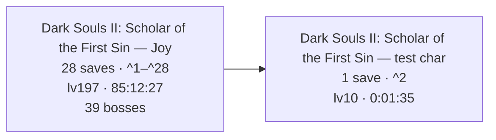
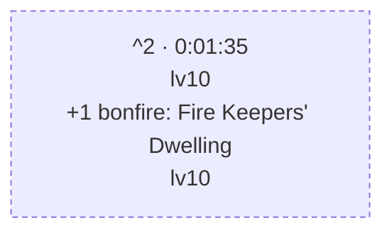

# Dark Souls II: Scholar of the First Sin — Corpus Timeline

This directory contains all 28 individual PC `.sl2` files in this collection.
They are the actual dataset; this README is the generated interpretation of
those files. Preserve a copy before loading or editing anything, and treat the
files as offline-only because Soul Memory and item-legitimacy checks can make
copied saves unsafe online.

**Collection setup:** Scholar of the First Sin on PC, Heroic,
GE-Proton11-3, Nobara 43. Its patch version was not independently retained and
is intentionally not guessed. DS2's inactive encrypted slot records remain
present because a safe trimming operation has not been verified.

---

# FromSoftware Saves — Combined Playthrough Timeline

_Reconstructed from 28 save files across 2 runs and 1 game: Dark Souls II: Scholar of the First Sin._

_Every timestamp is an UPPER BOUND, not the moment it happened: a thing is dated to the first save it appears in, so the real event is somewhere between the previous save and that one. This is a reconstruction from sparse backups, not a log._

---

## The Journey

_One box per character, in the order the files were last written — the only clock the games share, since a Dark Souls II play time and a Dark Souls III one are unrelated numbers._

---

## Dark Souls II: Scholar of the First Sin — Joy

_28 saves · lv127 → lv197 · 36:58:24 → 85:12:27 played · 77 bonfires · 39 bosses (38 still provable in the newest save, 1 carried from earlier)._

### Save Tree

_Each box is one save file, numbered as in the references at the end. A snapshot's parent is the latest earlier one whose progress it still entirely contains — event flags never clear, so a fork (the same save played on twice) lands both children on the shared ancestor._

_No forks, a dashed box is where a line stopped._

```mermaid
flowchart TD
  n0["^1 · 36:58:24<br/>lv127<br/>BOSS: Belfry Gargoyles · Covetous Demon +18 more<br/>KEY ITEM: Antiquated Key · Brightstone Key +16 more<br/>COVENANT: Bell Keepers · Brotherhood of Blood"]
  n1["^2 · 37:00:45<br/>lv127"]
  n2["^3 · 37:47:12<br/>lv129<br/>BOSS: Guardian Dragon<br/>+1 bonfire: Dragon Aerie<br/>lv127 → lv129"]
  n3["^4 · 39:10:28<br/>lv129<br/>KEY ITEM: Heavy Iron Key<br/>+2 bonfires: Shrine Entrance · Outer Wall"]
  n4["^5 · 40:09:57<br/>lv129<br/>KEY ITEM: Ashen Mist Heart"]
  n5["^6 · 40:10:25<br/>lv129"]
  n6["^7 · 40:11:27<br/>lv129"]
  n7["^8 · 40:25:47<br/>lv130<br/>lv129 → lv130"]
  n8["^9 · 40:26:22<br/>lv130"]
  n9["^10 · 41:15:50<br/>lv140<br/>BOSS: Giant Lord<br/>KEY ITEM: Giant's Kinship<br/>lv130 → lv140"]
  n10["^11 · 41:41:59<br/>lv155<br/>lv140 → lv155"]
  n11["^12 · 41:57:54<br/>lv155"]
  n12["^13 · 42:25:34<br/>lv155"]
  n13["^14 · 43:34:28<br/>lv155<br/>+5 bonfires"]
  n14["^15 · 44:15:25<br/>lv156<br/>+4 bonfires<br/>lv155 → lv156"]
  n15["^16 · 46:00:28<br/>lv157<br/>KEY ITEM: Bastille Key · Dragon Stone +1 more<br/>+2 bonfires: Priestess' Chamber · Tower of Prayer<br/>lv156 → lv157"]
  n16["^17 · 46:27:51<br/>lv159<br/>BOSS: Graverobber, Varg, and Cerah<br/>lv157 → lv159"]
  n17["^18 · 48:07:34<br/>lv159<br/>COVENANT: Dragon Remnants"]
  n18["^19 · 51:04:20<br/>lv163<br/>BOSS: Elana, the Squalid Queen · Sinh, the Slumbering Dragon<br/>KEY ITEM: Small Smooth & Silky Stone<br/>+6 bonfires"]
  n19["^20 · 54:06:12<br/>lv169<br/>BOSS: Aava, the King's Pet<br/>KEY ITEM: Garrison Ward Key · Smooth & Silky Stone<br/>+5 bonfires"]
  n20["^21 · 55:13:08<br/>lv171<br/>BOSS: Burnt Ivory King<br/>KEY ITEM: Tower Key<br/>+3 bonfires"]
  n21["^22 · 57:37:28<br/>lv179<br/>BOSS: Blue Smelter Demon · Fume Knight +1 more<br/>lv171 → lv179"]
  n22["^23 · 58:24:34<br/>lv179<br/>BOSS: Ancient Dragon<br/>COVENANT: Pilgrims of Dark"]
  n23["^24 · 74:14:20<br/>lv195<br/>BOSS: Darklurker · The Pursuer<br/>lv179 → lv195"]
  n24["^25 · 77:00:45<br/>lv196<br/>BOSS: Sir Alonne<br/>lv195 → lv196"]
  n25["^26 · 84:29:15<br/>lv196<br/>BOSS: Lud, the King's Pet · Zallen, the King's Pet"]
  n26["^27 · 84:43:19<br/>lv197<br/>BOSS: Nashandra · Throne Defender +1 more<br/>lv196 → lv197"]
  n27["^28 · 85:12:27<br/>lv197<br/>KEY ITEM: Ladder Miniature"]
  n0 --> n1
  n1 --> n2
  n2 --> n3
  n3 --> n4
  n4 --> n5
  n5 --> n6
  n6 --> n7
  n7 --> n8
  n8 --> n9
  n9 --> n10
  n10 --> n11
  n11 --> n12
  n12 --> n13
  n13 --> n14
  n14 --> n15
  n15 --> n16
  n16 --> n17
  n17 --> n18
  n18 --> n19
  n19 --> n20
  n20 --> n21
  n21 --> n22
  n22 --> n23
  n23 --> n24
  n24 --> n25
  n25 --> n26
  n26 --> n27
  classDef leaf stroke-dasharray:4 3;
  class n27 leaf;
```

### Current State — `Joy_85-12-27_lv197_361d_77bf_37b.sl2` (^28)

### Slot 2: Joy

- **Soul Level:** 197
- **Class:** Knight
- **Covenant:** Pilgrims of Dark
- **Sex:** Female
- **Playthrough:** New Game
- **Soul Memory:** 5,509,824  _(total souls earned — main progress metric)_
- **Play Time:** 85:12:27
- **Souls held:** 661
- **Max HP:** 2,145
- **Deaths:** 361
- **Build:** strength-focused melee

#### Attributes

| VGR | END | VIT | ATN | STR | DEX | ADP | INT | FTH |
|----|----|----|----|----|----|----|----|----|
| 50 | 40 | 40 | 4 | 60 | 12 | 34 | 4 | 6 |

<b>Attribute Scaling</b> — what each stat scales and its soft caps (game-mechanics reference, not read from this save)

- **Vigor** (50) — Max HP. Soft caps 20 & 50; +30 HP/lvl to 20, +20 to 50, +5 after.
- **Endurance** (40) — Stamina. Soft cap 20; +2 stamina/lvl to 20, +1 after.
- **Vitality** (40) — Equip load, physical defense, petrify resistance. Soft caps 29/49/70; +1.5 load/lvl to 29, +1 to 49, +0.5 to 69, +0.25 after.
- **Attunement** (4) — Attunement (spell) slots, casting speed. Slots at 10/13/16/20/25/30/40/50/60/75/94; cast-speed breakpoints 30/45/60/80.
- **Strength** (60) — Physical attack, strength-weapon scaling. Scaling soft caps 40 & 50.
- **Dexterity** (12) — Physical attack, dex-weapon scaling, casting speed. Scaling soft caps 40 & 50.
- **Adaptability** (34) — Agility (i-frames), poison/bleed/petrify resistance. Raises Agility (with Attunement); gains taper past ~40.
- **Intelligence** (4) — Magic & dark attack, sorcery/hex scaling. Scaling soft caps 40 & 50.
- **Faith** (6) — Lightning & dark attack, miracle/hex scaling. Scaling soft caps 40 & 50.

#### Derived Stats  _(computed from attributes — base values before rings & equipment; the in-game screen adds ring/gear bonuses on top)_

- **Stamina:** 140
- **Equip Load (max capacity):** 93.0
- **Attunement Slots:** 0
- **Agility (AGL):** 106  _(13 roll i-frames)_
- **Poise (base):** 9.8
- **ATK: Str:** 162
- **ATK: Dex:** 61
- **Magic DEF:** 24
- **Fire DEF:** 30
- **Lightning DEF:** 36
- **Dark DEF:** 24

#### Key Items  _(progress / areas & shortcuts unlocked)_

- Soul Vessel ×4
- Skeptic's Spice ×15
- Simpleton's Spice ×14
- Soul of a Giant ×5
- Small Smooth & Silky Stone ×6
- Smooth & Silky Stone ×10
- Lenigrast's Key
- Soldier Key
- House Key
- Antiquated Key
- Undead Lockaway Key
- Tseldora Den Key
- Brightstone Key
- Frozen Flower
- Key to King's Passage
- Iron Key
- Forgotten Key
- Dragon Talon
- Heavy Iron Key
- Ashen Mist Heart
- Giant's Kinship
- Bastille Key
- Eternal Sanctum Key
- Garrison Ward Key
- Ladder Miniature
- Tower Key

#### Bonfires Discovered (77 of 77, in 34 of 34 areas)  _(each bonfire the save records as discovered, by area — a floor)_

- Things Betwixt: 1/1 — Fire Keepers' Dwelling
- Majula: 1/1 — The Far Fire
- Forest of Fallen Giants: 4/4 — Cardinal Tower, Soldiers' Rest, The Crestfallen's Retreat, The Place Unbeknownst
- Shrine of Amana: 4/4 — Tower of Prayer, Crumbled Ruins, Rhoy's Resting Place, Rise of the Dead
- Brightstone Cove Tseldora: 3/3 — Lower Brightstone Cove, Royal Army Campsite, Chapel Threshold
- Aldia's Keep: 2/2 — Foregarden, Ritual Site
- The Lost Bastille: 5/5 — Straid's Cell, Exile Holding Cells, The Tower Apart, McDuff's Workshop, Servants' Quarters
- Belfry Luna: 1/1 — Upper Ramparts
- Sinners' Rise: 1/1 — The Saltfort
- Harvest Valley: 2/2 — The Mines, Poison Pool
- Earthen Peak: 3/3 — Lower Earthen Peak, Central Earthen Peak, Upper Earthen Peak
- No-Man's Wharf: 1/1 — Unseen Path to Heide
- Iron Keep: 3/3 — Ironhearth Hall, Threshold Bridge, Eygil's Idol
- Belfry Sol: 1/1 — Belfry Sol Approach
- Drangleic Castle: 4/4 — King's Gate, Central Castle Drangleic, Forgotten Chamber, Under Castle Drangleic
- Huntsman's Copse: 3/3 — Undead Refuge, Bridge Approach, Undead Lockaway
- Undead Purgatory: 1/1 — Undead Purgatory
- Undead Crypt: 2/2 — Undead Ditch, Undead Crypt Entrance
- Black Gulch: 2/2 — Black Gulch Mouth, Hidden Chamber
- The Gutter: 2/2 — Central Gutter, Upper Gutter
- Dragon Aerie: 1/1 — Dragon Aerie
- Dragon Shrine: 1/1 — Shrine Entrance
- Shaded Woods: 3/3 — Old Akelarre, Ruined Fork Road, Shaded Ruins
- Heide's Tower of Flame: 2/2 — Tower of Flame, Heide's Ruin
- Cathedral of Blue: 1/1 — The Blue Cathedral
- Doors of Pharros: 2/2 — Gyrm's Respite, Ordeal's End
- Grave of Saints: 2/2 — Grave Entrance, Harval's Resting Place
- Shulva, Sanctum City: 3/3 — Sanctum Walk, Priestess' Chamber, Tower of Prayer
- Dragon's Rest: 1/1 — Sanctum Nadir
- Dragon's Sanctum: 3/3 — Hidden Sanctum Chamber, Lair of the Imperfect, Sanctum Interior
- Brume Tower: 5/5 — Throne Floor, Foyer, Upper Floor, Lowermost Floor, The Smelter Throne
- Iron Passage: 1/1 — Iron Hallway Entrance
- Frozen Eleum Loyce: 5/5 — Outer Wall, Abandoned Dwelling, Lower Garrison, Expulsion Chamber, Inner Wall
- Grand Cathedral: 1/1 — Grand Cathedral

#### Covenants Found (5 of 9)  _(discovered — a floor; the one currently worn is the Covenant field above)_

- **Brotherhood of Blood:** discovered
- **Way of Blue:** rank 3 of 3
- **Bell Keepers:** discovered
- **Dragon Remnants:** discovered
- **Pilgrims of Dark:** rank 3 of 3

_Not found yet: Blue Sentinels · Company of Champions · Heirs of the Sun · Rat King._

#### Bosses Defeated (38 of 39 tracked)  _(a floor — from defeat flags, held boss souls, progression, and NG+ clears; a boss whose soul was consumed and isn't gated may still be missing)_

- Aava, the King's Pet  _(soul held)_
- Ancient Dragon  _(soul held)_
- Belfry Gargoyles  _(soul held)_
- Blue Smelter Demon  _(progression)_
- Burnt Ivory King  _(soul held)_
- Covetous Demon  _(soul held)_
- Darklurker  _(confirmed, soul held)_
- Demon of Song  _(progression, soul held)_
- Dragonrider  _(progression)_
- Elana, the Squalid Queen  _(soul held)_
- Executioner's Chariot  _(confirmed, soul held)_
- Flexile Sentry  _(soul held)_
- Fume Knight  _(soul held)_
- Giant Lord  _(confirmed, soul held)_
- Graverobber, Varg, and Cerah  _(progression)_
- Guardian Dragon  _(soul held)_
- Looking Glass Knight  _(progression, soul held)_
- Lud, the King's Pet  _(soul held)_
- Mytha, the Baneful Queen  _(soul held)_
- Nashandra  _(soul held)_
- Old Dragonslayer  _(soul held)_
- Old Iron King  _(soul held)_
- Royal Rat Vanguard  _(soul held)_
- Ruin Sentinels  _(soul held)_
- Scorpioness Najka  _(soul held)_
- Sinh, the Slumbering Dragon  _(soul held)_
- Sir Alonne  _(soul held)_
- Skeleton Lords  _(soul held)_
- Smelter Demon  _(soul held)_
- The Duke's Dear Freja  _(soul held)_
- The Last Giant  _(confirmed, soul held)_
- The Lost Sinner  _(soul held)_
- The Pursuer  _(soul held)_
- The Rotten  _(confirmed, soul held)_
- Throne Defender  _(progression, soul held)_
- Throne Watcher  _(progression, soul held)_
- Velstadt, the Royal Aegis  _(confirmed, progression, soul held)_
- Zallen, the King's Pet  _(soul held)_

_No evidence yet: Royal Rat Authority._

#### Inventory

##### Weapons

- Broadsword ×3
- Mirrah Shield
- Dagger
- Foot Soldier Sword ×2
- Short Bow ×2
- Sorcerer's Staff
- Winged Spear ×3
- Longsword
- Blue Wooden Shield
- Large Leather Shield
- Silverblack Shield
- Fire Longsword +6
- Crimson Parma
- Broken Thief Sword
- Grand Lance
- Winged Spear +7
- Pate's Spear
- Light Crossbow
- Mail Breaker
- Greatsword
- Hand Axe
- Small Leather Shield
- Magic Mace
- Craftsman's Hammer
- Drakekeeper's Greataxe
- Bone Staff
- Parrying Dagger ×2
- Twinblade
- Drangleic Sword
- Drangleic Shield
- Halberd ×2
- Zweihander
- Greataxe +7
- Broken Straight Sword
- Great Club
- Caestus
- Morning Star ×2
- Dragonslayer's Crescent Axe
- Golden Falcon Shield
- Cleric's Sacred Chime
- Binoculars
- Shotel
- Dark Scythe
- Manikin Knife ×2
- Black Knight Halberd
- Target Shield
- Large Club
- Priest's Chime
- Bandit's Knife
- Sanctum Crossbow ×2
- Silverblack Spear
- Pike
- Gyrm Axe
- Giant Stone Axe
- Lightning Gyrm Great Hammer +10
- Pursuer's Ultra Greatsword
- Avelyn
- Bell Keeper Bow
- Blacksteel Katana
- Llewellyn Shield
- Black Knight Greataxe
- Lightning Short Bow +5
- Dragon Tooth ×2
- Enchanted Falchion
- Mastodon Greatsword
- Notched Whip
- Old Knight Hammer
- Caitha's Chime
- Washing Pole
- Long Bow
- Cleric's Parma ×2
- Blacksmith's Hammer
- Bastard Sword
- Whip
- Slumbering Dragon Shield
- Archdrake Mace
- Red Iron Twinblade
- Staff of Amana
- Witchtree Branch
- Witchtree Bellvine
- Syan's Halberd ×2
- Magic Shield
- Mace of the Insolent
- Blue Flame Sword ×2
- Smelter Sword
- Drakeblood Greatsword
- Old Whip ×4
- Demon's Great Hammer ×2
- Giant Warrior Club +10
- Royal Dirk
- Espada Ropera
- Hunter's Blackbow
- Sanctum Mace
- Long Bow +7
- Puzzling Stone Sword
- Sanctum Shield
- Melu Scimitar
- Varangian Shield
- Pyromancy Flame
- Varangian Sword
- Bandit Axe
- Handmaid's Ladle
- Scythe +7
- Vessel Shield
- Retainer Staff
- Retainer's Short Sword ×3
- Sorcerer's Twinblade
- Curved Nil Greatsword
- Charred Loyce Greatsword
- Large Club +8
- Azal's Staff
- Alonne Greatbow +5
- Majestic Greatsword
- Partizan +6
- Twinblade +7
- Staff of Wisdom
- Black Knight Ultra Greatsword
- Dragon Chime
- Heavy Crossbow
- Malformed Skull
- Lightning Short Bow +1
- Iron Parma
- Silver Eagle Kite Shield

##### Armor

- Imported Hood
- Imported Tunic
- Imported Manchettes
- Imported Trousers
- Hollow Soldier Gauntlets ×9
- Falconer Armor ×3
- Falconer Gloves
- Falconer Boots ×4
- Alonne Knight Helm +5
- Ironclad Helm
- Varangian Leggings ×2
- Hollow Soldier Helm ×4
- Hollow Soldier Armor ×2
- Tattered Cloth Robe ×2
- Tseldora Cap +2
- Tseldora Robe +2
- Tseldora Manchettes +2
- Tseldora Trousers +2
- Flower Skirt
- Alonne Knight Armor ×5
- Hollow Infantry Gloves
- Prisoner's Tatters ×4
- Infantry Helm
- Hollow Infantry Armor
- Tattered Cloth Hood
- Hunter's Hat
- Varangian Armor ×2
- Wanderer Coat
- Wanderer Manchettes
- Wanderer Boots
- Old Knight Armor
- Tattered Cloth Manchettes
- Drangleic Mail +5
- Drangleic Gauntlets +5
- Drangleic Leggings +5
- Blossom Kite Shield ×2
- Prisoner's Hood ×5
- Rogue Armor
- Royal Swordsman Leggings ×2
- Heavy Boots
- Royal Swordsman Armor ×3
- Royal Swordsman Helm +1
- Prisoner's Gloves
- Wicked Eye Greatshield
- Drakekeeper's Greatshield
- Prisoner's Waistcloth ×5
- Royal Swordsman Gloves ×2
- Alonne Knight Leggings ×8
- Royal Swordsman Helm ×3
- Manikin Mask
- Ironclad Armor ×2
- Rogue Leggings
- Grave Warden Top ×2
- Rogue Hood
- Manikin Top
- Alonne Knight Helm ×7
- Desert Sorceress Skirt
- Drangleic Helm
- Rusted Mastodon Helm
- Alonne Knight Gauntlets ×6
- Gyrm Warrior Helm
- Peasant Attire
- Alonne Captain Armor
- Ironclad Gauntlets
- Orma's Greatshield
- Syan's Gauntlets
- Desert Sorceress Top
- Imperious Armor
- Tower Shield
- Dragon Acolyte Mask
- Archdrake Boots ×2
- Archdrake Robes
- Archdrake Helm
- Imperious Gloves
- Leydia White Hood
- Syan's Helm
- Syan's Armor
- Rebel's Greatshield +5
- Bone Shield
- Mask of Judgment
- Robe of Judgment
- Manchettes of Judgment
- Tights of Judgment
- Drakekeeper Gauntlets
- Drakekeeper Helm
- Vengarl's Armor +2
- Vengarl's Gloves +1
- Vengarl's Boots +1
- Vengarl's Helm +5
- Drakekeeper Boots
- Llewellyn Armor
- Llewellyn Gloves
- Llewellyn Shoes
- Ruin Gauntlets
- Ruin Armor
- Faraam Helm
- Faraam Armor
- Faraam Gauntlets
- Faraam Boots
- Catarina Helm
- Drakeblood Helm
- Drakeblood Armor
- Flying Feline Boots
- Thief Mask
- Black Leather Armor
- Black Leather Gloves
- Black Leather Boots
- Brigand Hood
- Brigand Armor
- Brigand Gauntlets
- Brigand Trousers
- Rampart Golem Leggings
- Drakeblood Gauntlets
- Varangian Cuffs
- Sanctum Knight Helm
- Drakeblood Leggings
- Crown of the Sunken King
- Crown of the Ivory King
- Northwarder Hood
- Northwarder Robe
- Northwarder Manchettes
- Northwarder Trousers
- Old Bell Helm
- Symbol of Avarice
- Retainer Robe
- Mirrah Hat
- Mad Warrior Mask
- Mad Warrior Leggings
- Crown of the Old Iron King
- Imperious Helm
- Pharros Mask
- Dark Leggings
- King's Crown +5
- King's Armor
- King's Gauntlets
- King's Leggings
- Durgo's Hat
- Rampart Golem Armor
- Xanthous Crown
- Xanthous Overcoat
- Xanthous Gloves
- Xanthous Waistcloth
- Engraved Gauntlets
- Peasant Trousers +5
- Twin Dragon Greatshield
- Standard Helm
- Hard Leather Armor
- Hard Leather Gauntlets
- Hard Leather Boots
- Infantry Armor
- Infantry Gloves
- Infantry Boots
- Falconer Helm
- Raime's Leggings
- Raime's Gauntlets
- Raime's Armor
- Raime's Helm
- Alonne's Leggings
- Alonne's Gauntlets
- Alonne's Armor
- Alonne's Helm
- Bandit Boots
- Bandit Gauntlets
- Bandit Armor
- Spiked Bandit Helm
- Jester's Tights
- Jester's Gloves
- Jester's Robes
- Jester's Cap

##### Rings

- Blue Seal
- Life Ring
- Stone Ring
- Ring of Binding
- Life Ring+1
- Ring of Restoration
- Chloranthy Ring
- Silvercat Ring
- Ring of Blades ×2
- Covetous Silver Serpent Ring
- Ash Knuckle Ring
- Northern Ritual Band
- Covetous Silver Serpent Ring+1
- Ring of Steel Protection+1
- Red Tearstone Ring
- Clear Bluestone Ring+1
- Chloranthy Ring+1
- Second Dragon Ring
- White Ring
- Ring of the Evil Eye
- Redeye Ring
- Ring of Whispers
- Poisonbite Ring
- Blue Tearstone Ring
- Flame Quartz Ring
- Southern Ritual Band
- Covetous Gold Serpent Ring+1
- Northern Ritual Band+2
- Thunder Quartz Ring+1
- Bell Keeper's Seal
- Royal Soldier's Ring+1
- Covetous Gold Serpent Ring
- Dark Quartz Ring+1 ×2
- Gower's Ring of Protection
- Spell Quartz Ring+2
- Thunder Quartz Ring
- Old Leo Ring
- Crest of Blood
- Ring of Giants+1
- Ring of the Dead
- Ring of Thorns+1
- King's Ring
- Dark Quartz Ring
- Ring of the Evil Eye+1
- Flame Quartz Ring+1
- Hawk Ring
- Ring of Giants+2 ×3
- Third Dragon Ring
- Simpleton's Ring
- Bracing Knuckle Ring+1
- Ring of Steel Protection
- Poisonbite Ring+1
- Dark Quartz Ring+3
- Bloodbite Ring+1
- Lightning Clutch Ring
- Name-engraved Ring
- Ancient Dragon Seal
- Cursebite Ring
- Flynn's Ring
- Yorgh's Ring
- Dexterity Ring
- Flame Quartz Ring+3
- Spell Quartz Ring+3
- Ring of Resistance+1
- Fire Clutch Ring
- Strength Ring
- Sorcery Clutch Ring
- Abyss Seal

##### Spells

- Great Soul Arrow ×15
- Emit Force ×4
- Great Magic Barrier
- Lingering Flame ×4
- Dark Greatsword ×3
- Great Heal ×3
- Dark Fog ×4
- Combustion ×10
- Great Magic Weapon ×3
- Hush ×10
- Scraps of Life ×4
- Twisted Barricade ×20
- Soul Spear ×2
- Immolation ×8
- Soul Greatsword ×3
- Firestorm ×4
- Strong Magic Shield ×4
- Soul Bolt ×3
- Great Lightning Spear ×2
- Soul Vortex ×4
- Soul Geyser
- Crystal Magic Weapon
- Focus Souls ×2
- Fireball ×8
- Denial
- Dance of Fire ×3
- Soul Flash ×4
- Recollection ×6
- Great Fireball ×6
- Homing Soulmass ×4
- Resonant Soul ×20
- Fire Snake ×2
- Great Resonant Soul ×4
- Splintering Lightning Spear ×2
- Climax ×3
- Soul Arrow ×30
- Fall Control ×10
- Heavy Soul Arrow ×20

##### Ammunition

- Fire Arrow ×16
- Heavy Bolt ×10
- Lacerating Arrow
- Magic Bolt ×10
- Iron Greatarrow ×15
- Destructive Greatarrow ×63
- Dark Arrow
- Fire Greatarrow ×10
- Iron Arrow ×90
- Magic Arrow ×83
- Lightning Arrow ×106
- Poison Arrow ×15

##### Upgrade Materials

- Titanite Shard ×9
- Titanite Slab ×15
- Bleed Stone ×6
- Titanite Chunk ×17
- Petrified Dragon Bone ×37
- Palestone ×4
- Poison Stone ×3
- Old Mundane Stone ×3
- Large Titanite Shard ×26
- Magic Stone ×9
- Darknight Stone ×2
- Boltstone ×7
- Raw Stone ×3
- Faintstone ×5
- Firedrake Stone ×3
- Twinkling Titanite ×19

##### Consumables

- Darksign
- Human Effigy ×35
- Amber Herb ×21
- Estus Flask (10/10 charges)
- Homeward Bone ×15
- Rusted Coin ×23
- Rubbish ×2
- Repair Powder ×7
- Lloyd's Talisman ×17
- Silver Talisman ×17
- Twilight Herb ×13
- Monastery Charm ×3
- Pharros' Lockstone ×5
- Alluring Skull ×20
- Flame Butterfly ×17
- Common Fruit ×4
- Fragrant Branch of Yore ×3
- Throwing Knife ×29
- Lacerating Knife ×45
- Wilted Dusk Herb ×14
- Poison Throwing Knife ×41
- Brightbug ×5
- Blackweed Balm ×5
- Rotten Pine Resin ×4
- Prism Stone ×41
- Crimson Water ×4
- Firebomb ×49
- Elizabeth Mushroom
- Rouge Water ×4
- Small Blue Burr ×14
- Small Yellow Burr ×7
- Bonfire Ascetic ×19
- Dragon Charm ×2
- Red Leech Troches
- Charcoal Pine Resin ×6
- Triclops Snake Troches ×6
- Corrosive Urn ×16
- Poison Moss ×3
- Divine Blessing ×3
- Fire Seed ×12
- Black Firebomb ×3
- Aged Feather
- Dark Pine Resin
- Seed Of A Tree Of Giants
- Goldenfruit Balm ×15
- Hexing Urn ×10
- Soul of Nadalia, Bride of Ash ×11
- Old Growth Balm ×15
- Dried Root ×5
- Witching Urn
- Aromatic Ooze
- Bleeding Serum ×4
- Lifegem ×30
- Dung Pie ×11
- Holy Water Urn ×8
- Vine Balm ×6
- Green Blossom
- Small Orange Burr ×4
- Gold Pine Resin ×9
- Hello Carving
- Thank You Carving
- I'm Sorry Carving
- Very Good! Carving
- Lightning Urn ×10
- Smelter Wedge
- Eye of the Priestess

##### Summon & Covenant Items

- Black Separation Crystal
- Bone of Order
- Cracked Blue Eye Orb ×9
- Small White Sign Soapstone
- White Sign Soapstone
- Rat Tail ×2
- Token of Spite
- Sunlight Medal
- Cracked Red Eye Orb ×21
- Dragon Scale ×2
- Dried Fingers
- Dragon Eye

##### Great Boss Souls

- Old Witch Soul
- Old King Soul
- Old Paledrake Soul
- Old Dead One Soul

##### Boss Souls

- Old Iron King Soul
- Flexile Sentry Soul
- Royal Rat Vanguard Soul
- Ruin Sentinel Soul
- Soul of the Lost Sinner
- Soul of the Rotten
- Skeleton Lord's Soul
- Mytha, the Baneful Queen Soul
- Giant Lord Soul
- Covetous Demon Soul
- Scorpioness Najka Soul
- Belfry Gargoyle Soul
- Soul of the Duke's Dear Freja ×2
- Throne Defender Soul
- Executioner's Chariot Soul
- Looking Glass Knight Soul
- Old Dragonslayer Soul
- Guardian Dragon Soul
- Demon of Song Soul
- Soul of Velstadt
- Soul of the Ivory King
- Soul of Elana, Squalid Queen
- Soul of Sinh, the Slumbering Dragon
- Soul of Aava, the King's Pet
- Loyce Soul
- Soul of the Fume Knight
- Smelter Demon Soul
- Ancient Dragon Soul
- Soul of the King
- Darklurker Soul
- Soul of the Last Giant
- Soul of the Pursuer
- Soul of Sir Alonne
- Soul of Lud, the King's Pet
- Soul of Zallen, the King's Pet
- Throne Watcher Soul
- Soul of Nashandra

##### Gestures

- "Point" Gesture
- "I won't bite" Gesture
- "Bow" Gesture
- "Wave" Gesture
- "Pumped up" Gesture
- "Warcry" Gesture
- "Righty-ho!" Gesture
- "No way" Gesture
- "Fist pump" Gesture
- "Mock" Gesture
- "Prostration" Gesture
- "Have mercy!" Gesture
- "Warmup" Gesture
- "Decapitate" Gesture
- "Hurrah!" Gesture
- "This one's me" Gesture
- "Welcome" Gesture

_1 inventory item(s) had IDs not in the name database (upgraded / infused variants) and were omitted._

### Bosses Carried Forward

_Proven by an EARLIER save on this line and not by the newest one. A held boss soul is proof of a kill, and spending the soul destroys the proof — but a kill is permanent, so the evidence stands. Only this save's own ancestors count; a boss killed on a different branch was never killed here._

| Boss | Evidence | Proven in | Play Time |
|---|---|---|---|
| Royal Rat Authority | soul held | ^9 | 40:26:22 |

### Timeline

#### Bosses — first appearance

| Play Time | Lv | Boss | Evidence | Save |
|---|---|---|---|---|
| 36:58:24 | 127 | Belfry Gargoyles | soul held | ^1 |
| 36:58:24 | 127 | Covetous Demon | soul held | ^1 |
| 36:58:24 | 127 | Demon of Song | progression, soul held | ^1 |
| 36:58:24 | 127 | Dragonrider | progression | ^1 |
| 36:58:24 | 127 | Executioner's Chariot | confirmed, soul held | ^1 |
| 36:58:24 | 127 | Flexile Sentry | soul held | ^1 |
| 36:58:24 | 127 | Looking Glass Knight | progression, soul held | ^1 |
| 36:58:24 | 127 | Mytha, the Baneful Queen | soul held | ^1 |
| 36:58:24 | 127 | Old Dragonslayer | soul held | ^1 |
| 36:58:24 | 127 | Old Iron King | soul held | ^1 |
| 36:58:24 | 127 | Royal Rat Authority | soul held | ^1 |
| 36:58:24 | 127 | Royal Rat Vanguard | soul held | ^1 |
| 36:58:24 | 127 | Ruin Sentinels | soul held | ^1 |
| 36:58:24 | 127 | Scorpioness Najka | soul held | ^1 |
| 36:58:24 | 127 | Skeleton Lords | soul held | ^1 |
| 36:58:24 | 127 | The Duke's Dear Freja | soul held | ^1 |
| 36:58:24 | 127 | The Last Giant | confirmed | ^1 |
| 36:58:24 | 127 | The Lost Sinner | soul held | ^1 |
| 36:58:24 | 127 | The Rotten | confirmed, soul held | ^1 |
| 36:58:24 | 127 | Velstadt, the Royal Aegis | confirmed, progression, soul held | ^1 |
| 37:47:12 | 129 | Guardian Dragon | soul held | ^3 |
| 41:15:50 | 140 | Giant Lord | confirmed, soul held | ^10 |
| 46:27:51 | 159 | Graverobber, Varg, and Cerah | progression | ^17 |
| 51:04:20 | 163 | Elana, the Squalid Queen | soul held | ^19 |
| 51:04:20 | 163 | Sinh, the Slumbering Dragon | soul held | ^19 |
| 54:06:12 | 169 | Aava, the King's Pet | soul held | ^20 |
| 55:13:08 | 171 | Burnt Ivory King | soul held | ^21 |
| 57:37:28 | 179 | Blue Smelter Demon | progression | ^22 |
| 57:37:28 | 179 | Fume Knight | soul held | ^22 |
| 57:37:28 | 179 | Smelter Demon | soul held | ^22 |
| 58:24:34 | 179 | Ancient Dragon | soul held | ^23 |
| 74:14:20 | 195 | Darklurker | confirmed, soul held | ^24 |
| 74:14:20 | 195 | The Pursuer | soul held | ^24 |
| 77:00:45 | 196 | Sir Alonne | soul held | ^25 |
| 84:29:15 | 196 | Lud, the King's Pet | soul held | ^26 |
| 84:29:15 | 196 | Zallen, the King's Pet | soul held | ^26 |
| 84:43:19 | 197 | Nashandra | soul held | ^27 |
| 84:43:19 | 197 | Throne Defender | progression, soul held | ^27 |
| 84:43:19 | 197 | Throne Watcher | progression, soul held | ^27 |

#### Covenants — first found

| Play Time | Lv | Covenant | Progress | Save |
|---|---|---|---|---|
| 36:58:24 | 127 | Brotherhood of Blood | discovered | ^1 |
| 36:58:24 | 127 | Way of Blue | rank 3 of 3 | ^1 |
| 36:58:24 | 127 | Bell Keepers | discovered | ^1 |
| 48:07:34 | 159 | Dragon Remnants | discovered | ^18 |
| 58:24:34 | 179 | Pilgrims of Dark | rank 1 of 3 | ^23 |

#### Bonfires — first lit

**36:58:24 · lv127 · ^1** — 49 total (+49)

- Aldia's Keep: Foregarden
- Belfry Luna: Upper Ramparts
- Belfry Sol: Belfry Sol Approach
- Black Gulch: Black Gulch Mouth
- Black Gulch: Hidden Chamber
- Brightstone Cove Tseldora: Chapel Threshold
- Brightstone Cove Tseldora: Lower Brightstone Cove
- Brightstone Cove Tseldora: Royal Army Campsite
- Cathedral of Blue: The Blue Cathedral
- Doors of Pharros: Gyrm's Respite
- Doors of Pharros: Ordeal's End
- Drangleic Castle: Central Castle Drangleic
- Drangleic Castle: King's Gate
- Earthen Peak: Central Earthen Peak
- Earthen Peak: Lower Earthen Peak
- Forest of Fallen Giants: Cardinal Tower
- Forest of Fallen Giants: Soldiers' Rest
- Forest of Fallen Giants: The Crestfallen's Retreat
- Forest of Fallen Giants: The Place Unbeknownst
- Grave of Saints: Grave Entrance
- Grave of Saints: Harval's Resting Place
- Harvest Valley: The Mines
- Heide's Tower of Flame: Heide's Ruin
- Heide's Tower of Flame: Tower of Flame
- Huntsman's Copse: Bridge Approach
- Huntsman's Copse: Undead Lockaway
- Huntsman's Copse: Undead Refuge
- Iron Keep: Eygil's Idol
- Iron Keep: Ironhearth Hall
- Iron Keep: Threshold Bridge
- Majula: The Far Fire
- No-Man's Wharf: Unseen Path to Heide
- Shaded Woods: Old Akelarre
- Shaded Woods: Ruined Fork Road
- Shaded Woods: Shaded Ruins
- Shrine of Amana: Crumbled Ruins
- Shrine of Amana: Rhoy's Resting Place
- Shrine of Amana: Tower of Prayer
- Sinners' Rise: The Saltfort
- The Gutter: Upper Gutter
- The Lost Bastille: Exile Holding Cells
- The Lost Bastille: McDuff's Workshop
- The Lost Bastille: Servants' Quarters
- The Lost Bastille: Straid's Cell
- The Lost Bastille: The Tower Apart
- Things Betwixt: Fire Keepers' Dwelling
- Undead Crypt: Undead Crypt Entrance
- Undead Crypt: Undead Ditch
- Undead Purgatory: Undead Purgatory

**37:47:12 · lv129 · ^3** — 50 total (+1)

- Dragon Aerie: Dragon Aerie

**39:10:28 · lv129 · ^4** — 52 total (+2)

- Dragon Shrine: Shrine Entrance
- Frozen Eleum Loyce: Outer Wall

**43:34:28 · lv155 · ^14** — 57 total (+5)

- Brume Tower: Throne Floor
- Drangleic Castle: Forgotten Chamber
- Drangleic Castle: Under Castle Drangleic
- Harvest Valley: Poison Pool
- Shulva, Sanctum City: Sanctum Walk

**44:15:25 · lv156 · ^15** — 61 total (+4)

- Aldia's Keep: Ritual Site
- Earthen Peak: Upper Earthen Peak
- Shrine of Amana: Rise of the Dead
- The Gutter: Central Gutter

**46:00:28 · lv157 · ^16** — 63 total (+2)

- Shulva, Sanctum City: Priestess' Chamber
- Shulva, Sanctum City: Tower of Prayer

**51:04:20 · lv163 · ^19** — 69 total (+6)

- Brume Tower: Foyer
- Brume Tower: Upper Floor
- Dragon's Rest: Sanctum Nadir
- Dragon's Sanctum: Hidden Sanctum Chamber
- Dragon's Sanctum: Lair of the Imperfect
- Dragon's Sanctum: Sanctum Interior

**54:06:12 · lv169 · ^20** — 74 total (+5)

- Frozen Eleum Loyce: Abandoned Dwelling
- Frozen Eleum Loyce: Expulsion Chamber
- Frozen Eleum Loyce: Inner Wall
- Frozen Eleum Loyce: Lower Garrison
- Grand Cathedral: Grand Cathedral

**55:13:08 · lv171 · ^21** — 77 total (+3)

- Brume Tower: Lowermost Floor
- Brume Tower: The Smelter Throne
- Iron Passage: Iron Hallway Entrance

---

## Dark Souls II: Scholar of the First Sin — test char

_1 save · lv10 → lv10 · 0:01:35 → 0:01:35 played · 1 bonfire._

### Save Tree

_Each box is one save file, numbered as in the references at the end. A snapshot's parent is the latest earlier one whose progress it still entirely contains — event flags never clear, so a fork (the same save played on twice) lands both children on the shared ancestor._

_No forks, a dashed box is where a line stopped._

### Current State — `Joy_37-00-45_lv127_181d_49bf_19b.sl2` (^2)

### Slot 1: test char

- **Soul Level:** 10
- **Class:** Explorer
- **Sex:** Male
- **Playthrough:** New Game
- **Soul Memory:** 0  _(total souls earned — main progress metric)_
- **Play Time:** 0:01:35
- **Souls held:** 0
- **Max HP:** 822
- **Deaths:** 0
- **Build:** caster / hybrid (high INT/FTH/ATN)

#### Attributes

| VGR | END | VIT | ATN | STR | DEX | ADP | INT | FTH |
|----|----|----|----|----|----|----|----|----|
| 7 | 6 | 9 | 7 | 6 | 6 | 12 | 5 | 5 |

<b>Attribute Scaling</b> — what each stat scales and its soft caps (game-mechanics reference, not read from this save)

- **Vigor** (7) — Max HP. Soft caps 20 & 50; +30 HP/lvl to 20, +20 to 50, +5 after.
- **Endurance** (6) — Stamina. Soft cap 20; +2 stamina/lvl to 20, +1 after.
- **Vitality** (9) — Equip load, physical defense, petrify resistance. Soft caps 29/49/70; +1.5 load/lvl to 29, +1 to 49, +0.5 to 69, +0.25 after.
- **Attunement** (7) — Attunement (spell) slots, casting speed. Slots at 10/13/16/20/25/30/40/50/60/75/94; cast-speed breakpoints 30/45/60/80.
- **Strength** (6) — Physical attack, strength-weapon scaling. Scaling soft caps 40 & 50.
- **Dexterity** (6) — Physical attack, dex-weapon scaling, casting speed. Scaling soft caps 40 & 50.
- **Adaptability** (12) — Agility (i-frames), poison/bleed/petrify resistance. Raises Agility (with Attunement); gains taper past ~40.
- **Intelligence** (5) — Magic & dark attack, sorcery/hex scaling. Scaling soft caps 40 & 50.
- **Faith** (5) — Lightning & dark attack, miracle/hex scaling. Scaling soft caps 40 & 50.

#### Derived Stats  _(computed from attributes — base values before rings & equipment; the in-game screen adds ring/gear bonuses on top)_

- **Stamina:** 92
- **Equip Load (max capacity):** 52.0
- **Attunement Slots:** 0
- **Agility (AGL):** 90  _(9 roll i-frames)_
- **Poise (base):** 1.8
- **ATK: Str:** 54
- **ATK: Dex:** 54
- **Magic DEF:** 30
- **Fire DEF:** 30
- **Lightning DEF:** 30
- **Dark DEF:** 30

#### Bonfires Discovered (1 of 77, in 1 of 34 areas)  _(each bonfire the save records as discovered, by area — a floor)_

- Things Betwixt: 1/1 — Fire Keepers' Dwelling
- Majula: 0/1
- Forest of Fallen Giants: 0/4
- Shrine of Amana: 0/4
- Brightstone Cove Tseldora: 0/3
- Aldia's Keep: 0/2
- The Lost Bastille: 0/5
- Belfry Luna: 0/1
- Sinners' Rise: 0/1
- Harvest Valley: 0/2
- Earthen Peak: 0/3
- No-Man's Wharf: 0/1
- Iron Keep: 0/3
- Belfry Sol: 0/1
- Drangleic Castle: 0/4
- Huntsman's Copse: 0/3
- Undead Purgatory: 0/1
- Undead Crypt: 0/2
- Black Gulch: 0/2
- The Gutter: 0/2
- Dragon Aerie: 0/1
- Dragon Shrine: 0/1
- Shaded Woods: 0/3
- Heide's Tower of Flame: 0/2
- Cathedral of Blue: 0/1
- Doors of Pharros: 0/2
- Grave of Saints: 0/2
- Shulva, Sanctum City: 0/3
- Dragon's Rest: 0/1
- Dragon's Sanctum: 0/3
- Brume Tower: 0/5
- Iron Passage: 0/1
- Frozen Eleum Loyce: 0/5
- Grand Cathedral: 0/1

#### Inventory

##### Weapons

- Dagger

##### Armor

- Imported Hood
- Imported Tunic
- Imported Manchettes
- Imported Trousers
- Traveling Merchant Hat
- Traveling Merchant Coat
- Traveling Merchant Gloves
- Traveling Merchant Boots

##### Rings

- Spell Quartz Ring

##### Ammunition

- Wood Bolt ×20

##### Consumables

- Darksign
- Seed Of A Tree Of Giants
- Lifegem ×20
- Witching Urn ×8
- Aromatic Ooze ×4
- Prism Stone ×5
- Rusted Coin ×2
- Repair Powder
- Pharros' Lockstone

##### Summon & Covenant Items

- Black Separation Crystal
- Bone of Order

##### Gestures

- "Point" Gesture
- "I won't bite" Gesture
- "Bow" Gesture
- "Wave" Gesture
- "Pumped up" Gesture
- "Warcry" Gesture
- "Righty-ho!" Gesture
- "No way" Gesture

### Timeline

#### Bonfires — first lit

**0:01:35 · lv10 · ^2** — 1 total (+1)

- Things Betwixt: Fire Keepers' Dwelling

---

## References

_Every node above is one save file. Numbered earliest to latest by file date._

^1: [[Joy_36-58-24_lv127_181d_49bf_19b.sl2]] — _2026-09-28 00:43_
^2: [[Joy_37-00-45_lv127_181d_49bf_19b.sl2]] — _2026-09-28 00:43_
^3: [[Joy_37-47-12_lv129_183d_50bf_20b.sl2]] — _2026-09-28 00:43_
^4: [[Joy_39-10-28_lv129_195d_52bf_20b.sl2]] — _2026-09-28 00:43_
^5: [[Joy_40-09-57_lv129_201d_52bf_20b.sl2]] — _2026-09-28 00:43_
^6: [[Joy_40-10-25_lv129_201d_52bf_20b_Male.sl2]] — _2026-09-28 00:43_
^7: [[Joy_40-11-27_lv129_201d_52bf_20b_Male.sl2]] — _2026-09-28 00:43_
^8: [[Joy_40-25-47_lv130_201d_52bf_20b.sl2]] — _2026-09-28 00:43_
^9: [[Joy_40-26-22_lv130_202d_52bf_20b.sl2]] — _2026-09-28 00:43_
^10: [[Joy_41-15-50_lv140_207d_52bf_20b.sl2]] — _2026-09-28 00:43_
^11: [[Joy_41-41-59_lv155_210d_52bf_20b.sl2]] — _2026-09-28 00:43_
^12: [[Joy_41-57-54_lv155_213d_52bf_20b.sl2]] — _2026-09-28 00:43_
^13: [[Joy_42-25-34_lv155_224d_52bf_20b.sl2]] — _2026-09-28 00:43_
^14: [[Joy_43-34-28_lv155_229d_57bf_20b.sl2]] — _2026-09-28 00:43_
^15: [[Joy_44-15-25_lv156_229d_61bf_20b.sl2]] — _2026-09-28 00:43_
^16: [[Joy_46-00-28_lv157_236d_63bf_20b.sl2]] — _2026-09-28 00:43_
^17: [[Joy_46-27-51_lv159_237d_63bf_20b.sl2]] — _2026-09-28 00:43_
^18: [[Joy_48-07-34_lv159_239d_63bf_20b.sl2]] — _2026-09-28 00:43_
^19: [[Joy_51-04-20_lv163_249d_69bf_22b.sl2]] — _2026-09-28 00:44_
^20: [[Joy_54-06-12_lv169_254d_74bf_23b.sl2]] — _2026-09-28 00:44_
^21: [[Joy_55-13-08_lv171_259d_77bf_24b.sl2]] — _2026-09-28 00:44_
^22: [[Joy_57-37-28_lv179_284d_77bf_26b.sl2]] — _2026-09-28 00:44_
^23: [[Joy_58-24-34_lv179_285d_77bf_27b.sl2]] — _2026-09-28 00:44_
^24: [[Joy_74-14-20_lv195_320d_77bf_29b.sl2]] — _2026-09-28 00:44_
^25: [[Joy_77-00-45_lv196_339d_77bf_30b.sl2]] — _2026-09-28 00:44_
^26: [[Joy_84-29-15_lv196_359d_77bf_32b.sl2]] — _2026-09-28 00:44_
^27: [[Joy_84-43-19_lv197_360d_77bf_37b.sl2]] — _2026-09-28 00:44_
^28: [[Joy_85-12-27_lv197_361d_77bf_37b.sl2]] — _2026-09-28 00:44_

---

About this file — how it was produced, and how far to trust it

- **Save files read:** 28
- **Runs (characters):** 2

**Games covered**

- **Dark Souls II: Scholar of the First Sin:** support tier full

**Setup**  _(supplied by the caller — not read from the saves, which cannot know any of it)_

- **Edition:** Scholar of the First Sin
- **Platform:** PC
- **Launcher:** Heroic
- **Proton:** GE-Proton11-3
- **OS:** Nobara 43

Everything above is read out of the saves themselves, in this browser or on this machine — nothing is uploaded. A field the tool cannot verify is left out rather than guessed, and every progress section is a FLOOR: it reports what the saves prove, never what they merely suggest.

_Generated 2026-09-28 00:45 by sl2-analyzer._

