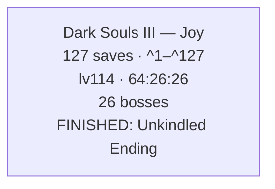

# Dark Souls III — Corpus Timeline

This directory contains all 127 individual PC `.sl2` files in this collection:
Joy's character from level 17 to 114, including the End of Fire, Link the
Flame, Unkindled and Usurpation of Fire endings. This README is the generated interpretation of those
files. Preserve a copy before loading or editing anything, and treat the files
as offline-only because copied saves can trip invalid-data checks online.

**Collection setup:** Deluxe Edition, version 1.15, with Ashes of Ariandel and
The Ringed City, PC, Heroic, GE-Proton11-3, and Nobara 43. The files are
byte-identical copies of the backups; every embedded SteamID64 already was the
public one, so nothing was rewritten.

---

# FromSoftware Saves — Combined Playthrough Timeline

_Reconstructed from 127 save files across 1 run and 1 game: Dark Souls III._

_Every timestamp is an UPPER BOUND, not the moment it happened: a thing is dated to the first save it appears in, so the real event is somewhere between the previous save and that one. This is a reconstruction from sparse backups, not a log._

---

## The Journey

_One box per character, in the order the files were last written — the only clock the games share, since a Dark Souls II play time and a Dark Souls III one are unrelated numbers._

---

## Dark Souls III — Joy

_127 saves · lv17 → lv114 · 1:34:40 → 64:26:26 played · 77 bonfires · 26 bosses · 750 of 937 world items · finished: Unkindled Ending._

### Save Tree

_Each box is one save file, numbered as in the references at the end. A snapshot's parent is the latest earlier one whose progress it still entirely contains — event flags never clear, so a fork (the same save played on twice) lands both children on the shared ancestor._

_2 forks, a dashed box is where a line stopped._

```mermaid
flowchart TD
  n0["^7 · 1:34:40<br/>lv17<br/>BOSS: Iudex Gundyr<br/>+5 bonfires<br/>+49 world items"]
  n1["^8 · 1:34:58<br/>lv17"]
  n2["^9 · 1:37:24<br/>lv17<br/>BOSS: Vordt of the Boreal Valley"]
  n3["^66 · 2:44:34<br/>lv20<br/>KEY ITEM: Cell Key · Loretta's Bone +2 more<br/>COVENANT: Warrior of Sunlight · Way of Blue<br/>+4 bonfires"]
  n4["^77 · 3:58:51<br/>lv24<br/>KEY ITEM: Tower Key<br/>COVENANT: Blue Sentinels<br/>+2 bonfires: Halfway Fortress · Road of Sacrifices"]
  n5["^90 · 4:14:52<br/>lv24<br/>+2 bonfires: Crucifixion Woods · Farron Keep<br/>+10 world items"]
  n6["^91 · 4:38:42<br/>lv25<br/>KEY ITEM: Sage's Coal<br/>+1 bonfire: Keep Ruins<br/>+9 world items"]
  n7["^92 · 4:38:57<br/>lv25<br/>Estus +0 → +1"]
  n8["^106 · 5:12:03<br/>lv25<br/>KEY ITEM: Dreamchaser's Ashes · Grave Key<br/>+1 bonfire: Old Wolf of Farron<br/>+12 world items"]
  n9["^107 · 5:12:59<br/>lv25"]
  n10["^114 · 6:05:04<br/>lv26<br/>BOSS: Stray Demon<br/>KEY ITEM: Golden Scroll · Sage's Scroll<br/>+1 bonfire: Farron Keep Perimeter"]
  n11["^122 · 7:03:48<br/>lv27<br/>BOSS: Crystal Sage<br/>+1 bonfire: Crystal Sage<br/>+7 world items"]
  n12["^123 · 7:03:58<br/>lv27"]
  n13["^124 · 7:17:31<br/>lv30<br/>KEY ITEM: Paladin's Ashes<br/>+1 bonfire: Cathedral of the Deep<br/>+3 world items"]
  n14["^125 · 7:17:52<br/>lv30"]
  n15["^126 · 7:27:47<br/>lv30"]
  n16["^127 · 7:28:29<br/>lv30"]
  n17["^1 · 10:03:00<br/>lv32<br/>KEY ITEM: Deep Braille Divine Tome<br/>+2 bonfires: Cleansing Chapel · Snowfield<br/>+34 world items"]
  n18["^2 · 10:16:19<br/>lv35<br/>+5 world items<br/>lv32 → lv35"]
  n19["^3 · 10:16:31<br/>lv35<br/>Estus +1 → +2"]
  n20["^4 · 10:17:27<br/>lv35"]
  n21["^5 · 10:17:48<br/>lv35"]
  n22["^6 · 11:08:38<br/>lv35<br/>BOSS: Deacons of the Deep<br/>KEY ITEM: Small Doll<br/>+5 world items"]
  n23["^10 · 11:08:48<br/>lv35<br/>+1 bonfire: Deacons of the Deep"]
  n24["^11 · 12:17:13<br/>lv38<br/>+3 world items<br/>lv35 → lv38"]
  n25["^12 · 12:31:25<br/>lv38<br/>+1 world item"]
  n26["^13 · 12:31:34<br/>lv38<br/>+1 bonfire: Rosaria's Bed Chamber"]
  n27["^14 · 12:32:11<br/>lv38<br/>COVENANT: Rosaria's Fingers"]
  n28["^15 · 13:49:28<br/>lv38<br/>+5 world items"]
  n29["^16 · 13:55:07<br/>lv38<br/>BOSS: Curse-Rotted Greatwood<br/>KEY ITEM: Transposing Kiln"]
  n30["^17 · 13:55:14<br/>lv38<br/>+1 bonfire: Pit of Hollows"]
  n31["^18 · 14:08:36<br/>lv39<br/>BOSS: Abyss Watchers<br/>KEY ITEM: Cinders of a Lord<br/>+2 world items"]
  n32["^19 · 14:08:45<br/>lv39<br/>+1 bonfire: Abyss Watchers"]
  n33["^20 · 14:12:37<br/>lv44<br/>COVENANT: Watchdogs of Farron<br/>lv38 → lv44"]
  n34["^21 · 14:27:21<br/>lv44<br/>BOSS: Abyss Watchers<br/>KEY ITEM: Cinders of a Lord<br/>+1 bonfire: Abyss Watchers"]
  n35["^22 · 14:29:34<br/>lv44<br/>+1 bonfire: Catacombs of Carthus<br/>+1 world item"]
  n36["^23 · 16:25:58<br/>lv45<br/>BOSS: High Lord Wolnir<br/>KEY ITEM: Carthus Pyromancy Tome · Grave Warden Pyromancy Tome<br/>+4 bonfires"]
  n37["^24 · 18:58:29<br/>lv45<br/>+10 world items<br/>lv44 → lv45"]
  n38["^25 · 19:05:02<br/>lv47<br/>BOSS: High Lord Wolnir<br/>KEY ITEM: Grave Warden Pyromancy Tome<br/>+1 bonfire: High Lord Wolnir"]
  n39["^26 · 19:45:18<br/>lv48<br/>KEY ITEM: Excrement-covered Ashes · Lift Chamber Key<br/>+4 bonfires<br/>Estus +2 → +3"]
  n40["^27 · 19:55:49<br/>lv48<br/>KEY ITEM: Jailbreaker's Key<br/>+1 bonfire: Irithyll Dungeon<br/>+9 world items"]
  n41["^28 · 20:08:31<br/>lv48<br/>+11 world items"]
  n42["^29 · 20:25:16<br/>lv49<br/>KEY ITEM: Old Cell Key · Profaned Coal +1 more<br/>+1 bonfire: Profaned Capital<br/>+9 world items"]
  n43["^30 · 20:34:19<br/>lv49<br/>KEY ITEM: Jailer's Key Ring · Logan's Scroll<br/>+10 world items"]
  n44["^31 · 20:43:29<br/>lv50<br/>+6 world items<br/>lv49 → lv50"]
  n45["^32 · 20:49:06<br/>lv50<br/>BOSS: Yhorm the Giant<br/>+1 bonfire: Yhorm the Giant"]
  n46["^33 · 20:52:08<br/>lv53<br/>lv50 → lv53"]
  n47["^34 · 21:06:09<br/>lv53"]
  n48["^35 · 21:18:54<br/>lv49<br/>KEY ITEM: Jailbreaker's Key · Lift Chamber Key<br/>+3 bonfires<br/>Estus +2 → +3"]
  n49["^36 · 21:19:30<br/>lv53<br/>+9 world items"]
  n50["^37 · 21:19:40<br/>lv49<br/>CINDERS: Abyss Watchers"]
  n51["^38 · 21:19:49<br/>lv53"]
  n52["^39 · 21:33:21<br/>lv55<br/>Estus +3 → +4<br/>+5 world items<br/>lv53 → lv55"]
  n53["^40 · 21:38:30<br/>lv55<br/>BOSS: Pontiff Sulyvahn<br/>+1 bonfire: Pontiff Sulyvahn<br/>+1 world item"]
  n54["^41 · 21:42:17<br/>lv55<br/>+3 world items"]
  n55["^42 · 21:47:49<br/>lv55<br/>+3 world items"]
  n56["^43 · 21:52:30<br/>lv56<br/>KEY ITEM: Londor Braille Divine Tome<br/>+1 world item<br/>lv55 → lv56"]
  n57["^44 · 21:55:14<br/>lv56<br/>+1 world item"]
  n58["^45 · 21:58:17<br/>lv56<br/>COVENANT: Blade of the Darkmoon<br/>+2 bonfires: Anor Londo · Prison Tower"]
  n59["^46 · 22:02:14<br/>lv56<br/>+1 world item"]
  n60["^47 · 22:05:11<br/>lv56<br/>KEY ITEM: Giant's Coal<br/>+2 world items"]
  n61["^48 · 22:05:46<br/>lv56"]
  n62["^49 · 22:06:15<br/>lv56"]
  n63["^50 · 22:10:45<br/>lv56<br/>BOSS: Aldrich, Devourer of Gods<br/>+1 bonfire: Aldrich, Devourer of Gods"]
  n64["^51 · 22:14:11<br/>lv59<br/>+1 world item<br/>lv56 → lv59"]
  n65["^52 · 22:15:35<br/>lv59<br/>KEY ITEM: Basin of Vows"]
  n66["^53 · 22:15:57<br/>lv51<br/>KEY ITEM: Jailer's Key Ring · Logan's Scroll +2 more<br/>+1 bonfire: Profaned Capital<br/>Estus +3 → +4"]
  n67["^54 · 22:30:28<br/>lv63<br/>+2 world items<br/>lv59 → lv63"]
  n68["^55 · 22:32:57<br/>lv63<br/>BOSS: Dancer of the Boreal Valley<br/>+1 bonfire: Dancer of the Boreal Valley"]
  n69["^56 · 22:41:31<br/>lv65<br/>COVENANT: Mound-makers<br/>lv63 → lv65"]
  n70["^57 · 22:46:25<br/>lv66<br/>+1 bonfire: Lothric Castle<br/>lv65 → lv66"]
  n71["^58 · 22:52:02<br/>lv66<br/>+1 bonfire: Dragon Barracks<br/>+7 world items"]
  n72["^59 · 22:57:43<br/>lv66<br/>+1 world item"]
  n73["^60 · 23:12:36<br/>lv66<br/>BOSS: Dragonslayer Armour<br/>KEY ITEM: Grand Archives Key<br/>+2 bonfires: Dragonslayer Armour · Grand Archives"]
  n74["^61 · 23:23:04<br/>lv70<br/>KEY ITEM: Crystal Scroll<br/>+11 world items<br/>lv66 → lv70"]
  n75["^62 · 23:38:52<br/>lv70<br/>+15 world items"]
  n76["^63 · 23:47:13<br/>lv73<br/>+2 world items<br/>lv70 → lv73"]
  n77["^64 · 24:09:22<br/>lv73<br/>Estus +4 → +5<br/>+5 world items"]
  n78["^65 · 24:17:10<br/>lv76<br/>lv73 → lv76"]
  n79["^67 · 24:26:31<br/>lv76<br/>+1 world item"]
  n80["^68 · 24:29:42<br/>lv76<br/>BOSS: Lothric, Younger Prince<br/>+1 bonfire: Twin Princes"]
  n81["^69 · 24:32:28<br/>lv76<br/>CINDERS: Abyss Watchers · Aldrich, Devourer of Gods · Lothric, Younger Prince · Yhorm the Giant<br/>+2 bonfires: Flameless Shrine · Kiln of the First Flame"]
  n82["^70 · 24:35:51<br/>lv78<br/>+1 bonfire: The Dreg Heap<br/>lv76 → lv78"]
  n83["^71 · 24:39:45<br/>lv55<br/>+18 world items<br/>lv51 → lv55"]
  n84["^72 · 24:40:11<br/>lv78<br/>BOSS: Soul of Cinder"]
  n85["^73 · 24:41:55<br/>lv78<br/>ENDING: The Usurpation of Fire<br/>NEW JOURNEY: NG+2"]
  n86["^74 · 25:05:42<br/>lv59<br/>BOSS: Yhorm the Giant<br/>CINDERS: Yhorm the Giant<br/>+1 bonfire: Yhorm the Giant"]
  n87["^75 · 26:13:33<br/>lv62<br/>BOSS: Pontiff Sulyvahn<br/>KEY ITEM: Easterner's Ashes · Giant's Coal<br/>+2 bonfires: Anor Londo · Pontiff Sulyvahn"]
  n88["^76 · 29:49:02<br/>lv66<br/>BOSS: Aldrich, Devourer of Gods<br/>KEY ITEM: Basin of Vows<br/>CINDERS: Aldrich, Devourer of Gods"]
  n89["^78 · 30:32:58<br/>lv67<br/>KEY ITEM: Izalith Pyromancy Tome<br/>+2 bonfires: Abandoned Tomb · Old King's Antechamber<br/>+13 world items"]
  n90["^79 · 30:54:17<br/>lv68<br/>BOSS: Old Demon King<br/>+2 bonfires: Demon Ruins · Old Demon King<br/>+6 world items"]
  n91["^80 · 31:11:03<br/>lv70<br/>BOSS: Dancer of the Boreal Valley<br/>+1 bonfire: Dancer of the Boreal Valley<br/>Estus +4 → +5"]
  n92["^81 · 32:07:20<br/>lv71<br/>COVENANT: Aldrich Faithful · Blade of the Darkmoon<br/>+3 bonfires<br/>+16 world items"]
  n93["^82 · 32:09:44<br/>lv71"]
  n94["^83 · 33:31:38<br/>lv74<br/>BOSS: Oceiros, the Consumed King<br/>+4 bonfires<br/>+24 world items"]
  n95["^84 · 34:05:59<br/>lv74<br/>+1 bonfire: Dragon Barracks<br/>Estus +5 → +6<br/>+23 world items"]
  n96["^85 · 34:41:30<br/>lv78<br/>BOSS: Ancient Wyvern<br/>+1 bonfire: Dragon-Kin Mausoleum<br/>+5 world items"]
  n97["^86 · 36:15:12<br/>lv79<br/>+1 bonfire: Great Belfry<br/>+29 world items<br/>lv78 → lv79"]
  n98["^87 · 36:54:10<br/>lv84<br/>KEY ITEM: Braille Divine Tome of Lothric<br/>+13 world items<br/>lv79 → lv84"]
  n99["^88 · 37:49:48<br/>lv85<br/>+2 bonfires: Ariandel Chapel · Rope Bridge Cave<br/>+20 world items<br/>lv84 → lv85"]
  n100["^89 · 38:33:40<br/>lv88<br/>BOSS: Dragonslayer Armour<br/>KEY ITEM: Crystal Scroll · Grand Archives Key<br/>+2 bonfires: Dragonslayer Armour · Grand Archives"]
  n101["^93 · 40:05:14<br/>lv90<br/>Estus +6 → +7<br/>+16 world items<br/>lv88 → lv90"]
  n102["^94 · 40:33:41<br/>lv90<br/>+10 world items"]
  n103["^95 · 41:21:16<br/>lv90<br/>COVENANT: Mound-makers<br/>+5 world items"]
  n104["^96 · 41:37:50<br/>lv90<br/>BOSS: Champion Gundyr<br/>+1 bonfire: Champion Gundyr<br/>+6 world items"]
  n105["^97 · 42:11:27<br/>lv92<br/>BOSS: Lothric, Younger Prince<br/>CINDERS: Lothric, Younger Prince<br/>+2 bonfires: Flameless Shrine · Twin Princes"]
  n106["^98 · 45:06:41<br/>lv95<br/>KEY ITEM: Contraption Key<br/>+2 bonfires: Corvian Settlement · Snowy Mountain Pass<br/>+35 world items"]
  n107["^99 · 45:25:15<br/>lv95<br/>+1 bonfire: Depths of the Painting<br/>+4 world items"]
  n108["^100 · 46:11:05<br/>lv98<br/>BOSS: Champion's Gravetender · Sister Friede<br/>+5 bonfires<br/>Estus +7 → +8"]
  n109["^101 · 47:09:43<br/>lv99<br/>+1 bonfire: Within the Earthen Peak Ruins<br/>+16 world items<br/>lv98 → lv99"]
  n110["^102 · 47:42:42<br/>lv100<br/>+14 world items<br/>lv99 → lv100"]
  n111["^103 · 48:09:39<br/>lv102<br/>BOSS: Demon Prince<br/>KEY ITEM: Small Envoy Banner<br/>+2 bonfires: The Demon Prince · Mausoleum Lookout"]
  n112["^104 · 48:43:02<br/>lv102<br/>+1 bonfire: Ringed Inner Wall<br/>+9 world items"]
  n113["^105 · 49:35:56<br/>lv104<br/>+1 bonfire: Ringed City Streets<br/>+13 world items<br/>lv102 → lv104"]
  n114["^108 · 52:31:55<br/>lv105<br/>+18 world items<br/>lv104 → lv105"]
  n115["^109 · 55:47:33<br/>lv106<br/>+1 bonfire: Shared Grave<br/>+22 world items<br/>lv105 → lv106"]
  n116["^110 · 56:07:34<br/>lv106<br/>Estus +8 → +9<br/>+11 world items"]
  n117["^111 · 56:59:18<br/>lv110<br/>BOSS: Darkeater Midir · Halflight, Spear of the Church<br/>COVENANT: Spears of the Church<br/>+2 bonfires: Church of Filianore · Darkeater Midir"]
  n118["^112 · 57:19:01<br/>lv111<br/>+1 bonfire: Filianore's Rest<br/>+1 world item<br/>lv110 → lv111"]
  n119["^113 · 57:52:00<br/>lv111"]
  n120["^115 · 62:49:31<br/>lv113<br/>BOSS: Slave Knight Gael<br/>KEY ITEM: Blood of the Dark souls · Old Woman's Ashes<br/>COVENANT: Watchdogs of Farron"]
  n121["^116 · 64:00:40<br/>lv114<br/>BOSS: Nameless King<br/>+1 bonfire: Nameless King<br/>+2 world items"]
  n122["^117 · 64:11:16<br/>lv114<br/>+1 world item"]
  n123["^118 · 64:23:13<br/>lv114<br/>BOSS: Soul of Cinder"]
  n124["^119 · 64:24:08<br/>lv114<br/>ENDING: To Link the First Flame<br/>NEW JOURNEY: NG+1"]
  n125["^120 · 64:26:02<br/>lv114<br/>ENDING: The End of Fire<br/>NEW JOURNEY: NG+1"]
  n126["^121 · 64:26:26<br/>lv114<br/>ENDING: Unkindled Ending<br/>NEW JOURNEY: NG+2"]
  n0 --> n1
  n1 --> n2
  n2 --> n3
  n3 --> n4
  n4 --> n5
  n5 --> n6
  n6 --> n7
  n7 --> n8
  n8 --> n9
  n9 --> n10
  n10 --> n11
  n11 --> n12
  n12 --> n13
  n13 --> n14
  n14 --> n15
  n15 --> n16
  n16 --> n17
  n17 --> n18
  n18 --> n19
  n19 --> n20
  n20 --> n21
  n21 --> n22
  n22 --> n23
  n23 --> n24
  n24 --> n25
  n25 --> n26
  n26 --> n27
  n27 --> n28
  n28 --> n29
  n29 --> n30
  n30 --> n31
  n31 --> n32
  n30 --> n33
  n33 --> n34
  n34 --> n35
  n32 --> n36
  n35 --> n37
  n37 --> n38
  n38 --> n39
  n39 --> n40
  n40 --> n41
  n41 --> n42
  n42 --> n43
  n43 --> n44
  n44 --> n45
  n45 --> n46
  n46 --> n47
  n36 --> n48
  n47 --> n49
  n48 --> n50
  n49 --> n51
  n51 --> n52
  n52 --> n53
  n53 --> n54
  n54 --> n55
  n55 --> n56
  n56 --> n57
  n57 --> n58
  n58 --> n59
  n59 --> n60
  n60 --> n61
  n61 --> n62
  n62 --> n63
  n63 --> n64
  n64 --> n65
  n50 --> n66
  n65 --> n67
  n67 --> n68
  n68 --> n69
  n69 --> n70
  n70 --> n71
  n71 --> n72
  n72 --> n73
  n73 --> n74
  n74 --> n75
  n75 --> n76
  n76 --> n77
  n77 --> n78
  n78 --> n79
  n79 --> n80
  n80 --> n81
  n81 --> n82
  n66 --> n83
  n82 --> n84
  n84 --> n85
  n83 --> n86
  n86 --> n87
  n87 --> n88
  n88 --> n89
  n89 --> n90
  n90 --> n91
  n91 --> n92
  n92 --> n93
  n93 --> n94
  n94 --> n95
  n95 --> n96
  n96 --> n97
  n97 --> n98
  n98 --> n99
  n99 --> n100
  n100 --> n101
  n101 --> n102
  n102 --> n103
  n103 --> n104
  n104 --> n105
  n105 --> n106
  n106 --> n107
  n107 --> n108
  n108 --> n109
  n109 --> n110
  n110 --> n111
  n111 --> n112
  n112 --> n113
  n113 --> n114
  n114 --> n115
  n115 --> n116
  n116 --> n117
  n117 --> n118
  n118 --> n119
  n119 --> n120
  n120 --> n121
  n121 --> n122
  n122 --> n123
  n123 --> n124
  n123 --> n125
  n123 --> n126
  classDef ending fill:#3a2a12,stroke:#c9a227,color:#f0e6d2,stroke-width:2px;
  class n85,n124,n125,n126 ending;
```

### Current State — `Joy_64-26-26_lv114_77bf_26b_ng2_end-unkindled.sl2` (^121)

### Slot 1: Joy

- **Soul Level:** 114
- **Covenant:** Rosaria's Fingers
- **Playthrough:** New Game +2
- **Play Time:** 64:26:26
- **Souls held:** 101,593
- **Max HP:** 1,721
- **Embered:** Yes  _(Max HP above includes the +30% ember bonus)_
- **Max FP:** 72
- **Stamina:** 166
- **Cinders of a Lord Placed:** 4 of 4 — Abyss Watchers · Yhorm the Giant · Aldrich, Devourer of Gods · Lothric, Younger Prince  _(NG+ — only the mapped throne flags are read, so this is a floor)_
- **Ending Reached:** Unkindled Ending
- **Build:** strength-focused melee

#### Attributes

| VGR | ATN | END | VIT | STR | DEX | INT | FTH | LCK |
|----|----|----|----|----|----|----|----|----|
| 43 | 6 | 36 | 40 | 40 | 10 | 8 | 9 | 11 |

<b>Attribute Scaling</b> — what each stat scales and its soft caps (game-mechanics reference, not read from this save)

- **Vigor** (43) — Max HP. Soft caps ~27 & 50; ~1,300 HP at 50, only ~100 more to 99.
- **Attunement** (6) — FP, attunement (spell) slots. FP soft cap 35 (450 max at 99); slots at 10/14/18/24/30/40/50/60/80/99.
- **Endurance** (36) — Stamina. Stamina soft cap 40.
- **Vitality** (40) — Equip load, physical defense. Roughly linear to 99.
- **Strength** (40) — Physical attack, strength-weapon scaling. Scaling soft caps 40 & 60.
- **Dexterity** (10) — Physical attack, dex-weapon scaling, faster casting. Scaling soft caps 40 & 60.
- **Intelligence** (8) — Magic attack, sorcery & pyromancy scaling. Scaling soft caps 40 & 60.
- **Faith** (9) — Lightning & dark attack, miracle & pyromancy scaling. Scaling soft caps 40 & 60.
- **Luck** (11) — Item discovery, bleed/poison buildup, hollow-weapon scaling. +1 item discovery/pt (base 100); bleed/poison speed soft cap 50.

#### Derived Stats  _(computed from attributes, plus the documented bonus of any worn ring named beside the value — the game's other gear is not read)_

- **Attunement Slots:** 0
- **Equip Load (max capacity):** 101.6  _(80.0 base, +8% Ring of Favor +3, +19% Havel's Ring+3)_
- **Item Discovery:** 111
- **Also from rings:** +6% Max HP (Ring of Favor +3), +12% Stamina (Ring of Favor +3)  _(Max HP and Stamina are read from the save, so they already include these)_

#### Key Items  _(progress / areas & shortcuts unlocked)_

- Cell Key
- Small Lothric Banner
- Grave Key
- Tower Key
- Contraption Key
- Small Envoy Banner
- Blood of the Dark souls
- Small Doll
- Jailbreaker's Key
- Old Cell Key
- Old Woman's Ashes
- Grave Warden Pyromancy Tome
- Lift Chamber Key
- Grand Archives Key
- Jailer's Key Ring

#### Bonfires Discovered (77 of 77, in 14 of 14 areas)  _(bonfires lit, inferred from each area's flag bits — a floor)_

- High Wall of Lothric: 5/5 — Oceiros, the Consumed King, Vordt of the Boreal Valley, Dancer of the Boreal Valley, Tower on the Wall, High Wall of Lothric
- Lothric Castle: 5/5 — Lothric Castle, Dragonslayer Armour, Dragon Barracks, Twin Princes, Grand Archives
- Undead Settlement: 5/5 — Undead Settlement, Pit of Hollows, Cliff Underside, Dilapidated Bridge, Foot of the High Wall
- Archdragon Peak: 4/4 — Archdragon Peak, Nameless King, Great Belfry, Dragon-Kin Mausoleum
- Road of Sacrifices: 9/9 — Halfway Fortress, Abyss Watchers, Crystal Sage, Farron Keep, Keep Ruins, Old Wolf of Farron, Road of Sacrifices, Crucifixion Woods, Farron Keep Perimeter
- Cathedral of the Deep: 4/4 — Cleansing Chapel, Deacons of the Deep, Rosaria's Bed Chamber, Cathedral of the Deep
- Irithyll of the Boreal Valley: 9/9 — Church of Yorshka, Pontiff Sulyvahn, Aldrich, Devourer of Gods, Anor Londo, Central Irithyll, Distant Manor, Water Reserve, Irithyll of the Boreal Valley, Prison Tower
- Catacombs of Carthus: 6/6 — High Lord Wolnir, Abandoned Tomb, Old King's Antechamber, Demon Ruins, Old Demon King, Catacombs of Carthus
- Irithyll Dungeon: 3/3 — Irithyll Dungeon, Yhorm the Giant, Profaned Capital
- Cemetery of Ash: 5/5 — Firelink Shrine, Cemetery of Ash, Iudex Gundyr, Untended Graves, Champion Gundyr
- Kiln of the First Flame: 2/2 — Flameless Shrine, Kiln of the First Flame
- The Painted World of Ariandel: 8/8 — Sister Friede, Snowfield, Rope Bridge Cave, Corvian Settlement, Snowy Mountain Pass, Ariandel Chapel, Champion's Gravetender, Depths of the Painting
- The Dreg Heap: 4/4 — The Demon Prince, The Dreg Heap, Earthen Peak Ruins, Within the Earthen Peak Ruins
- The Ringed City: 8/8 — Church of Filianore, Darkeater Midir, Mausoleum Lookout, Ringed Inner Wall, Ringed City Streets, Shared Grave, Slave Knight Gael, Filianore's Rest

#### Covenants Found (9 of 9)  _(discovered — a floor; the one currently worn is the Covenant field above)_

- **Warrior of Sunlight:** joined (emblem found)
- **Mound-makers:** joined (emblem found)
- **Watchdogs of Farron:** joined (emblem found)
- **Aldrich Faithful:** joined (emblem found)
- **Blue Sentinels:** joined (emblem found)
- **Blade of the Darkmoon:** joined (emblem found)
- **Rosaria's Fingers:** joined (emblem found)
- **Way of Blue:** joined (emblem found)
- **Spears of the Church:** joined (covenant item from Halflight)

#### NPC States (26 of 85 tracked)  _(NPC deaths, hostility and questline milestones, each its own flag — the descriptions are the source's and one is known to be on the wrong flag, so an entity id is printed beside them where there is one)_

- Areas entered: 2/2 — after entering Road of Sacrifices · after entering Undead Settlement
- DLC owned: 2/2 — DLC2 ownership flag · DLC1 ownership flag
- Items handed over: 0/2
- NPCs killed: 15/39 — after killing Eygon of Carim or defeating Dragonslayer Armour (entity 3100720, 4000755, 4000756)  _(+14 more, known only by entity id)_
- NPCs turned hostile: 0/32
- Questline states: 6/7 — Blood Moon Appears · after completing Sirris' questline · Irina - Normal Placement · after completing Anri's questline or killing Anri · [Shrine Handmaid] Dried Finger · [Shrine Handmaid] White Sign Soapstone
- World state: 1/1 — after placing all Cinders of a Lord on their thrones

#### One-Time Enemies Defeated (96 of 148 tracked)  _(each enemy's own defeat flag — exact, not inferred, and it carries across a new journey; names are enemy types, so repeats in an area are different enemies)_

- Archdragon Peak: 4/6 — Ancient Wyvern Boss · Crystal Lizard · Havel Knight · Nameless King  _(still alive: Ancient Wyvern Mob ×2)_
- Catacombs of Carthus: 7/12 — Crystal Lizard ×3 · Demon · High Lord Wolnir · Knight Slayer Tsorig · Old Demon King  _(still alive: Carthus Sandworm · Crystal Lizard ×2 · Knight Slayer Tsorig · Mimic Chest)_
- Cathedral of the Deep: 9/12 — Archdeacon of the Deep · Brigand · Crystal Lizard ×2 · Deep Accursed · Fallen Knight · Giant Slave ×2 · Mimic Chest  _(still alive: Corpse-grub · Longfinger Kirk · Ravenous Crystal Lizard)_
- Filianore's Rest (DLC2): 2/2 — Passive Locust Preacher · Shira
- Firelink Shrine / Cemetery of Ash: 2/7 — Crystal Lizard · Gundyr  _(still alive: Daughter of Crystal Kriemhild · Ravenous Crystal Lizard ×3 · Unnamed enemy (4000250) + Unnamed enemy (4000290))_
- Grand Archives: 13/13 — Black Hand Kamui · Boreal Outrider Knight · Crystal Lizard ×8 · Crystal Sage in Archives · Daughter of Crystal Kriemhild · Lion Knight Albert
- High Wall of Lothric: 5/6 — Consumed King Oceiros · Crystal Lizard · Dancer of the Boreal Valley · Mimic Chest · Vordt of the Boreal Valley  _(still alive: Unnamed enemy (3000661))_
- Irithyll Dungeon: 10/19 — Court Sorcerer · Crystal Lizard ×4 · Giant Slave · Mimic Chest ×2 · Monstrosity of Sin · Yhorm the Giant  _(still alive: Alva, Seeker of the Spurned · Mimic Chest ×5 · Monstrosity of Sin ×3)_
- Irithyll of the Boreal Valley: 15/19 — Aldrich, Devourer of Gods · Crystal Lizard ×4 · Deep Accursed · Drang Hammers Knight · Drang Twinspears Knight · Pontiff Sulyvahn · Silver Knight ×3 · Sulyvahn's Beast ×3  _(still alive: Creighton the Wanderer · Crystal Lizard · Londor Pale Shade · Mimic Chest)_
- Kiln of the First Flame: 1/1 — Lords of Cinder
- Lothric Castle: 3/5 — Crystal Lizard · Dragonslayer Armour · Mimic Chest  _(still alive: Boreal Outrider Knight · Mimic Chest)_
- Painted World of Ariandel (DLC1): 7/9 — Adriandel Greater Crab · Champion's Gravetender + Greatwolf · Crystal Lizard ×5  _(still alive: Crystal Lizard ×2)_
- Road of Sacrifices / Farron Keep: 9/17 — Abyss Watchers · Crystal Lizard ×5 · Crystal Sage in Farron · Ravenous Crystal Lizard · Stray Demon  _(still alive: Crystal Lizard ×2 · Great Club Exile Knight · Greatsword Exile Knight · Londor Pale Shade · Madwoman · Yellowfinger Heysel ×2)_
- The Dreg Heap (DLC2): 1/1 — Desert Pyromancer Zoey
- The Ringed City (DLC2): 4/12 — Crystal Lizard ×2 · Dragonslayer Armour · Mimic Chest  _(still alive: Alva, Seeker of the Spurned · Crystal Lizard ×2 · Moaning Knight · Silver Knight Ledo · Unnamed enemy (5100292) · Unnamed enemy (5100293) · Unnamed enemy (5100295))_
- Undead Settlement: 4/7 — Boreal Outrider Knight · Crystal Lizard · Demon · Rotted Greatwood  _(still alive: Crystal Lizard · Peasant Hollow · Unnamed enemy (3100900))_

#### Items Collected (750 of 937 tracked)  _(one-off world items picked up, from each area's pickup flags — covers only the areas whose flag group is mapped)_

- High Wall of Lothric: 57/67  _(10 still out there)_
- Lothric Castle: 50/60  _(10 still out there)_
- Undead Settlement: 67/76  _(9 still out there)_
- Archdragon Peak: 35/43  _(8 still out there)_
- Road of Sacrifices: 77/97  _(20 still out there)_
- Grand Archives: 44/47  _(3 still out there)_
- Cathedral of the Deep: 48/61  _(13 still out there)_
- Irithyll: 77/90  _(13 still out there)_
- Catacombs of Carthus: 41/65  _(24 still out there)_
- Irithyll Dungeon: 63/78  _(15 still out there)_
- Cemetery of Ash: 30/35  _(5 still out there)_
- Ariandel: 48/66  _(18 still out there)_
- Dreg Heap: 46/58  _(12 still out there)_
- Ringed City: 67/94  _(27 still out there)_

Where the missing items are — the ones with a known location

**High Wall of Lothric** — 10 missing

- Titanite Shard — On the balcony with the Tower on the Wall bonfire
- Ring of Sacrifice — Coming from the elevator shortcut, on a side path to the left (toward Winged Knight area), jumping onto a wooden support
- Dragonscale Ring (Consumed King's Garden) — From the middle level of the second elevator, toward the Oceiros boss fight
- Fleshbite Ring+1 — Jumping from the roof with the Pus of Man to a nearby building with a fenced roof
- Wood Grain Ring+1 — Behind the first elevator going down into the garden, in the toxic pool
- Ring of the Evil Eye+2 — In the basement of the building with the Pus of Man on the roof, on the far wall past the stairwell, behind some barrels
- Sage Ring+2 (Consumed King's Garden) — From the middle platform of the first elevator in the target, going out and dropping off to the left, and then running off onto the ruined arch behind.
- Drakeblood Helm (Consumed King's Garden) — On the Drakeblood Knight after Oceiros fight, after defeating the Drakeblood Knight from the Serpent-Man Summoner
- Symbol of Avarice (Mimic)
- Titanite Shard (Pus of Man #2)

**Lothric Castle** — 10 missing

- Caitha's Chime (Grand Archives) — Dropping down from the chapel balcony where the Red Tearstone Ring is found, and then dropping down again towards the Lothric knights
- Twinkling Titanite
- Life Ring+2 — Past the room with the firebomb-throwing hollows and Pus of Man wyvern, around to the front, dropping down past where the Titanite Chunk is
- Dark Stoneplate Ring+1 — Through the room next to the second Pus of Man wyvern, on the balcony outside
- Thunder Stoneplate Ring+2 — Dropping down from the chapel balcony where the Red Tearstone Ring is found, out on the edge
- Symbol of Avarice (Mimic) ×2
- Magic Stoneplate Ring (Cathedral Knight - Oceiros)
- Titanite Scale (Mimic)
- Irithyll Rapier (Boreal Outrider Knight)

**Undead Settlement** — 9 missing

- Spotted Whip — Appears next to Cornyx's cage after defeating Old Demon King with Cuculus surviving
- Soul of an Unknown Traveler — After exiting the building after the burning tree on the way to the Dilapidated Bridge bonfire. Hidden behind some crates between two buildings on the right.
- Rusted Coin
- Fire Clutch Ring — From the area bombarded by firebombs above the Cliff Underside bonfire
- Large Soul of a Deserted Corpse — After going up the stairs from Curse-Rotted Greatwood to Cliff Underside area, on a cliff edge to the right
- Pale Tongue — Hanging corpse in the Fire Demon fight area, can be knocked down by rolling into it
- Life Ring+1 — On the wooden rafters near where Siegward is waiting for Fire Demon
- Poisonbite Ring+1 — Behind the well in the back of area where the Giant shoots arrows, nearby where the flamerge-wielding thrall drops down.
- Covetous Silver Serpent Ring+2 — At the back of a roof near the end of the Fire Demon loop, dropping down past where Flynn's Ring is

**Archdragon Peak** — 8 missing

- Lightning Bolt
- Dung Pie
- Titanite Scale — From the Mausoleum bonfire, up the first stairs to the right, going around toward the Man-Serpent Summoner, on the balcony on the side
- Twinkling Titanite
- Havel's Ring+1 — Just past the building with all of the Man-Serpents on the way to the Dragon Altar, on the left side
- Covetous Gold Serpent Ring+2 — In the Nameless King boss arena after he is defeated
- Twinkling Dragon Torso Stone — Received using Path of the Dragon at the Altar after the Belfry bonfire. Hawkwood also uses the gesture there when summoned.
- Calamity Ring — Received using Path of the Dragon at the Altar by the Mausoleum bonfire

**Road of Sacrifices** — 20 missing

- Titanite Shard — Dropping down into the Crucifixion Woods crab area right after Halfway Fortress, on the left wall heading toward the Black Knight building, guarded by dog
- Soul of an Unknown Traveler — From Halfway Fortress, hug the right wall and drop down twice on the way to the crab area
- Conjurator Hood — In the deep water part of the Crucifixion Woods crab area, between a large tree and the keep wall
- Rusted Gold Coin — Hidden behind the right wall of the ritual fire with stairs guarded by Elder Ghrus/basilisks
- Titanite Shard — In front of the stairs leading up to the ritual fire straight ahead of the Farron Keep bonfire
- Large Soul of a Nameless Soldier — Hidden in a corner to the right of the stairs leading up to the ritual fire from the basilisk area
- Brigand Twindaggers — At the end of the path guarded by the Madwoman in Road of Sacrifices
- Braille Divine Tome of Carim — Dropping down before the bridge leading up to Halfway Fortress from Road of Sacrifices, guarded by the maggot belly dog
- Brigand Hood — In the middle of the path where the Madwoman waits in Road of Sacrifices
- Morne's Ring — Dropping down before the bridge leading up to Halfway Fortress from Road of Sacrifices, guarded by the maggot belly dog
- Havel's Helm (Farron Keep) — Appears by Stray Demon, up from the Old Wolf of Farron bonfire, after the Havel Knight guarding the Titanite Slab in Archdragon Peak has been killed
- Dark Stoneplate Ring+2 (Farron Keep) — Hidden behind the right wall of the ritual fire before Keep Ruins
- Chloranthy Ring+2 (Farron Keep) — Found dropping down from the first Storyteller Corvian on the left side rather than the right side. You can then further drop down to where the madwoman is, after healing.
- Lingering Dragoncrest Ring+1 (Farron Keep) — On a tree by the greater crab near the Crucifixion Woods bonfire, after the Grass Crest Shield tree
- Magic Stoneplate Ring+1 (Farron Keep) — Behind a tree in the basilisk area, heading directly right from Farron Keep bonfire
- Wolf Ring+1 (Farron Keep) — To the right of the building with the Keep Ruins bonfire, when approached from the ritual fire
- Antiquated Dress (Farron Keep) — In a chest in the cave found along the keep wall in the basilisk area, with the Elizabeth corpse
- Lingering Dragoncrest Ring (Great Crab - Farron Keep)
- Pharis's Hat (Elder Ghru #3)
- Black Bow of Pharis (Elder Ghru #4)

**Grand Archives** — 3 missing

- Sage Ring+1 — On the rafters high above the Grand Archives, dropping down from the cage to the high rafters to the rafters below with the Corpse-grub
- Lingering Dragoncrest Ring+2 — Near the tower with the Winged Knights, up the stairs on the opposite side from the ladder leading up to the Hunter's Ring
- Titanite Slab (Winged Knight #3 - Grand Archives)

**Cathedral of the Deep** — 13 missing

- Titanite Shard — Behind the cathedral near the Infested Corpse moat, going from the Ravenous Crystal Lizard
- Arbalest — Before the rafters on the way to Rosaria, up a flying buttress, past a halberd-wielding Large Hollow Soldier to the right, and down another flying buttress to the right
- Pale Tongue — Before the rafters on the way to Rosaria, up a flying buttress and straight right, passing a halberd-wielding Large Hollow Soldier
- Blessed Gem — In the rafters leading to Rosaria, guarded by a Cathedral Knight to the right
- Titanite Shard — Past the Infested Corpse graveyard to the left, hidden along the left wall of the building with the shortcut ladder and Curse Ward Greatshield
- Helm of Thorns — Found in Rosaria's Bed Chamber after killing Longfinger Kirk
- Ring of the Evil Eye+1 — Before the stairs leading down into the Deacons fight
- Ring of Favor+2 — Before the rafters on the way to Rosaria, up a flying buttress, behind a greataxe-wielding Large Hollow Soldier to the left
- Crest Shield — On a grave near the Cathedral of the Deep bonfire, accessed by dropping down to the right
- Young White Branch — By the White Birch tree in the Infested Corpse graveyard ×2
- Heysel Pick (Yellowfinger Heysel)
- Symbol of Avarice (Mimic)

**Irithyll** — 13 missing

- Creighton's Steel Mask — Following Sirris' questline, found on the bridge to Irithyll after being invaded by Creighton the Wanderer in the graveyard after the Church of Yorshka.
- Rime-blue Moss Clump
- Large Soul of a Nameless Soldier — On the path from Central Irithyll bonfire, before making the left toward Church of Yorshka
- Painting Guardian's Curved Sword (Anor Londo) — On the rafters dropping down from Yorshka's Prison Tower to the Church of Yorshka
- Brass Helm — Behind the illusory statue in the hallway leading to the Darkmoon Tomb
- Large Soul of a Nameless Soldier — Next to the fountain up the stairs from the Central Irithyll bonfire
- Chloranthy Ring+1 — In the area before and below Pontiff's cathedral, behind the central structure
- Havel's Ring+2 — On the rafters dropping down from Yorshka's Prison Tower to the Church of Yorshka
- Ring of Favor+1 — In the higher levels of Pontiff's cathedral, accessible from the Deacons after the Pontiff fight
- Covetous Gold Serpent Ring+1 — After the dark area with the Irithyllian slaves, drop down to the right
- Wood Grain Ring+2 — Leaving the building with the Silver Knight staring at the painting, instead of going left up the stairs, go right
- Reversal Ring — In a chest in Darkmoon Tomb
- Symbol of Avarice (Mimic)

**Catacombs of Carthus** — 24 missing

- Carthus Rouge
- Large Titanite Shard — From the Catacombs bonfire, down the stairs into the main hall and up the stairs to the other side, in a middle hallway
- Grave Warden's Ashes — From the Catacombs bonfire, down the stairs into the main hall and up the stairs to the other side, on the far left side. Stairwell past the illusory wall is most direct.
- Yellow Bug Pellet
- Large Titanite Shard — In the Smouldering Lake pit where Horace can be found, following the right wall from Abandoned Tomb ×2
- Speckled Stoneplate Ring — Behind a destructible wall in Smouldering Lake which the ballista has to destroy
- Ember — In the Demon Ruins, hugging the right wall from the Demon Ruins bonfire, or making a jump from the illusory hall corridor from Antechamber bonfire
- Black Knight Sword — On the far exit of the Demon Ruins main hall, past an illusory wall, guarded by a Black Knight
- Quelana Pyromancy Tome — At the far end of the Demon Ruins main hall to the right, where the rats are, then another right and past the illusory wall
- Izalith Staff — Past an illusory wall to the left of the Large Hound Rat in Demon Ruins, and then past another illusory wall, before the basilisk area
- White Hair Talisman — At the far end of the Demon Ruins main hall to the right, where the rats are, then another right and past the illusory wall, at the far end of the lava pit.
- Toxic Mist — At the far end of the Demon Ruins main hall to the right, where the rats are, then another right and past the illusory wall, in the middle of the lava pit.
- Ember — In the lava pit under the Black Knight, by Knight Slayer Tsorig
- Sacred Flame — In the lava pit under the Black Knight, by Knight Slayer Tsorig
- Dragonrider Bow — After climbing up the ladder after the Black Knight in Demon Ruins, falling back down to a ledge
- Ring of Steel Protection+2 — From the first bridge in Catacombs where the first skeletons are encountered, parallel to the long stairwell, walk off onto a pillar on the left side.
- Thunder Stoneplate Ring+1 — After the first Skeleton Ball, in the hallway alcove with the many dark-exploding pots, behind one of the pillars
- Bloodbite Ring+1 — Behind the ballista, overlooking Smouldering Lake
- Flame Stoneplate Ring+2 — On the far exit of the Demon Ruins main hall, past an illusory wall, past the Black Knight, hidden in a corner
- Large Titanite Shard
- Dark Gem — Dropped by second Skeleton Ball after killing its sorcerer skeleton
- Lightning Stake (Carthus Sandworm)
- Symbol of Avarice (Mimic)

**Irithyll Dungeon** — 15 missing

- Bellowing Dragoncrest Ring — Dropping down from the Jailbreaker's Key shortcut at the end of the top corridor on the bonfire side in Irithyll Dungeon
- Alva Helm — In the main Jailer cell block on the floor close to Karla's cell, if the invading Alva is killed
- Ember — To the right of the Profaned Flame, in the room with the many Jailers looking at the mimics
- Flame Stoneplate Ring+1 — Dropping down from the roof connected to the second floor of the Monstrosity of Sin building, above the main entrance to the building
- Covetous Silver Serpent Ring+1 — On one of the platforms in elevator shaft of the shortcut elevator from the Giant Slave area to the Irithyll Dungeon bonfire
- Magic Stoneplate Ring+2 — At the base of the Profaned Capital structure, going all the way around the outside wall clockwise
- Eleonora (Monstrosity of Sin #3)
- Jailer's Key Ring (Jailer #2)
- Symbol of Avarice (Mimic) ×7

**Cemetery of Ash** — 5 missing

- Sneering Mask — In Yoel/Yuria's area after defeating both Londor Pale Shade invasions
- Life Ring+3 — Behind Prince Lothric's throne
- Ring of Steel Protection+1 — Behind Bell Tower to the right
- Speckled Stoneplate Ring+1 — In the area with the Ravenous Crystal Lizard, along the right wall
- Wolf Ring+2 — After Iudex Gundyr on the left

**Ariandel** — 18 missing

- Large Soul of an Unknown Traveler — Dropping down after the first snow overhang and following the cliff on the right, on a tree past where the large wolf jumps down
- Blessed Gem — Behind the Millwood Knight tower in the first area, approach from the right side
- Millwood Greatbow — Dropping down after the first snow overhang and following the cliff on the right, making the full loop around, up the slope leading towards where the large wolf drops down
- Large Titanite Shard — Dropping down after the first snow overhang, guarded by a Tree Woman overlooking the rotting bed along the left wall
- Large Soul of an Unknown Traveler — After sliding down the slope on the way to Corvian Settlement, on a cliff to the right and behind
- Crow Quills — Crossing the bridge after Corvian Settlement bonfire, follow the left edge past another bridge until a dropdown point looping back to the bonfire. Go right and jump past some barrels onto the central platform.
- Simple Gem — Crossing the bridge after Corvian Settlement bonfire, follow the left edge until a bridge, then drop down on the right side. Guarded by a Sewer Centipede.
- Ember — Crossing the bridge after Corvian Settlement bonfire, in the building to the left.
- Large Soul of an Unknown Traveler — Crossing the bridge after Corvian Settlement bonfire, follow the left edge past another bridge until a dropdown point looping back to the bonfire. On the corpse in a hole in the wall leading back to the bonfire.
- Rusted Coin
- Young White Branch — To the right of Vilhelm's building
- Budding Green Blossom
- Titanite Chunk — On a cliff overlooking the Snowy Mountain Pass bonfire. Requires following the left wall
- Ember — After the Snowy Mountain Pass bonfire, going left of the bell stuck in the ground, in a small alcove along the left wall
- Rime-blue Moss Clump
- Follower Sabre — On a tree branch after climbing down the rope bridge. Rather than hugging a right wall toward a Follower Javelin wielder, drop off to the left.
- Frozen Weapon — Dropping down after the first snow overhang, in the rotting bed along the left side
- Large Soul of an Unknown Traveler — In Corvian Settlement, on the ground before the ladder climbing onto the rooftops

**Dreg Heap** — 12 missing

- Ember — After exiting the building with the Lothric Knights where the front crumbles, to the last room end of the building to the right, up stairs past an illusory wall to the left, in the second-to-last room of the sequence, behind some crates to the left.
- Fading Soul ×8
- Projected Heal — After crossing the spire bridge that crashes into the building with the Lothric Knights, past Lapp's initial location, dropping down behind the murkman, against a wall in the area with the Lothric War Banner Knight and many murkmen.
- Desert Pyromancer Hood
- Titanite Slab — Deep within the cavern adjacent to the poison swamp, to the back and then left. Alternatively, given by Lapp after exhausting dialogue near the bonfire and dying, or left after he moves on, or dropped upon death if not given.

**Ringed City** — 27 missing

- Budding Green Blossom
- Fading Soul ×20
- Soul of a Crestfallen Knight
- Ringed Knight Straight Sword — On a monument next to the Ringed City Streets building. Can be easily accessed after unlocking the shortcut by following the left wall inside and then outside the building.
- Rubbish — In the remote end of the muck pit, next to a massive crystal structure between a giant tree and the building with praying Hollow Clerics, guarded by several Locust Preachers.
- Titanite Scale — Partway down a slope to the right of the bridge where Midir first assaults you.
- Dragonhead Greatshield — Down a slope to the right of the bridge where Midir first assaults you, past a sword-wielding Ringed Knight, under the bridge.
- Soul of a Crestfallen Knight — Behind a crystal structure at the far end of the muck pit, close to the building with the praying Hollow Clerics before Dragonslayer Armour.

#### Rewards Obtained  _(one-off rewards from NPCs, invaders and landmark pickups — a progress floor)_

- **Anri of Astora:** Ring of the Evil Eye
- **Yuria of Londor:** Londor Braille Divine Tome
- **Hawkwood the Deserter:** Heavy Gem, Farron Ring
- **Sirris of the Sunless Realms:** Blessed Mail Breaker, Sunset Shield, Sunset Helm
- **Ringfinger Leonhard:** Cracked Red Eye Orb, Lift Chamber Key
- **Greirat of the Undead Settlement:** Blue Tearstone Ring, Greirat's Ashes
- **Orbeck of Vinheim:** Young Dragon Ring, Slumbering Dragoncrest Ring
- **Cornyx of the Great Swamp:** Pyromancy Flame
- **Siegward of Catarina:** Siegbräu, Siegbräu, Siegbräu, Emit Force, Titanite Slab
- **High Priestess Emma:** Basin of Vows, Small Lothric Banner
- **Giant:** Young White Branch
- **Drowsy Forlorn:** Homeward Bone
- **Sir Vilhelm:** Contraption Key, Onyx Blade
- **Sister Friede:** Chillbite Ring
- **Amnesiac Lapp:** Titanite Slab, Siegbräu, Champion's Bones, Lapp's Helm
- **Shira, Knight of Filianore:** Sacred Chime of Filianore, Titanite Slab, Crucifix of the Mad King
- **Stone-humped Hag:** Old Woman's Ashes
- **Black Hand Gotthard:** Grand Archives Key
- **Black Hand Kamui:** Onikiri and Ubadachi
- **Havel the Rock:** Dragon Tooth
- **Sword Master:** Uchigatana
- **Brigand:** Spider Shield
- **Drakeblood Knight:** Drakeblood Greatsword
- **Rapier Champion:** Ricard's Rapier
- **Lion Knight Albert:** Golden Wing Crest Shield
- **Daughter of Crystal Kriemhild:** Sage's Crystal Staff
- **Court Sorcerer:** Logan's Scroll
- **Drang Knight:** Drang Twinspears
- **Knight Slayer Tsorig:** Knight Slayer's Ring, Fume Ultra Greatsword
- **Livid Pyromancer Dunnel:** Floating Chaos
- **Desert Pyromancer Zoey:** Flame Fan

#### Bosses Defeated (26 of 26 tracked)  _(a floor — from defeat flags, held boss souls, progression, and NG+ clears; a boss whose soul was consumed and isn't gated may still be missing)_

- Nameless King  _(confirmed, soul held)_
- High Lord Wolnir  _(confirmed, soul held)_
- Soul of Cinder  _(cleared (NG+), confirmed, soul held)_
- Champion Gundyr  _(confirmed, soul held)_
- Slave Knight Gael  _(confirmed, soul held)_
- Iudex Gundyr  _(cleared (NG+), confirmed, progression)_
- Vordt of the Boreal Valley  _(cleared (NG+), confirmed, progression)_
- Dancer of the Boreal Valley  _(cleared (NG+), confirmed, progression)_
- Abyss Watchers  _(cleared (NG+), confirmed, progression)_
- Pontiff Sulyvahn  _(cleared (NG+), confirmed, progression)_
- Aldrich, Devourer of Gods  _(cleared (NG+), confirmed, progression)_
- Yhorm the Giant  _(cleared (NG+), confirmed, progression)_
- Dragonslayer Armour  _(cleared (NG+), confirmed)_
- Lothric, Younger Prince  _(cleared (NG+), confirmed, progression)_
- Oceiros, the Consumed King  _(confirmed)_
- Curse-Rotted Greatwood  _(confirmed)_
- Ancient Wyvern  _(confirmed)_
- Crystal Sage  _(confirmed)_
- Deacons of the Deep  _(confirmed)_
- Old Demon King  _(confirmed)_
- Sister Friede  _(confirmed)_
- Champion's Gravetender  _(confirmed)_
- Demon Prince  _(confirmed)_
- Halflight, Spear of the Church  _(confirmed)_
- Darkeater Midir  _(confirmed)_
- Stray Demon  _(confirmed)_

#### Equipped  _(worn gear read from the equip slots)_

- **Right Hand:** Yhorm's Great Machete +5
- **Left Hand:** Grass Crest Shield
- **Head:** Black Iron Helm
- **Chest:** Harald Legion Armor
- **Hands:** Black Iron Gauntlets
- **Legs:** Black Iron Leggings
- **Rings:**
    - Chloranthy Ring +3 — Raises stamina recovery speed by 7 points/second (+3: +10 stamina/second)
    - Ring of Steel Protection +3 — Increases physical absorption by 10% (PVP: +2%) (+3: +17% (PVP: +5%))
    - Ring of Favor +3 — Increases max HP by 3%, stamina by 9% and Equipment Load by 5% (+3: +6% / +12% / +8%)
    - Havel's Ring+3 — Increases maximum Equipment Load by 15% (+3: +19%)
- **Ammo:** Standard Arrow, Wood Bolt, Dragonslayer Lightning Arrow, Heavy Bolt

#### Inventory

##### Weapons

- Round Shield
- Fists ×4
- Man Serpent Hatchet
- Dragon Tooth
- Havel's Greatshield
- Lucerne
- Cleric's Sacred Chime
- Astora Straight Sword
- Broken Straight Sword
- Torch
- Longbow
- Uchigatana
- Knight's Crossbow
- Rapier
- Black Blade
- Broadsword
- Silver Eagle Kite Shield
- East-West Shield
- Deep Battle Axe +1
- Small Leather Shield
- Great Door Twinshields
- Whip
- Caduceus Round Shield
- Reinforced Club
- Great Scythe
- Blue Wooden Shield
- Caestus
- Pike
- Irithyll Straight Sword
- Brigand Axe
- Great Corvian Scythe ×2
- Twin Dragon Greatshield
- Drakeblood Greatsword
- Heretic's Staff
- Stone Parma
- Soldering Iron
- Red Hilted Halberd
- Blessed Red and White Shield +1
- Saint's Talisman
- Sunlight Talisman
- Spider Shield
- Astora Greatsword
- Greataxe +10
- Dragon Crest Shield
- Light Crossbow
- Sellsword Twinblades
- Golden Falcon Shield
- Sorcerer's Staff
- Wooden Shield ×3
- Notched Whip
- Saint-tree Bellvine
- Curse Ward Greatshield
- Executioner's Greatsword
- Dragonslayer Greataxe +5
- Saint Bident
- Sunlight Straight Sword
- Drang Hammers
- Wargod Wooden Shield
- Murky Hand Scythe
- Carthus Curved Greatsword
- Pontiff Knight Curved Sword ×2
- Pontiff Knight Shield
- Blessed Mail Breaker
- Witchtree Branch
- Yorshka's Spear
- Pickaxe
- Plank Shield
- Court Sorcerer's Staff
- Onislayer Greatbow
- Handmaid's Dagger
- Hand Axe
- Greatshield of Glory
- Smough's Great Hammer
- Pierce Shield
- Storm Ruler
- Drang Twinspears
- Golden Ritual Spear
- Dragonslayer Greatbow
- Shield of Want
- Large Club
- Fume Ultra Greatsword +5
- Black Iron Greatshield
- Lothric Knight Sword ×2
- Zweihander
- Partizan
- Warden Twinblades
- Pyromancy Flame +10
- Claymore
- Yhorm's Great Machete +5
- Club
- Halberd
- Black Knight Glaive
- Ancient Dragon Greatshield
- Dragonslayer Spear
- Sacred Bloom Shield
- Greatlance
- Sniper Crossbow
- Spirit Tree Crest Shield
- Ricard's Rapier
- Claw
- Storyteller's Staff
- Gotthard Twinswords
- Scholar's Candlestick ×2
- Flamberge
- Witch's Locks
- Crystal Chime
- Avelyn
- Thrall Axe
- Onikiri and Ubadachi
- Sage's Crystal Staff
- Golden Wing Crest Shield
- Gargoyle Flame Spear
- Lothric Knight Greatshield ×3
- Grass Crest Shield
- Silver Knight Shield ×3
- Sunset Shield
- Chaos Blade
- Blacksmith Hammer
- Follower Torch
- Follower Javelin
- Quakestone Hammer +5
- Millwood Battle Axe
- Ethereal Oak Shield
- Shotel
- Parrying Dagger
- Crow Talons
- Onyx Blade
- Followers Shield
- Earth Seeker
- Pyromancer's Parting Flame
- Valorheart
- Splitleaf Greatsword
- Murky Longstaff
- Aquamarine Dagger
- Lothric War Banner
- Herald Curved Greatsword
- Ringed Knight Paired Greatswords +5
- Sacred Chime of Filianore
- White Tree Bow
- Ringed Knight Spear
- Preacher's Right Arm
- Dragonhead Shield
- Dark Sword
- Greatsword
- Crucifix of the Mad King

##### Armor

- Painting Guardian Hood
- Northern Helm
- Northern Trousers ×2
- Iron Bracelets
- Painting Guardian Gown
- Painting Guardian Gloves
- Steel Soldier Helm
- Master's Attire
- Master's Gloves
- Painting Guardian Waistcloth
- Fire Keeper Robe
- Fire Keeper Gloves
- Fire Keeper Skirt
- Cleric Hat
- Cleric Blue Robe
- Cleric Gloves
- Cleric Trousers
- Armor of the Sun
- Northern Armor
- Northern Gloves
- Fallen Knight Helm
- Fallen Knight Armor
- Fallen Knight Gauntlets
- Fallen Knight Trousers
- Loincloth ×2
- Chain Helm
- Chain Armor
- Dragonslayer Helm
- Leather Gauntlets
- Crown of Dusk
- Nameless Knight Helm
- Nameless Knight Armor
- Nameless Knight Gauntlets
- Nameless Knight Leggings
- Herald Helm
- Leather Gloves
- Leather Boots ×2
- Chain Leggings ×2
- Dragonslayer Armor
- Sellsword Helm
- Sellsword Armor
- Sellsword Gauntlet
- Sellsword Trousers
- Sorcerer Hood
- Sorcerer Robe
- Sorcerer Gloves
- Sorcerer Trousers
- Dragonslayer Gauntlets
- Black Iron Leggings
- Herald Armor
- Herald Gloves
- Herald Trousers
- Pontiff Knight Gauntlets
- Archdeacon White Crown
- Drang Gauntlets
- Drang Armor
- Drang Shoes
- Maiden Hood
- Maiden Robe
- Maiden Gloves
- Maiden Skirt
- Thrall Hood
- Archdeacon Holy Garb
- Archdeacon Skirt
- Evangelist Trousers
- Worker Trousers ×2
- Dark Leggings
- Undead Legion Leggings
- Smough's Armor
- Pontiff Knight Leggings
- Old Sorcerer Hat
- Old Sorcerer Coat
- Old Sorcerer Gauntlets
- Old Sorcerer Boots
- Dragonslayer Leggings
- Grave Warden Skirt
- Aristocrat's Mask
- Undead Legion Armor
- Court Sorcerer Hood
- Court Sorcerer Robe
- Court Sorcerer Gloves
- Court Sorcerer Trousers
- Ruin Sentinel Helm
- Black Leather Armor
- Black Leather Gloves
- Black Leather Boots
- Undead Legion Helm
- Undead Legion Gauntlet
- Deacon Skirt ×2
- Leather Armor
- Worker Gloves
- Deacon Robe
- Silver Knight Helm ×3
- Silver Knight Gauntlets ×5
- Evangelist Hat
- Follower Helm
- Old Sage's Blindfold
- Mirrah Vest
- Mirrah Gloves
- Mirrah Trousers
- Hood of Prayer
- Robe of Prayer
- Skirt of Prayer
- Winged Knight Helm
- Winged Knight Armor
- Winged Knight Gauntlets
- Winged Knight Leggings
- Shadow Mask
- Shadow Garb
- Shadow Gauntlets
- Shadow Leggings
- Pontiff Knight Armor
- Black Iron Armor
- Black Iron Helm
- Black Iron Gauntlets
- Eastern Helm
- Lothric Knight Gauntlets ×2
- Outrider Knight Helm
- Outrider Knight Armor
- Outrider Knight Gauntlets
- Outrider Knight Leggings
- Morne's Armor
- Morne's Helm
- Pyromancer Trousers ×2
- Pyromancer Wrap ×2
- Pyromancer Garb ×2
- Pyromancer Crown ×2
- Silver Knight Armor ×3
- Sunset Helm
- Sunset Armor
- Sunset Gauntlets
- Sunset Leggings
- Black Knight Armor
- Follower Gloves ×2
- Wolf Knight Helm
- Wolf Knight Armor
- Wolf Knight Gauntlets
- Wolf Knight Leggings
- Vilhelm's Helm
- Slave Knight Hood
- Slave Knight Armor
- Slave Knight Gauntlets
- Slave Knight Leggings
- Vilhelm's Armor
- Vilhelm's Gauntlets
- Vilhelm's Leggings
- Morne's Gauntlets
- Morne's Leggings
- Gundyr's Armor
- Gundyr's Helm
- Lothric Knight Armor ×6
- Desert Pyromancer Garb
- Lothric Knight Leggings ×6
- Desert Pyromancer Gloves
- Desert Pyromancer Skirt
- Desert Pyromancer Hood
- Gundyr's Leggings
- Worker Garb
- Worker Hat
- Ruin Sentinel Armor
- Ruin Sentinel Gauntlets
- Ruin Sentinel Leggings
- Gundyr's Gauntlets
- Smough's Leggings
- Harald Legion Armor
- Black Witch Hat
- Black Witch Garb
- Black Witch Wrappings
- Black Witch Trousers
- White Preacher Head
- Smough's Helm
- Smough's Gauntlets
- Lorian's Armor
- Ringed Knight Gauntlets ×2
- Silver Knight Leggings ×3
- Eastern Armor
- Eastern Gauntlets
- Eastern Leggings
- Lorian's Helm
- Iron Dragonslayer Helm
- Iron Dragonslayer Armor
- Iron Dragonslayer Gauntlets
- Iron Dragonslayer Leggings
- Black Witch Veil
- Dancer's Crown
- Dancer's Leggings
- Dancer's Gauntlets
- Dancer's Armor
- Millwood Knight Leggings
- Symbol of Avarice
- Lapp's Helm
- Lapp's Armor
- Lapp's Gauntlets
- Lapp's Leggings
- Millwood Knight Helm
- Millwood Knight Gauntlets
- Millwood Knight Armor
- Antiquated Plain Garb
- Violet Wrappings
- Ragged Mask
- Shira's Crown
- Shira's Armor
- Shira's Gloves
- Shira's Trousers

##### Rings

- Life Ring
- Covetous Silver Serpent Ring
- Blue Tearstone Ring
- Estus Ring
- Bloodbite Ring
- Red Tearstone Ring
- Flynn's Ring
- Lloyd's Shield Ring
- Knight's Ring
- Sage Ring
- Ring of Sacrifice ×3
- Poisonbite Ring
- Lloyd's Sword Ring
- Deep Ring
- Aldrich's Sapphire
- Ashen Estus Ring
- Carthus Milkring
- Carthus Bloodring
- Pontiff's Right Eye
- Ring of the Evil Eye
- Magic Clutch Ring
- Silvercat Ring
- Havel's Ring
- Farron Ring
- Dark Clutch Ring
- Dusk Crown Ring
- Cursebite Ring
- Leo Ring
- Covetous Gold Serpent Ring
- Ring of the Sun's First Born
- Wood Grain Ring
- Sun Princess Ring
- Chloranthy Ring
- Witch's Ring
- Knight Slayer's Ring
- Dark Stoneplate Ring
- Ring of Favor
- Thunder Stoneplate Ring
- Ring of Steel Protection
- Lightning Clutch Ring
- Aldrich's Ruby
- Chillbite Ring
- Fleshbite Ring
- Scholar Ring
- Hunter's Ring
- Great Swamp Ring
- Young Dragon Ring
- Slumbering Dragoncrest Ring
- Saint's Ring
- Hornet Ring
- Priestess Ring
- Ring of Steel Protection +3
- Covetous Silver Serpent Ring +3
- Ring of Favor +3
- Flame Stoneplate Ring
- Havel's Ring+3
- Covetous Gold Serpent Ring +3
- Ring of the Evil Eye +3
- Chloranthy Ring +3

##### Spells

- Seek Guidance
- Great Magic Barrier
- Lightning Spear
- Great Magic Weapon
- Atonement
- Profaned Flame
- Dorhys' Gnawing
- Great Heal
- Great Magic Shield
- Lightning Blade
- Wrath of the Gods
- Emit Force
- Homing Crystal Soulmass
- Homing Soulmass
- Farron Hail
- Farron Dart
- Power Within
- Soul Stream
- Great Farron Dart
- Divine Pillars of Light
- Farron Flashsword
- Soul Arrow
- Great Soul Arrow
- Heavy Soul Arrow
- Great Heavy Soul Arrow
- Soul Greatsword
- Repair
- Aural Decoy
- Pestilent Mercury
- Spook
- Heal
- Replenishment
- Bountiful Light
- Caressing Tears
- Homeward
- Magic Barrier
- Blessed Weapon
- Fireball
- Crystal Soul Spear
- Crystal Magic Weapon
- Soul Spear
- Magic Weapon
- Magic Shield
- Hidden Body
- Cast Light
- Twisted Wall of Light
- Hidden Weapon
- Chaos Storm
- Great Chaos Fire Orb
- Bursting Fireball
- Carthus Flame Arc
- Carthus Beacon
- Profuse Sweat
- Acid Surge
- Flash Sweat
- Fire Surge
- Poison Mist
- Great Combustion
- Fire Orb
- Way of White Corona
- Floating Chaos
- Snap Freeze
- Great Soul Dregs
- Flame Fan
- Lightning Arrow
- Iron Flesh

##### Ammunition

- Standard Arrow ×12
- Heavy Bolt ×19
- Wood Bolt ×306
- Dragonslayer Lightning Arrow ×10
- Poison Arrow ×18
- Onislayer Greatarrow ×8
- Dragonslayer Greatarrow ×10
- Moonlight Arrow ×6
- Sniper Bolt ×11
- Standard Bolt ×32

##### Upgrade Materials

- Raw Gem ×3
- Titanite Shard ×138
- Twinkling Titanite ×5
- Refined Gem ×4
- Fire Gem ×2
- Shriving Stone ×10
- Heavy Gem ×3
- Poison Gem ×4
- Hollow Gem ×4
- Crystal Gem ×5
- Deep Gem ×3
- Sharp Gem ×2
- Blood Gem ×4
- Lightning Gem ×4
- Large Titanite Shard ×70
- Titanite Scale ×22
- Simple Gem ×4
- Titanite Slab ×4
- Chaos Gem ×3
- Titanite Chunk ×77
- Dark Gem ×3
- Blessed Gem ×2

##### Consumables

- Estus Flask +9 ×3
- Darksign
- Ashen Estus Flask +9
- Homeward Bone ×34
- Ember ×37
- Binoculars
- Gold Pine Resin
- Throwing Knife ×31
- Green Blossom ×6
- Alluring Skull ×5
- Charcoal Pine Bundle
- Repair Powder ×11
- Sunlight Medal
- Rubbish ×5
- Kukri ×19
- Young White Branch ×5
- Red Bug Pellet ×5
- Human Pine Resin ×7
- Rotten Pine Resin ×4
- Prism Stone ×97
- Wolf's Blood Swordgrass
- Dried Finger
- Gold Pine Bundle ×2
- Blue Bug Pellet ×3
- Pale Tongue
- Rime-blue Moss Clump ×10
- Duel Charm ×10
- Firebomb ×5
- Bloodred Moss Clump ×10
- Rusted Coin ×23
- Black Bug Pellet ×5
- Carthus Rouge ×2
- Stalk Dung Pie ×13
- Yellow Bug Pellet ×4
- Budding Green Blossom ×7
- Proof of a Concord Kept ×5
- Rusted Gold Coin ×11
- Dung Pie ×7
- Pale Pine Resin ×4
- Dragon Torso Stone
- Blooming Purple Moss Clump ×8
- Purging Stone ×6
- Rope Black Firebomb ×5
- Purple Moss Clump ×21
- Siegbräu ×3
- Charcoal Pine Resin ×3
- Lightning Urn ×23
- Rope Firebomb ×10
- Human Dregs
- Hidden Blessing ×3
- Black Firebomb ×6
- Dragon Head Stone
- Undead Hunter Charm ×4
- Coiled Sword Fragment
- Ritual Spear Fragment
- Mossfruit ×4
- Church Guardian Shiv
- Filianore's Spear Ornament ×2
- Divine Blessing ×5

##### Summon & Covenant Items

- Black Separation Crystal
- Way of White Circlet
- Cracked Red Eye Orb ×9
- White Sign Soapstone
- Red Sign Soapstone
- Roster of Knights
- Red Eye Orb

##### Boss Souls

- Soul of the Nameless King
- Soul of High Lord Wolnir
- Soul of the Lords
- Soul of Champion Gundyr
- Soul of Slave Knight Gael

### Timeline

#### Bosses — first appearance

| Play Time | Lv | Boss | Evidence | Save |
|---|---|---|---|---|
| 1:34:40 | 17 | Iudex Gundyr | confirmed | ^7 |
| 1:37:24 | 17 | Vordt of the Boreal Valley | confirmed, soul held | ^9 |
| 6:05:04 | 26 | Stray Demon | confirmed, soul held | ^114 |
| 7:03:48 | 27 | Crystal Sage | confirmed, soul held | ^122 |
| 11:08:38 | 35 | Deacons of the Deep | confirmed, soul held | ^6 |
| 13:55:07 | 38 | Curse-Rotted Greatwood | confirmed, soul held | ^16 |
| 14:08:36 | 39 | Abyss Watchers | confirmed, soul held | ^18 |
| 16:25:58 | 45 | High Lord Wolnir | confirmed, soul held | ^23 |
| 20:49:06 | 50 | Yhorm the Giant | confirmed, soul held | ^32 |
| 21:38:30 | 55 | Pontiff Sulyvahn | confirmed, soul held | ^40 |
| 22:10:45 | 56 | Aldrich, Devourer of Gods | confirmed, soul held | ^50 |
| 22:32:57 | 63 | Dancer of the Boreal Valley | confirmed, soul held | ^55 |
| 23:12:36 | 66 | Dragonslayer Armour | confirmed, soul held | ^60 |
| 24:29:42 | 76 | Lothric, Younger Prince | confirmed, soul held | ^68 |
| 24:40:11 | 78 | Soul of Cinder | confirmed, soul held | ^72 |
| 30:54:17 | 68 | Old Demon King | confirmed, soul held | ^79 |
| 33:31:38 | 74 | Oceiros, the Consumed King | confirmed, soul held | ^83 |
| 34:41:30 | 78 | Ancient Wyvern | confirmed | ^85 |
| 41:37:50 | 90 | Champion Gundyr | confirmed, soul held | ^96 |
| 46:11:05 | 98 | Sister Friede | confirmed | ^100 |
| 46:11:05 | 98 | Champion's Gravetender | confirmed | ^100 |
| 48:09:39 | 102 | Demon Prince | confirmed | ^103 |
| 56:59:18 | 110 | Darkeater Midir | confirmed, soul held | ^111 |
| 56:59:18 | 110 | Halflight, Spear of the Church | confirmed | ^111 |
| 62:49:31 | 113 | Slave Knight Gael | confirmed, soul held | ^115 |
| 64:00:40 | 114 | Nameless King | confirmed, soul held | ^116 |

#### Covenants — first found

| Play Time | Lv | Covenant | Progress | Save |
|---|---|---|---|---|
| 2:44:34 | 20 | Warrior of Sunlight | joined (emblem found) | ^66 |
| 2:44:34 | 20 | Way of Blue | joined (emblem found) | ^66 |
| 3:58:51 | 24 | Blue Sentinels | joined (emblem found) | ^77 |
| 12:32:11 | 38 | Rosaria's Fingers | joined (emblem found) | ^14 |
| 14:12:37 | 44 | Watchdogs of Farron | joined (emblem found) | ^20 |
| 21:58:17 | 56 | Blade of the Darkmoon | joined (emblem found) | ^45 |
| 22:41:31 | 65 | Mound-makers | joined (emblem found) | ^56 |
| 32:07:20 | 71 | Aldrich Faithful | joined (emblem found) | ^81 |
| 56:59:18 | 110 | Spears of the Church | joined (covenant item from Halflight) | ^111 |

#### Rewards — first obtained

_A floor: only rewards actually collected are visible._

| Play Time | Lv | Source | Reward | Save |
|---|---|---|---|---|
| 1:34:40 | 17 | Yuria of Londor | Londor Braille Divine Tome | ^7 |
| 1:34:40 | 17 | Ringfinger Leonhard | Cracked Red Eye Orb | ^7 |
| 1:34:40 | 17 | Greirat of the Undead Settlement | Blue Tearstone Ring | ^7 |
| 1:34:40 | 17 | Cathedral of the Deep | Deep Braille Divine Tome - Mimic drop | ^7 |
| 1:34:40 | 17 | Sword Master | Uchigatana | ^7 |
| 2:44:34 | 20 | High Priestess Emma | Small Lothric Banner | ^66 |
| 3:58:51 | 24 | Siegward of Catarina | Siegbräu | ^77 |
| 3:58:51 | 24 | Giant | Young White Branch | ^77 |
| 10:03:00 | 32 | Brigand | Spider Shield | ^1 |
| 10:17:48 | 35 | Hawkwood the Deserter | Heavy Gem | ^5 |
| 13:49:28 | 38 | Drowsy Forlorn | Homeward Bone | ^15 |
| 19:45:18 | 48 | Anri of Astora | Ring of the Evil Eye | ^26 |
| 19:45:18 | 48 | Ringfinger Leonhard | Lift Chamber Key | ^26 |
| 19:45:18 | 48 | Siegward of Catarina | Emit Force | ^26 |
| 20:34:19 | 49 | Court Sorcerer | Logan's Scroll | ^30 |
| 20:43:29 | 50 | Siegward of Catarina | Titanite Slab | ^31 |
| 20:49:06 | 50 | Siegward of Catarina | Catarina Helm | ^32 |
| 20:49:06 | 50 | Siegward of Catarina | Storm Ruler | ^32 |
| 21:18:54 | 49 | Hawkwood the Deserter | Farron Ring | ^35 |
| 21:18:54 | 49 | Sirris of the Sunless Realms | Blessed Mail Breaker | ^35 |
| 21:55:14 | 56 | Yoel of Londor | Dark Sigil | ^44 |
| 21:55:14 | 56 | Londor Pilgrim | Chameleon | ^44 |
| 21:55:14 | 56 | Londor Pilgrim | Sword of Avowal | ^44 |
| 22:15:35 | 59 | High Priestess Emma | Basin of Vows | ^52 |
| 23:12:36 | 66 | Black Hand Gotthard | Grand Archives Key | ^60 |
| 23:47:13 | 73 | Black Hand Kamui | Onikiri and Ubadachi | ^63 |
| 23:47:13 | 73 | Lion Knight Albert | Golden Wing Crest Shield | ^63 |
| 23:47:13 | 73 | Daughter of Crystal Kriemhild | Sage's Crystal Staff | ^63 |
| 26:13:33 | 62 | Drang Knight | Drang Twinspears | ^75 |
| 30:32:58 | 67 | Knight Slayer Tsorig | Knight Slayer's Ring | ^78 |
| 30:32:58 | 67 | Knight Slayer Tsorig | Fume Ultra Greatsword | ^78 |
| 32:09:44 | 71 | Cornyx of the Great Swamp | Pyromancy Flame | ^82 |
| 36:15:12 | 79 | Drakeblood Knight | Drakeblood Greatsword | ^86 |
| 36:15:12 | 79 | Rapier Champion | Ricard's Rapier | ^86 |
| 36:54:10 | 84 | Havel the Rock | Dragon Tooth | ^87 |
| 37:49:48 | 85 | Greirat of the Undead Settlement | Greirat's Ashes | ^88 |
| 37:49:48 | 85 | Sister Friede | Chillbite Ring | ^88 |
| 41:21:16 | 90 | Orbeck of Vinheim | Young Dragon Ring | ^95 |
| 41:21:16 | 90 | Orbeck of Vinheim | Slumbering Dragoncrest Ring | ^95 |
| 41:37:50 | 90 | Sirris of the Sunless Realms | Sunset Shield | ^96 |
| 41:37:50 | 90 | Sirris of the Sunless Realms | Sunset Helm | ^96 |
| 45:06:41 | 95 | Sir Vilhelm | Contraption Key | ^98 |
| 45:06:41 | 95 | Sir Vilhelm | Onyx Blade | ^98 |
| 45:06:41 | 95 | Livid Pyromancer Dunnel | Floating Chaos | ^98 |
| 46:11:05 | 98 | Amnesiac Lapp | Champion's Bones | ^100 |
| 47:09:43 | 99 | Amnesiac Lapp | Titanite Slab | ^101 |
| 47:42:42 | 100 | Desert Pyromancer Zoey | Flame Fan | ^102 |
| 48:43:02 | 102 | Amnesiac Lapp | Siegbräu | ^104 |
| 49:35:56 | 104 | Shira, Knight of Filianore | Sacred Chime of Filianore | ^105 |
| 55:47:33 | 106 | Amnesiac Lapp | Lapp's Helm | ^109 |
| 56:59:18 | 110 | Shira, Knight of Filianore | Titanite Slab | ^111 |
| 57:19:01 | 111 | Shira, Knight of Filianore | Crucifix of the Mad King | ^112 |
| 62:49:31 | 113 | Stone-humped Hag | Old Woman's Ashes | ^115 |

#### Bonfires — first lit

**1:34:40 · lv17 · ^7** — 5 total (+5)

- Cemetery of Ash: Cemetery of Ash
- Cemetery of Ash: Firelink Shrine
- Cemetery of Ash: Iudex Gundyr
- High Wall of Lothric: High Wall of Lothric
- High Wall of Lothric: Tower on the Wall

**2:44:34 · lv20 · ^66** — 9 total (+4)

- High Wall of Lothric: Vordt of the Boreal Valley
- Undead Settlement: Dilapidated Bridge
- Undead Settlement: Foot of the High Wall
- Undead Settlement: Undead Settlement

**3:58:51 · lv24 · ^77** — 11 total (+2)

- Road of Sacrifices: Halfway Fortress
- Road of Sacrifices: Road of Sacrifices

**4:14:52 · lv24 · ^90** — 13 total (+2)

- Road of Sacrifices: Crucifixion Woods
- Road of Sacrifices: Farron Keep

**4:38:42 · lv25 · ^91** — 14 total (+1)

- Road of Sacrifices: Keep Ruins

**5:12:03 · lv25 · ^106** — 15 total (+1)

- Road of Sacrifices: Old Wolf of Farron

**6:05:04 · lv26 · ^114** — 16 total (+1)

- Road of Sacrifices: Farron Keep Perimeter

**7:03:48 · lv27 · ^122** — 17 total (+1)

- Road of Sacrifices: Crystal Sage

**7:17:31 · lv30 · ^124** — 18 total (+1)

- Cathedral of the Deep: Cathedral of the Deep

**10:03:00 · lv32 · ^1** — 20 total (+2)

- Cathedral of the Deep: Cleansing Chapel
- The Painted World of Ariandel: Snowfield

**11:08:48 · lv35 · ^10** — 21 total (+1)

- Cathedral of the Deep: Deacons of the Deep

**12:31:34 · lv38 · ^13** — 22 total (+1)

- Cathedral of the Deep: Rosaria's Bed Chamber

**13:55:14 · lv38 · ^17** — 23 total (+1)

- Undead Settlement: Pit of Hollows

**14:08:45 · lv39 · ^19** — 24 total (+1)

- Road of Sacrifices: Abyss Watchers

**14:29:34 · lv44 · ^22** — 25 total (+1)

- Catacombs of Carthus: Catacombs of Carthus

**16:25:58 · lv45 · ^23** — 28 total (+3)

- Catacombs of Carthus: High Lord Wolnir
- Irithyll of the Boreal Valley: Central Irithyll
- Irithyll of the Boreal Valley: Irithyll of the Boreal Valley

**19:45:18 · lv48 · ^26** — 30 total (+2)

- Irithyll of the Boreal Valley: Church of Yorshka
- Irithyll of the Boreal Valley: Distant Manor

**19:55:49 · lv48 · ^27** — 31 total (+1)

- Irithyll Dungeon: Irithyll Dungeon

**20:25:16 · lv49 · ^29** — 32 total (+1)

- Irithyll Dungeon: Profaned Capital

**20:49:06 · lv50 · ^32** — 33 total (+1)

- Irithyll Dungeon: Yhorm the Giant

**21:38:30 · lv55 · ^40** — 34 total (+1)

- Irithyll of the Boreal Valley: Pontiff Sulyvahn

**21:58:17 · lv56 · ^45** — 36 total (+2)

- Irithyll of the Boreal Valley: Anor Londo
- Irithyll of the Boreal Valley: Prison Tower

**22:10:45 · lv56 · ^50** — 37 total (+1)

- Irithyll of the Boreal Valley: Aldrich, Devourer of Gods

**22:32:57 · lv63 · ^55** — 38 total (+1)

- High Wall of Lothric: Dancer of the Boreal Valley

**22:46:25 · lv66 · ^57** — 39 total (+1)

- Lothric Castle: Lothric Castle

**22:52:02 · lv66 · ^58** — 40 total (+1)

- Lothric Castle: Dragon Barracks

**23:12:36 · lv66 · ^60** — 42 total (+2)

- Lothric Castle: Dragonslayer Armour
- Lothric Castle: Grand Archives

**24:29:42 · lv76 · ^68** — 43 total (+1)

- Lothric Castle: Twin Princes

**24:32:28 · lv76 · ^69** — 45 total (+2)

- Kiln of the First Flame: Flameless Shrine
- Kiln of the First Flame: Kiln of the First Flame

**24:35:51 · lv78 · ^70** — 46 total (+1)

- The Dreg Heap: The Dreg Heap

**30:32:58 · lv67 · ^78** — 48 total (+2)

- Catacombs of Carthus: Abandoned Tomb
- Catacombs of Carthus: Old King's Antechamber

**30:54:17 · lv68 · ^79** — 50 total (+2)

- Catacombs of Carthus: Demon Ruins
- Catacombs of Carthus: Old Demon King

**32:07:20 · lv71 · ^81** — 52 total (+2)

- Irithyll of the Boreal Valley: Water Reserve
- Undead Settlement: Cliff Underside

**33:31:38 · lv74 · ^83** — 55 total (+3)

- Archdragon Peak: Archdragon Peak
- Cemetery of Ash: Untended Graves
- High Wall of Lothric: Oceiros, the Consumed King

**34:41:30 · lv78 · ^85** — 56 total (+1)

- Archdragon Peak: Dragon-Kin Mausoleum

**36:15:12 · lv79 · ^86** — 57 total (+1)

- Archdragon Peak: Great Belfry

**37:49:48 · lv85 · ^88** — 59 total (+2)

- The Painted World of Ariandel: Ariandel Chapel
- The Painted World of Ariandel: Rope Bridge Cave

**41:37:50 · lv90 · ^96** — 60 total (+1)

- Cemetery of Ash: Champion Gundyr

**45:06:41 · lv95 · ^98** — 62 total (+2)

- The Painted World of Ariandel: Corvian Settlement
- The Painted World of Ariandel: Snowy Mountain Pass

**45:25:15 · lv95 · ^99** — 63 total (+1)

- The Painted World of Ariandel: Depths of the Painting

**46:11:05 · lv98 · ^100** — 66 total (+3)

- The Dreg Heap: Earthen Peak Ruins
- The Painted World of Ariandel: Champion's Gravetender
- The Painted World of Ariandel: Sister Friede

**47:09:43 · lv99 · ^101** — 67 total (+1)

- The Dreg Heap: Within the Earthen Peak Ruins

**48:09:39 · lv102 · ^103** — 69 total (+2)

- The Dreg Heap: The Demon Prince
- The Ringed City: Mausoleum Lookout

**48:43:02 · lv102 · ^104** — 70 total (+1)

- The Ringed City: Ringed Inner Wall

**49:35:56 · lv104 · ^105** — 71 total (+1)

- The Ringed City: Ringed City Streets

**55:47:33 · lv106 · ^109** — 72 total (+1)

- The Ringed City: Shared Grave

**56:59:18 · lv110 · ^111** — 74 total (+2)

- The Ringed City: Church of Filianore
- The Ringed City: Darkeater Midir

**57:19:01 · lv111 · ^112** — 75 total (+1)

- The Ringed City: Filianore's Rest

**62:49:31 · lv113 · ^115** — 76 total (+1)

- The Ringed City: Slave Knight Gael

**64:00:40 · lv114 · ^116** — 77 total (+1)

- Archdragon Peak: Nameless King

#### Estus — reinforcement

_Each step is one Undead Bone Shard burned. The level is stored in the flask's own item id, so this is read, not inferred._

| Play Time | Lv | Estus | Save |
|---|---|---|---|
| 1:34:40 | 17 | +0 | ^7 |
| 4:38:57 | 25 | +1 | ^92 |
| 10:16:31 | 35 | +2 | ^3 |
| 19:45:18 | 48 | +3 | ^26 |
| 21:33:21 | 55 | +4 | ^39 |
| 24:09:22 | 73 | +5 | ^64 |
| 24:39:45 | 55 | +4 | ^71 |
| 24:40:11 | 78 | +5 | ^72 |
| 25:05:42 | 59 | +4 | ^74 |
| 31:11:03 | 70 | +5 | ^80 |
| 34:05:59 | 74 | +6 | ^84 |
| 40:05:14 | 90 | +7 | ^93 |
| 46:11:05 | 98 | +8 | ^100 |
| 56:07:34 | 106 | +9 | ^110 |

#### World items — where the count moved

_Only the areas whose pickup-flag group is mapped are counted, so an area absent here is unmapped, not empty._

**1:34:40 · lv17 · ^7** — 49 total (+49)

- Cemetery of Ash: +14 (now 14)
- High Wall of Lothric: +35 (now 35)

**2:44:34 · lv20 · ^66** — 77 total (+28)

- High Wall of Lothric: +1 (now 36)
- Lothric Castle: +1 (now 1)
- Undead Settlement: +26 (now 26)

**3:58:51 · lv24 · ^77** — 99 total (+22)

- Cemetery of Ash: +3 (now 17)
- Road of Sacrifices: +5 (now 5)
- Undead Settlement: +14 (now 40)

**4:14:52 · lv24 · ^90** — 109 total (+10)

- Road of Sacrifices: +10 (now 15)

**4:38:42 · lv25 · ^91** — 118 total (+9)

- Road of Sacrifices: +9 (now 24)

**5:12:03 · lv25 · ^106** — 130 total (+12)

- Road of Sacrifices: +5 (now 29)
- Undead Settlement: +7 (now 47)

**6:05:04 · lv26 · ^114** — 157 total (+27)

- Road of Sacrifices: +27 (now 56)

**7:03:48 · lv27 · ^122** — 164 total (+7)

- Road of Sacrifices: +7 (now 63)

**7:17:31 · lv30 · ^124** — 167 total (+3)

- Cathedral of the Deep: +2 (now 2)
- Road of Sacrifices: +1 (now 64)

**10:03:00 · lv32 · ^1** — 201 total (+34)

- Ariandel: +2 (now 2)
- Cathedral of the Deep: +32 (now 34)

**10:16:19 · lv35 · ^2** — 206 total (+5)

- Cathedral of the Deep: +5 (now 39)

**11:08:38 · lv35 · ^6** — 211 total (+5)

- Cathedral of the Deep: +5 (now 44)

**12:17:13 · lv38 · ^11** — 214 total (+3)

- Cathedral of the Deep: +3 (now 47)

**12:31:25 · lv38 · ^12** — 215 total (+1)

- Cathedral of the Deep: +1 (now 48)

**13:49:28 · lv38 · ^15** — 220 total (+5)

- Undead Settlement: +5 (now 52)

**14:08:36 · lv39 · ^18** — 222 total (+2)

- Road of Sacrifices: +2 (now 66)

**14:29:34 · lv44 · ^22** — 223 total (+1)

- Catacombs of Carthus: +1 (now 1)

**16:25:58 · lv45 · ^23** — 252 total (+29)

- Catacombs of Carthus: +20 (now 21)
- Irithyll: +9 (now 9)

**19:45:18 · lv48 · ^26** — 248 total (+5)

- Irithyll: +5 (now 14)

**19:55:49 · lv48 · ^27** — 257 total (+9)

- Irithyll: +1 (now 15)
- Irithyll Dungeon: +8 (now 8)

**20:08:31 · lv48 · ^28** — 268 total (+11)

- Irithyll Dungeon: +11 (now 19)

**20:25:16 · lv49 · ^29** — 277 total (+9)

- Irithyll Dungeon: +9 (now 28)

**20:34:19 · lv49 · ^30** — 287 total (+10)

- Irithyll Dungeon: +10 (now 38)

**20:43:29 · lv50 · ^31** — 293 total (+6)

- Irithyll Dungeon: +6 (now 44)

**21:18:54 · lv49 · ^35** — 297 total (+30)

- Catacombs of Carthus: +9 (now 21)
- Irithyll: +21 (now 36)

**21:19:30 · lv53 · ^36** — 302 total (+26)

- Irithyll Dungeon: +26 (now 44)

**21:19:40 · lv49 · ^37** — 297 total (+21)

- Catacombs of Carthus: +9 (now 21)
- Irithyll: +12 (now 36)

**21:19:49 · lv53 · ^38** — 302 total (+26)

- Irithyll Dungeon: +26 (now 44)

**21:33:21 · lv55 · ^39** — 307 total (+5)

- Undead Settlement: +5 (now 57)

**21:38:30 · lv55 · ^40** — 308 total (+1)

- Irithyll: +1 (now 25)

**21:42:17 · lv55 · ^41** — 311 total (+3)

- Irithyll: +3 (now 28)

**21:47:49 · lv55 · ^42** — 314 total (+3)

- Irithyll: +3 (now 31)

**21:52:30 · lv56 · ^43** — 315 total (+1)

- Irithyll: +1 (now 32)

**21:55:14 · lv56 · ^44** — 316 total (+1)

- Irithyll: +1 (now 33)

**22:02:14 · lv56 · ^46** — 317 total (+1)

- Irithyll: +1 (now 34)

**22:05:11 · lv56 · ^47** — 319 total (+2)

- Irithyll: +2 (now 36)

**22:14:11 · lv59 · ^51** — 320 total (+1)

- Irithyll: +1 (now 37)

**22:15:57 · lv51 · ^53** — 335 total (+21)

- Catacombs of Carthus: +9 (now 21)
- Irithyll Dungeon: +12 (now 56)

**22:30:28 · lv63 · ^54** — 322 total (+8)

- Irithyll: +3 (now 39)
- Undead Settlement: +5 (now 57)

**22:52:02 · lv66 · ^58** — 329 total (+7)

- Lothric Castle: +7 (now 8)

**22:57:43 · lv66 · ^59** — 330 total (+1)

- Lothric Castle: +1 (now 9)

**23:12:36 · lv66 · ^60** — 331 total (+1)

- Grand Archives: +1 (now 1)

**23:23:04 · lv70 · ^61** — 342 total (+11)

- Grand Archives: +11 (now 12)

**23:38:52 · lv70 · ^62** — 357 total (+15)

- Grand Archives: +15 (now 27)

**23:47:13 · lv73 · ^63** — 359 total (+2)

- Grand Archives: +2 (now 29)

**24:09:22 · lv73 · ^64** — 364 total (+5)

- Grand Archives: +5 (now 34)

**24:26:31 · lv76 · ^67** — 365 total (+1)

- Cathedral of the Deep: +1 (now 49)

**24:39:45 · lv55 · ^71** — 353 total (+36)

- Catacombs of Carthus: +9 (now 21)
- Irithyll: +8 (now 47)
- Irithyll Dungeon: +19 (now 63)

**24:40:11 · lv78 · ^72** — 365 total (+48)

- Cathedral of the Deep: +1 (now 49)
- Grand Archives: +34 (now 34)
- Lothric Castle: +8 (now 9)
- Undead Settlement: +5 (now 57)

**25:05:42 · lv59 · ^74** — 353 total (+36)

- Catacombs of Carthus: +9 (now 21)
- Irithyll: +8 (now 47)
- Irithyll Dungeon: +19 (now 63)

**26:13:33 · lv62 · ^75** — 373 total (+20)

- Irithyll: +20 (now 67)

**29:49:02 · lv66 · ^76** — 378 total (+5)

- Ariandel: +3 (now 5)
- Irithyll: +2 (now 69)

**30:32:58 · lv67 · ^78** — 391 total (+13)

- Catacombs of Carthus: +13 (now 34)

**30:54:17 · lv68 · ^79** — 397 total (+6)

- Catacombs of Carthus: +6 (now 40)

**32:07:20 · lv71 · ^81** — 413 total (+16)

- High Wall of Lothric: +4 (now 40)
- Irithyll: +5 (now 74)
- Undead Settlement: +7 (now 59)

**33:31:38 · lv74 · ^83** — 437 total (+24)

- Archdragon Peak: +11 (now 11)
- Cemetery of Ash: +5 (now 22)
- High Wall of Lothric: +7 (now 47)
- Lothric Castle: +1 (now 2)

**34:05:59 · lv74 · ^84** — 460 total (+23)

- Lothric Castle: +23 (now 25)

**34:41:30 · lv78 · ^85** — 465 total (+5)

- Archdragon Peak: +4 (now 15)
- Cemetery of Ash: +1 (now 23)

**36:15:12 · lv79 · ^86** — 494 total (+29)

- Archdragon Peak: +17 (now 32)
- Lothric Castle: +12 (now 37)

**36:54:10 · lv84 · ^87** — 507 total (+13)

- Archdragon Peak: +1 (now 33)
- Lothric Castle: +12 (now 49)

**37:49:48 · lv85 · ^88** — 527 total (+20)

- Ariandel: +4 (now 9)
- High Wall of Lothric: +10 (now 57)
- Undead Settlement: +6 (now 65)

**38:33:40 · lv88 · ^89** — 546 total (+19)

- Grand Archives: +19 (now 19)

**40:05:14 · lv90 · ^93** — 562 total (+16)

- Grand Archives: +16 (now 35)

**40:33:41 · lv90 · ^94** — 572 total (+10)

- Grand Archives: +9 (now 44)
- Lothric Castle: +1 (now 50)

**41:21:16 · lv90 · ^95** — 577 total (+5)

- Road of Sacrifices: +4 (now 70)
- Undead Settlement: +1 (now 66)

**41:37:50 · lv90 · ^96** — 583 total (+6)

- Cemetery of Ash: +6 (now 29)

**45:06:41 · lv95 · ^98** — 618 total (+35)

- Ariandel: +35 (now 44)

**45:25:15 · lv95 · ^99** — 622 total (+4)

- Ariandel: +4 (now 48)

**46:11:05 · lv98 · ^100** — 637 total (+15)

- Dreg Heap: +15 (now 15)

**47:09:43 · lv99 · ^101** — 653 total (+16)

- Dreg Heap: +16 (now 31)

**47:42:42 · lv100 · ^102** — 667 total (+14)

- Dreg Heap: +14 (now 45)

**48:09:39 · lv102 · ^103** — 671 total (+4)

- Dreg Heap: +1 (now 46)
- Ringed City: +2 (now 2)
- Undead Settlement: +1 (now 67)

**48:43:02 · lv102 · ^104** — 680 total (+9)

- Ringed City: +9 (now 11)

**49:35:56 · lv104 · ^105** — 693 total (+13)

- Ringed City: +13 (now 24)

**52:31:55 · lv105 · ^108** — 711 total (+18)

- Ringed City: +18 (now 42)

**55:47:33 · lv106 · ^109** — 733 total (+22)

- Ringed City: +22 (now 64)

**56:07:34 · lv106 · ^110** — 744 total (+11)

- Catacombs of Carthus: +1 (now 41)
- Irithyll: +3 (now 77)
- Road of Sacrifices: +7 (now 77)

**56:59:18 · lv110 · ^111** — 746 total (+2)

- Ringed City: +2 (now 66)

**57:19:01 · lv111 · ^112** — 747 total (+1)

- Ringed City: +1 (now 67)

**64:00:40 · lv114 · ^116** — 749 total (+2)

- Archdragon Peak: +2 (now 35)

**64:11:16 · lv114 · ^117** — 750 total (+1)

- Cemetery of Ash: +1 (now 30)

---

## References

_Every node above is one save file. Numbered earliest to latest by file date._

^1: [[Joy_10-03-00_lv32_20bf_4b.sl2]] — _2026-10-24 20:26_
^2: [[Joy_10-16-19_lv35_20bf_4b.sl2]] — _2026-10-24 20:26_
^3: [[Joy_10-16-31_lv35_20bf_4b.sl2]] — _2026-10-24 20:26_
^4: [[Joy_10-17-27_lv35_20bf_4b.sl2]] — _2026-10-24 20:26_
^5: [[Joy_10-17-48_lv35_20bf_4b.sl2]] — _2026-10-24 20:26_
^6: [[Joy_11-08-38_lv35_20bf_5b.sl2]] — _2026-10-24 20:26_
^7: [[Joy_1-34-40_lv17_5bf_1b.sl2]] — _2026-10-24 20:26_
^8: [[Joy_1-34-58_lv17_5bf_1b.sl2]] — _2026-10-24 20:26_
^9: [[Joy_1-37-24_lv17_5bf_2b.sl2]] — _2026-10-24 20:26_
^10: [[Joy_11-08-48_lv35_21bf_5b.sl2]] — _2026-10-24 20:26_
^11: [[Joy_12-17-13_lv38_21bf_5b.sl2]] — _2026-10-24 20:26_
^12: [[Joy_12-31-25_lv38_21bf_5b.sl2]] — _2026-10-24 20:26_
^13: [[Joy_12-31-34_lv38_22bf_5b.sl2]] — _2026-10-24 20:26_
^14: [[Joy_12-32-11_lv38_22bf_5b.sl2]] — _2026-10-24 20:26_
^15: [[Joy_13-49-28_lv38_22bf_5b.sl2]] — _2026-10-24 20:26_
^16: [[Joy_13-55-07_lv38_22bf_6b.sl2]] — _2026-10-24 20:26_
^17: [[Joy_13-55-14_lv38_23bf_6b.sl2]] — _2026-10-24 20:26_
^18: [[Joy_14-08-36_lv39_23bf_7b.sl2]] — _2026-10-24 20:26_
^19: [[Joy_14-08-45_lv39_24bf_7b.sl2]] — _2026-10-24 20:26_
^20: [[Joy_14-12-37_lv44_23bf_6b.sl2]] — _2026-10-24 20:26_
^21: [[Joy_14-27-21_lv44_24bf_7b.sl2]] — _2026-10-24 20:26_
^22: [[Joy_14-29-34_lv44_25bf_7b.sl2]] — _2026-10-24 20:26_
^23: [[Joy_16-25-58_lv45_28bf_8b.sl2]] — _2026-10-24 20:26_
^24: [[Joy_18-58-29_lv45_25bf_7b.sl2]] — _2026-10-24 20:26_
^25: [[Joy_19-05-02_lv47_26bf_8b.sl2]] — _2026-10-24 20:26_
^26: [[Joy_19-45-18_lv48_30bf_8b.sl2]] — _2026-10-24 20:26_
^27: [[Joy_19-55-49_lv48_31bf_8b.sl2]] — _2026-10-24 20:26_
^28: [[Joy_20-08-31_lv48_31bf_8b.sl2]] — _2026-10-24 20:26_
^29: [[Joy_20-25-16_lv49_32bf_8b.sl2]] — _2026-10-24 20:26_
^30: [[Joy_20-34-19_lv49_32bf_8b.sl2]] — _2026-10-24 20:26_
^31: [[Joy_20-43-29_lv50_32bf_8b.sl2]] — _2026-10-24 20:26_
^32: [[Joy_20-49-06_lv50_33bf_9b.sl2]] — _2026-10-24 20:26_
^33: [[Joy_20-52-08_lv53_33bf_9b.sl2]] — _2026-10-24 20:26_
^34: [[Joy_21-06-09_lv53_33bf_9b.sl2]] — _2026-10-24 20:26_
^35: [[Joy_21-18-54_lv49_31bf_8b.sl2]] — _2026-10-24 20:26_
^36: [[Joy_21-19-30_lv53_33bf_9b.sl2]] — _2026-10-24 20:26_
^37: [[Joy_21-19-40_lv49_31bf_8b.sl2]] — _2026-10-24 20:26_
^38: [[Joy_21-19-49_lv53_33bf_9b.sl2]] — _2026-10-24 20:26_
^39: [[Joy_21-33-21_lv55_33bf_9b.sl2]] — _2026-10-24 20:26_
^40: [[Joy_21-38-30_lv55_34bf_10b.sl2]] — _2026-10-24 20:26_
^41: [[Joy_21-42-17_lv55_34bf_10b.sl2]] — _2026-10-24 20:26_
^42: [[Joy_21-47-49_lv55_34bf_10b.sl2]] — _2026-10-24 20:26_
^43: [[Joy_21-52-30_lv56_34bf_10b.sl2]] — _2026-10-24 20:26_
^44: [[Joy_21-55-14_lv56_34bf_10b.sl2]] — _2026-10-24 20:26_
^45: [[Joy_21-58-17_lv56_36bf_10b.sl2]] — _2026-10-24 20:26_
^46: [[Joy_22-02-14_lv56_36bf_10b.sl2]] — _2026-10-24 20:26_
^47: [[Joy_22-05-11_lv56_36bf_10b.sl2]] — _2026-10-24 20:26_
^48: [[Joy_22-05-46_lv56_36bf_10b.sl2]] — _2026-10-24 20:26_
^49: [[Joy_22-06-15_lv56_36bf_10b.sl2]] — _2026-10-24 20:26_
^50: [[Joy_22-10-45_lv56_37bf_11b.sl2]] — _2026-10-24 20:26_
^51: [[Joy_22-14-11_lv59_37bf_11b.sl2]] — _2026-10-24 20:26_
^52: [[Joy_22-15-35_lv59_37bf_11b.sl2]] — _2026-10-24 20:26_
^53: [[Joy_22-15-57_lv51_32bf_8b.sl2]] — _2026-10-24 20:26_
^54: [[Joy_22-30-28_lv63_37bf_11b.sl2]] — _2026-10-24 20:26_
^55: [[Joy_22-32-57_lv63_38bf_12b.sl2]] — _2026-10-24 20:26_
^56: [[Joy_22-41-31_lv65_38bf_12b.sl2]] — _2026-10-24 20:26_
^57: [[Joy_22-46-25_lv66_39bf_12b.sl2]] — _2026-10-24 20:26_
^58: [[Joy_22-52-02_lv66_40bf_12b.sl2]] — _2026-10-24 20:26_
^59: [[Joy_22-57-43_lv66_40bf_12b.sl2]] — _2026-10-24 20:26_
^60: [[Joy_23-12-36_lv66_42bf_13b.sl2]] — _2026-10-24 20:26_
^61: [[Joy_23-23-04_lv70_42bf_13b.sl2]] — _2026-10-24 20:26_
^62: [[Joy_23-38-52_lv70_42bf_13b.sl2]] — _2026-10-24 20:26_
^63: [[Joy_23-47-13_lv73_42bf_13b.sl2]] — _2026-10-24 20:26_
^64: [[Joy_24-09-22_lv73_42bf_13b.sl2]] — _2026-10-24 20:26_
^65: [[Joy_24-17-10_lv76_42bf_13b.sl2]] — _2026-10-24 20:26_
^66: [[Joy_2-44-34_lv20_9bf_2b.sl2]] — _2026-10-24 20:26_
^67: [[Joy_24-26-31_lv76_42bf_13b.sl2]] — _2026-10-24 20:26_
^68: [[Joy_24-29-42_lv76_43bf_14b.sl2]] — _2026-10-24 20:26_
^69: [[Joy_24-32-28_lv76_45bf_14b.sl2]] — _2026-10-24 20:26_
^70: [[Joy_24-35-51_lv78_46bf_14b.sl2]] — _2026-10-24 20:26_
^71: [[Joy_24-39-45_lv55_32bf_8b.sl2]] — _2026-10-24 20:26_
^72: [[Joy_24-40-11_lv78_46bf_15b.sl2]] — _2026-10-24 20:26_
^73: [[Joy_24-41-55_lv78_46bf_15b_ng2_end-usurpation.sl2]] — _2026-10-24 20:26_
^74: [[Joy_25-05-42_lv59_33bf_9b.sl2]] — _2026-10-24 20:26_
^75: [[Joy_26-13-33_lv62_35bf_10b.sl2]] — _2026-10-24 20:26_
^76: [[Joy_29-49-02_lv66_36bf_11b.sl2]] — _2026-10-24 20:26_
^77: [[Joy_3-58-51_lv24_11bf_2b.sl2]] — _2026-10-24 20:26_
^78: [[Joy_30-32-58_lv67_38bf_11b.sl2]] — _2026-10-24 20:26_
^79: [[Joy_30-54-17_lv68_40bf_12b.sl2]] — _2026-10-24 20:26_
^80: [[Joy_31-11-03_lv70_41bf_13b.sl2]] — _2026-10-24 20:26_
^81: [[Joy_32-07-20_lv71_44bf_13b.sl2]] — _2026-10-24 20:26_
^82: [[Joy_32-09-44_lv71_44bf_13b.sl2]] — _2026-10-24 20:26_
^83: [[Joy_33-31-38_lv74_48bf_14b.sl2]] — _2026-10-24 20:26_
^84: [[Joy_34-05-59_lv74_49bf_14b.sl2]] — _2026-10-24 20:26_
^85: [[Joy_34-41-30_lv78_50bf_15b.sl2]] — _2026-10-24 20:26_
^86: [[Joy_36-15-12_lv79_51bf_15b.sl2]] — _2026-10-24 20:26_
^87: [[Joy_36-54-10_lv84_51bf_15b.sl2]] — _2026-10-24 20:26_
^88: [[Joy_37-49-48_lv85_53bf_15b.sl2]] — _2026-10-24 20:26_
^89: [[Joy_38-33-40_lv88_55bf_16b.sl2]] — _2026-10-24 20:26_
^90: [[Joy_4-14-52_lv24_13bf_2b.sl2]] — _2026-10-24 20:26_
^91: [[Joy_4-38-42_lv25_14bf_2b.sl2]] — _2026-10-24 20:26_
^92: [[Joy_4-38-57_lv25_14bf_2b.sl2]] — _2026-10-24 20:26_
^93: [[Joy_40-05-14_lv90_55bf_16b.sl2]] — _2026-10-24 20:26_
^94: [[Joy_40-33-41_lv90_55bf_16b.sl2]] — _2026-10-24 20:26_
^95: [[Joy_41-21-16_lv90_55bf_16b.sl2]] — _2026-10-24 20:26_
^96: [[Joy_41-37-50_lv90_56bf_17b.sl2]] — _2026-10-24 20:26_
^97: [[Joy_42-11-27_lv92_58bf_18b.sl2]] — _2026-10-24 20:26_
^98: [[Joy_45-06-41_lv95_60bf_18b.sl2]] — _2026-10-24 20:26_
^99: [[Joy_45-25-15_lv95_61bf_18b.sl2]] — _2026-10-24 20:26_
^100: [[Joy_46-11-05_lv98_66bf_20b.sl2]] — _2026-10-24 20:26_
^101: [[Joy_47-09-43_lv99_67bf_20b.sl2]] — _2026-10-24 20:26_
^102: [[Joy_47-42-42_lv100_67bf_20b.sl2]] — _2026-10-24 20:26_
^103: [[Joy_48-09-39_lv102_69bf_21b.sl2]] — _2026-10-24 20:26_
^104: [[Joy_48-43-02_lv102_70bf_21b.sl2]] — _2026-10-24 20:26_
^105: [[Joy_49-35-56_lv104_71bf_21b.sl2]] — _2026-10-24 20:26_
^106: [[Joy_5-12-03_lv25_15bf_2b.sl2]] — _2026-10-24 20:26_
^107: [[Joy_5-12-59_lv25_15bf_2b.sl2]] — _2026-10-24 20:26_
^108: [[Joy_52-31-55_lv105_71bf_21b.sl2]] — _2026-10-24 20:26_
^109: [[Joy_55-47-33_lv106_72bf_21b.sl2]] — _2026-10-24 20:26_
^110: [[Joy_56-07-34_lv106_72bf_21b.sl2]] — _2026-10-24 20:26_
^111: [[Joy_56-59-18_lv110_74bf_23b.sl2]] — _2026-10-24 20:26_
^112: [[Joy_57-19-01_lv111_75bf_23b.sl2]] — _2026-10-24 20:26_
^113: [[Joy_57-52-00_lv111_75bf_23b.sl2]] — _2026-10-24 20:26_
^114: [[Joy_6-05-04_lv26_16bf_3b.sl2]] — _2026-10-24 20:26_
^115: [[Joy_62-49-31_lv113_76bf_24b.sl2]] — _2026-10-24 20:26_
^116: [[Joy_64-00-40_lv114_77bf_25b.sl2]] — _2026-10-24 20:26_
^117: [[Joy_64-11-16_lv114_77bf_25b.sl2]] — _2026-10-24 20:26_
^118: [[Joy_64-23-13_lv114_77bf_26b.sl2]] — _2026-10-24 20:26_
^119: [[Joy_64-24-08_lv114_77bf_26b_ng1_end-link.sl2]] — _2026-10-24 20:26_
^120: [[Joy_64-26-02_lv114_77bf_26b_ng1_end-fire.sl2]] — _2026-10-24 20:26_
^121: [[Joy_64-26-26_lv114_77bf_26b_ng2_end-unkindled.sl2]] — _2026-10-24 20:26_
^122: [[Joy_7-03-48_lv27_17bf_4b.sl2]] — _2026-10-24 20:26_
^123: [[Joy_7-03-58_lv27_17bf_4b.sl2]] — _2026-10-24 20:26_
^124: [[Joy_7-17-31_lv30_18bf_4b.sl2]] — _2026-10-24 20:26_
^125: [[Joy_7-17-52_lv30_18bf_4b.sl2]] — _2026-10-24 20:26_
^126: [[Joy_7-27-47_lv30_18bf_4b.sl2]] — _2026-10-24 20:26_
^127: [[Joy_7-28-29_lv30_18bf_4b.sl2]] — _2026-10-24 20:26_

---

About this file — how it was produced, and how far to trust it

- **Save files read:** 127
- **Runs (characters):** 1

**Games covered**

- **Dark Souls III:** support tier full

**Setup**  _(supplied by the caller — not read from the saves, which cannot know any of it)_

- **Launcher:** Heroic
- **Proton:** GE-Proton11-3
- **OS:** Nobara 43

Everything above is read out of the saves themselves, in this browser or on this machine — nothing is uploaded. A field the tool cannot verify is left out rather than guessed, and every progress section is a FLOOR: it reports what the saves prove, never what they merely suggest.

_Generated 2026-10-24 20:39 by sl2-analyzer._

