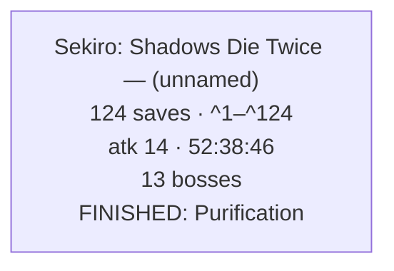

# Sekiro: Shadows Die Twice — Corpus Timeline

This directory contains all 125 individual PC `.sl2` files in this collection:
124 readable Wolf snapshots and one empty save container. This README is the
generated interpretation of the readable files. Preserve a copy before loading
or editing anything, and use the collection offline.

**Collection setup:** Game of the Year Edition, version 1.06, PC, Heroic,
GE-Proton11-3, and Nobara Linux 44. Inactive Sekiro padding was canonicalised
only on copies after integrity verification; no backup file was changed.

---

# FromSoftware Saves — Combined Playthrough Timeline

_Reconstructed from 124 save files across 1 run and 1 game: Sekiro: Shadows Die Twice._

_Every timestamp is an UPPER BOUND, not the moment it happened: a thing is dated to the first save it appears in, so the real event is somewhere between the previous save and that one. This is a reconstruction from sparse backups, not a log._

---

## The Journey

_One box per character, in the order the files were last written — the only clock the games share, since a Dark Souls II play time and a Dark Souls III one are unrelated numbers._

---

## Sekiro: Shadows Die Twice — (unnamed)

_124 saves · atk 1 → atk 14 · 2:05:30 → 52:38:46 played · 55 bonfires · 13 bosses · 488 of 581 world items · finished: Purification._

### Save Tree

_Each box is one save file, numbered as in the references at the end. A snapshot's parent is the latest earlier one whose progress it still entirely contains — event flags never clear, so a fork (the same save played on twice) lands both children on the shared ancestor._

_3 forks, a dashed box is where a line stopped._

```mermaid
flowchart TD
  n0["^20 · 2:05:30<br/>atk 1<br/>KEY ITEM: Kusabimaru · Night Eye +1 more<br/>+3 world items"]
  n1["^21 · 2:40:13<br/>atk 1<br/>KEY ITEM: Resurrection · Shinobi Prosthetic +1 more<br/>+3 bonfires<br/>+8 world items"]
  n2["^103 · 5:15:19<br/>atk 1<br/>MINIBOSS: General Naomori Kawarada<br/>GOURD SEED USED: gourd 1 → 2<br/>KEY ITEM: Flame Barrel · Flame Barrel Memo +5 more"]
  n3["^122 · 6:25:43<br/>atk 1<br/>KEY ITEM: Prosthetic Esoteric Text<br/>+6 world items"]
  n4["^123 · 9:19:46<br/>atk 1<br/>MINIBOSS: Chained Ogre · Juzou the Drunkard +1 more<br/>GOURD SEED USED: gourd 2 → 3<br/>KEY ITEM: Hidden Temple Key · Shinobi Medicine Rank 1 +1 more"]
  n5["^124 · 9:20:07<br/>atk 1<br/>NECKLACE USED: vitality 1 → 2<br/>KEY ITEM: First Prayer Necklace"]
  n6["^1 · 12:04:28<br/>atk 1<br/>MINIBOSS: General Tenzen Yamauchi<br/>KEY ITEM: Phantom Kunai · Prayer Bead<br/>+1 bonfire: Underbridge Valley"]
  n7["^2 · 12:04:44<br/>atk 1<br/>+1 bonfire: Ashina Castle Fortress"]
  n8["^3 · 14:26:51<br/>atk 1<br/>KEY ITEM: Robert's Firecrackers<br/>+6 world items"]
  n9["^4 · 14:33:50<br/>atk 1<br/>BOSS: Gyoubu Masataka Oniwa<br/>KEY ITEM: Mechanical Barrel · Memory: Gyoubu Oniwa"]
  n10["^5 · 14:34:09<br/>atk 1"]
  n11["^6 · 14:34:22<br/>atk 1<br/>+1 bonfire: Ashina Castle Gate"]
  n12["^7 · 15:26:59<br/>atk 1<br/>+8 world items"]
  n13["^8 · 15:29:29<br/>atk 1<br/>MINIBOSS: Blazing Bull<br/>KEY ITEM: Shinobi Medicine Rank 2<br/>+1 bonfire: Ashina Castle"]
  n14["^9 · 15:38:39<br/>atk 1<br/>KEY ITEM: Gatehouse Key<br/>+3 world items"]
  n15["^10 · 15:42:12<br/>atk 1<br/>+1 bonfire: Abandoned Dungeon Entrance"]
  n16["^11 · 15:49:25<br/>atk 1<br/>+1 world item"]
  n17["^12 · 15:49:37<br/>atk 1<br/>+1 bonfire: Ashina Reservoir"]
  n18["^13 · 17:12:12<br/>atk 1<br/>KEY ITEM: Rot Essence: Crow Mob · Rot Essence: Newcomer<br/>+5 world items"]
  n19["^14 · 17:35:58<br/>atk 2<br/>BOSS: Lady Butterfly<br/>MEMORY SPENT: attack 1 → 2<br/>KEY ITEM: Memory: Lady Butterfly · Remnant: Gyoubu +1 more"]
  n20["^15 · 17:52:36<br/>atk 3<br/>MINIBOSS: Lone Shadow Longswordsman<br/>MEMORY SPENT: attack 2 → 3<br/>KEY ITEM: Remnant: Lady Butterfly"]
  n21["^16 · 19:07:32<br/>atk 3<br/>KEY ITEM: Gyoubu's Broken Horn · Rotting Prisoner's Note +1 more<br/>+16 world items"]
  n22["^17 · 19:07:44<br/>atk 3<br/>+1 bonfire: Hirata Estate - Hidden Temple"]
  n23["^18 · 19:21:18<br/>atk 3<br/>+4 world items"]
  n24["^19 · 19:22:11<br/>atk 3<br/>+1 bonfire: Upper Tower - Antechamber"]
  n25["^22 · 20:26:16<br/>atk 3<br/>GOURD SEED USED: gourd 3 → 4<br/>KEY ITEM: Dragon's Blood Droplet · Iron Fortress +1 more<br/>+1 bonfire: Old Grave"]
  n26["^23 · 20:32:46<br/>atk 3<br/>KEY ITEM: Anti-air Deathblow Text"]
  n27["^24 · 21:05:02<br/>atk 3<br/>KEY ITEM: Rot Essence: Surgeons<br/>+3 world items"]
  n28["^25 · 21:05:27<br/>atk 3<br/>+1 bonfire: Upper Tower - Ashina Dojo<br/>+1 world item"]
  n29["^26 · 22:01:15<br/>atk 3<br/>MINIBOSS: General Kuranosuke Matsumoto · Ashina Elite - Jinsuke Saze<br/>NECKLACE USED: vitality 2 → 3<br/>KEY ITEM: Dragonrot Blood Sample · Nightjar Beacon Memo +1 more"]
  n30["^27 · 22:01:35<br/>atk 3<br/>+1 bonfire: Underground Waterway"]
  n31["^28 · 22:06:23<br/>atk 3<br/>+5 world items"]
  n32["^29 · 22:06:34<br/>atk 3<br/>+1 bonfire: Senpou Temple, Mt. Kongo"]
  n33["^30 · 23:22:31<br/>atk 3<br/>KEY ITEM: Gourd Seed<br/>+25 world items"]
  n34["^31 · 23:22:40<br/>atk 3<br/>+1 bonfire: Shugendo"]
  n35["^32 · 25:05:15<br/>atk 3<br/>MINIBOSS: Armored Warrior<br/>KEY ITEM: Breath of Nature: Shadow · Monkey Booze +6 more<br/>+2 bonfires: Bell Demon's Temple · Temple Grounds"]
  n36["^33 · 25:29:43<br/>atk 3<br/>GOURD SEED USED: gourd 4 → 5<br/>KEY ITEM: Holy Chapter: Infested · Recovery Charm +1 more<br/>+1 bonfire: Main Hall"]
  n37["^34 · 32:24:26<br/>atk 3<br/>MINIBOSS: Leader Shigenori Yamauchi · Seven Ashina Spears - Shikibu Toshikatsu Yamauchi +1 more<br/>NECKLACE USED: vitality 3 → 4<br/>KEY ITEM: Rot Essence: Faithful One · Rot Essence: Pious Mob +1 more"]
  n38["^35 · 34:18:32<br/>atk 3<br/>NECKLACE USED: vitality 4 → 5<br/>GOURD SEED USED: gourd 5 → 6<br/>KEY ITEM: Ashina Esoteric Text · Ashina Sake +3 more"]
  n39["^36 · 34:47:16<br/>atk 3<br/>+3 bonfires<br/>+9 world items"]
  n40["^37 · 35:20:51<br/>atk 3<br/>BOSS: Genichiro Ashina<br/>KEY ITEM: Bloodsmoke Ninjutsu · Memory: Genichiro<br/>+1 bonfire: Castle Tower Lookout"]
  n41["^38 · 35:34:28<br/>atk 3<br/>KEY ITEM: Gourd Seed · Sabimaru Memo (Bought) +3 more<br/>+1 bonfire: Upper Tower - Kuro's Room<br/>+1 world item"]
  n42["^39 · 35:36:49<br/>atk 3<br/>KEY ITEM: Immortal Severance Text"]
  n43["^40 · 36:02:23<br/>atk 4<br/>MEMORY SPENT: attack 3 → 4<br/>GOURD SEED USED: gourd 6 → 7<br/>KEY ITEM: Fragrant Flower Note · Gun Fort Shrine Key +1 more"]
  n44["^41 · 36:06:44<br/>atk 4<br/>GOURD SEED USED: gourd 7 → 8"]
  n45["^42 · 36:22:18<br/>atk 4<br/>MINIBOSS: Snake Eyes Shirahagi<br/>KEY ITEM: Prayer Bead<br/>+1 bonfire: Hidden Forest"]
  n46["^43 · 36:41:09<br/>atk 4<br/>+1 world item"]
  n47["^44 · 36:45:37<br/>atk 5<br/>BOSS: Folding Screen Monkeys<br/>MEMORY SPENT: attack 4 → 5<br/>KEY ITEM: Puppeteer Ninjutsu · Remnant: Screen Monkeys"]
  n48["^45 · 37:50:21<br/>atk 5<br/>KEY ITEM: Mortal Blade<br/>+1 bonfire: Sunken Valley Cavern<br/>+3 world items"]
  n49["^46 · 38:03:21<br/>atk 5<br/>MINIBOSS: Long-arm Centipede Giraffe<br/>KEY ITEM: Fresh Serpent Viscera · Large Fan<br/>+2 bonfires: Gun Fort · Riven Cave"]
  n50["^47 · 38:39:08<br/>atk 5<br/>MINIBOSS: Snake Eyes Shirafuji<br/>+1 bonfire: Bodhisattva Valley<br/>+13 world items"]
  n51["^48 · 38:49:39<br/>atk 5<br/>+2 world items"]
  n52["^49 · 39:14:26<br/>atk 5<br/>MINIBOSS: Mist Noble · Tokujiro the Glutton<br/>NECKLACE USED: vitality 5 → 6<br/>KEY ITEM: Fifth Prayer Necklace · Floating Passage Text"]
  n53["^50 · 39:39:16<br/>atk 5"]
  n54["^51 · 40:03:33<br/>atk 5<br/>+1 bonfire: Water Mill<br/>+13 world items"]
  n55["^52 · 40:06:13<br/>atk 5<br/>KEY ITEM: Prayer Bead<br/>+5 world items"]
  n56["^53 · 40:09:45<br/>atk 6<br/>BOSS: Corrupted Monk<br/>MEMORY SPENT: attack 5 → 6<br/>KEY ITEM: Remnant: Corrupted Monk"]
  n57["^54 · 40:53:40<br/>atk 6<br/>KEY ITEM: Red Carp Eyes · Shelter Stone +1 more<br/>+23 world items"]
  n58["^55 · 40:56:25<br/>atk 6"]
  n59["^56 · 41:00:51<br/>atk 6<br/>MINIBOSS: O'Rin of the Water<br/>NECKLACE USED: vitality 6 → 7<br/>KEY ITEM: Breath of Life: Shadow · Sixth Prayer Necklace"]
  n60["^57 · 41:19:39<br/>atk 6<br/>KEY ITEM: Surgeon's Stained Letter<br/>+1 world item"]
  n61["^58 · 41:20:18<br/>atk 6"]
  n62["^59 · 41:27:08<br/>atk 6<br/>BOSS: Guardian Ape<br/>KEY ITEM: Memory: Guardian Ape · Slender Finger<br/>+1 bonfire: Guardian Ape's Watering Hole"]
  n63["^60 · 41:47:55<br/>atk 7<br/>MEMORY SPENT: attack 6 → 7<br/>KEY ITEM: Lotus of the Palace · Precious Bait +1 more<br/>+12 world items"]
  n64["^61 · 41:51:32<br/>atk 7<br/>MINIBOSS: Lone Shadow Vilehand<br/>KEY ITEM: Prayer Bead<br/>+1 world item"]
  n65["^62 · 41:58:39<br/>atk 7<br/>MINIBOSS: Lone Shadow Masanaga the Spear-Bearer<br/>+1 world item"]
  n66["^63 · 42:03:50<br/>atk 7"]
  n67["^64 · 42:18:16<br/>atk 7<br/>MINIBOSS: Chained Ogre<br/>KEY ITEM: Shinobi Medicine Rank 3<br/>+1 world item"]
  n68["^65 · 42:41:21<br/>atk 7<br/>+2 world items"]
  n69["^66 · 42:47:34<br/>atk 7<br/>BOSS: Headless Ape<br/>KEY ITEM: Bestowal Ninjutsu · Memory: Headless Ape<br/>+1 bonfire: Guardian Ape's Burrow"]
  n70["^67 · 43:05:15<br/>atk 8<br/>MEMORY SPENT: attack 7 → 8<br/>NECKLACE USED: vitality 7 → 8<br/>KEY ITEM: Remnant: Headless Ape · Seventh Prayer Necklace"]
  n71["^68 · 43:35:24<br/>atk 8<br/>MINIBOSS: Shichimen Warrior<br/>KEY ITEM: Gourd Seed · Malcontent's Ring<br/>+5 world items"]
  n72["^69 · 44:01:41<br/>atk 8<br/>GOURD SEED USED: gourd 8 → 9<br/>+1 world item"]
  n73["^70 · 44:02:41<br/>atk 8"]
  n74["^71 · 44:04:47<br/>atk 8"]
  n75["^72 · 44:09:51<br/>atk 8<br/>ENDING: Shura<br/>BOSS: Emma, the Gentle Blade · Isshin Ashina<br/>KEY ITEM: Memory: Isshin Ashina · One Mind"]
  n76["^73 · 44:10:36<br/>atk 8<br/>BOSS: Great Shinobi Owl<br/>KEY ITEM: Aromatic Branch · Memory: Great Shinobi"]
  n77["^74 · 44:40:18<br/>atk 9<br/>BOSS: True Corrupted Monk<br/>MEMORY SPENT: attack 8 → 9<br/>KEY ITEM: Dosaku's Note · Immortal Severance Scrap +2 more"]
  n78["^75 · 44:48:50<br/>atk 10<br/>MEMORY SPENT: attack 9 → 10<br/>KEY ITEM: Dragon's Tally Board · Remnant: True Monk<br/>+2 bonfires: Mibu Manor · Vermilion Bridge"]
  n79["^76 · 45:01:53<br/>atk 10<br/>+1 bonfire: Flower Viewing Stage<br/>+8 world items"]
  n80["^77 · 45:11:46<br/>atk 10<br/>MINIBOSS: Sakura Bull of the Palace<br/>KEY ITEM: A Beast's Karma<br/>+12 world items"]
  n81["^78 · 45:19:10<br/>atk 10<br/>+1 bonfire: Great Sakura<br/>+1 world item"]
  n82["^79 · 45:28:46<br/>atk 10<br/>MINIBOSS: Okami Leader Shizu<br/>NECKLACE USED: vitality 8 → 9<br/>KEY ITEM: Eighth Prayer Necklace"]
  n83["^80 · 46:32:24<br/>atk 10<br/>KEY ITEM: Dried Serpent Viscera · Father's Bell Charm +3 more<br/>+12 world items"]
  n84["^81 · 46:51:12<br/>atk 10<br/>+6 world items"]
  n85["^82 · 47:02:48<br/>atk 10<br/>MINIBOSS: Juzou the Drunkard · Lone Shadow Masanaga the Spear-Bearer<br/>KEY ITEM: Prayer Bead<br/>+1 world item"]
  n86["^83 · 47:53:00<br/>atk 10<br/>+8 world items"]
  n87["^84 · 48:16:48<br/>atk 10<br/>+2 bonfires: Near Pot Noble · Palace Grounds<br/>+4 world items"]
  n88["^85 · 48:31:07<br/>atk 10<br/>KEY ITEM: Gourd Seed<br/>+1 bonfire: Feeding Grounds<br/>+2 world items"]
  n89["^86 · 48:34:51<br/>atk 10<br/>KEY ITEM: Rot Essence: Jail Mob · Rot Essence: Surgeons +1 more<br/>+1 bonfire: Sanctuary"]
  n90["^87 · 48:41:10<br/>atk 11<br/>BOSS: Divine Dragon<br/>MEMORY SPENT: attack 10 → 11<br/>GOURD SEED USED: gourd 9 → 10"]
  n91["^88 · 48:53:25<br/>atk 11<br/>+1 bonfire: Flames of Hatred<br/>+5 world items"]
  n92["^89 · 49:10:21<br/>atk 10<br/>GOURD SEED USED: gourd 9 → 10<br/>KEY ITEM: Black Scroll · Frozen Tears +1 more<br/>+2 world items"]
  n93["^90 · 49:17:31<br/>atk 10<br/>BOSS: Divine Dragon<br/>KEY ITEM: Divine Dragon's Tears · Memory: Divine Dragon +1 more"]
  n94["^91 · 49:22:42<br/>atk 11<br/>MINIBOSS: Headless<br/>MEMORY SPENT: attack 10 → 11<br/>KEY ITEM: Remnant: Divine Dragon"]
  n95["^92 · 49:24:14<br/>atk 11"]
  n96["^93 · 49:26:19<br/>atk 11<br/>MINIBOSS: Ashina Elite - Ujinari Mizuo<br/>+1 world item"]
  n97["^94 · 49:31:31<br/>atk 11<br/>MINIBOSS: Shigekichi of the Red Guard<br/>KEY ITEM: Promissory Note<br/>+5 world items"]
  n98["^95 · 49:40:33<br/>atk 12<br/>MINIBOSS: Seven Ashina Spears - Shume Masaji Oniwa<br/>MEMORY SPENT: attack 11 → 12<br/>NECKLACE USED: vitality 9 → 10"]
  n99["^96 · 49:45:20<br/>atk 13<br/>BOSS: Owl (Father)<br/>MEMORY SPENT: attack 12 → 13<br/>KEY ITEM: Aromatic Flower · Remnant: Foster Father"]
  n100["^97 · 49:46:30<br/>atk 13<br/>+1 bonfire: Near Secret Passage<br/>+1 world item"]
  n101["^98 · 49:47:34<br/>atk 12<br/>BOSS: Demon of Hatred<br/>MEMORY SPENT: attack 11 → 12<br/>KEY ITEM: Remnant: Hatred Demon"]
  n102["^99 · 49:51:32<br/>atk 13<br/>BOSS: Isshin, the Sword Saint<br/>KEY ITEM: Dragon Flash · Memory: Saint Isshin"]
  n103["^100 · 49:54:50<br/>atk 13<br/>ENDING: Return<br/>KEY ITEM: Another's Memory: Ashina"]
  n104["^101 · 49:56:02<br/>atk 12<br/>+4 world items"]
  n105["^102 · 49:57:16<br/>atk 12"]
  n106["^104 · 50:01:07<br/>atk 12<br/>MINIBOSS: Seven Ashina Spears - Shume Masaji Oniwa<br/>+1 world item"]
  n107["^105 · 50:33:20<br/>atk 12<br/>MINIBOSS: Shigekichi of the Red Guard<br/>+1 bonfire: Near Secret Passage<br/>+8 world items"]
  n108["^106 · 50:43:44<br/>atk 12"]
  n109["^107 · 51:08:19<br/>atk 12<br/>MINIBOSS: Headless<br/>KEY ITEM: Promissory Note<br/>+1 world item"]
  n110["^108 · 51:12:12<br/>atk 12<br/>MINIBOSS: Headless"]
  n111["^109 · 51:16:03<br/>atk 12<br/>MINIBOSS: Headless<br/>+2 world items"]
  n112["^110 · 51:23:16<br/>atk 12<br/>MINIBOSS: Headless<br/>+2 world items"]
  n113["^111 · 51:25:47<br/>atk 12<br/>MINIBOSS: Headless<br/>+1 world item"]
  n114["^112 · 51:29:06<br/>atk 12<br/>MINIBOSS: Ashina Elite - Ujinari Mizuo<br/>NECKLACE USED: vitality 9 → 10<br/>KEY ITEM: Black Scroll · Ninth Prayer Necklace"]
  n115["^113 · 51:31:50<br/>atk 12<br/>MINIBOSS: Shichimen Warrior<br/>+1 world item"]
  n116["^114 · 51:36:29<br/>atk 12<br/>MINIBOSS: Shichimen Warrior"]
  n117["^115 · 52:14:03<br/>atk 13<br/>MEMORY SPENT: attack 12 → 13<br/>KEY ITEM: Dancing Dragon Mask"]
  n118["^116 · 52:14:47<br/>atk 13"]
  n119["^117 · 52:19:52<br/>atk 13<br/>BOSS: Owl (Father)<br/>KEY ITEM: Aromatic Flower · Memory: Foster Father"]
  n120["^118 · 52:23:18<br/>atk 14<br/>MEMORY SPENT: attack 13 → 14<br/>KEY ITEM: Remnant: Foster Father"]
  n121["^119 · 52:33:54<br/>atk 14<br/>BOSS: Isshin, the Sword Saint<br/>KEY ITEM: Dragon Flash · Memory: Saint Isshin"]
  n122["^120 · 52:36:30<br/>atk 14<br/>ENDING: Immortal Severance<br/>KEY ITEM: Another's Memory: Ashina"]
  n123["^121 · 52:38:46<br/>atk 14<br/>ENDING: Purification<br/>KEY ITEM: Another's Memory: Ashina"]
  n0 --> n1
  n1 --> n2
  n2 --> n3
  n3 --> n4
  n4 --> n5
  n5 --> n6
  n6 --> n7
  n7 --> n8
  n8 --> n9
  n9 --> n10
  n10 --> n11
  n11 --> n12
  n12 --> n13
  n13 --> n14
  n14 --> n15
  n15 --> n16
  n16 --> n17
  n17 --> n18
  n18 --> n19
  n19 --> n20
  n20 --> n21
  n21 --> n22
  n22 --> n23
  n23 --> n24
  n24 --> n25
  n25 --> n26
  n26 --> n27
  n27 --> n28
  n28 --> n29
  n29 --> n30
  n30 --> n31
  n31 --> n32
  n32 --> n33
  n33 --> n34
  n34 --> n35
  n35 --> n36
  n36 --> n37
  n37 --> n38
  n38 --> n39
  n39 --> n40
  n40 --> n41
  n41 --> n42
  n42 --> n43
  n43 --> n44
  n44 --> n45
  n45 --> n46
  n46 --> n47
  n47 --> n48
  n48 --> n49
  n49 --> n50
  n50 --> n51
  n51 --> n52
  n52 --> n53
  n53 --> n54
  n54 --> n55
  n55 --> n56
  n56 --> n57
  n57 --> n58
  n58 --> n59
  n59 --> n60
  n60 --> n61
  n61 --> n62
  n62 --> n63
  n63 --> n64
  n64 --> n65
  n65 --> n66
  n66 --> n67
  n67 --> n68
  n68 --> n69
  n69 --> n70
  n70 --> n71
  n71 --> n72
  n72 --> n73
  n73 --> n74
  n74 --> n75
  n74 --> n76
  n76 --> n77
  n77 --> n78
  n78 --> n79
  n79 --> n80
  n80 --> n81
  n81 --> n82
  n82 --> n83
  n83 --> n84
  n84 --> n85
  n85 --> n86
  n86 --> n87
  n87 --> n88
  n88 --> n89
  n89 --> n90
  n90 --> n91
  n89 --> n92
  n92 --> n93
  n93 --> n94
  n94 --> n95
  n95 --> n96
  n96 --> n97
  n97 --> n98
  n98 --> n99
  n99 --> n100
  n91 --> n101
  n100 --> n102
  n102 --> n103
  n101 --> n104
  n104 --> n105
  n105 --> n106
  n106 --> n107
  n107 --> n108
  n108 --> n109
  n109 --> n110
  n110 --> n111
  n111 --> n112
  n112 --> n113
  n113 --> n114
  n114 --> n115
  n115 --> n116
  n116 --> n117
  n117 --> n118
  n118 --> n119
  n119 --> n120
  n120 --> n121
  n121 --> n122
  n121 --> n123
  classDef ending fill:#3a2a12,stroke:#c9a227,color:#f0e6d2,stroke-width:2px;
  class n75,n103,n122,n123 ending;
```

### Current State — `Wolf_52-38-46_atk14_13b.sl2` (^121)

### Slot 1: (unnamed)

- **Playthrough:** New Game
- **Play Time:** 52:38:46
- **Sen held:** 87
- **Attack Power:** 14
- **Vitality:** 10  _(9 Prayer Necklaces used — four Prayer Beads each, read back from Vitality across every journey so far)_
- **Healing Gourd:** 10 charges  _(9 Gourd Seeds used — handed to Emma, read back from the gourd's own capacity across every journey so far)_
- **Skill Points Held:** 1  _(spendable at a Sculptor's Idol — the points already spent are not stored, so this is what is banked, not what has been earned)_
- **Memories:** 14 Memory-dropping bosses defeated  _(13 Memories already spent, read back from Attack Power, plus 1 still held — this journey; a boss that drops no Memory is not counted either way)_
- **Max HP:** 1,040
- **Max Posture:** 390
- **Ending Reached:** Purification

#### Key Items  _(progress / areas & shortcuts unlocked)_

- Night Eye
- Shinobi Medicine Rank 1
- Resurrection
- Three-story Pagoda Memo (In Shop)
- Shinobi Medicine Rank 2
- Breath of Nature: Shadow
- Dragon's Blood Droplet
- Sabimaru Memo (In Shop)
- Bloodsmoke Ninjutsu
- Puppeteer Ninjutsu
- Breath of Life: Shadow
- Shinobi Medicine Rank 3
- Bestowal Ninjutsu
- A Beast's Karma
- Valley Apparitions Memo (In Shop)
- Dragon Flash
- Ornamental Letter
- Kusabimaru
- Shinobi Prosthetic
- Rat Description
- Young Lord's Bell Charm
- First Prayer Necklace
- Flame Barrel Memo
- Shinobi Esoteric Text
- Fifth Prayer Necklace
- Prosthetic Esoteric Text
- Hidden Temple Key
- Unrefined Sake ×2
- Second Prayer Necklace
- Remnant: Gyoubu
- Gatehouse Key
- Ashina Esoteric Text
- Remnant: Genichiro
- Gun Fort Shrine Key
- Remnant: Lady Butterfly
- Rotting Prisoner's Note
- Surgeon's Bloody Letter
- Anti-air Deathblow Text
- Fourth Prayer Necklace
- Third Prayer Necklace
- Nightjar Beacon Memo
- Ashina Sake
- Ashina Sake ×2
- White Pinwheel
- Monkey Booze ×2
- Three-story Pagoda Memo (Bought)
- Sabimaru Memo (Bought)
- Immortal Severance Text
- Unrefined Sake
- Fresh Serpent Viscera
- Senpou Esoteric Text
- Recovery Charm
- Fragrant Flower Note
- Remnant: Screen Monkeys
- Isshin's Letter
- Mortal Blade
- Floating Passage Text
- Sixth Prayer Necklace
- Remnant: Corrupted Monk
- Shelter Stone
- Treasure Carp Scale ×3
- Remnant: Guardian Ape
- Surgeon's Stained Letter
- Precious Bait ×4
- Lotus of the Palace
- Eighth Prayer Necklace
- Remnant: Headless Ape
- Seventh Prayer Necklace
- Aromatic Branch
- Remnant: Great Shinobi
- Page's Diary
- Dosaku's Note
- Immortal Severance Scrap
- Dragon's Tally Board
- Remnant: True Monk
- Valley Apparitions Memo (Bought)
- Dried Serpent Viscera
- Tomoe's Note
- Father's Bell Charm
- Ninth Prayer Necklace
- Remnant: Divine Dragon
- Aromatic Flower
- Remnant: Foster Father
- Memory: Saint Isshin
- Divine Dragon's Tears
- Remnant: Hatred Demon
- Secret Passage Key
- Promissory Note
- Black Scroll
- Another's Memory: Ashina
- Dancing Dragon Mask

#### Sculptor's Idols Lit (55 of 55, in 8 of 8 areas)  _(each idol's own flag bit, by area — a floor, and one that starts again on a new journey)_

- Ashina Outskirts: 8/8 — Dilapidated Temple, Outskirts Wall - Gate Path, Outskirts Wall - Stairway, Underbridge Valley, Ashina Castle Fortress, Ashina Castle Gate, Ashina Outskirts, Flames of Hatred
- Hirata Estate: 6/6 — Dragonspring - Hirata Estate, Estate Path, Bamboo Thicket Slope, Hirata Estate - Main Hall, Hirata Estate - Hidden Temple, Hirata Audience Chamber
- Ashina Castle: 10/10 — Ashina Castle, Upper Tower - Antechamber, Castle Tower Lookout, Upper Tower - Kuro's Room, Great Serpent Shrine, Abandoned Dungeon Entrance, Old Grave, Upper Tower - Ashina Dojo, Near Secret Passage, Ashina Reservoir
- Abandoned Dungeon: 2/2 — Underground Waterway, Bottomless Hole
- Senpou Temple, Mt. Kongo: 7/7 — Senpou Temple, Mt. Kongo, Shugendo, Temple Grounds, Main Hall, Inner Sanctum, Sunken Valley Cavern, Bell Demon's Temple
- Sunken Valley: 6/6 — Sunken Valley, Gun Fort, Riven Cave, Guardian Ape's Watering Hole, Under-Shrine Valley, Bodhisattva Valley
- Ashina Depths: 7/7 — Hidden Forest, Mibu Village, Water Mill, Wedding Cave Door, Poison Pool, Ashina Depths, Guardian Ape's Burrow
- Fountainhead Palace: 9/9 — Fountainhead Palace, Vermilion Bridge, Flower Viewing Stage, Great Sakura, Palace Grounds, Sanctuary, Mibu Manor, Feeding Grounds, Near Pot Noble

#### Minibosses Defeated (37 of 37 tracked)  _(each miniboss's own defeat flag — exact, not inferred, but it resets on a new journey; names are the game's own, so a repeat in an area is a second placement of that character)_

- Ashina Outskirts: 5/5 — General Naomori Kawarada · General Tenzen Yamauchi · Chained Ogre · Headless · Shigekichi of the Red Guard
- Hirata Estate: 4/4 — Juzou the Drunkard ×2 · Shinobi Hunter Enshin of Misen · Lone Shadow Masanaga the Spear-Bearer
- Ashina Castle: 8/8 — Lone Shadow Vilehand · Lone Shadow Masanaga the Spear-Bearer · General Kuranosuke Matsumoto · Blazing Bull · Ashina Elite - Jinsuke Saze · Ashina Elite - Ujinari Mizuo · Chained Ogre · Headless
- Ashina Reservoir: 4/4 — Leader Shigenori Yamauchi · Lone Shadow Longswordsman · Seven Ashina Spears - Shume Masaji Oniwa · Seven Ashina Spears - Shikibu Toshikatsu Yamauchi
- Abandoned Dungeon: 1/1 — Shichimen Warrior
- Senpou Temple, Mt. Kongo: 2/2 — Long-arm Centipede Sen'un · Armored Warrior
- Sunken Valley: 5/5 — Snake Eyes Shirafuji · Snake Eyes Shirahagi · Long-arm Centipede Giraffe · Headless · Shichimen Warrior
- Ashina Depths: 4/4 — Mist Noble · Tokujiro the Glutton · Headless · O'Rin of the Water
- Fountainhead Palace: 4/4 — Okami Leader Shizu · Headless · Sakura Bull of the Palace · Shichimen Warrior

#### Items Collected (488 of 581 tracked)  _(one-off world items picked up, from each area's item-lot flags — covers the nine areas whose flag bank is mapped, 581 of the 826 lots the table knows)_

- Ashina Outskirts: 58/70  _(12 still out there)_
- Hirata Estate: 54/64  _(10 still out there)_
- Ashina Castle: 83/97  _(14 still out there)_
- Ashina Reservoir: 18/20  _(2 still out there)_
- Abandoned Dungeon: 26/27  _(1 still out there)_
- Senpou Temple, Mt. Kongo: 72/76  _(4 still out there)_
- Sunken Valley: 68/89  _(21 still out there)_
- Ashina Depths: 60/68  _(8 still out there)_
- Fountainhead Palace: 49/70  _(21 still out there)_

Where the missing items are — the ones with a known location

**Ashina Outskirts** — 12 missing

- Light Coin Purse — ashinaoutskirts stairway ×3
- Heavy Coin Purse — ashinaoutskirts fortress1
- Bundled Jizo Statue — ashinaoutskirts gatepath
- Ako's Sugar — ashinaoutskirts gatepath
- Ceramic Shard — ashinaoutskirts gatepath
- Ceramic Shard — ashinaoutskirts fortress1
- Mibu Balloon of Wealth — ashinaoutskirts fortress1
- Adamantite Scrap — ashinaoutskirts invasion2
- Ministry Dousing Powder — ashinaoutskirts invasion2
- Pellet — ashinaoutskirts invasion2

**Hirata Estate** — 10 missing

- Dragon's Blood Droplet — fountainhead
- Lapis Lazuli — fountainhead
- Ungo's Sugar — hirata
- Mibu Possession Balloon — hirata sidepath
- Mibu Balloon of Soul — hirata sidepath
- Bundled Jizo Statue — hirata
- Pellet — hirata sidepath
- Pellet — hirata courtyard2
- Gokan's Sugar — hirata temple2
- Red Lump — hirata

**Ashina Castle** — 14 missing

- Light Coin Purse — ashinacastle
- Scrap Iron — ashinacastle
- Gachiin's Sugar — ashinacastle
- Heavy Coin Purse — ashinacastle
- Pellet — ashinacastle invasion1
- Antidote Powder — ashinacastle invasion1
- Ako's Sugar — ashinacastle invasion2
- Pellet — ashinacastle invasion2
- Gokan's Sugar — ashinacastle invasion2
- Bundled Jizo Statue — ashinacastle
- Oil — ashinacastle invasion1
- Black Gunpowder — ashinacastle invasion1
- Adamantite Scrap — ashinacastle invasion2
- Prayer Bead — ashinacastle

**Ashina Reservoir** — 2 missing

- Fulminated Mercury — ashinareservoir invasion2
- Mibu Balloon of Soul — ashinareservoir underwater

**Abandoned Dungeon** — 1 missing

- Black Gunpowder — dungeon

**Senpou Temple, Mt. Kongo** — 4 missing

- Holy Chapter: Dragon's Return — senpou grounds
- Ceramic Shard — senpou grounds
- Mibu Possession Balloon — senpou grounds
- Divine Grass — senpou

**Sunken Valley** — 21 missing

- Bundled Jizo Statue — sunkenvalley
- Bundled Jizo Statue — sunkenvalley burrow1
- Divine Confetti — sunkenvalley
- Gokan's Sugar — sunkenvalley
- Ungo's Sugar — sunkenvalley
- Snap Seed — sunkenvalley passage
- Ungo's Sugar — sunkenvalley passage
- Pacifying Agent — sunkenvalley passage
- Divine Confetti — sunkenvalley shrine
- Ako's Sugar — sunkenvalley passage
- Fulminated Mercury — sunkenvalley passage
- Yellow Gunpowder — sunkenvalley burrow1
- Yellow Gunpowder — sunkenvalley poisonpool
- Contact Medicine — sunkenvalley passage ×2
- Scrap Magnetite — sunkenvalley passage
- Monkey Booze — sunkenvalley burrow1
- Contact Medicine — sunkenvalley
- Scrap Iron — sunkenvalley passage
- Prayer Bead — sunkenvalley
- Prayer Bead — sunkenvalley burrow1

**Ashina Depths** — 8 missing

- Adamantite Scrap — hiddenforest
- Fistful of Ash — mibuvillage
- Precious Bait — mibuvillage underwater
- Contact Medicine — mibuvillage
- Yashariku's Sugar — mibuvillage
- Adamantite Scrap — mibuvillage ×2
- Heavy Coin Purse — mibuvillage

**Fountainhead Palace** — 21 missing

- Mibu Balloon of Wealth — fountainhead surface
- Treasure Carp Scale — fountainhead ×6
- Ako's Sugar — fountainhead surface
- Heavy Coin Purse — fountainhead surface
- Bulging Coin Purse — fountainhead surface
- Light Coin Purse — fountainhead
- Adamantite Scrap — fountainhead
- Mibu Balloon of Soul — fountainhead
- Dragon's Blood Droplet — fountainhead
- Heavy Coin Purse — fountainhead
- Adamantite Scrap — fountainhead surface
- Lump of Grave Wax — fountainhead surface ×2
- Water of the Palace — fountainhead
- Ako's Sugar — fountainhead
- Ungo's Sugar — fountainhead

#### Bosses Defeated (13 of 18 tracked)  _(a floor — from defeat flags, held boss souls, progression, and NG+ clears; a boss whose soul was consumed and isn't gated may still be missing)_

- Isshin, the Sword Saint  _(confirmed, soul held)_
- Gyoubu Masataka Oniwa  _(confirmed)_
- Lady Butterfly  _(confirmed)_
- Genichiro Ashina  _(confirmed)_
- Guardian Ape  _(confirmed)_
- Folding Screen Monkeys  _(confirmed)_
- Corrupted Monk  _(confirmed)_
- Headless Ape  _(confirmed)_
- Great Shinobi Owl  _(confirmed)_
- True Corrupted Monk  _(confirmed)_
- Divine Dragon  _(confirmed)_
- Demon of Hatred  _(confirmed)_
- Owl (Father)  _(confirmed)_

_No evidence yet: Emma, the Gentle Blade · Inner Father (Gauntlet) · Inner Genichiro (Gauntlet) · Inner Isshin (Gauntlet) · Isshin Ashina._

#### Inventory

##### Combat Arts

- Whirlwind Slash
- Praying Strikes
- Ichimonji
- Mortal Draw
- Floating Passage
- Ichimonji: Double
- Nightjar Slash
- Dragon Flash

##### Prosthetic Tools

- Loaded Shuriken
- Loaded Axe
- Spinning Shuriken
- Flame Vent
- Spring-load Axe
- Malconent
- Phantom Kunai
- Loaded Spear
- Sabimaru
- Shinobi Firecracker
- Improved Sabimaru
- Loaded Umbrella
- Spring-load Firecracker
- Spring-load Flame Vent
- Double Divine Abduction
- Loaded Umbrella - Magnet
- Divine Abduction
- Long Spark
- Mountain Echo
- Sparking Axe
- Golden Vortex
- Finger Whistle
- Loaded Spear Thrust type
- Gouging Top
- Phoenix's Lilac Umbrella
- Suzaku's Lotus Umbrella
- Loaded Spear Cleave type
- Purple Fume Spark
- Spiral Spear
- Sen Throw
- Aged Feather Mist Raven
- Mist Raven
- Okinaga's Flame Vent
- Piercing Sabimaru
- Leaping Flame

##### Skills & Techniques

- Breath of Life: Light
- Mikiri Counter
- Shinobi Medicine Rank 1
- Run and Slide
- Mid-air Deflection
- Grappling Hook Attack
- Chasing Slice
- Suppress Presence
- Suppress Sound
- Emma's Medicine: Potency
- A Shinobi's Karma: Body
- Fang and Blade
- Shinobi Medicine Rank 2
- A Shinobi's Karma: Mind
- Anti-air Deathblow
- Mid-air Prosthetic Tool
- Breath of Nature: Shadow
- Ascending Carp
- Descending Carp
- Shinobi Eyes
- Floating Passage
- Mibu Breathing Technique
- Breath of Life: Shadow
- Flowing Water
- Shinobi Medicine Rank 3
- Projected Force
- Virtuous Deed
- A Beast's Karma
- Mid-air Combat Arts
- Emma's Medicine: Aroma

##### Attire

- Another's Memory: Ashina - Head
- Another's Memory: Ashina - Body
- Another's Memory: Ashina - Body - No Mortal Blade
- Another's Memory: Ashina - Prosthetic Arm
- Another's Memory: Ashina - Legs

##### Upgrade Materials

- Black Gunpowder ×10
- Scrap Magnetite ×14
- Yellow Gunpowder ×11
- Adamantite Scrap ×7
- Lump of Grave Wax ×12
- Lump of Fat Wax
- Lapis Lazuli ×4

##### Consumables

- Homeward Idol
- Healing Gourd ×10
- Fistful of Ash ×10
- Ceramic Shard ×10
- Ungo's Sugar ×3
- Temporary Regenerative Power
- Regenerative Power ×2
- Mibu Balloon of Wealth ×5
- Gachiin's Sugar ×3
- Dousing Powder ×5
- Mibu Possession Balloon ×5
- Spirit Emblem ×16
- Withered Red Gourd ×5
- Gokan's Sugar ×3
- Antidote Powder ×5
- Bulging Coin Purse ×2
- Nightjar Monocular
- Pacifying Agent ×5
- Snap Seed ×10
- Contact Medicine ×3
- Red Lump ×3
- Bite Down ×3
- Mibu Balloon of Soul ×5
- Divine Grass
- Eel Liver ×5
- Mibu Balloon of Spirit ×5
- Yashariku's Sugar ×3
- Heavy Coin Purse
- Persimmon ×2
- Bundled Jizo Statue
- Pellet ×3
- Light Coin Purse ×8
- Oil ×10
- Illusive Hall Bell
- Hidden Tooth
- Rice ×2
- Ministry Dousing Powder ×5
- Ako's Spiritfall
- Ungo's Spiritfall
- Gachiin's Spiritfall
- Gokan's Spiritfall
- Yashariku's Spiritfall
- Ceremonial Tanto ×3
- Divine Confetti ×5

##### Storage (item box)

- Pacifying Agent ×8
- Spirit Emblem ×136
- Ceramic Shard ×50
- Ungo's Sugar ×10
- Dousing Powder ×20
- Gachiin's Sugar ×12
- Mibu Possession Balloon ×18
- Fistful of Ash ×42
- Mibu Balloon of Wealth ×16
- Antidote Powder ×14
- Oil ×15
- Gokan's Sugar ×12
- Contact Medicine ×18
- Dragon's Blood Droplet ×9
- Mibu Balloon of Spirit ×11
- Bundled Jizo Statue ×4
- Eel Liver ×15
- Pellet ×44
- Yashariku's Sugar ×13
- Mibu Balloon of Soul ×23
- Bite Down ×4
- Snap Seed ×7
- Divine Grass ×4
- Red Lump
- Ministry Dousing Powder ×5

_10 further entries carried only an engine development name — placeholder rows and debug items rather than anything the game hands you — and were left out._

_41 further entries were engine state rather than inventory — Sekiro has no armour system, so the character's own body models sit in the protector table, the `Virtual Weapon:` rows restate a Combat Art already listed under its own name, and the two plain `Memory` rows are the game's counters of Memories spent and held. Counted here, not printed._

### Timeline

#### Bosses — first appearance

| Play Time | Atk | Boss | Evidence | Save |
|---|---|---|---|---|
| 14:33:50 | 1 | Gyoubu Masataka Oniwa | confirmed, soul held | ^4 |
| 17:35:58 | 2 | Lady Butterfly | confirmed, soul held | ^14 |
| 35:20:51 | 3 | Genichiro Ashina | confirmed, soul held | ^37 |
| 36:45:37 | 5 | Folding Screen Monkeys | confirmed | ^44 |
| 40:09:45 | 6 | Corrupted Monk | confirmed | ^53 |
| 41:27:08 | 6 | Guardian Ape | confirmed, soul held | ^59 |
| 42:47:34 | 7 | Headless Ape | confirmed, soul held | ^66 |
| 44:09:51 | 8 | Isshin Ashina | confirmed, soul held | ^72 |
| 44:09:51 | 8 | Emma, the Gentle Blade | confirmed | ^72 |
| 44:10:36 | 8 | Great Shinobi Owl | confirmed, soul held | ^73 |
| 44:40:18 | 9 | True Corrupted Monk | confirmed | ^74 |
| 48:41:10 | 11 | Divine Dragon | confirmed | ^87 |
| 49:45:20 | 13 | Owl (Father) | confirmed | ^96 |
| 49:47:34 | 12 | Demon of Hatred | confirmed | ^98 |
| 49:51:32 | 13 | Isshin, the Sword Saint | confirmed, soul held | ^99 |

#### Bonfires — first lit

**2:40:13 · atk 1 · ^21** — 3 total (+3)

- Ashina Outskirts: Ashina Outskirts
- Ashina Outskirts: Dilapidated Temple
- Ashina Outskirts: Outskirts Wall - Gate Path

**5:15:19 · atk 1 · ^103** — 6 total (+3)

- Ashina Outskirts: Outskirts Wall - Stairway
- Hirata Estate: Dragonspring - Hirata Estate
- Hirata Estate: Estate Path

**9:19:46 · atk 1 · ^123** — 9 total (+3)

- Hirata Estate: Bamboo Thicket Slope
- Hirata Estate: Hirata Audience Chamber
- Hirata Estate: Hirata Estate - Main Hall

**12:04:28 · atk 1 · ^1** — 10 total (+1)

- Ashina Outskirts: Underbridge Valley

**12:04:44 · atk 1 · ^2** — 11 total (+1)

- Ashina Outskirts: Ashina Castle Fortress

**14:34:22 · atk 1 · ^6** — 12 total (+1)

- Ashina Outskirts: Ashina Castle Gate

**15:29:29 · atk 1 · ^8** — 13 total (+1)

- Ashina Castle: Ashina Castle

**15:42:12 · atk 1 · ^10** — 14 total (+1)

- Ashina Castle: Abandoned Dungeon Entrance

**15:49:37 · atk 1 · ^12** — 15 total (+1)

- Ashina Castle: Ashina Reservoir

**19:07:44 · atk 3 · ^17** — 16 total (+1)

- Hirata Estate: Hirata Estate - Hidden Temple

**19:22:11 · atk 3 · ^19** — 17 total (+1)

- Ashina Castle: Upper Tower - Antechamber

**20:26:16 · atk 3 · ^22** — 18 total (+1)

- Ashina Castle: Old Grave

**21:05:27 · atk 3 · ^25** — 19 total (+1)

- Ashina Castle: Upper Tower - Ashina Dojo

**22:01:35 · atk 3 · ^27** — 20 total (+1)

- Abandoned Dungeon: Underground Waterway

**22:06:34 · atk 3 · ^29** — 21 total (+1)

- Senpou Temple, Mt. Kongo: Senpou Temple, Mt. Kongo

**23:22:40 · atk 3 · ^31** — 22 total (+1)

- Senpou Temple, Mt. Kongo: Shugendo

**25:05:15 · atk 3 · ^32** — 24 total (+2)

- Senpou Temple, Mt. Kongo: Bell Demon's Temple
- Senpou Temple, Mt. Kongo: Temple Grounds

**25:29:43 · atk 3 · ^33** — 25 total (+1)

- Senpou Temple, Mt. Kongo: Main Hall

**34:18:32 · atk 3 · ^35** — 28 total (+3)

- Ashina Castle: Great Serpent Shrine
- Sunken Valley: Sunken Valley
- Sunken Valley: Under-Shrine Valley

**34:47:16 · atk 3 · ^36** — 31 total (+3)

- Abandoned Dungeon: Bottomless Hole
- Ashina Depths: Ashina Depths
- Ashina Depths: Poison Pool

**35:20:51 · atk 3 · ^37** — 32 total (+1)

- Ashina Castle: Castle Tower Lookout

**35:34:28 · atk 3 · ^38** — 33 total (+1)

- Ashina Castle: Upper Tower - Kuro's Room

**36:22:18 · atk 4 · ^42** — 34 total (+1)

- Ashina Depths: Hidden Forest

**36:45:37 · atk 5 · ^44** — 35 total (+1)

- Senpou Temple, Mt. Kongo: Inner Sanctum

**37:50:21 · atk 5 · ^45** — 36 total (+1)

- Senpou Temple, Mt. Kongo: Sunken Valley Cavern

**38:03:21 · atk 5 · ^46** — 38 total (+2)

- Sunken Valley: Gun Fort
- Sunken Valley: Riven Cave

**38:39:08 · atk 5 · ^47** — 39 total (+1)

- Sunken Valley: Bodhisattva Valley

**39:14:26 · atk 5 · ^49** — 40 total (+1)

- Ashina Depths: Mibu Village

**40:03:33 · atk 5 · ^51** — 41 total (+1)

- Ashina Depths: Water Mill

**40:09:45 · atk 6 · ^53** — 42 total (+1)

- Ashina Depths: Wedding Cave Door

**41:27:08 · atk 6 · ^59** — 43 total (+1)

- Sunken Valley: Guardian Ape's Watering Hole

**42:47:34 · atk 7 · ^66** — 44 total (+1)

- Ashina Depths: Guardian Ape's Burrow

**44:40:18 · atk 9 · ^74** — 45 total (+1)

- Fountainhead Palace: Fountainhead Palace

**44:48:50 · atk 10 · ^75** — 47 total (+2)

- Fountainhead Palace: Mibu Manor
- Fountainhead Palace: Vermilion Bridge

**45:01:53 · atk 10 · ^76** — 48 total (+1)

- Fountainhead Palace: Flower Viewing Stage

**45:19:10 · atk 10 · ^78** — 49 total (+1)

- Fountainhead Palace: Great Sakura

**48:16:48 · atk 10 · ^84** — 51 total (+2)

- Fountainhead Palace: Near Pot Noble
- Fountainhead Palace: Palace Grounds

**48:31:07 · atk 10 · ^85** — 52 total (+1)

- Fountainhead Palace: Feeding Grounds

**48:34:51 · atk 10 · ^86** — 53 total (+1)

- Fountainhead Palace: Sanctuary

**48:53:25 · atk 11 · ^88** — 54 total (+1)

- Ashina Outskirts: Flames of Hatred

**49:46:30 · atk 13 · ^97** — 55 total (+1)

- Ashina Castle: Near Secret Passage

#### World items — where the count moved

_Only the areas whose pickup-flag group is mapped are counted, so an area absent here is unmapped, not empty._

**2:05:30 · atk 1 · ^20** — 3 total (+3)

- Ashina Reservoir: +3 (now 3)

**2:40:13 · atk 1 · ^21** — 11 total (+8)

- Ashina Outskirts: +8 (now 8)

**5:15:19 · atk 1 · ^103** — 33 total (+22)

- Ashina Outskirts: +7 (now 15)
- Hirata Estate: +15 (now 15)

**6:25:43 · atk 1 · ^122** — 39 total (+6)

- Hirata Estate: +6 (now 21)

**9:19:46 · atk 1 · ^123** — 59 total (+20)

- Ashina Outskirts: +9 (now 24)
- Hirata Estate: +11 (now 32)

**12:04:28 · atk 1 · ^1** — 72 total (+13)

- Ashina Outskirts: +10 (now 34)
- Hirata Estate: +3 (now 35)

**14:26:51 · atk 1 · ^3** — 78 total (+6)

- Ashina Outskirts: +5 (now 39)
- Hirata Estate: +1 (now 36)

**15:26:59 · atk 1 · ^7** — 86 total (+8)

- Ashina Castle: +8 (now 8)

**15:38:39 · atk 1 · ^9** — 89 total (+3)

- Ashina Castle: +3 (now 11)

**15:49:25 · atk 1 · ^11** — 90 total (+1)

- Ashina Castle: +1 (now 12)

**17:12:12 · atk 1 · ^13** — 95 total (+5)

- Ashina Castle: +2 (now 14)
- Ashina Reservoir: +3 (now 6)

**19:07:32 · atk 3 · ^16** — 111 total (+16)

- Abandoned Dungeon: +9 (now 9)
- Ashina Castle: +2 (now 16)
- Ashina Reservoir: +5 (now 11)

**19:21:18 · atk 3 · ^18** — 115 total (+4)

- Ashina Castle: +4 (now 20)

**20:26:16 · atk 3 · ^22** — 130 total (+15)

- Ashina Castle: +15 (now 35)

**21:05:02 · atk 3 · ^24** — 133 total (+3)

- Ashina Castle: +3 (now 38)

**21:05:27 · atk 3 · ^25** — 134 total (+1)

- Ashina Castle: +1 (now 39)

**22:01:15 · atk 3 · ^26** — 143 total (+9)

- Ashina Castle: +7 (now 46)
- Ashina Reservoir: +2 (now 13)

**22:06:23 · atk 3 · ^28** — 148 total (+5)

- Abandoned Dungeon: +5 (now 14)

**23:22:31 · atk 3 · ^30** — 173 total (+25)

- Senpou Temple, Mt. Kongo: +25 (now 25)

**25:05:15 · atk 3 · ^32** — 194 total (+21)

- Senpou Temple, Mt. Kongo: +21 (now 46)

**25:29:43 · atk 3 · ^33** — 207 total (+13)

- Senpou Temple, Mt. Kongo: +13 (now 59)

**32:24:26 · atk 3 · ^34** — 221 total (+14)

- Ashina Castle: +1 (now 47)
- Ashina Reservoir: +1 (now 14)
- Hirata Estate: +7 (now 43)
- Senpou Temple, Mt. Kongo: +5 (now 64)

**34:18:32 · atk 3 · ^35** — 240 total (+19)

- Ashina Castle: +7 (now 54)
- Ashina Outskirts: +5 (now 44)
- Sunken Valley: +7 (now 7)

**34:47:16 · atk 3 · ^36** — 249 total (+9)

- Abandoned Dungeon: +4 (now 18)
- Sunken Valley: +5 (now 12)

**35:34:28 · atk 3 · ^38** — 250 total (+1)

- Ashina Castle: +1 (now 55)

**36:02:23 · atk 4 · ^40** — 257 total (+7)

- Ashina Castle: +1 (now 56)
- Sunken Valley: +6 (now 18)

**36:22:18 · atk 4 · ^42** — 270 total (+13)

- Ashina Depths: +11 (now 11)
- Sunken Valley: +2 (now 20)

**36:41:09 · atk 4 · ^43** — 271 total (+1)

- Sunken Valley: +1 (now 21)

**36:45:37 · atk 5 · ^44** — 272 total (+1)

- Senpou Temple, Mt. Kongo: +1 (now 65)

**37:50:21 · atk 5 · ^45** — 275 total (+3)

- Senpou Temple, Mt. Kongo: +3 (now 68)

**38:03:21 · atk 5 · ^46** — 287 total (+12)

- Senpou Temple, Mt. Kongo: +1 (now 69)
- Sunken Valley: +11 (now 32)

**38:39:08 · atk 5 · ^47** — 300 total (+13)

- Sunken Valley: +13 (now 45)

**38:49:39 · atk 5 · ^48** — 302 total (+2)

- Ashina Depths: +2 (now 13)

**39:14:26 · atk 5 · ^49** — 313 total (+11)

- Ashina Depths: +11 (now 24)

**40:03:33 · atk 5 · ^51** — 326 total (+13)

- Ashina Depths: +10 (now 34)
- Sunken Valley: +3 (now 48)

**40:06:13 · atk 5 · ^52** — 331 total (+5)

- Ashina Depths: +5 (now 39)

**40:53:40 · atk 6 · ^54** — 354 total (+23)

- Ashina Castle: +7 (now 63)
- Ashina Depths: +8 (now 47)
- Hirata Estate: +1 (now 44)
- Senpou Temple, Mt. Kongo: +2 (now 71)
- Sunken Valley: +5 (now 53)

**41:19:39 · atk 6 · ^57** — 355 total (+1)

- Ashina Reservoir: +1 (now 15)

**41:47:55 · atk 7 · ^60** — 367 total (+12)

- Ashina Castle: +10 (now 73)
- Sunken Valley: +2 (now 55)

**41:51:32 · atk 7 · ^61** — 368 total (+1)

- Ashina Castle: +1 (now 74)

**41:58:39 · atk 7 · ^62** — 369 total (+1)

- Ashina Castle: +1 (now 75)

**42:18:16 · atk 7 · ^64** — 370 total (+1)

- Ashina Castle: +1 (now 76)

**42:41:21 · atk 7 · ^65** — 372 total (+2)

- Sunken Valley: +2 (now 57)

**43:35:24 · atk 8 · ^68** — 377 total (+5)

- Ashina Depths: +5 (now 52)

**44:01:41 · atk 8 · ^69** — 378 total (+1)

- Ashina Castle: +1 (now 77)

**44:40:18 · atk 9 · ^74** — 387 total (+9)

- Abandoned Dungeon: +7 (now 25)
- Ashina Reservoir: +1 (now 16)
- Fountainhead Palace: +1 (now 1)

**44:48:50 · atk 10 · ^75** — 395 total (+8)

- Fountainhead Palace: +8 (now 9)

**45:01:53 · atk 10 · ^76** — 403 total (+8)

- Fountainhead Palace: +8 (now 17)

**45:11:46 · atk 10 · ^77** — 415 total (+12)

- Fountainhead Palace: +12 (now 29)

**45:19:10 · atk 10 · ^78** — 416 total (+1)

- Fountainhead Palace: +1 (now 30)

**45:28:46 · atk 10 · ^79** — 428 total (+12)

- Fountainhead Palace: +12 (now 42)

**46:32:24 · atk 10 · ^80** — 440 total (+12)

- Hirata Estate: +2 (now 46)
- Senpou Temple, Mt. Kongo: +1 (now 72)
- Sunken Valley: +9 (now 66)

**46:51:12 · atk 10 · ^81** — 446 total (+6)

- Ashina Outskirts: +1 (now 45)
- Hirata Estate: +5 (now 51)

**47:02:48 · atk 10 · ^82** — 447 total (+1)

- Hirata Estate: +1 (now 52)

**47:53:00 · atk 10 · ^83** — 455 total (+8)

- Ashina Depths: +6 (now 58)
- Hirata Estate: +2 (now 54)

**48:16:48 · atk 10 · ^84** — 459 total (+4)

- Fountainhead Palace: +4 (now 46)

**48:31:07 · atk 10 · ^85** — 461 total (+2)

- Fountainhead Palace: +2 (now 48)

**48:53:25 · atk 11 · ^88** — 466 total (+5)

- Ashina Castle: +2 (now 79)
- Ashina Outskirts: +3 (now 48)

**49:10:21 · atk 10 · ^89** — 463 total (+1)

- Senpou Temple, Mt. Kongo: +1 (now 73)

**49:26:19 · atk 11 · ^93** — 464 total (+1)

- Ashina Castle: +1 (now 79)

**49:31:31 · atk 11 · ^94** — 469 total (+5)

- Ashina Outskirts: +5 (now 50)

**49:40:33 · atk 12 · ^95** — 470 total (+1)

- Ashina Reservoir: +1 (now 17)

**49:46:30 · atk 13 · ^97** — 471 total (+1)

- Ashina Reservoir: +1 (now 18)

**49:56:02 · atk 12 · ^101** — 470 total (+2)

- Ashina Castle: +2 (now 81)

**50:01:07 · atk 12 · ^104** — 471 total (+1)

- Ashina Reservoir: +1 (now 17)

**50:33:20 · atk 12 · ^105** — 479 total (+8)

- Ashina Outskirts: +7 (now 57)
- Ashina Reservoir: +1 (now 18)

**51:08:19 · atk 12 · ^107** — 480 total (+1)

- Ashina Outskirts: +1 (now 58)

**51:16:03 · atk 12 · ^109** — 482 total (+2)

- Ashina Depths: +2 (now 60)

**51:23:16 · atk 12 · ^110** — 484 total (+2)

- Sunken Valley: +2 (now 68)

**51:25:47 · atk 12 · ^111** — 485 total (+1)

- Fountainhead Palace: +1 (now 49)

**51:29:06 · atk 12 · ^112** — 487 total (+2)

- Ashina Castle: +2 (now 83)

**51:31:50 · atk 12 · ^113** — 488 total (+1)

- Abandoned Dungeon: +1 (now 26)

---

## References

_Every node above is one save file. Numbered earliest to latest by file date._

^1: [[Wolf_12-04-28_atk1_0b.sl2]] — _2026-09-28 00:44_
^2: [[Wolf_12-04-44_atk1_0b.sl2]] — _2026-09-28 00:44_
^3: [[Wolf_14-26-51_atk1_0b.sl2]] — _2026-09-28 00:44_
^4: [[Wolf_14-33-50_atk1_1b.sl2]] — _2026-09-28 00:44_
^5: [[Wolf_14-34-09_atk1_1b.sl2]] — _2026-09-28 00:44_
^6: [[Wolf_14-34-22_atk1_1b.sl2]] — _2026-09-28 00:44_
^7: [[Wolf_15-26-59_atk1_1b.sl2]] — _2026-09-28 00:44_
^8: [[Wolf_15-29-29_atk1_1b.sl2]] — _2026-09-28 00:44_
^9: [[Wolf_15-38-39_atk1_1b.sl2]] — _2026-09-28 00:44_
^10: [[Wolf_15-42-12_atk1_1b.sl2]] — _2026-09-28 00:44_
^11: [[Wolf_15-49-25_atk1_1b.sl2]] — _2026-09-28 00:44_
^12: [[Wolf_15-49-37_atk1_1b.sl2]] — _2026-09-28 00:44_
^13: [[Wolf_17-12-12_atk1_1b.sl2]] — _2026-09-28 00:44_
^14: [[Wolf_17-35-58_atk2_2b.sl2]] — _2026-09-28 00:44_
^15: [[Wolf_17-52-36_atk3_2b.sl2]] — _2026-09-28 00:44_
^16: [[Wolf_19-07-32_atk3_2b.sl2]] — _2026-09-28 00:44_
^17: [[Wolf_19-07-44_atk3_2b.sl2]] — _2026-09-28 00:44_
^18: [[Wolf_19-21-18_atk3_2b.sl2]] — _2026-09-28 00:44_
^19: [[Wolf_19-22-11_atk3_2b.sl2]] — _2026-09-28 00:44_
^20: [[Wolf_2-05-30_atk1_0b.sl2]] — _2026-09-28 00:44_
^21: [[Wolf_2-40-13_atk1_0b.sl2]] — _2026-09-28 00:44_
^22: [[Wolf_20-26-16_atk3_2b.sl2]] — _2026-09-28 00:44_
^23: [[Wolf_20-32-46_atk3_2b.sl2]] — _2026-09-28 00:44_
^24: [[Wolf_21-05-02_atk3_2b.sl2]] — _2026-09-28 00:44_
^25: [[Wolf_21-05-27_atk3_2b.sl2]] — _2026-09-28 00:44_
^26: [[Wolf_22-01-15_atk3_2b.sl2]] — _2026-09-28 00:44_
^27: [[Wolf_22-01-35_atk3_2b.sl2]] — _2026-09-28 00:44_
^28: [[Wolf_22-06-23_atk3_2b.sl2]] — _2026-09-28 00:44_
^29: [[Wolf_22-06-34_atk3_2b.sl2]] — _2026-09-28 00:44_
^30: [[Wolf_23-22-31_atk3_2b.sl2]] — _2026-09-28 00:44_
^31: [[Wolf_23-22-40_atk3_2b.sl2]] — _2026-09-28 00:44_
^32: [[Wolf_25-05-15_atk3_2b.sl2]] — _2026-09-28 00:44_
^33: [[Wolf_25-29-43_atk3_2b.sl2]] — _2026-09-28 00:44_
^34: [[Wolf_32-24-26_atk3_2b.sl2]] — _2026-09-28 00:44_
^35: [[Wolf_34-18-32_atk3_2b.sl2]] — _2026-09-28 00:44_
^36: [[Wolf_34-47-16_atk3_2b.sl2]] — _2026-09-28 00:44_
^37: [[Wolf_35-20-51_atk3_3b.sl2]] — _2026-09-28 00:44_
^38: [[Wolf_35-34-28_atk3_3b.sl2]] — _2026-09-28 00:44_
^39: [[Wolf_35-36-49_atk3_3b.sl2]] — _2026-09-28 00:44_
^40: [[Wolf_36-02-23_atk4_3b.sl2]] — _2026-09-28 00:44_
^41: [[Wolf_36-06-44_atk4_3b.sl2]] — _2026-09-28 00:44_
^42: [[Wolf_36-22-18_atk4_3b.sl2]] — _2026-09-28 00:44_
^43: [[Wolf_36-41-09_atk4_3b.sl2]] — _2026-09-28 00:44_
^44: [[Wolf_36-45-37_atk5_4b.sl2]] — _2026-09-28 00:44_
^45: [[Wolf_37-50-21_atk5_4b.sl2]] — _2026-09-28 00:44_
^46: [[Wolf_38-03-21_atk5_4b.sl2]] — _2026-09-28 00:44_
^47: [[Wolf_38-39-08_atk5_4b.sl2]] — _2026-09-28 00:44_
^48: [[Wolf_38-49-39_atk5_4b.sl2]] — _2026-09-28 00:44_
^49: [[Wolf_39-14-26_atk5_4b.sl2]] — _2026-09-28 00:44_
^50: [[Wolf_39-39-16_atk5_4b.sl2]] — _2026-09-28 00:44_
^51: [[Wolf_40-03-33_atk5_4b.sl2]] — _2026-09-28 00:44_
^52: [[Wolf_40-06-13_atk5_4b.sl2]] — _2026-09-28 00:44_
^53: [[Wolf_40-09-45_atk6_5b.sl2]] — _2026-09-28 00:44_
^54: [[Wolf_40-53-40_atk6_5b.sl2]] — _2026-09-28 00:44_
^55: [[Wolf_40-56-25_atk6_5b.sl2]] — _2026-09-28 00:44_
^56: [[Wolf_41-00-51_atk6_5b.sl2]] — _2026-09-28 00:44_
^57: [[Wolf_41-19-39_atk6_5b.sl2]] — _2026-09-28 00:44_
^58: [[Wolf_41-20-18_atk6_5b.sl2]] — _2026-09-28 00:44_
^59: [[Wolf_41-27-08_atk6_6b.sl2]] — _2026-09-28 00:44_
^60: [[Wolf_41-47-55_atk7_6b.sl2]] — _2026-09-28 00:44_
^61: [[Wolf_41-51-32_atk7_6b.sl2]] — _2026-09-28 00:44_
^62: [[Wolf_41-58-39_atk7_6b.sl2]] — _2026-09-28 00:44_
^63: [[Wolf_42-03-50_atk7_6b.sl2]] — _2026-09-28 00:44_
^64: [[Wolf_42-18-16_atk7_6b.sl2]] — _2026-09-28 00:44_
^65: [[Wolf_42-41-21_atk7_6b.sl2]] — _2026-09-28 00:44_
^66: [[Wolf_42-47-34_atk7_7b.sl2]] — _2026-09-28 00:44_
^67: [[Wolf_43-05-15_atk8_7b.sl2]] — _2026-09-28 00:44_
^68: [[Wolf_43-35-24_atk8_7b.sl2]] — _2026-09-28 00:44_
^69: [[Wolf_44-01-41_atk8_7b.sl2]] — _2026-09-28 00:44_
^70: [[Wolf_44-02-41_atk8_7b.sl2]] — _2026-09-28 00:44_
^71: [[Wolf_44-04-47_atk8_7b.sl2]] — _2026-09-28 00:44_
^72: [[Wolf_44-09-51_atk8_9b.sl2]] — _2026-09-28 00:44_
^73: [[Wolf_44-10-36_atk8_8b.sl2]] — _2026-09-28 00:44_
^74: [[Wolf_44-40-18_atk9_9b.sl2]] — _2026-09-28 00:44_
^75: [[Wolf_44-48-50_atk10_9b.sl2]] — _2026-09-28 00:44_
^76: [[Wolf_45-01-53_atk10_9b.sl2]] — _2026-09-28 00:44_
^77: [[Wolf_45-11-46_atk10_9b.sl2]] — _2026-09-28 00:44_
^78: [[Wolf_45-19-10_atk10_9b.sl2]] — _2026-09-28 00:44_
^79: [[Wolf_45-28-46_atk10_9b.sl2]] — _2026-09-28 00:44_
^80: [[Wolf_46-32-24_atk10_9b.sl2]] — _2026-09-28 00:44_
^81: [[Wolf_46-51-12_atk10_9b.sl2]] — _2026-09-28 00:44_
^82: [[Wolf_47-02-48_atk10_9b.sl2]] — _2026-09-28 00:44_
^83: [[Wolf_47-53-00_atk10_9b.sl2]] — _2026-09-28 00:44_
^84: [[Wolf_48-16-48_atk10_9b.sl2]] — _2026-09-28 00:44_
^85: [[Wolf_48-31-07_atk10_9b.sl2]] — _2026-09-28 00:44_
^86: [[Wolf_48-34-51_atk10_9b.sl2]] — _2026-09-28 00:44_
^87: [[Wolf_48-41-10_atk11_10b.sl2]] — _2026-09-28 00:44_
^88: [[Wolf_48-53-25_atk11_10b.sl2]] — _2026-09-28 00:44_
^89: [[Wolf_49-10-21_atk10_9b.sl2]] — _2026-09-28 00:44_
^90: [[Wolf_49-17-31_atk10_10b.sl2]] — _2026-09-28 00:44_
^91: [[Wolf_49-22-42_atk11_10b.sl2]] — _2026-09-28 00:44_
^92: [[Wolf_49-24-14_atk11_10b.sl2]] — _2026-09-28 00:44_
^93: [[Wolf_49-26-19_atk11_10b.sl2]] — _2026-09-28 00:44_
^94: [[Wolf_49-31-31_atk11_10b.sl2]] — _2026-09-28 00:44_
^95: [[Wolf_49-40-33_atk12_10b.sl2]] — _2026-09-28 00:44_
^96: [[Wolf_49-45-20_atk13_11b.sl2]] — _2026-09-28 00:44_
^97: [[Wolf_49-46-30_atk13_11b.sl2]] — _2026-09-28 00:44_
^98: [[Wolf_49-47-34_atk12_11b.sl2]] — _2026-09-28 00:44_
^99: [[Wolf_49-51-32_atk13_12b.sl2]] — _2026-09-28 00:44_
^100: [[Wolf_49-54-50_atk13_12b.sl2]] — _2026-09-28 00:44_
^101: [[Wolf_49-56-02_atk12_11b.sl2]] — _2026-09-28 00:44_
^102: [[Wolf_49-57-16_atk12_11b.sl2]] — _2026-09-28 00:44_
^103: [[Wolf_5-15-19_atk1_0b.sl2]] — _2026-09-28 00:44_
^104: [[Wolf_50-01-07_atk12_11b.sl2]] — _2026-09-28 00:44_
^105: [[Wolf_50-33-20_atk12_11b.sl2]] — _2026-09-28 00:44_
^106: [[Wolf_50-43-44_atk12_11b.sl2]] — _2026-09-28 00:44_
^107: [[Wolf_51-08-19_atk12_11b.sl2]] — _2026-09-28 00:44_
^108: [[Wolf_51-12-12_atk12_11b.sl2]] — _2026-09-28 00:44_
^109: [[Wolf_51-16-03_atk12_11b.sl2]] — _2026-09-28 00:44_
^110: [[Wolf_51-23-16_atk12_11b.sl2]] — _2026-09-28 00:44_
^111: [[Wolf_51-25-47_atk12_11b.sl2]] — _2026-09-28 00:44_
^112: [[Wolf_51-29-06_atk12_11b.sl2]] — _2026-09-28 00:44_
^113: [[Wolf_51-31-50_atk12_11b.sl2]] — _2026-09-28 00:44_
^114: [[Wolf_51-36-29_atk12_11b.sl2]] — _2026-09-28 00:44_
^115: [[Wolf_52-14-03_atk13_11b.sl2]] — _2026-09-28 00:44_
^116: [[Wolf_52-14-47_atk13_11b.sl2]] — _2026-09-28 00:44_
^117: [[Wolf_52-19-52_atk13_12b.sl2]] — _2026-09-28 00:44_
^118: [[Wolf_52-23-18_atk14_12b.sl2]] — _2026-09-28 00:44_
^119: [[Wolf_52-33-54_atk14_13b.sl2]] — _2026-09-28 00:44_
^120: [[Wolf_52-36-30_atk14_13b.sl2]] — _2026-09-28 00:44_
^121: [[Wolf_52-38-46_atk14_13b.sl2]] — _2026-09-28 00:44_
^122: [[Wolf_6-25-43_atk1_0b.sl2]] — _2026-09-28 00:44_
^123: [[Wolf_9-19-46_atk1_0b.sl2]] — _2026-09-28 00:44_
^124: [[Wolf_9-20-07_atk1_0b.sl2]] — _2026-09-28 00:44_

---

About this file — how it was produced, and how far to trust it

- **Save files read:** 124
- **Runs (characters):** 1

**Games covered**

- **Sekiro: Shadows Die Twice:** support tier full

**Setup**  _(supplied by the caller — not read from the saves, which cannot know any of it)_

- **Edition:** Game of the Year Edition
- **Version:** 1.06
- **Platform:** PC
- **Launcher:** Heroic
- **Proton:** GE-Proton11-3
- **OS:** Nobara Linux 44

Everything above is read out of the saves themselves, in this browser or on this machine — nothing is uploaded. A field the tool cannot verify is left out rather than guessed, and every progress section is a FLOOR: it reports what the saves prove, never what they merely suggest.

_Generated 2026-09-28 00:45 by sl2-analyzer._

